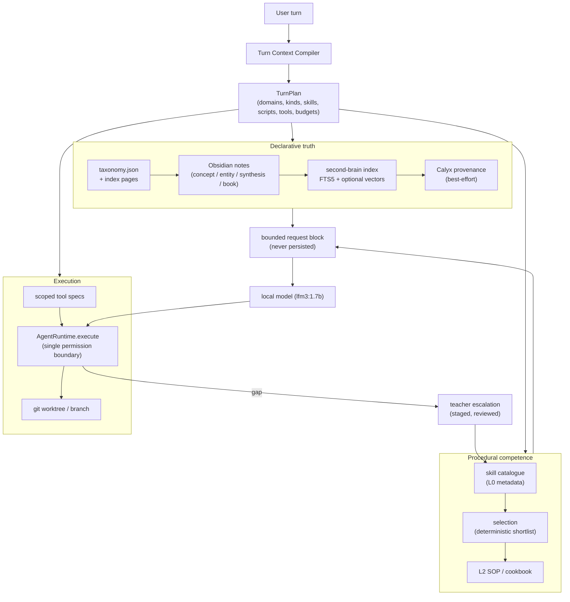
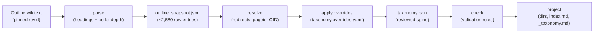

# Brahma Knowledge & Skills Engine — Design Specification

**Status:** Design (pre-implementation)  
**Authority:** This document is the canonical design record for the academic
knowledge tree, the document-conversion and knowledge-extraction pipeline, the
skills engine, and the turn-context compiler.  
**Supersedes:** the 2026-11-09 draft of this file and the Gemini-side summary
`academic_taxonomy_and_skills_spec.md` (which should now be treated as an index
into this document).  
**Date:** 2026-11-09  
**Revision:** 3.1 — rev 3 plus verified corrections. The material change is the
inbound-link measurement (§2.7, §5.2, §5.11): rev 3's "5 links in 4 files"
counted only the routing files; the vault-wide count is **54 links in 16 files**,
and 40 of them are rewritten in Phase 1. Smaller corrections: one canonical home
for computer science (`formal-sciences/computer-science`), `legacy_path` /
`legacy_domains` instead of overloading `domain`, `--check-links` in the Phase 1
gate, and stated counting rules for every measured number.  
**Scope:** design only. No implementation in this change.

---

## 0. How to read this document

- **§1–§3** state the thesis, the measured ground truth, and what the first
  draft missed. Read these before the pillars.
- **§4** is the target architecture and the single per-turn contract.
- **§5–§11** are the seven pillars, each with a data model, a pipeline, failure
  modes, and acceptance criteria.
- **§12–§14** are cross-cutting: security, budgets, and tests.
- **§15–§16** are the roadmap and the decisions that need the user.
- **§17** holds the schemas and CLI contracts that implementers will copy.

Every claim about the existing system in §2 was measured on this machine on
2026-11-09, not inferred from the previous draft.

---

## 1. Thesis and system boundary

### 1.1 The thesis

> **Offload intelligence onto the harness and architecture; make a compact
> local model operate the architecture.**

A 1.7B function-calling model cannot hold a world model, a taxonomy, a skills
library, and a tool catalogue in its weights. It can, however, reliably do four
small things if the harness makes them small:

1. **Choose among a handful of labelled options** (a domain, a skill, a tool).
2. **Call one tool with a valid schema.**
3. **Read one bounded context block and answer from it.**
4. **Stop and report a gap** when no option fits.

The architecture's job is to convert every open-ended task into those four
moves. Knowledge, procedures, and tools are retrieved *before* the model is
asked, and are presented as data it can cite, not as facts it must recall.

### 1.2 What "offloading" means operationally

| Layer | What the harness owns | What the model owns |
| --- | --- | --- |
| **Declarative truth** | Taxonomy, vault, FTS/vector index, Calyx provenance | Reading the injected block and citing it |
| **Procedural competence** | Skill catalogue, L0→L3 disclosure, cookbooks | Choosing one skill and following its SOP |
| **Execution** | Tool catalogue, permissions, process containment, worktrees | Emitting one valid call at a time |
| **Routing** | Intent classification, context budget, tool scoping | Choosing among the scoped options |
| **Escalation** | Gap detection, teacher prompt, sandbox, review gate | Reporting the gap, then using the new capability |

### 1.3 Non-goals (v1)

- Training or fine-tuning a model.
- Replacing Obsidian, Calyx, or the existing skill/tool catalogues.
- Autonomous, unreviewed installation of model-generated code.
- Cloud dependency for retrieval, routing, or the vault.
- A perfect ontology. The tree is a **navigation aid with provenance**, not a
  claim that knowledge has one true home.

---

## 2. Ground truth: what exists today

### 2.1 The live vault

`C:\Users\Admin\Documents\Obsidian\My Vault` is a git repository, 414.1 MB.

| Measurement | Value |
| --- | ---: |
| Directories under `wiki/library/knowledge/` | **2,578** |
| `index.md` files under that tree | **2,579** |
| Markdown files under that tree | **5,420** |
| Maximum directory depth | **6** |
| Top-level domains | **9** |
| Second-brain index pages / chunks / vectors | **6,008 / 8,125 / 102** |
| Vector coverage | **0.013** (`semantic_enabled=false`) |

The nine top-level domains are `arts`, `computer-science`, `engineering`,
`humanities`, `mathematics`, `meta-knowledge`, `practical-domains`, `sciences`,
and `social-sciences`. The root index cites
`https://en.wikipedia.org/wiki/Knowledge_Domains`, **not** the
`Outline_of_academic_disciplines` page named in the brief.

**Measured structural problems:**

- **Duplicated concept nodes.** `technical-drawing` appears 5 times;
  `information-theory`, `social-policy`, `sindhology`, `latin-american-studies`,
  `slavic-studies`, `food-engineering`, `sociolinguistics`,
  `television-studies`, and `systems-analysis` appear 4 times each.
- **Misplaced nodes.** For example
  `computer-science/network-security/computational-biology` and
  `.../network-security/finite-element-analysis`. The seed appears to have
  expanded Wikipedia links recursively instead of following a curated parent
  relation.
- **Redundant nesting.** `computer-science/computer-science/operating-systems`
  and `computer-science/computer-program` vs `.../computer-programming` coexist.
- **Stub concept notes.** A representative note is literally
  `# Archaeology\n\nArchaeology is a core area of study.\n\nSee also: ...`.
  These add no knowledge and actively pollute retrieval.
- **Generic index descriptions.** Many index pages say only
  "The study of X", not a real encyclopedia summary.

**Consequence:** Phase 1 is not "create the tree". It is **audit, normalize,
and re-anchor** an existing tree, then seed real content.

### 2.2 Harness seams that already exist

| Concern | Existing module | Fact the design must respect |
| --- | --- | --- |
| Vault retrieval | `agent/second_brain.py` | SQLite FTS5, `SCHEMA_VERSION=1`, tables `pages/chunks/vectors/meta`; `chunks` has `path`, not `page_id`; `context_for_turn` injects a bounded block; `with_retrieval` supports the GUI first call |
| Loop injection | `agent/loop.py` | `_prepare_retrieval` runs before the first model call; `AgentLoop(retrieval=...)` reuses a host-rendered block; children skip retrieval |
| Context assembly | `agent/context.py` | `as_payload()` places the retrieval block immediately before the most recent user message |
| Prompt | `agent/prompts.py` | `brain_prompt_block()` is resident; `build_system_prompt(include_brain=False)` for children |
| Vault tools | `agent/brain_tools.py` | `brain_search`, `brain_read`, `brain_status`, `brain_sync` |
| Calyx | `agent/calyx_bridge.py` | stdio MCP; `fast_search` now has a 2.5 s timeout and 120 s failure cooldown |
| Tool catalogue | `core/tool_index.py` | FTS5 + n-gram + optional embeddings, fused with RRF; pinned meta-tools |
| Project skills | `agent/skills.py` | `.brahma/skills/<name>/SKILL.md`, `load_project_skill`, resident metadata only |
| Managed skills | `core/skills_library.py` (catalogue) + `core/tool_bridge.py` (handlers) | `skills_library/` + user data + project roots; `search_skills` / `list_skills` / `load_skill`; `skill.yaml` or `SKILL.md`; optional `executor.py` |
| Skill synthesis | `core/skill_forge.py` | Prompts Gemini for a complete skill package; stages output |
| Skill verification | `core/skill_crucible.py` | Static AST bans + sandboxed test execution |
| Skill approval | `core/skill_store.py` | Content-addressed store; `draft → approved → installed` / `rejected` / `quarantine`; grants + audit log |
| Skill execution | `core/skill_host.py` | Out-of-process, Windows Job Object, closed stdin, env scrub |
| Process containment | `agent/process.py` | `run_captured` is the only subprocess path for tools; timeout tree-kill |
| Sandbox config | `agent/sandbox.py` | Env scrub, optional prefix, limits; POSIX process cap is not enforceable |

### 2.3 Skills that exist today

- `skills_library/`: 3 managed skills (`reasoning-rigor`, `web-research`,
  `word-count`), one of them executable.
- `.brahma/skills/`: 12 project skills (`code-review`, `git-workflow`,
  `security-auditor`, …).
- `subagents/`: 610 vendored specialist templates, indexed by
  `subagents/catalog.json`.
- The user's repository catalog lists **32 skill/tooling repositories** in its
  "Agent Skills, Tooling & SOP Frameworks" section.

### 2.4 The book pipeline that already exists

`book-library/` is a **Calibre library** (`metadata.db`) and a sibling of
`wiki/library/`. It already has an intake pipeline, which the design must
extend rather than replace:

| Piece | Path | What it does |
| --- | --- | --- |
| Intake | `book-library/_scripts/intake.ps1` | Adds a file to Calibre, sets `Domain.Subdomain` tags, converts to `.txt` with `ebook-convert`, regenerates the catalog |
| Catalog | `book-library/_scripts/make-catalog.ps1` | Reads `calibredb list --for-machine`, resolves the primary domain from tags, writes `catalog.json` + `catalog.md` |
| Vocabulary | `book-library/_taxonomy.md` | The controlled list of 9 domains and their valid subdomains; the **only** source of valid tags |
| Companion convert | `operations/book-library/` | `discover → convert (markitdown) → normalize → link → qa → ledger`; writes `book-library/fulltext/<slug>.md` and `fulltext/.raw/<slug>.md` |
| Calyx | `book-library/_scripts/ingest-wiki-calyx.ps1` | Batched `calyx.ingest` over `wiki/**/*.md`, with a `rel_path → cx_id` map |
| Gate | `book-library/_scripts/validate.ps1` | Byte-safe validation rooted at `wiki/library` |

Measured state: 6 authored notes, 7 full-text companions, 6 raw bodies, and 1
file in `_bookinbox/`. Book-derived concept notes already exist — the Wheeler
units are flat under `humanities/philosophy/buddhism/`, which is the "vaguely
taxonomized" state the brief acknowledges.

**Consequences for this design:**

- The converter is **not** greenfield. Phase 4 extends
  `operations/book-library/` with OCR and asset extraction; it does not create
  a parallel `raw/converted/` tree.
- `_taxonomy.md` and `taxonomy.json` must not diverge. `taxonomy.json` becomes
  the machine spine and `_taxonomy.md` is generated from it, with one check
  that fails if they disagree.
- The extractor's input is the normalized companion
  `book-library/fulltext/<slug>.md`, not the original PDF or EPUB.

### 2.5 Conversion tools present on the machine

- `C:\Users\Admin\markitdown` exists (Python package tree, `packages/`).
- `C:\Users\Admin\Unlimited-OCR` exists (`infer.py`, assets, utils).
- PaddleOCR and Tesseract are named as external repos; they are **not**
  vendored in this repository and must be treated as optional, allowlisted
  binaries.
- Calyx is available at `C:\Users\Admin\Calyx\target\release\calyx-mcp.exe`;
  last status: 118 constellations, ledger chain `ok`.

### 2.6 What does **not** exist

- No in-repo git-worktree module (`agent/worktree.py` does not exist).
- No taxonomy source-of-truth file (`taxonomy.json` does not exist); the vault
  has `_taxonomy.md` only.
- No Wikipedia seeder (`tools/seed_academic_taxonomy.py` does not exist).
- No **multimodal** ingestion: the existing pipeline converts text-like
  formats with markitdown/Calibre, but has no OCR path, no asset extraction,
  and no `tools/ingest_multimodal.py`.
- No knowledge-unit extractor/placer (`tools/extract_knowledge.py` does not
  exist); book units are authored or placed by hand.
- No JIT skill injection in `AgentLoop`; skills are model-initiated through
  `search_skills` / `load_skill`.
- No scripts index; the eight `tools/*.py` CLIs are discoverable only by reading
  the directory or a doc.
- No taxonomy-aware ranking in the second-brain index; index pages and concept
  notes are ranked identically.

### 2.7 Empirical measurements of the Outline and the live vault

Measured on this machine on 2026-11-09 by automated audit against `C:\Users\Admin\Documents\Obsidian\My Vault` and the live Wikipedia API for `Outline of academic disciplines`:

#### 2.7.1 The Wikipedia Outline authority

| Metric | Measured value | Note |
| --- | ---: | --- |
| Total outline nodes | **2,583** | 65 headings + 2,518 bullet/subdiscipline entries |
| Top-level divisions | **5** | *Humanities*, *Social sciences*, *Natural sciences*, *Formal sciences*, *Applied sciences* |
| Maximum tree depth | **7** | Depth histogram: L1: 5, L2: 40, L3: 779, L4: 1,160, L5: 478, L6: 87, L7: 34 |
| Unique article targets | **2,159** | 311 targets appear in >1 branch (367 duplicate entries from polyhierarchy) |
| Nodes without wikilinks | **7** | Heading-only structural groupings |
| Linked "Outline of X" subpages | **106** | Curated candidate subtrees for on-demand topic expansion |
| Target redirect rate | **30%** | In a 50-title random sample, 15 resolved to redirects (dedup must follow canonical `pageid`) |
| Wikitext article size | **p10: 8.6 KB / p50: 37.8 KB / p90: 146.0 KB** | Mean: 58.7 KB; max: 267.0 KB |

#### 2.7.2 The live Obsidian vault (`wiki/library/knowledge/`)

| Metric | Measured value | Significance |
| --- | ---: | --- |
| Directories under `knowledge/` | **2,578** | Nearly identical to the 2,583 Outline entries; proves the vault was seeded from this page |
| Markdown files under `knowledge/` | **5,420** | 2,579 `index.md` files + 2,841 non-index concept notes |
| Non-index concept notes | **2,841** | Real notes vs stubs |
| Stub phrase notes (< 200 chars) | **2,518 (88.6%)** | Body chars p10: 88, p50: 107, p90: 3,361. Almost 90% of notes are low-value stubs |
| Substantive concept notes | **~320** | Notes to be preserved and transplanted during normalization |
| Directory names occurring > 1 | **425** | 512 redundant directory duplicates across branches |
| Inbound links from outside `knowledge/` | **54** (in 16 files, 49 distinct targets) | 48 path-form links in 11 content files; 5 in the 4 routing files; 1 in an archived index |
| Inbound links broken by a transplant | **40** | They point at concept notes Phase 1 moves; the other 8 already dangle |

**Key findings:**
1. **The link-breakage concern is real, but small and mechanical:** 54 links in 16 files point into `knowledge/`. Forty of them are *path-form* links (markdown relative paths or full-path wikilinks) to concept notes that Phase 1 moves, so the migration must rewrite them from `_audit/transplant.json`. The `aliases` in §5.11 step 3 only rescue basename wikilinks, and none of the 48 content links is basename-form. That is a bounded rewrite pass over 11 files, not a reason to keep the nine domains.
2. **Phase 1 is a transplant, not a mass move:** Because 89% of concept notes are single-line stubs, regenerating the canonical tree from `taxonomy.json` and transplanting the ~320 substantive notes is vastly safer, cleaner, and faster than attempting to `git mv` 2,578 directories.
3. **Deduplication requires resolved pageids:** 30% of Outline targets are redirects, and 311 targets repeat across branches due to inherent academic polyhierarchy. Identity must be keyed to Wikidata QID / Wikipedia `pageid`, with secondary occurrences rendered as cross-links rather than duplicate directories.

**Counting conventions.** A vault measurement is reproducible only with its rules stated:

- A *note* is a `.md` file whose basename is not `index.md`. A *stub* is a note whose body is under 200 characters.
- A *directory* is any directory under `knowledge/`; `arts` therefore has 5
  subdirectories plus `index.md`. Rev 3's earlier "6 and 6" counted the
  `index.md` entry; the table above counts subdirectories.
- *Inbound links* are `](…knowledge/…)` markdown targets and `[[…knowledge/…]]` wikilinks found in `.md` files anywhere in the vault except `knowledge/` itself and `ai-chats/` (chat archives quote old paths and are not routing surfaces).
- An Outline *node* is a heading or a bullet entry, excluding the trailing `See also`, `Notes`, `Further reading` and `External links` sections; multi-line bullets count once. A plain parse without those exclusions yields 2,608 nodes and 2,362 distinct targets, so §5.3's builder, not this table, is the authority for the final count.
- The redirect rate is a 50-title random sample resolved through `action=query&redirects=1`; 30% and 18% are both consistent with the true rate at that sample size, which is why dedup keys on `pageid` rather than on any assumed percentage.

---

## 3. What the first draft got right, and what it missed

| Draft claim | Verdict | Resolution in this document |
| --- | --- | --- |
| Offload intelligence onto the harness | **Right** | §1, §4 |
| Academic tree as the declarative backbone | **Right** | §5 |
| Multimodal conversion before extraction | **Right** | §6 |
| Separate declarative knowledge from procedural skills | **Right** | §9.1 |
| ICM L0→L3 disclosure | **Right** | §9.4 |
| Teacher-model escalation | **Right** | §11 |
| "5 divisions, 40+ disciplines, 250+ subdisciplines" | **Empirically verified** | The Outline contains 2,583 entries matching the 2,578 live directories (§2.7); the existing tree was an Outline seed, but uncurated and polluted with stubs. |
| "Phase 1 creates the tree" | **Wrong** | Phase 0 audits and snapshots; Phase 1 regenerates the canonical 5-division spine and transplants the ~320 substantive notes; Phase 2 seeds content (§5.11, §15). |
| 9 domains vs 5 divisions | **Resolved (Rev 3)** | Physical tree aligns to canonical 5 divisions (§5.2); the 9 legacy domains are preserved as routing aliases in `taxonomy.json` (§5.3). The real cost is 40 path-form links in 11 files, rewritten from `transplant.json` (§2.7, §5.11). |
| Recursive Wikipedia traversal | **Caused duplicates and misplacements** | Curated `taxonomy.json` from a pinned snapshot is the spine; never crawl the live link graph (§5.3). |
| No licensing | **Missing** | CC BY-SA 4.0 attribution, revision pinning, per-page provenance (§5.13). |
| Single home per knowledge unit | **Too rigid** | One canonical directory home + `listed_under` / `also_in` cross-links; never duplicate directories for polyhierarchical disciplines (§5.5). |
| New `skills_library/` tree | **A fourth skill tree would fragment the system** | Extend `core/skills_library.py`; do not create a parallel catalogue (§9.1) |
| New teacher escalation | **Already exists** | Reuse `skill_forge` → `skill_crucible` → `skill_store` → `skill_host` (§11.1) |
| The book pipeline is greenfield | **Wrong** | Extend `operations/book-library/`; keep the `fulltext/` contract (§2.4, §6) |
| Four catalogues named but only three exist | **Scripts are missing** | Add a static scripts index; do not merge it into skills (§9.9) |
| Worktrees as if implemented | **No module exists** | Define `tools/worktree.py` over `run_captured` (§11.3) |
| No trust model | **Missing and dangerous** | Untrusted-content, path, process, egress, and approval rules (§12) |
| No ranking implications | **Index pages would swamp concept notes** | Index schema v2 + type weights (§8) |
| No embedding-budget policy | **Coverage is already 1.3%** | Do not embed index pages by default (§8.3) |
| No evaluation criteria | **Missing** | Gold sets, acceptance gates, and regression suites (§14–§15) |

---

## 4. Target architecture

### 4.1 Planes



### 4.2 The per-turn contract: `TurnPlan`

Every surface (CLI, GUI local, GUI custom, voice) produces the same logical
plan, even if it renders it differently:

```python
@dataclass
class TurnPlan:
    text: str                      # the user's turn, unchanged
    domains: list[str]             # taxonomy ids, most specific first
    kinds: list[str]               # concept, index, book, synthesis, entity
    skill_ids: list[str]           # at most 1 primary + 1 fallback
    script_ids: list[str]          # at most 1; a deterministic CLI to run
    tool_names: list[str] | None   # None = leave the surface default
    note_budget: int               # chars for the knowledge block
    skill_budget: int              # chars for the SOP block
    reason: str                    # one line, for telemetry
```

Rules:

- **Cheap by default.** No extra model call. Classification uses aliases,
  FTS, and tags. A local-model rerank is allowed only when the deterministic
  shortlist is ambiguous (top two within a small margin) and the surface has a
  text model.
- **Fail-soft.** Any step may return empty. An empty plan is valid and means
  "no extra context".
- **Bounded.** `note_budget` defaults to 2,400 chars; `skill_budget` to 1,200.
  A 1.7B model on an 8K window must not receive both at full size.
- **Ephemeral.** Blocks are inserted into the request payload, never into the
  stored transcript.

### 4.3 Surface matrix

| Surface | Automatic notes | Automatic skill SOP | Tools | Notes |
| --- | --- | --- | --- | --- |
| CLI (`python -m agent`) | Yes | Yes (v1: opt-in) | Full harness surface | Reference implementation |
| GUI local brain | Yes, on the first call | Yes | Scoped local surface | `with_retrieval` extends to `with_turn_context` |
| GUI custom provider | Yes, on the first call | Yes, if tools work | Scoped | Tool-less fallback still gets notes |
| Gemini Live voice | No per-turn block | No per-turn SOP | Map + tools | Resident brain map says retrieval is not automatic |
| Subagent child | No | No | Filtered child surface | Focused worker; no resident brain map |

A selected **script** is not a separate surface: it is a one-line hint inside the
skill block ("`brain-sync` rebuilds the index: `python tools/brain_sync.py`"),
and the model runs it through `run_command`. Where the skill SOP is off, the
script hint is off too.

---

## 5. Pillar I — The academic knowledge tree

> **Rev 3.** This section was rewritten after measuring the Outline page and
> the live tree (§2.7). The main changes from rev 2: the top level follows the
> Outline's five divisions (§5.2); `taxonomy.json` is built from a pinned
> snapshot plus a reviewed overrides file (§5.3); the tree has a discipline
> spine and on-demand topic subtrees (§5.4); the full article is split from the
> navigation page (§5.7); book knowledge lands as attributed *views*, not as
> the canonical concept (§5.9); and Phase 1 regenerates the tree and
> transplants the substantive notes instead of moving 2,578 directories
> (§5.11).

### 5.1 Design principles

1. **Projection, not hand-curation.** The tree on disk is generated from one
   file, `taxonomy.json`, which is itself generated from a pinned Outline
   snapshot plus a reviewed overrides file. Nothing creates a directory that is
   not in `taxonomy.json`.
2. **Predictable for a small model.** Every node has the same anatomy (§5.7).
   A 1.7B model navigating the tree should only ever choose among a short list
   of labelled children with one-line scopes, read a page of at most 4 KB, and
   descend. Uniformity beats saving folders.
3. **One home, many threads.** A discipline that the Outline lists under several
   parents has exactly one directory and is listed, as a cross-link, under every
   other parent (§5.5).
4. **Neutral spine, attributed content.** The spine and its index pages are
   encyclopedia-neutral. A book's interpretation is stored as an attributed view
   of a concept, never as the concept (§5.9).
5. **Generated and authored content never share a byte range.** The seeder
   rewrites only what it generated; human and extractor content survives every
   re-seed (§5.7.3).
6. **Provenance everywhere.** Every generated region names its source revision
   and license; every extracted claim names its source location.
7. **Fail toward the inbox.** When placement is uncertain, the unit goes to
   `_inbox/`, never to a guessed parent.

### 5.2 The top level: the Outline's five divisions

Rev 2 kept the nine live domains because migrating them "would break thousands
of links". Measurement shows that cost is bounded and mechanical:

| Measurement (2026-11-09) | Value |
| --- | ---: |
| Links into `wiki/library/knowledge/` from outside it | **54** (in 16 files, 49 distinct targets) |
| …of which path-form links to notes Phase 1 moves | **40** (in 11 content files) |
| …of which regenerated (4 routing files + an archived index) | 6 |
| …already dangling | 8 |
| Non-index notes that are generated stubs (body < 200 chars, "is a core area of study") | **2,518 of 2,841 (89%)** |
| Substantive notes that must be preserved | **≈ 320** |
| Index-page body size, p10 / p50 / p90 | 595 / 633 / 677 chars (template text) |
| Directories under `arts/` and `meta-knowledge/` | 5 each (vs 657 under `social-sciences/`) |

The nine domains are not the Outline's structure. The Outline's ~2,500 entries
were forced into them, which is why `arts` and `meta-knowledge` are nearly
empty, and why every Outline re-sync would need a hand-maintained mapping
forever. The tree therefore adopts the Outline's own top level:

```text
wiki/library/knowledge/
├── humanities/
├── social-sciences/
├── natural-sciences/
├── formal-sciences/
└── applied-sciences/
```

Rev 2's `division` facet becomes the first path segment. The former domain
names survive as **aliases** on the nodes that absorb them, so alias search
still routes "computer science" or "arts" correctly:

| Former domain | New canonical home | Notes |
| --- | --- | --- |
| `humanities` | `humanities` | |
| `arts` | `humanities/performing-arts`, `humanities/visual-arts` | alias on both |
| `social-sciences` | `social-sciences` | the Outline places *Business* here |
| `sciences` | `natural-sciences` | |
| `mathematics` | `formal-sciences/mathematics` | |
| `computer-science` | `formal-sciences/computer-science` | |
| `engineering` | `applied-sciences/engineering-and-technology` | |
| `practical-domains` | `applied-sciences` | the Outline's professions: medicine, law-adjacent practice, education, agriculture, … |
| `meta-knowledge` | `humanities/philosophy/epistemology`, `formal-sciences/logic` | vault-operational material (ICM, OKF) moves to `wiki/library/methodology/` and `references/`; it is not academic knowledge |

The Calibre vocabulary (`book-library/_taxonomy.md`) is regenerated from
`taxonomy.json` at depth 1–2 (§5.3.4), and the seven tagged books are retagged
by a mapping in the same change.

> [!NOTE]
> This is decision D1 in §16. The recommendation flipped between rev 2 and
> rev 3 because the link-breakage premise was measured: it is 54 links in
> 16 files, not "thousands", and 40 of them are rewritten mechanically from
> `_audit/transplant.json`. Rev 2's number was never measured; rev 3's first
> draft counted only the four routing files.

### 5.3 Building the spine: snapshot → overrides → `taxonomy.json`

#### 5.3.1 Pipeline



- **Parse.** Read the Outline's *wikitext*, not rendered HTML. Section headings
  give the first levels (`==` division, `===` group, `====`/`=====` sub-group);
  bullet depth (`*`, `**`, …) adds to the current heading level. The parser
  must handle `{{div col}}` blocks; `{{Main|…}}` hatnotes (recorded as
  `outline_page` hints, not children); labels that differ from their target
  (`[[Music history|Historical musicology]]`); trailing outline links
  (`([[Outline of jazz|outline]])`); and partial links (`[[Orchestra]]l
  studies`). Strip `<ref>` and comments first. Skip targets that start with
  `List of`, `Outline of`, `Index of`, or `Glossary of`.
- **Why the parser matters.** The current tree's misplacements
  (`computer-science/network-security/computational-biology`) are the
  signature of a parser that lost track of heading versus bullet depth. In the
  Outline, *Computational biology* sits under *Computing in mathematics, natural
  sciences, engineering, and medicine* and under *Biology* — never under
  *Network security*. A golden test pins these cases (§14.1).
- **Resolve.** One batched MediaWiki call per 50 titles
  (`action=query&prop=info|pageprops&redirects=1`) returns the canonical
  title, `pageid`, and `wikibase_item` (the Wikidata QID). In a 50-title sample,
  **30% of targets were redirects** (§2.7), so duplicates are detected *after*
  resolution: two labels that resolve to the same `pageid` are one node.
- **Overrides.** One small, reviewed YAML file holds every human decision
  (§5.3.3). The pipeline is deterministic: the same snapshot and the same
  overrides produce a byte-identical `taxonomy.json`.
- **Re-sync.** A new Outline revision produces a new snapshot and a **diff
  report** (added, removed, moved, and renamed entries). Nothing changes on disk
  until the overrides are reviewed and `taxonomy.json` is regenerated.

#### 5.3.2 Node schema

```json
{
  "id": "humanities/philosophy/epistemology",
  "title": "Epistemology",
  "parent": "humanities/philosophy",
  "layer": "spine",
  "order": 4,
  "wikipedia": {"title": "Epistemology", "pageid": 0, "revid": 0},
  "wikidata": "Q…",
  "aliases": ["theory of knowledge"],
  "legacy_domains": [],
  "scope": "Theory of knowledge: justification, belief, evidence, skepticism.",
  "listed_under": [],
  "also_in": [],
  "home_reason": "override",
  "status": "active",
  "moved_from": [],
  "seed": {"status": "pending"},
  "codes": {}
}
```

Field rules:

- `id` is the path. It is the **address**: human-readable, and changed only by
  `taxonomy.py --apply`, which appends the old id to `moved_from` and rewrites
  every note's `domain:` / `view_of:` reference.
- `wikipedia.pageid` and `wikidata` are the **identity**: used for dedup,
  re-sync, and cross-walks. They never change when a node moves.
- `layer` is `spine` (from the Outline) or `topic` (§5.4).
- `aliases` holds Wikipedia synonyms and redirect titles (the names a user may
  type); `legacy_domains` holds the pre-migration domain ids (`arts`,
  `computer-science`, `meta-knowledge`, …) whose routing now lands on this node.
  Both are searched by `brain_locate`; neither is a directory (§5.2).
- `order` keeps the Outline's sibling order so index pages are stable.
- `scope` is the one line a small model sees when it chooses among siblings.
  Seeded from the article's first sentence; editable through overrides.
- `listed_under` holds the other parents that list this node (§5.5);
  `also_in` holds conceptual cross-links. Both render as links, never as
  directories.
- `home_reason` records which rule chose the canonical home (§5.5).
- `codes` holds optional cross-walk classification codes (§5.15).

Validation rules, enforced by `tools/taxonomy.py --check`:

1. Every `id` is unique and equals its parent id plus one slug.
2. Every `parent` exists, except the five roots.
3. `listed_under` and `also_in` targets exist; no self-references; no cycles.
4. **Depth:** the spine is at most 6 segments; a topic subtree adds at most 3
   segments below its spine anchor; no path exceeds 8 segments. Outline entries
   deeper than the spine cap become seeded concept hubs (files) inside their
   deepest allowed ancestor, not directories.
5. Every segment matches `^[a-z0-9]+(?:-[a-z0-9]+)*$` and is at most 40 chars.
6. The path relative to `wiki/library/knowledge/` is at most 160 chars.
7. No segment is a Windows reserved name (`con`, `prn`, `aux`, `nul`,
   `com1`–`com9`, `lpt1`–`lpt9`).
8. A `merged` node has `merged_into` pointing at an active node; a
   `quarantined` node has no children.
9. **No two active nodes share a `pageid` or a `wikidata` id.** This is the
   structural fix for the 367 duplicate occurrences in the Outline (§5.5).
10. **No grouping node with exactly one child** unless it has content of its
    own; collapse it and keep its title as an alias. Example: the Outline's
    *Life science* has one child, *Biology*.
11. **Sibling fan-out:** above 40 children the check warns and suggests a
    `group:` override. A small model should not choose among 130 options; the
    Outline's *Sociology* group has 130.
12. Every override matches something in the snapshot (no stale overrides).

#### 5.3.3 The overrides file

Every human decision about the spine lives in one reviewed file. The entries
below are **examples of the mechanism**, not ratified decisions:

```yaml
# _taxonomy/taxonomy.overrides.yaml
snapshot: {title: Outline of academic disciplines, revid: 1382763980}

rename:     # long or awkward slugs
  "formal-sciences/computer-science/computing-in-mathematics-natural-sciences-engineering-and-medicine": scientific-computing

collapse:   # single-child or pure grouping nodes
  - natural-sciences/life-science

merge:      # overlapping Outline groups (needs the owner's call, see D13)
  humanities/divinity: humanities/theology

canonical:  # home for an entry the Outline lists several times
  "Information theory": formal-sciences/mathematics/applied-mathematics/information-theory

drop:       # entries that are not disciplines
  - "Live action"

group:      # split an oversized sibling set into reviewed sub-groups
  social-sciences/sociology:
    family-and-life-course: ["Sociology of the family", "Sociology of childhood"]

add:        # topic nodes the Outline does not have
  - {id: humanities/religion/indian-religions/buddhism/early-buddhism, layer: topic, wikipedia: "Early Buddhism"}

expand:     # one-hop topic expansion from a named outline page (§5.4)
  humanities/religion/indian-religions/buddhism: {outline: "Outline of Buddhism", max_depth: 2}

scope:
  humanities/philosophy/epistemology: "Theory of knowledge: justification, belief, evidence, skepticism."
```

Rules: an override names its target by id or by Outline title; an override
that no longer matches the snapshot fails the build; overrides are reviewed
like code and are the only place a human edits the spine.

#### 5.3.4 Generated artefacts

The projection step writes, and only it writes:

- one directory and one `index.md` per active node (§5.7, §5.8);
- `wiki/library/knowledge/index.md` (the five divisions) and
  `wiki/library/knowledge/CLAUDE.md` (today it still claims "312 concepts,
  141 subdomains", which is stale);
- `book-library/_taxonomy.md`, the Calibre vocabulary, as `Division.Discipline`
  tags at depth 1–2. `intake.ps1` and `make-catalog.ps1` keep reading it; one
  check fails if it disagrees with `taxonomy.json`.

The taxonomy files themselves live with the vault, because the vault is the
product:

```text
wiki/library/knowledge/_taxonomy/
├── outline_snapshot.json       # parsed Outline at the pinned revid
├── taxonomy.overrides.yaml     # human decisions
├── taxonomy.json               # generated spine (+ topic nodes)
├── diff-<old>-<new>.md         # re-sync reports
└── proposals/<node>.yaml       # growth proposals (§5.4)
```

The tools that read and write them live in the Brahma repo (`tools/`).

### 5.4 Two layers: the discipline spine and topic subtrees

The Outline stops at sub-disciplines. Real books need finer homes: the Wheeler
units belong under *Buddhism*, and within it under early Buddhism, doctrine,
practice, and texts. Those are subdivisions of a **subject**, not academic
sub-disciplines, so the tree has two layers with different rules:

| | Spine | Topic subtree |
| --- | --- | --- |
| Source | `Outline of academic disciplines` | the anchor's own `Outline of X` page, the anchor article's section structure, or a reviewed proposal |
| Created by | projection of the snapshot | an `expand:` or `add:` override, or an accepted growth proposal |
| Depth | at most 6 segments | at most 3 segments below its spine anchor |
| Seeded with | the discipline's article | the topic's article when one exists; otherwise a manual stub with no invented text |
| Exists | always; the starting-point vault ships it | on demand, when content needs it or an `expand:` is configured |

**One-hop expansion, never a crawl.** The Outline links 106 distinct
`Outline of X` pages. An `expand:` override fetches exactly one of them for
exactly one anchor and maps its headings and bullets to at most `max_depth`
levels. Its links are not followed. Entries that resolve to a `pageid` already
in the tree become `listed_under` cross-links, not new nodes.

**Demand-driven growth.** The extractor never creates directories. When a node
holds more than **30** concept and view notes, `taxonomy.py --propose`
clusters them (by `section_path`, tags, and the matching `Outline of X`
headings, if any) and writes `_taxonomy/proposals/<node>.yaml`: the new topic
children, which notes move where, and the evidence. A human accepts it by
moving it into the overrides; `--apply` performs the moves and rewrites the
references. This is how the flat 63-note `buddhism/` folder gets its
sub-structure.

Worked example of the target state for the demo. The topic names are
illustrative; the real ones come from `Outline of Buddhism`:

```text
humanities/religion/indian-religions/buddhism/   spine: Humanities > Religion > Indian religions > Buddhism
├── index.md
├── wikipedia.md           the node's own article (no separate buddhism.md hub)
├── early-buddhism/        topic  ← most Wheeler units: anatta, attan, citta, khandhas
├── buddhist-philosophy/   topic  ← avijja, dependent origination
├── buddhist-practice/     topic  ← anapanasati, jhana
├── buddhist-texts/        topic  ← Dhammapada, the Nikayas
└── schools/               topic  ← Theravada, Mahayana, Vajrayana
```

The Outline also lists *Buddhist studies* under *Theology*; that occurrence
resolves to a different article, so it stays a separate spine node that cross-links
to `buddhism` through `also_in`. If a philosophy node survives in the overrides
(for example an *Eastern philosophy* topic), it lists `buddhism` under
`listed_under`, so a reader browsing philosophy still reaches it in one hop.

### 5.5 Polyhierarchy: one home, many threads

The Outline itself lists **311 entries under more than one parent (367 extra
occurrences)**: *Sociology of the family* five times; *Information theory*
four times (computer communications, applied mathematics, electrical
engineering, communication studies). Every one of them became a duplicate
directory in the current tree (425 repeated directory names, 512 extra copies).
These are the "multithreaded" sub-disciplines of the brief. The rule:

1. **Identity.** Occurrences that resolve to the same `pageid` are one node.
2. **Canonical home**, chosen deterministically, first match wins:
   1. an explicit `canonical:` override;
   2. the occurrence whose parent matches the article's Wikidata *subclass of*
      (P279) or *part of* (P361) values, or the field named in the lead's first
      sentence ("X is a branch of Y");
   3. the occurrence whose parent holds most of the node's own Outline
      children (keeps subtrees together);
   4. the first occurrence in Outline order.

   The winning rule is stored in `home_reason`, so a review can go straight
   to the weak decisions (rule 4).
3. **Every other occurrence becomes a `listed_under` entry.** That parent's
   index page lists the node among its subfields with a cross-link marker —
   `↗ Information theory (home: formal-sciences/mathematics/applied-mathematics)`
   — so navigation from any parent reaches it in one hop, without a second
   directory.
4. **Conceptual cross-links** that the Outline does not state (epistemology ↔
   cognitive science) are `also_in` and render under *Related fields*.

### 5.6 Naming and path rules

- Lowercase kebab-case, ASCII only. Transliterate accents; drop punctuation.
- Slugs come from the **resolved** Wikipedia title, not the Outline label,
  unless an override renames them. Drop a parenthetical disambiguator unless a
  sibling would collide (`mercury` vs `mercury-planet`).
- Discipline slugs keep the article title's number (`linguistics`,
  `fine-arts`); concept-note slugs are singular.
- No abbreviations unless they are the common name.
- Reserved filenames inside a node: `index.md` (navigation page),
  `wikipedia.md` (full article), `log.md`. Concept hubs are
  `<concept-slug>.md`; views are `<concept-slug>--<source-slug>.md`.
- Do not encode hierarchy in filenames. The path is the hierarchy.
- About 2,200 files will be named `index.md`, so tool-generated links are
  vault-relative, path-qualified, and carry display text:
  `[[wiki/library/knowledge/humanities/philosophy/epistemology/index|Epistemology]]`.
  Every index page carries `aliases: [<Title>]`, so a hand-typed
  `[[Epistemology]]` resolves too.
- `_`-prefixed directories (`_taxonomy`, `_inbox`, `_audit`) are never nodes,
  are never projected, and are excluded from automatic retrieval.
- The relative path budget is 160 chars. With the vault prefix
  (`C:\Users\Admin\Documents\Obsidian\My Vault\wiki\library\knowledge\`,
  64 chars), that leaves room under Windows' 260-char practical limit for the
  filename and `.assets` links. If a node cannot fit, shorten the segment, not
  the depth.

### 5.7 Node anatomy

#### 5.7.1 Folder layout

```text
<node>/
├── index.md                    # L1: navigation page; generated regions; ≤ 4 KB
├── wikipedia.md                # L3: the full article; generated; ≤ 40 KB; kind=reference
├── <concept>.md                # L2: neutral concept hub (seeded or authored)
├── <concept>--<source>.md      # L2: one source's view of that concept (extracted)
└── <child>/                    # sub-discipline (spine) or subject division (topic)
```

#### 5.7.2 Why the article is split from the navigation page

Rev 2 put up to 40 KB of article text into `index.md`. Measured Outline
articles have a median of 38 KB of wikitext and a p90 of 146 KB (§2.7). With
the article in the navigation page, one `brain_read(index.md)` would consume
most of an 8K context just to descend one level. Splitting gives knowledge the
same progressive disclosure the skills engine uses:

| Level | Artefact | Size | Used for |
| --- | --- | --- | --- |
| L0 | resident brain map: five divisions, tool names | ≤ 700 chars | knowing the tree exists |
| L1 | `index.md`: lead, children with one-line scopes, notes list | ≤ 4 KB | choosing where to go |
| L2 | concept hubs and views | 200–2,000 words | answering |
| L3 | `wikipedia.md`, book full text, Calyx anchors | large; chunked | depth and verification |

Navigation tools that expose L1 directly are specified in §8.8.

#### 5.7.3 Generated regions

`index.md` is mostly generated but may carry human prose. Generated parts sit
between markers:

```markdown
<!-- brahma:begin lead src=wikipedia revid=1234567890 hash=sha256:… -->
…
<!-- brahma:end lead -->
```

Rules:

- The seeder rewrites a marked region only when its current hash equals the
  hash the seeder last wrote. A hand-edited region is left alone and a conflict
  record goes to `_inbox/seed-conflicts/`.
- Text outside markers is never touched.
- `wikipedia.md` is one generated region. Concept hubs and views are never
  rewritten by the seeder; once created they are authored files.

### 5.8 Index page contract

```yaml
---
type: ConceptIndex
id: humanities/philosophy/epistemology
title: Epistemology
aliases: [Epistemology, Theory of knowledge]
parent: humanities/philosophy
layer: spine
wikipedia: Epistemology
wikidata: Q…
source_url: https://en.wikipedia.org/wiki/Epistemology
revision_id: 1234567890
fetched_at: 2026-11-09T00:00:00Z
license: CC-BY-SA-4.0
seed_status: exact   # exact | redirect | section | missing | manual
generated_by: tools/seed_academic_taxonomy.py@0.1
---
```

Body, in order; every block except free prose is a generated region:

1. **Lead** — the article's first one or two paragraphs, at most 1,500 chars.
2. **Subfields** — a table of children: link, one-line `scope`, note count.
   `listed_under` children appear as `↗` rows pointing at their home.
3. **Notes in this field** — concept hubs with their `description`; each
   hub's views listed under it with their source.
4. **Related fields** — parent, `also_in`, and the parents this node is
   `listed_under`.
5. **Capabilities** — skills, scripts, and tools whose `domain` is this node
   (§9.11), when there are any.
6. **Reference** — a link to `wikipedia.md`, with its omitted-sections list
   when truncated.
7. **Source and license** — the attribution footer (§5.13).

Rev 2's long-form sections (scope, theories, methods, history, open questions,
foundational reading) live in `wikipedia.md` when the article has them. They
are never invented when it does not.

`wikipedia.md` carries `type: Reference`, the same `id` and provenance block,
and `truncated: true|false`. Its body is the converted article (§5.12),
trimmed at a section boundary to 40 KB.

### 5.9 Concept hubs, views, and entities

Rev 2's rule "a unit whose title matches an existing note in the same domain is
merged" fails as soon as a second book disagrees with the first. The Wheeler
units show why. Notes such as `anatta-as-not-the-true-self.md` and
`hindu-fallacy-in-buddhism.md` are one author's revisionist reading; filed as
plain concept notes, they become the vault's definition of *anatta*. When a
mainstream Theravada text arrives, a merge would blend contradictory claims
into one note, and a small model would repeat the blend as fact.

Three note kinds:

| Kind | `type` | What it is | Written by | Location |
| --- | --- | --- | --- | --- |
| Concept hub | `Concept` | neutral definition and a generated map of views; seeded from Wikipedia when an article exists | seeder (first version), extractor, human | `<node>/<concept>.md` |
| View | `View` | what **one source** claims about a concept, with locators | extractor | `<node>/<concept>--<source>.md` |
| Entity | `Entity` | a person, organization, or work | extractor, human | `wiki/entities/<slug>.md` |

View frontmatter:

```yaml
---
type: View
title: "Anatta: Wheeler's reading"
description: "Anatta denies that the aggregates are the self, not that a self exists."
view_of: humanities/religion/indian-religions/buddhism/early-buddhism/anatta
source: book-library/notes/the-core-of-original-buddhism.md
locator: "Part 3, 'The Attan/Soul in Original Buddhism'"
stance: ""          # optional; set by a human, never inferred by the extractor
disputes: []        # other views this one contradicts
confidence: 0.8
status: draft       # draft | reviewed | disputed
created: 2026-11-09
---
```

Rules:

- A view always attaches to a hub. If no hub exists, the extractor seeds one
  from Wikipedia when an article exists, or creates a minimal hub (title, a
  one-line definition marked as `inference`, `status: draft`).
- A source-specific coinage with no general concept (Wheeler's "bubblegum
  Buddhism") is a view of the nearest hub or of the BookNote, never a new hub.
- Merging (append the source, union the tags) happens only between units from
  the **same source** or with verbatim-identical bodies. Units from different
  sources become sibling views of one hub.
- A hub's *Views* section is generated from the views that point at it.
- The retrieval block shows the hub first and labels views with their source
  ("According to Wheeler (2021), …"). A small model can then answer "what is
  anatta?" neutrally and "what does Wheeler argue?" faithfully.

**BookNotes** live only in `book-library/notes/<slug>.md`. The current copy at
`knowledge/humanities/philosophy/buddhism/the-core-of-original-buddhism.md` is
a duplicate whose `sources` field holds an absolute Windows path and whose
`author` field is double-encoded JSON (`["[\"Ken Wheeler\"]"]`); the lint in
§5.11 flags all three defects.

### 5.10 Complete vault layout and ownership

```text
My Vault/
├── README.md, CONTEXT.md, AGENTS.md        # L0/L1 routing (human)
├── _meta/                                  # vault self-description (human)
├── raw/                                    # append-only sources (pre-commit enforced)
├── book-library/                           # Calibre library + intake (existing)
│   ├── _taxonomy.md                        # GENERATED from taxonomy.json
│   ├── notes/<slug>.md                     # BookNotes (authored; never overwritten)
│   └── fulltext/{<slug>.md,.raw,.meta,.assets}   # conversion outputs (§6)
├── wiki/
│   ├── concepts/                           # vault-operational concepts only (D12)
│   ├── entities/  synthesis/  sources/  projects/
│   └── library/
│       ├── knowledge/                      # THE ACADEMIC TREE
│       │   ├── _taxonomy/                  # snapshot, overrides, taxonomy.json, proposals
│       │   ├── _inbox/                     # unsorted units, seed conflicts
│       │   ├── _audit/                     # audit and transplant reports
│       │   ├── index.md, CLAUDE.md         # GENERATED
│       │   └── humanities/  social-sciences/  natural-sciences/  formal-sciences/  applied-sciences/
│       └── methodology/  references/  patterns/  guides/  templates/  workspaces/  about/
└── ai-chats/, exports/, _archive/          # excluded from search (unchanged)
```

Ownership matrix:

| Path | Seeder | Extractor | Human | Runtime agent |
| --- | --- | --- | --- | --- |
| `_taxonomy/taxonomy.overrides.yaml` | — | proposes | **writes** | proposes |
| `_taxonomy/taxonomy.json`, `outline_snapshot.json` | **writes** | reads | via overrides | reads |
| node directories; marked regions of `index.md` | **writes** | — | outside markers | reads |
| `wikipedia.md` | **writes** | — | — | reads |
| concept hubs | creates if missing | creates; appends sources | edits | reads; writes via `_inbox/` |
| views | — | **writes** | edits | reads |
| `_inbox/` | seed conflicts | low-confidence units | files them | writes |
| `book-library/notes/` | — | creates once | **owns** | reads |

Runtime agents, including automatic retrieval, never write into the tree
directly; agent-authored knowledge goes to `_inbox/` and is promoted after
review (D6).

### 5.11 Migrating the existing tree: regenerate, then transplant

Because 89% of the existing notes are generated stubs and the index pages are
template text (§5.2), Phase 1 does **not** `git mv` 2,578 directories with
redirect stubs. It:

1. **Audits (read-only).** `_audit/taxonomy-audit.md` lists every
   substantive note (body ≥ 200 chars, no stub phrase) with its current path,
   every duplicate, and every defect: absolute paths in `sources`, malformed
   frontmatter, BookNotes outside `book-library/notes/`, stale counts in
   `CLAUDE.md`.
2. **Builds** the new spine from the snapshot and overrides, on vault branch
   `taxonomy/spine-v1`, in the five-division layout.
3. **Transplants** the ≈ 320 substantive notes: classify each against the new
   tree (§7.2), write `_audit/transplant.json` (old path, new home,
   confidence), review it, apply it. Low confidence goes to `_inbox/`.
   Transplanted notes keep their basename and gain `aliases`, which rescues a
   basename wikilink (`[[transformers]]`) but **not** a path-qualified one
   (`[[wiki/library/knowledge/computer-science/ai-ml/transformers]]`, the
   pre-migration form).
4. **Rewrites the inbound links.** The 54 links in 16 files that point into the
   tree are enumerated into `_audit/link-rewrite.json` (file, old target, new
   target, form). 40 of them are path-form links to moved notes in 11 content
   files — six `learning-paths/` guides (38), four `book-library/notes/` files
   (8), and `agi-knowledge-system-plan.md` (2) — and are rewritten from
   `transplant.json`. The 6 links in the routing files and the archived index are
   regenerated, and the 8 that already dangle are recorded as intentional, not
   silently dropped.
5. **Retires** the old nine-domain directories in one commit. The deleted stubs
   are listed in the audit.
6. **Verifies.** `taxonomy.py --check`, `--lint-notes` and `--check-links` pass;
   `brain_sync --no-embed` completes; `git diff --stat` shows nothing outside
   the knowledge tree, the routing files, `book-library/_taxonomy.md`, and the
   11 link-bearing content files named in `_audit/link-rewrite.json`.
7. **Merges or discards** the branch after the owner reviews the audit, the
   transplant list, and the link-rewrite list.

**Acceptance:** no two active nodes share a `pageid`; every substantive note is
transplanted or inboxed; no stub note remains; every inbound link either
resolves or is listed as intentionally dangling in `_audit/link-rewrite.json`.

**Lint** (`tools/taxonomy.py --lint-notes`): frontmatter schema per `type`;
`domain` and `view_of` exist in `taxonomy.json`; no absolute paths in
`sources`; no generated-region hash drift without a conflict record; no note
under 200 chars outside `_inbox/`; no BookNote outside `book-library/notes/`.
The vault's existing `validate.ps1` and pre-commit hooks keep running; the lint
adds the taxonomy-specific checks rather than replacing them.

### 5.12 Wikipedia seeding

**Input** is `taxonomy.json` (resolved titles and `pageid`s), never the
Outline's link graph.

**Resolution per node:**

1. Fetch by resolved title with `redirects=1`; record the revision id.
2. A redirect records `seed_status: redirect`, and the label becomes an alias.
3. A missing page falls back to the parent page's matching section
   (`seed_status: section`).
4. If neither exists, `seed_status: missing`: a reviewed manual stub with no
   invented content.

**Endpoint and parameters:**

```
https://en.wikipedia.org/w/api.php
  ?action=parse
  &page=<title>
  &prop=text|revid|sections
  &disableeditsection=1
  &format=json
  &formatversion=2
  &redirects=1
  &maxlag=5
```

- `User-Agent: BrahmaTaxonomySeeder/0.1 (local research; contact: <user>)`.
- Token-bucket rate limit: **2 requests/second** sustained, bursts of 5; at
  most **4 worker threads**. The API is not a bulk-download service.
- Retry with exponential backoff on `maxlag`, `5xx`, and timeouts; never retry
  a 404 forever.

**Cache outside git.** Raw responses go to
`%LOCALAPPDATA%\BrahmaAI\cache\wikipedia\<pageid>\<revid>.json`, keyed by
revision. Rev 2 put the cache under the vault's `raw/wikipedia/`. That is wrong
twice: `raw/` is append-only and reserved for sources the user adds, and the
vault is already a 414 MB git repository — parsed HTML for ~2,200 articles would
add hundreds of megabytes of history. Only the generated Markdown is committed.

**Conversion.** HTML to Markdown with `markitdown` when available; otherwise a
small allowlisted converter that keeps headings, paragraphs, lists, simple
tables, and links, and drops navigation, edit links, references, navboxes, and
infoboxes. Math keeps its LaTeX source (the `application/x-tex` annotation).
Complex tables are replaced by a one-line note, not mangled. The converter is
deterministic and has no network access.

**Size.** Article median 38 KB of wikitext, p90 146 KB (§2.7). Expect roughly a
fifth to a quarter of articles to exceed 40 KB of Markdown (estimate). Truncate
at a section boundary and append an *Omitted sections* list, so the model knows
what exists and can fetch it if needed.

**Idempotence.** An unchanged revision produces byte-identical output. A
changed revision rewrites only unmodified generated regions (§5.7.3) and
appends one line to `wiki/log.md`.

**Scope.** The seeder covers spine nodes, topic nodes, and — on request —
concept hubs that have an article. It never seeds views.

### 5.13 Licensing, provenance, and distribution

- Wikipedia text is **CC BY-SA 4.0**. Every seeded region carries
  `source_url`, `revision_id`, `fetched_at`, and `license`, plus a visible
  footer: *"Adapted from Wikipedia, "Title", revision N, CC BY-SA 4.0. Changes
  may have been made."* with a link to the license deed.
- Wikidata identifiers, labels, and aliases are CC0.
- **Distribution changes the obligations.** Rev 2 assumed the vault stays
  private. The goal is to *provide* a starting-point vault, so share-alike
  applies to the distributed seed content. Ship it under CC BY-SA 4.0 with
  `LICENSE-CONTENT.md` and a generated `ATTRIBUTION.md` (every page and
  revision). Brahma's code keeps its own license; the two are separate
  artifacts.
- **Book-derived notes are never part of the distributed seed.** Short
  attributed paraphrase in a private vault and redistribution are different
  risk profiles. The extractor must not copy long verbatim passages from
  copyrighted books in either case.

### 5.14 The starting-point vault as a product

Two editions, built from the same `taxonomy.json`:

| Edition | Contents | Size (estimate) | Use |
| --- | --- | --- | --- |
| **Lite** | spine and topic directories, `index.md` files, `_taxonomy/`, routing files, licenses | ~10 MB | fast clone; navigation only |
| **Full** | Lite plus `wikipedia.md` per node | ~50–70 MB (≈ 2,200 nodes × 20–30 KB) | the default for Brahma |

- **Build.** `tools/build_seed_vault.py` writes a separate repository
  (`brahma-seed-vault`) from a clean state. The output is byte-reproducible
  from the snapshot revision, the overrides, and the cache.
- **Contents.** No personal notes, no book-derived content, no transcripts.
- **Apply to a personal vault.** `--apply-to <vault>` writes only
  seeder-owned files (§5.10). Authored files and hand-edited regions are left
  alone; conflicts go to `_inbox/seed-conflicts/`.
- **Updates.** A re-seed release ships its diff report. `--apply-to` honours
  `moved_from`, so a user's notes follow their node.
- **Version.** `seed_version = <snapshot revid>.<overrides hash>`, recorded in
  `_taxonomy/taxonomy.json` and the release notes.

### 5.15 Cross-walk classification codes (optional)

A node's `codes` may hold library and subject classification codes: Dewey
Decimal (`ddc`, Wikidata P1036), Library of Congress (`lcc`, P1149), and domain
schemes such as ACM CCS (computing), MSC (mathematics), JEL (economics), and
arXiv categories. Two uses:

1. **Deterministic book placement.** A book's ISBN gives its DDC/LCC (from
   Calibre metadata, or an opt-in Open Library lookup), which maps to candidate
   nodes before any model is asked. This is the cheapest strong signal for a
   BookNote's primary domain.
2. **Finer topic layers** where a domain scheme is more precise than the
   Outline (MSC for mathematics, ACM CCS for computing).

Codes come from Wikidata where present, otherwise from overrides. Network
lookups are opt-in. Property ids other than P1036 and P1149 must be verified
before implementation.

### 5.16 Failure modes

| Failure | Behavior |
| --- | --- |
| No network | Seeder runs from cache; uncached nodes stay `pending`; the vault stays usable |
| Wikipedia renames a page | `redirect` resolution; the old title stays as an alias; `pageid` is unchanged |
| Two labels resolve to one page | One node; the other labels become aliases or `listed_under` entries |
| A node has no page | `missing`; manual stub, no invented content |
| The Outline's structure changes | New snapshot and diff report; the disk is unchanged until the overrides are reviewed |
| An override no longer matches | The build fails and names the stale override |
| A generated region was hand-edited | Left alone; conflict record in `_inbox/seed-conflicts/` |
| Sibling fan-out > 40 | Warning and a grouping proposal |
| An `Outline of X` page used by `expand:` disappears | Expansion skipped; existing topic nodes kept |
| Rate limit or 429 | Backoff; resume from cache |
| Malformed HTML | Plain-text extract fallback; warning recorded |
| Article > 40 KB | Truncated at a section boundary; `truncated: true`; omitted-sections list |
| Disk full or write error | Abort; no partial pages (temp file + rename) |

---

## 6. Pillar II — Conversion and ingestion

### 6.1 Where conversion sits

Conversion is **not** a new pipeline. The vault already has two entry points:

1. **Calibre intake** — `book-library/_scripts/intake.ps1` adds the file to the
   Calibre library, tags it, and produces a `.txt` with `ebook-convert`.
2. **Companion conversion** — `operations/book-library/` runs
   `discover → convert (markitdown) → normalize → link → qa → ledger` and
   writes `book-library/fulltext/.raw/<slug>.md` then
   `book-library/fulltext/<slug>.md`.

What is missing is the **multimodal** branch: OCR for scans and images, and
asset extraction. Phase 4 adds those as new stages in
`operations/book-library/`, driven by one harness CLI. The format matrix is
therefore a dispatch table over the existing tools, not a replacement for them:

| Input | First choice | Fallback | Notes |
| --- | --- | --- | --- |
| `.docx`, `.pptx`, `.xlsx` | MarkItDown | native XML extraction | Preserve tables, headings, speaker notes |
| `.epub` | MarkItDown (via Calibre `.txt`) | `zipfile` + XHTML parse | Keep chapter order; extract images |
| `.html`, `.htm` | MarkItDown | allowlisted HTML→MD | Strip scripts, styles, nav |
| text PDF (clean text layer) | MarkItDown | `pdftotext` + layout heuristics | Fast; tables may degrade; quality-scored |
| mixed PDF (hybrid pages) | Per-page router | MarkItDown (text) + Unlimited-OCR (scans) | Evaluated page-by-page; avoids blind uniform processing |
| scanned PDF / image | Unlimited-OCR | PaddleOCR, then Tesseract | Preserve reading order; LaTeX for math |
| `.txt`, `.md` | direct | — | Normalize encoding, line endings |
| `.rtf`, `.odt` | MarkItDown if supported | LibreOffice headless (optional) | Do not require it |

The pipeline records which tool and version produced the output. A degraded
conversion is labeled, not silently accepted. A source that yields no text
through the text path is **routed to OCR**, not silently indexed as empty.

**Per-page routing and quality scoring for PDFs:**
- **Text-layer probing:** Rather than treating an entire PDF as uniformly digital or scanned, `tools/ingest_multimodal.py` inspects the PDF page-by-page. Pages with embedded glyph streams are extracted via the text engine; image-only pages route directly to OCR.
- **Quality heuristics:** Text-extracted pages are evaluated on two automated quality signals:
  1. *Character density:* Extracted characters per unit of bounding-box area.
  2. *Dictionary-word ratio:* Percentage of extracted tokens matching standard dictionary terms (filtering out broken font-encoding glyph garbage).
  If a page fails either threshold (e.g. dictionary ratio < 60%), that page automatically escalates to OCR rather than polluting the companion with unsearchable mojibake.

### 6.2 Intermediate representation (existing layout, extended)

The contract is the existing `fulltext/` tree. Do not create a parallel
`raw/converted/` root:

```text
book-library/
├── <Author>/<Title> (<calibre-id>)/     # Calibre's own store (untouched)
├── notes/<slug>.md                       # authored Book Notes (never overwritten)
└── fulltext/
    ├── .raw/<slug>.md                    # converter output (existing contract)
    ├── .meta/<slug>.json                 # NEW: manifest (tool, hash, pages, warnings)
    ├── .assets/<slug>/fig_<page>_<n>.<ext>  # NEW: extracted figures
    ├── <slug>.md                         # normalized companion (existing)
    └── index.md                          # generated companion index
```

The **extractor reads `fulltext/<slug>.md`** (the normalized companion). If
only `.raw/<slug>.md` exists, `normalize/calibre_normalize.py` runs first. This
keeps extraction reproducible and lets a better converter be swapped in without
re-classifying anything.

### 6.3 Tool contracts

`tools/ingest_multimodal.py` (CLI, not an `agent/` module) is the one harness
entry point. It writes into the layout above:

```powershell
python tools/ingest_multimodal.py "C:\books\book.pdf" `
  --slug ken-lee-wheeler-core `
  --tool auto
```

- `--tool auto|markitdown|unlimited-ocr|paddle|tesseract|direct`.
- `--vault PATH` defaults to the configured second-brain vault.
- `--out DIR` overrides the default `book-library/fulltext`.
- `--pages 1-50` for a bounded trial run.
- `--no-network` is the default; conversion tools must not fetch anything.
- `--json` emits the manifest to stdout as well as writing `.meta/<slug>.json`.
- Exit codes: `0` success, `2` unsupported format, `3` tool missing, `4`
  conversion failed, `5` output too large.

Implementation rules:

- External binaries are resolved from an allowlist (explicit paths or
  `PATH`), never from a shell string.
- Every conversion runs through `agent.process.run_captured` with a timeout
  (default 300 s, clamp 1–1800 s), closed stdin, env scrub, and a job object on
  Windows.
- Output is capped (default 50 MB per source); a larger result is a failure,
  not a truncated success.
- A per-job temp directory is deleted on failure; successful output is written
  to a temp path and renamed into place.
- `--tool auto` order: existing `.raw` companion → markitdown → OCR. It never
  re-converts a source whose `.meta` hash already matches.

### 6.4 Asset extraction

- Figures are extracted at their original resolution when the format allows.
- Filenames are deterministic: `fig_<page>_<index>.<ext>`.
- Markdown links are relative (`../.assets/<slug>/fig_0042_01.png`), so the
  vault works when moved.
- A figure without a caption gets `*Figure: page 42, image 1 (no caption)*`.
- Do not OCR a figure into the main text; put any OCR text in a collapsible
  block or a sidecar `.txt`, so retrieval does not confuse caption text with
  body prose.
- Assets live under the hidden `.assets/` prefix so Obsidian does not index
  them as notes; the companion page embeds them by relative link.
- **Optional VLM figure captioning (Phase 4b):** Extracted figures may be passed
  to a local vision-language model (e.g. via llama.cpp or Ollama) to generate
  semantic text descriptions saved to sidecar manifests, making diagrams and
  charts retrievable via text search without altering original source images.

### 6.5 Security and containment

Documents are untrusted input:

- **Archive bombs.** Cap uncompressed size, entry count, and nesting depth for
  EPUB/ZIP; reject absolute paths and `..` entries.
- **Macros and scripts.** Never execute them. Strip or ignore them.
- **Embedded links.** Keep them as text; do not fetch them.
- **OCR binaries.** Treat as untrusted programs: allowlist, no network,
  timeout, job object, env scrub.
- **Output paths.** Derive every path from a sanitized slug; never from a
  document-supplied filename.
- **Prompt injection.** Converted text is data. It is wrapped as untrusted
  reference material and never treated as instructions (see §12.1).

### 6.6 Manifests and resumability

`fulltext/.meta/<slug>.json` records:

```json
{
  "source": "C:/books/book.pdf",
  "slug": "ken-lee-wheeler-core",
  "sha256": "...",
  "bytes": 12345678,
  "tool": "markitdown",
  "tool_version": "0.1.x",
  "pages": 312,
  "assets": 41,
  "warnings": ["table on p. 88 degraded"],
  "started_at": "...",
  "finished_at": "..."
}
```

A rerun with the same source hash and tool version is a no-op. A different tool
version produces a new manifest and a `conversion_version` field; extraction
records which version it used. `ledger/convert_manifest.json` keeps the
existing Calibre-level ledger; the per-slug `.meta` file is the multimodal
extension and must not replace it.

---

## 7. Pillar III — Knowledge unit extraction and placement

### 7.1 Segmentation (deterministic first)

1. Split on Markdown headings (`#`, `##`, `###`).
2. Keep sections between 400 and 4,000 characters; split longer sections on
   paragraph boundaries.
3. Preserve a `section_path` (e.g. `Chapter 3 > The Five Aggregates`) for
   citation.
4. Do not send the whole book to a model. Extraction is per section, with a
   bounded window and a hard cap.

### 7.2 Classification

For each candidate unit:

1. **Candidate generation (deterministic).** Score the unit against
   `taxonomy.json` titles, aliases, and descriptions with FTS5/BM25. Keep the
   top 8. This is fast and runs without a model.
2. **Decision.**
   - If one candidate is clearly ahead and its title/alias appears verbatim in
     the unit, accept it.
   - Otherwise ask the local model to choose exactly one id from the candidate
     list, or `none`. The schema is a constrained enum; the model cannot invent
     a path.
   - If the local model is unavailable, accept the top candidate only when the
     margin is large; otherwise route to `_inbox/`.
3. **Cross-links.** Ask for up to two `also_in` ids from the same candidate
   list. They become frontmatter, not directories.
4. **Record the reason.** `classification: {method, candidate_scores, margin}`
   goes into the note frontmatter or the extraction manifest.

### 7.3 Confidence and the review queue

- `confidence = f(margin, lexical overlap, model agreement)`.
- Accept ≥ 0.70; draft 0.50–0.69; `_inbox/unsorted/` < 0.50.
- `_inbox/unsorted/<source-slug>/<unit-slug>.md` preserves the unit and its
  candidate list; a human or a later pass can file it.
- The extraction run prints a summary: placed, drafted, inboxed, skipped.

### 7.4 Deduplication and entity resolution

- **Content hash.** A unit whose normalized body hash matches an existing note
  is skipped; the source is appended to the existing note's `sources`.
- **Title/alias match.** A unit whose title matches an existing note's title or
  alias in the same domain is merged (append source, merge tags), not duplicated.
- **Entities.** People, organizations, and works go to `wiki/entities/`, not
  the academic tree. They carry `domain` links to the relevant fields.
- **Synthesis.** Comparative or multi-source analysis goes to
  `wiki/synthesis/`, with links to the units it synthesizes.
- **Canonical home wins.** If two domains both claim a unit, the higher
  confidence wins; the other becomes `also_in`.

### 7.5 Note templates

- `BookNote`: one per source; metadata, chapter map, extraction summary, and
  links to its units. Lives in `book-library/notes/<slug>.md` (the existing
  authored-note location); the generated full text stays in
  `book-library/fulltext/<slug>.md`. Never overwrite an authored note.
- `ConceptNote`: one neutral idea, 200–2,000 words, cited (§5.9).
- `EntityNote`: one person/org/work, with claims and sources (§5.9).
- `SynthesisNote`: a comparison or thesis, with links to the units it draws on.
- `IndexPage`: the taxonomy node page (§5.8).

### 7.6 Quality gates

A note is `reviewed` only when:

- it has a description, a domain, and at least one source;
- it is at least 200 characters of substantive body;
- every non-obvious claim has a source or an explicit `inference` marker;
- its title is unique within the domain (or it has an alias that resolves);
- it does not contain a raw prompt-injection instruction.

`draft` notes are still indexed, but ranked lower and marked in the retrieval
block.

---

## 8. Pillar IV — Retrieval and context compilation

### 8.1 Index schema v2

The current schema (`SCHEMA_VERSION=1`) has no notion of page kind or domain.
Add, in a backward-compatible migration:

```sql
ALTER TABLE pages ADD COLUMN kind TEXT;      -- index|concept|entity|synthesis|book|note
ALTER TABLE pages ADD COLUMN domain TEXT;    -- taxonomy id, nullable
ALTER TABLE pages ADD COLUMN quality REAL;   -- 0..1, nullable
ALTER TABLE chunks ADD COLUMN kind TEXT;     -- denormalized for ranking
```

Migration rules:

- On open, if the stored version is 1, add the columns and backfill:
  `kind` from frontmatter `type` (fallback: path heuristics), `domain` from
  frontmatter `domain` or the longest matching taxonomy id, `quality` from
  `status` (`reviewed=1.0`, `draft=0.5`).
- If the migration fails, keep v1 behavior and report `schema_error` in
  `brain_status`; retrieval must not break.
- `SCHEMA_VERSION = 2`; a rebuild is not required.

### 8.2 Ranking

`final = bm25_score × kind_weight × quality_weight + title_boost + domain_bonus`

| Kind | Weight | Rationale |
| --- | ---: | --- |
| `index` | 0.55 | Broad pages must not drown specific notes |
| `book` | 0.90 | Useful, but often long |
| `concept` | 1.00 | Default |
| `entity` | 0.95 | Useful for "who/what" questions |
| `synthesis` | 1.10 | Curated, multi-source |
| `draft` | ×0.75 | Lower trust |

Additional rules:

- At most **2 index pages** in the top 8. If more qualify, keep the two with
  the highest domain match and drop the rest.
- A query that names a domain ("what is epistemology?") may return that
  domain's index page first, with its children as follow-ups.
- A query that names a specific concept prefers concept notes and uses the
  index page only as a fallback.

### 8.3 Embedding policy

Coverage is 1.3% and a CPU embedding takes ~1.7 s per chunk. The policy:

- **Embed concept, synthesis, and reviewed book notes first.**
- **Do not embed `index` pages by default.** They are broad, numerous, and
  cheap to keyword-match; embedding them would consume hours and crowd out
  specific knowledge.
- `brain_sync --embed-index` is an explicit opt-in for users who want semantic
  index search.
- The index reports `vectors_missing_by_kind` so the backlog is visible.
- Semantic search stays off until coverage of the *priority* kinds is ≥ 0.8
  (the existing gate), not total coverage.

### 8.4 Budgets per surface

| Surface | `note_budget` | `skill_budget` | Rationale |
| --- | ---: | ---: | --- |
| CLI | 2,400 | 1,200 | Same as today; predictable |
| GUI local | 2,400 | 1,200 | 8K window |
| GUI custom | 4,000 | 1,500 | Larger windows are common |
| Voice | 0 (no auto block) | 0 | No pre-turn text hook |
| Child agent | 0 | 0 | Focused worker |

The resident `brain_prompt_block` must stay under ~700 characters. It names the
tools and the taxonomy roots; it does not list 2,578 nodes.

### 8.5 Taxonomy-aware query routing

Before FTS, map the query to zero or more domains:

- exact title/alias match → that node;
- FTS over titles/aliases → top 3 nodes;
- if a domain is found, add a small score bonus to notes under it, but do not
  filter out cross-domain results.

This is a ranking hint, not a hard filter. A question about "the ethics of
autonomous weapons" may legitimately need `philosophy/ethics`,
`computer-science/ai-ml`, and `practical-domains/military`.

### 8.6 Telemetry

Extend the existing `retrieval` event:

```json
{
  "type": "retrieval",
  "chars": 2395,
  "sources": ["..."],
  "kinds": {"concept": 3, "index": 1},
  "domains": ["humanities/philosophy/epistemology"],
  "calyx": {"hits": 2, "state": "ok"}
}
```

The HUD already prints `retrieval`; add the kind/domain counts. No new event
type is needed.

### 8.7 Voice and subagents

- **Voice** keeps the resident map with `automatic=False`, plus the
  `brain_search` / `brain_read` tools. It cannot receive a per-turn block
  because the audio socket has no pre-turn text hook. The map says so.
- **Subagent children** get neither the block nor the resident map. They are
  focused workers; a map that promises retrieval they do not receive is
  misleading.

### 8.8 Navigation tools: `brain_browse` and `brain_locate`

To allow small models (such as LFM-3 1.7B) to navigate the academic knowledge
tree without flooding their context window with full Wikipedia articles, two
read-only navigation tools are added to `agent/brain_tools.py` as standard
`ToolSpec` definitions executed through `AgentRuntime.execute`:

#### 8.8.1 `brain_browse`

```python
ToolSpec(
    name="brain_browse",
    description="Browse the academic knowledge tree at a node path. Returns node title, description snippet, direct children, concept notes, cross-links, and parent. Budgeted for ~300-500 tokens.",
    parameters={
        "type": "object",
        "properties": {
            "path": {
                "type": "string",
                "description": "Taxonomy node path, e.g. 'humanities/philosophy' or 'social-sciences/economics'. Omit or pass '' for root divisions."
            }
        }
    }
)
```

**Payload contract:**
```json
{
  "path": "humanities/philosophy",
  "title": "Philosophy",
  "division": "humanities",
  "parent": "humanities",
  "summary": "The study of general and fundamental questions...",
  "children": [
    {"slug": "epistemology", "title": "Epistemology"},
    {"slug": "ethics", "title": "Ethics"},
    {"slug": "logic", "title": "Logic"}
  ],
  "concepts": [
    {"title": "Virtue Ethics", "type": "Concept"},
    {"title": "The Core of Original Buddhism", "type": "BookNote"}
  ],
  "listed_under": ["formal-sciences/logic/philosophical-logic"],
  "has_wikipedia_article": true
}
```

This returns strictly L1 navigation metadata. It does not inline `wikipedia.md`
or full note bodies, keeping token consumption predictably small (~300–500
tokens) so a compact model can descend several levels across multiple turns
without context exhaustion.

#### 8.8.2 `brain_locate`

```python
ToolSpec(
    name="brain_locate",
    description="Locate candidate academic knowledge nodes matching a free-text topic or query. Returns ranked taxonomy node paths with match confidence.",
    parameters={
        "type": "object",
        "properties": {
            "query": {
                "type": "string",
                "description": "Topic or concept to locate, e.g. 'Buddhist monasticism' or 'thermodynamic entropy'."
            },
            "limit": {
                "type": "integer",
                "description": "Maximum number of candidate nodes to return (default 5, max 10)."
            }
        },
        "required": ["query"]
    }
)
```

**Resolution mechanics:**
1. Exact and normalized slug matches against `taxonomy.json` node IDs.
2. Alias match against node `aliases` (Wikipedia synonyms and redirect titles)
   and `legacy_domains` (the nine pre-migration domain ids), both recorded in
   `taxonomy.json` (§5.3.2).
3. FTS5 BM25 match against `index.md` title, summary, and scope fields.
4. Returns ranked candidate paths and rationale (e.g. `{"path": "humanities/religion/indian-religions/buddhism", "confidence": 0.92, "match_type": "alias"}`).

#### 8.8.3 Small-model navigation benchmark

To evaluate whether harness offloading succeeds for compact models:

- **Test:** Given a target academic concept or query, measure how many tool turns
  (`brain_locate` → `brain_browse` → `brain_read`) a 1.7B model takes to
  identify and retrieve the correct knowledge note.
- **Success gate:** the target node is identified in ≤ 3 tool calls without
  context overflow.
- **Hard fail:** any `path` the model passes to `brain_browse` or `brain_read`
  that is not an active node id. Paths are validated against `taxonomy.json`
  before the tool runs, so a hallucinated path returns a structured error
  (`taxonomy/unknown_path`) that names the nearest real siblings; the run is
  scored as failed and the event is recorded in telemetry.
- **Abstention:** when `brain_locate` finds no candidate above the confidence
  floor it returns `{"candidates": [], "match_type": "none"}`, and the model is
  expected to say it does not know rather than invent a path. §10.4 covers
  abstention for the injected block; this is the same rule for the tool surface.

---

## 9. Pillar V — The skills and scripts engine

### 9.1 Integration decision: extend, do not fork

There are already four skill surfaces:

1. `core/skills_library.py` — managed catalogue, `skill.yaml`/`SKILL.md`,
   `search_skills` / `list_skills` / `load_skill`, optional `executor.py`.
2. `agent/skills.py` — project skills (`.brahma/skills/`), `load_project_skill`,
   resident metadata only.
3. `subagents/` — 610 specialist templates, selected by `list_subagents` /
   `run_subagent`.
4. `core/skill_forge.py` + `crucible` + `store` + `host` — synthesis,
   verification, approval, isolated execution.

**Do not add a fifth tree.** The JIT skills engine is a *selection and
injection layer* over #1 and #2, with #4 as the supply chain.

What to add:

- `domain` and `cookbook` fields to the managed catalogue.
- A deterministic shortlist + optional local rerank before `load_skill`.
- A per-turn SOP block for the text surfaces (opt-in for CLI at first).
- A cookbook type with steps, tools, and verification.

### 9.2 Skill taxonomy

Two facets, both recorded in frontmatter:

- **`domain`** — the academic/task domain, a node id in the knowledge tree
  (`formal-sciences/computer-science`, `humanities/writing`,
  `social-sciences/business`, `humanities/philosophy/epistemology`).
  A pre-migration catalogue may carry the old path in `legacy_path`; the loader
  maps it at read time and never writes it back (§9.11.1).
- **`category`** — the existing functional category (`reasoning`, `research`,
  `text`, `code`, `sysadmin`, `media`, `data`, `security`).

A skill may be useful across domains; `also_in` is allowed, exactly like
knowledge notes.

### 9.3 Skill contract

Managed library (instructional):

```yaml
id: git-worktree-ops
name: Git Worktree Operations
description: Create, inspect, and clean up isolated git worktrees for agent tasks.
version: "1.0.0"
domain: formal-sciences/computer-science
legacy_path: computer-science/software-eng
category: code
tags: [git, worktree, isolation, branch]
active: true
executable: false
source: { kind: local, upstream: null, license: MIT }
instructions: |
  ...
manual: |
  ...
```

Managed library (executable) adds:

```yaml
executable: true
tool_name: manage_worktree
parameters: { ... }
```

Project skills keep the existing `SKILL.md` contract. Do not rewrite them.

### 9.4 Cookbooks

A cookbook is a skill whose body is a **workflow**, not a single technique:

```yaml
type: cookbook
steps:
  - id: inspect
    tool: run_command
    args: { command: "git status --porcelain" }
  - id: branch
    tool: run_command
    args: { command: "git switch -c taxonomy/normalize-v1" }
  - id: verify
    tool: run_command
    args: { command: "python tools/taxonomy.py --check" }
verification:
  - "taxonomy check exits 0"
  - "brain_sync --no-embed completes"
```

Cookbooks live in `skills_library/cookbooks/<slug>/` and are selected by the
same `domain` + `tags` shortlist. They are **not** executed automatically; the
model loads the SOP and then calls the tools one at a time.

### 9.5 Sourcing from the repository catalog

The catalog's "Agent Skills, Tooling & SOP Frameworks" section lists 32
repositories. Port in this order (value first, risk second):

| Source | What to take | Form |
| --- | --- | --- |
| `Interpretable-Context-Methodology` | L0→L3 folder contract | Design reference |
| `Resource2Skill` | multimodal → executable skill distillation | Pipeline + examples |
| `superpowers` | disciplined software-development SOPs | Instructional skills |
| `procedure-ops` | SOP builder and procedure templates | Cookbooks |
| `cc-thinking-skills` | 28 mental models | Instructional skills |
| `book-to-skill` | book → study/reference skill | Pipeline + cookbook |
| `agent-skills` | production engineering skills | Instructional skills |
| `CLI-Anything` | software → agent-native CLI wrappers | Tool/cookbook pattern |
| `SkillOpt` | validation-gated skill edits | Evaluation method |
| `openmonoagent` (external) | domain cookbooks + single-agent routing | Cookbook patterns |

Rules for every port:

- Record `upstream` URL, commit, license, and the local diff.
- Normalize to the managed `skill.yaml` contract; keep the original body in
  `references/` when it is long.
- No executable code is installed without `skill_crucible` + `skill_store`
  approval.
- If a repository has no license, do not vendor its text; write an original
  skill that cites the idea.

### 9.6 Selection and JIT injection

**L0 — resident.** A category index, not a skill list: ~300 tokens naming the
categories and the `search_skills` tool. The existing project-skill metadata
block stays as it is; do not grow it.

**L1 — shortlist.** Deterministic scoring over `id`, `name`, `description`,
`domain`, `tags`, and `category`, using the same FTS/n-gram approach as
`core/tool_index.py`. Return top 5 with scores. No model call.

**L2 — SOP.** Load exactly one skill body (≤ 8 KB) through the existing loader.
Inject it as a request block with a clear header:

```
TASK SKILL (procedural guidance, follow it; it grants no permissions):
<skill body>
```

**L3 — assets.** The model calls the executable skill or its scripts through
`AgentRuntime.execute`, under the normal policy.

Ambiguity rule: if the top two shortlist scores are within 10% and the local
model is available, ask it to choose one id or `none` from the shortlist. If it
is unavailable, inject nothing and let the model call `search_skills`.

### 9.7 Evaluation

Build a gold set (`tests/fixtures/skill_selection.json`) of 50 intents:

```json
{"intent": "review this diff for security issues", "expect": "security-auditor"}
{"intent": "count the words in this paragraph", "expect": "word-count"}
{"intent": "what is the capital of France", "expect": null}
```

Metrics:

- **precision@1** — the loaded skill is the expected one;
- **recall@5** — the expected skill is in the shortlist;
- **abstain rate** — how often `none` is correct for non-procedural turns;
- **token cost** — L0 + L1 + L2 chars per turn.

Targets for v1: recall@5 ≥ 0.90, precision@1 ≥ 0.75, abstain ≥ 0.90 on the
non-procedural half, L0+L1+L2 ≤ 1,800 chars.

### 9.8 Safety

- A skill body is **prompt input**, not authority. It cannot grant a permission,
  bypass a deny, or approve a tool.
- Executable skills run through `skill_host` and `AgentRuntime.execute`; the
  policy remains the only boundary.
- Imported skills are `quarantine` until a human approves them.
- A skill that asks for a tool the surface does not have must degrade, not
  fail the turn.

### 9.9 The scripts index (tools and scripts are different catalogues)

The brief names four indexes: knowledge, skills, **tools**, and **scripts**.
Three exist. The fourth does not, and it is the one the local model needs most:
a deterministic program it can find by intent and run without knowing a path.

| Catalogue | Unit | Lives in | Reached by |
| --- | --- | --- | --- |
| Tools | `ToolSpec` | `core/tool_index.py`, MCP servers | advertised surface, `search_tools` |
| Skills | `SkillSpec` | `skills_library/`, `.brahma/skills/` | `search_skills` / `load_skill` |
| Subagents | template | `subagents/` | `list_subagents` / `run_subagent` |
| **Scripts** | **script record** | **`tools/`, user scripts dir** | **`search_scripts` → `run_command` (new)** |

A **script** is a deterministic, argv-driven program that does one job and
exits: `tools/brain_sync.py`, `tools/ingest_book.py`, a user's PDF splitter. It
is not a tool (no JSON schema, no in-process handler), not a skill (not prose
guidance), and not a cookbook (not a multi-step plan). Cataloguing scripts
separately is what lets the model answer "how do I rebuild the index?" with a
call instead of prose.

Record schema — `scripts/index.json`, generated, not hand-maintained:

```json
{
  "id": "brain-sync",
  "path": "tools/brain_sync.py",
  "summary": "Build or backfill the second-brain SQLite index.",
  "domain": "meta-knowledge",
  "tags": ["index", "sqlite", "embeddings"],
  "invoke": {"argv": ["{python}", "tools/brain_sync.py"], "cwd": "repo"},
  "args": [{"name": "--embed-limit", "type": "int", "default": 0}],
  "safety": "read_write_local",
  "requires": ["sqlite3"],
  "exit_codes": {"0": "ok", "2": "bad input", "4": "verification failed"},
  "source_sha256": "...",
  "status": "active"
}
```

`safety` is one of `read_only`, `read_write_local`, `network`,
`destructive`. Rules:

- **Generation is static.** Argparse introspection plus the module docstring,
  merged with a reviewed override file. Never execute a script to index it.
- **Safety is reviewed.** Derive a candidate class from a denylist scan
  (`shutil.rmtree`, `subprocess`, network imports, writes outside the repo) and
  require a human to confirm it before `status: active`.
- **Selection reuses §9.6 L1.** The same deterministic shortlist ranks
  `summary`, `tags`, and `domain`; no model call.
- **Execution has one path.** The model runs a script through `run_command`,
  so `agent.process.run_captured` (timeout clamp, env scrub, job object) and
  `AgentRuntime.execute` remain the only boundaries. A script record never
  creates a second executor.
- **Interpreter is resolved at run time.** `{python}` is the harness
  interpreter; a record never hardcodes an absolute path.
- **Staleness is visible.** A record whose `source_sha256` no longer matches
  the file is `stale` and is not offered; `scripts_index.py --build` refreshes
  it.

Acceptance: `search_scripts("embed the index")` returns `brain-sync` in the top
3; no record is `active` without a reviewed `safety` class; the index
regenerates in under 2 s and is byte-stable across runs.

### 9.10 One selection contract over four catalogues

To keep the turn cheap, the compiler asks one question per catalogue and keeps
at most one answer from each:

```python
@dataclass
class CapabilityPick:
    catalogue: Literal["skill", "script", "tool", "subagent"]
    id: str
    score: float
    reason: str
```

Hard limits per turn: at most **one skill body** and **one script record** are
injected; tools and subagents stay on their existing model-initiated paths
unless a surface explicitly opts in. This is the guard against the
"inject everything" failure that would drown a 1.7B model — the failure mode
this whole architecture exists to avoid.

### 9.11 Node capability binding (`taxonomy_node` facet)

As specified in the index page contract (§5.8 item 5), each taxonomy node may
surface associated procedural capabilities (skills, scripts, tools) under its
`Capabilities` section.

#### 9.11.1 Taxonomy association in catalogue manifests

Catalogued items declare their domain binding in their metadata:

- **Skills (`SKILL.md` / `skill.yaml`):**
  ```yaml
  taxonomy_node: "formal-sciences/computer-science"
  # Compatibility only; rewritten by tools/taxonomy.py --migrate-legacy.
  legacy_path: "computer-science/software-eng"
  ```
- **Scripts (`scripts/index.json`):**
  ```json
  {
    "name": "pdf_page_split.py",
    "taxonomy_node": "applied-sciences/engineering-and-technology",
    "legacy_path": "practical-domains/library-and-museum-studies"
  }
  ```
- **Tools (`core/tool_index.py`):**
  Tools declare domain tags in their `ToolDeclaration` or `ToolSpec` extra metadata.

`legacy_path` exists only so a pre-migration catalogue keeps routing during the
Phase 1 transition; it is never written by hand afterwards. It is deliberately
*not* called `domain`, because `domain` already means the canonical tree domain
in note and skill frontmatter (§7.5, Appendix A), and two meanings for one field
is exactly the drift this design is trying to remove.

#### 9.11.2 Index rendering and context injection

1. **Static index rendering:** `tools/taxonomy.py` cross-references `taxonomy.json`
   with the skills and scripts catalogues. When compiling `index.md`, if any
   skills or scripts match the node's `id` or `aliases`, they are listed in
   section 5 (`Capabilities`) with links to their documentation or execution commands.
2. **Turn-context routing:** When the turn-context compiler (§10) classifies a
   user request to a taxonomy node (e.g., `humanities/philosophy/ethics`), it
   prioritizes injecting capabilities bound to that node or its immediate
   parents, avoiding polluting the context with unrelated skills from all 32+
   repositories.

---

## 10. Pillar VI — The turn-context compiler

### 10.1 Where it lives

`AgentLoop._prepare_retrieval` already runs before the first model call. Extend
it into `_prepare_turn_context` (keep the old name as an alias for one release):

1. build a `TurnPlan`;
2. render the knowledge block (existing `context_for_turn`);
3. render the skill block (new, opt-in per surface);
4. store both on `ConversationContext` (`retrieval`, `skill_context`);
5. `as_payload()` inserts them before the most recent user message, knowledge
   first, skill second.

The GUI's first call happens before `AgentLoop` exists. Extend
`second_brain.with_retrieval` to `with_turn_context(messages, text, ...)`, which
returns `(preview, knowledge_block, skill_block)` and passes both to the loop.

### 10.2 Classification

Cheap, deterministic, fail-soft:

1. Normalize the turn.
2. Match taxonomy titles/aliases and skill tags (FTS).
3. If the turn looks procedural (imperative verb + artifact noun), prefer a
   skill; if it looks interrogative, prefer knowledge.
4. If both are plausible, include both, each within its budget.
5. Never block the turn on classification.

### 10.3 Injection order and framing

```text
[system prompt]
...
[SECOND BRAIN — notes retrieved for this turn ...]   <- data, cite it
[TASK SKILL — procedural guidance ...]                <- guidance, no authority
[user turn]
```

Framing rules:

- Knowledge is labeled **reference material**; the model is told to ignore it
  if irrelevant.
- Skill text is labeled **procedural guidance**; it grants no permissions.
- Neither block is persisted.
- Neither block may contain a tool result, a secret, or an approval.

### 10.4 Failure and abstention

- Retrieval failure → no block; the turn continues.
- Skill failure → no block; the model can still call `search_skills`.
- Classifier ambiguity → no automatic block; the model decides.
- A block that would exceed the budget is truncated at a section boundary and
  marked `truncated: true`.

---

## 11. Pillar VII — Teacher escalation, worktrees, and promotion

### 11.1 Reuse the existing forge

The capability-synthesis pipeline already exists:

```text
goal → skill_forge (Gemini) → staged package
     → skill_crucible (AST + sandbox tests)
     → skill_store (draft → approved → installed | rejected | quarantine)
     → skill_host (isolated execution)
     → ui_skill_review (human approval)
```

The design adds only a **policy layer** around it:

- **Triggers.** Two failed attempts on the same command; a requested capability
  with no skill and no tool; a repeated `no such tool` or `permission denied`
  that the user explicitly wants to solve.
- **Budget.** A per-day cap on teacher calls and tokens; a per-task cap.
- **Egress.** Send a task brief, not the vault. Redact absolute paths, emails,
  tokens, and file contents unless the user opts in for that class.
- **Approval.** A generated skill is **never** installed automatically. It is
  staged, tested, and shown for approval.
- **Provenance.** Record the teacher model, prompt hash, generation time, test
  results, and the approving user.

### 11.2 What the teacher is asked for

> Produce a deterministic, self-contained capability package: a `skill.yaml`
> (or `SKILL.md`), optional `executor.py`, a test suite, and a short usage
> note. Do not solve the user's task in prose. Do not require network access
> unless the brief says so. Declare every dependency.

The package is validated against the existing `skill.yaml` schema before it
reaches the crucible.

### 11.3 Git worktrees

There is no in-repo worktree module today. Add `tools/worktree.py` (a CLI, not
an `agent/` module) with:

```powershell
python tools/worktree.py create --task taxonomy-v1 --base main
python tools/worktree.py status --task taxonomy-v1
python tools/worktree.py verify --task taxonomy-v1   # ruff + pytest
python tools/worktree.py merge  --task taxonomy-v1   # fast-forward only
python tools/worktree.py remove --task taxonomy-v1
```

Rules:

- Worktrees live under `.brahma/worktrees/<task-id>/` (gitignored).
- Creation and merge go through `agent.process.run_captured`.
- Merge is fast-forward-only and requires a clean `verify`.
- Never delete a worktree with uncommitted changes unless `--force` is passed
  and the user confirms.
- For the **vault**, use a branch, not a worktree: Obsidian watches one folder,
  and a second checkout would confuse it.

### 11.4 Prime-agent adapter (optional)

If the user wants to pipe the local model through `prime-agent`, define a thin
adapter interface:

```python
class Planner(Protocol):
    def plan(self, turn: str, plan: TurnPlan) -> TurnPlan: ...
```

The adapter is optional; the harness must run without it. It is not part of
v1's acceptance criteria.

---

## 12. Security and trust model

### 12.1 Untrusted content

Wikipedia, books, web captures, OCR output, and imported skills are **data**,
not instructions:

- Wrap retrieved content in a clearly delimited block.
- State that it is reference material and grants no authority.
- Never execute a command found in a note.
- Never let a note change the permission policy, the tool surface, or the
  approval state.
- Strip or escape content that looks like a prompt-injection payload before it
  enters the resident prompt; keep the original in the note.

### 12.2 Paths and filesystem

- Slugs are generated from a strict allowlist; never from remote titles
  directly.
- Reject `..`, absolute paths, drive letters, UNC paths, reserved names, and
  trailing dots/spaces.
- Enforce the 160-char path budget; reject rather than silently truncate.
- Vault writes go through the vault root; a resolved path outside it is a bug.
- The agent may write notes; automatic retrieval may not.

### 12.3 Processes and network

- Every external converter runs through `run_captured`, with a timeout, closed
  stdin, env scrub, and a job object on Windows.
- Converters get no network by default.
- No shell string interpolation for paths; pass argv lists.
- Output is capped; a timeout kills the tree.

### 12.4 Egress

- Teacher calls send a brief, not the vault.
- Secrets (`api_keys.json`, `.env`, `agent_permissions.json`) are never sent.
- Redaction runs before the request, not after.
- The user can disable escalation entirely with one setting.

### 12.5 Supply chain

- Imported skills are vendored with a hash and a license.
- Executable skills require crucible + store approval.
- A missing license means no vendored text; write an original skill instead.
- Upstream updates are reviewed as diffs, not auto-merged.

### 12.6 Approval model

- `AgentRuntime.execute` remains the single permission boundary.
- A retrieved block cannot approve anything.
- A skill cannot approve anything.
- A teacher-generated skill cannot approve anything.
- The HUD's "always allow" is in-process only, as it is today.

---

## 13. Performance and budgets

| Operation | Target | Notes |
| --- | --- | --- |
| Keyword retrieval | < 150 ms | FTS5 over ~18k chunks |
| Calyx fast path | ≤ 2.5 s | Timeout; then 120 s cooldown |
| Full turn context | < 3 s | Notes + skill + Calyx, worst case |
| Wikipedia seed (2,578 nodes) | ~20–40 min cold | 2 req/s, 4 threads, cached |
| Re-seed (no changes) | < 1 min | Cache hit by revision id |
| Index sync (no embeddings) | < 60 s | 6k pages |
| Embedding backlog | hours | 1.7 s/chunk; priority kinds only |
| Skill shortlist | < 50 ms | FTS/ngram, no model |
| Script index build | < 2 s | Static scan of `tools/` + user scripts |
| Skill body load | < 20 ms | One file read |

Hard caps:

- Knowledge block: `note_budget` (default 2,400 chars).
- Skill block: `skill_budget` (default 1,200 chars).
- Resident brain map: 700 chars.
- L0 skill index: 300 tokens.
- One skill body: 8 KB.
- One index page: 40 KB Markdown.
- One converted source: 50 MB output.

---

## 14. Testing and evaluation

### 14.1 Unit tests

- Slugify: accents, punctuation, reserved names, length, collisions.
- Taxonomy validation: cycles, missing parents, bad divisions, depth, path
  length, `also_in` self-reference.
- Frontmatter parsing: missing fields, unknown types, malformed YAML.
- Migration mapping: keep/move/merge/quarantine/delete decisions.
- Redirect resolution: exact, redirect, section, missing.
- Index schema v2: migration from v1, backfill, failure fallback.
- Ranking: index page downweighted; at most 2 in top 8.
- Skill shortlist: gold set, abstain cases.
- Script index: stale hash detection, safety-class review gate, no absolute
  interpreter path.
- Budget truncation: section boundary, `truncated: true`.
- Path safety: `..`, UNC, reserved names, overlong paths.

### 14.2 Integration tests

- Seed a 20-node fixture taxonomy **offline** from a checked-in JSON; assert
  directories, frontmatter, and links.
- Assert `taxonomy.json` and the generated `_taxonomy.md` agree; a deliberate
  divergence fails `tools/taxonomy.py --check`.
- Convert a fixture DOCX, EPUB, text PDF, and one scanned page; assert Markdown,
  assets, manifest, and no network.
- Convert into an existing `book-library/fulltext/` fixture; assert the
  authored `notes/<slug>.md` is untouched and `.raw`/`.meta`/`.assets` land in
  the expected paths.
- Extract a fixture chapter; assert placement, confidence, and the inbox.
- Run `brain_sync --no-embed`; assert page/chunk counts and `kind` backfill.
- Run a retrieval query; assert the block cites a concept note, not an index
  page, for a specific question.
- Run the GUI first-call path with a fake completer; assert the block reaches
  the first call and is not persisted.

### 14.3 Regression suites that must keep passing

- `tests/test_agent_second_brain.py`
- `tests/test_agent_calyx.py`
- `tests/test_tool_retrieval_eval.py`
- `tests/test_agent_mcp.py`
- the full offscreen suite (`QT_QPA_PLATFORM=offscreen`)

### 14.4 Gold sets

- **Knowledge routing:** 50 questions → expected domain/note. Measure recall@5
  and citation correctness.
- **Skill selection:** 50 intents → expected skill or `none` (§9.7).
- **Conversion:** 10 fixture documents with expected text/assets.
- **Extraction:** one book chapter with 10 hand-labelled units and homes.

### 14.5 Acceptance gates

- `ruff check .` clean.
- Full offscreen suite: only the two known flaky process tests may fail.
- Gold-set metrics meet the targets in §9.7 and §14.4.
- A 20-node offline seed and one fixture conversion run in CI without network.

---

## 15. Phased roadmap with exit criteria

The order changed from the draft: **audit and normalize before seeding**, and
**retrieval integration before extraction**, so every later phase is testable
against a real index.

### Phase 0 — Audit and snapshot (no vault writes)

Deliverables:

- `wiki/library/knowledge/_audit/taxonomy-audit.md`
- `taxonomy.json` v1 (the reviewed spine, derived from the outline + the
  existing tree + `book-library/_taxonomy.md`)
- a generated `_taxonomy.md` that is byte-identical in meaning to the JSON, or
  a documented one-way generation rule
- a vault branch `taxonomy/audit-v1` and a backup tag

Exit: the audit lists every duplicate, misplacement, stub, depth violation, and
long path; the user has reviewed the top 50 decisions.

### Phase 1 — Normalize the existing tree

Deliverables:

- `taxonomy-migration.json`
- `_audit/link-rewrite.json` (every inbound link, old target, new target, form)
- `tools/taxonomy.py` (`--check`, `--lint-notes`, `--check-links`, `--plan`,
  `--apply`, `--prune`)
- moved/merged/quarantined nodes on `taxonomy/normalize-v1`
- rewritten inbound links and redirect stubs

Exit: §5.11 acceptance criteria pass; `taxonomy.py --check-links` resolves every
link or lists it as intentionally dangling; `brain_sync --no-embed` completes.

### Phase 2 — Wikipedia seeding

Deliverables:

- `tools/seed_academic_taxonomy.py`
- cached raw JSON + Markdown under `raw/wikipedia/`
- index pages with provenance and license
- `seed_status` coverage report

Exit: ≥ 95% of active nodes have a non-`missing` seed; attribution present on
every seeded page; a no-network rerun is a no-op.

### Phase 3 — Retrieval schema v2 and ranking

Deliverables:

- schema migration and backfill
- kind/domain/quality columns
- type-weighted ranking and the "max 2 index pages" rule
- `brain_status` backlog by kind
- telemetry kinds/domains

Exit: the knowledge-routing gold set improves over v1; specific questions cite
concept notes; the full suite passes.

### Phase 4 — Conversion pipeline (extend the existing one)

Deliverables:

- `tools/ingest_multimodal.py` over the existing
  `book-library/fulltext/` layout
- OCR dispatch (`Unlimited-OCR` → PaddleOCR → Tesseract) for sources that
  yield no text
- asset extraction to `fulltext/.assets/<slug>/` and per-slug `.meta` manifests
- containment tests and a 10-document fixture set

Exit: fixtures convert offline; manifests are complete; a failed conversion
leaves no partial output; a source with no text is routed to OCR, never indexed
empty.

### Phase 5 — Knowledge extraction and placement

Deliverables:

- `tools/extract_knowledge.py`
- deterministic segmentation, candidate generation, constrained classification
- confidence, `_inbox/`, dedup, and note templates
- a 10-unit hand-labelled fixture

Exit: ≥ 80% of fixture units placed correctly; low-confidence units land in the
inbox; no duplicate notes.

### Phase 6 — Skills and scripts engine

Deliverables:

- `domain`/`cookbook` fields in the managed catalogue
- deterministic shortlist + optional local rerank
- L2 SOP injection for the text surfaces (CLI opt-in first)
- `tools/scripts_index.py` and `scripts/index.json` (§9.9)
- 10 ported skills, 3 cookbooks, and script records for every `tools/*.py`
- the skill-selection gold set

Exit: §9.7 targets met; §9.9 acceptance passes; no fifth skill tree;
`load_skill` and `load_project_skill` still work.

### Phase 7 — Teacher escalation and worktrees

Deliverables:

- policy layer over `skill_forge` (triggers, budget, egress, approval)
- `tools/worktree.py`
- approval flow in `ui_skill_review` / CLI
- provenance record for every generated skill

Exit: a generated skill is staged, tested, and requires approval; a worktree
create/verify/merge/remove cycle works; rollback is demonstrated.

---

## 16. Open decisions

These need the user's call before implementation. The recommendation is first.

1. **Nine domains or five divisions?**
   *Resolved in Rev 3, re-justified:* The audit (§2.7) found 54 inbound links
   in 16 files, of which 40 are path-form links to notes Phase 1 moves. That is
   a bounded, mechanical rewrite (§5.11 steps 4–6), not "thousands of links".
   The physical tree aligns to the Outline's 5 canonical divisions (§5.2); the
   9 legacy domains survive as routing aliases in `taxonomy.json` (§5.3), so
   alias search still routes them and the restructure needs no hand-maintained
   mapping on every Outline re-sync.
2. **Full Wikipedia text or lead + subfields?**
   *Recommend:* full text, section-trimmed to 40 KB. The brief asks for full
   descriptions, and the index is the baseline world model.
3. **Accept CC BY-SA 4.0 attribution and share-alike?**
   *Recommend:* yes, with per-page attribution. If not, seed only short
   summaries and link out.
4. **Embed index pages?**
   *Recommend:* no by default. Embed concept/synthesis/reviewed book notes
   first; make index embedding an opt-in flag.
5. **Depth cap of 6 for spine, collapse deeper?**
   *Recommend:* yes (§5.4). Cap the discipline spine at depth 6 (depths 1–6).
   The 34 entries at depth 7 in the Outline collapse into concept-hub files
   under their depth-6 parent directory rather than creating deeper folders.
6. **May the agent write notes directly, or only to `_inbox/`?**
   *Recommend:* write to `_inbox/` first; promote after review. Automatic
   retrieval stays read-only.
7. **Teacher escalation egress.**
   *Recommend:* opt-in per class, redacted briefs, no vault contents by default.
8. **Auto-install teacher-generated skills?**
   *Recommend:* never. Stage, test, require approval.
9. **Is `openmonoagent` in scope?**
   It is named in the brief but is not in the 32-repo catalog section. Confirm
   whether it is a local repo to port or only a reference.
10. **Where do user scripts live?**
    *Recommend:* repo `tools/` for harness scripts plus a user scripts directory
    under the Brahma data dir (`%LOCALAPPDATA%\BrahmaAI\scripts`), both indexed
    into one `scripts/index.json`. Do not index arbitrary `PATH` entries; a
    script must be deliberately placed to be offered.
11. **Do scripts get their own selection tool, or ride on `search_skills`?**
    *Recommend:* a separate `search_scripts` tool. One tool that returns two
    kinds of object is exactly the ambiguity `core/tool_index.py` already
    warns about; keep the catalogues distinct.

---

## 17. Appendices

### A. Frontmatter schemas

**Index page** — see §5.8.

**Concept note** — see §5.9.

**Book note:**

```yaml
---
type: BookNote
title: "The Core of Original Buddhism"
authors: [Ken Lee Wheeler]
source: book-library/fulltext/ken-lee-wheeler-core.md
source_sha256: "..."
conversion: book-library/fulltext/.meta/ken-lee-wheeler-core.json
calibre_id: 123
domain: humanities/philosophy/eastern-philosophy/buddhism
license: unknown
created: 2026-11-09
---
```

**Skill:**

```yaml
id: ...
name: ...
description: ...
version: "1.0.0"
domain: ...
category: ...
tags: [...]
active: true
executable: false
source: { kind: local|upstream, upstream: null, license: MIT }
instructions: |
  ...
manual: |
  ...
```

### B. `taxonomy.json` example

```json
{
  "version": 1,
  "source": {
    "title": "Outline of academic disciplines",
    "url": "https://en.wikipedia.org/wiki/Outline_of_academic_disciplines",
    "revision_id": 0,
    "fetched_at": "2026-11-09T00:00:00Z"
  },
  "nodes": [
    {
      "id": "humanities",
      "title": "Humanities",
      "parent": null,
      "division": "humanities",
      "wikipedia": "Humanities",
      "aliases": [],
      "also_in": [],
      "status": "active",
      "seed": {"status": "pending"}
    },
    {
      "id": "humanities/philosophy",
      "title": "Philosophy",
      "parent": "humanities",
      "division": "humanities",
      "wikipedia": "Philosophy",
      "aliases": [],
      "also_in": [],
      "status": "active",
      "seed": {"status": "pending"}
    },
    {
      "id": "humanities/philosophy/epistemology",
      "title": "Epistemology",
      "parent": "humanities/philosophy",
      "division": "humanities",
      "wikipedia": "Epistemology",
      "aliases": ["theory of knowledge"],
      "legacy_domains": ["meta-knowledge"],
      "also_in": [],
      "status": "active",
      "seed": {"status": "pending"}
    }
  ]
}
```

The appendix shows the minimum a reader needs to follow §5.3; §5.3.2 is the
authoritative field list (`layer`, `order`, `wikipedia.pageid`, `wikidata`,
`scope`, `listed_under`, `home_reason`, `moved_from`, `codes`). The distinction
that matters: `legacy_domains` takes a **legacy domain id** (`meta-knowledge`),
while `also_in` takes a **node id**; the old `meta-knowledge/epistemology` path
was never a node, so it is a legacy domain, not a cross-link.

### C. CLI contracts

```text
tools/taxonomy.py
  --check                 validate taxonomy.json; exit 1 on error
  --lint-notes            check note frontmatter, stubs, and BookNote placement
  --check-links           resolve every inbound link; list intentional dangles
  --plan                  print the migration plan, write nothing
  --apply                 apply the plan on the current branch
  --prune                 remove empty/quarantined nodes (explicit only)
  --migrate-legacy        rewrite legacy `domain:` / `legacy_path:` fields
  --json                  machine-readable output

tools/seed_academic_taxonomy.py
  --taxonomy PATH         default taxonomy.json
  --limit N               seed at most N nodes
  --refresh               ignore the revision cache
  --no-network            cache only
  --json                  machine-readable output

tools/ingest_multimodal.py
  --tool auto|markitdown|unlimited-ocr|paddle|tesseract|direct
  --slug SLUG
  --out DIR
  --pages RANGE
  --json

tools/extract_knowledge.py
  --source book-library/fulltext/<slug>.md
  --taxonomy taxonomy.json
  --limit N
  --dry-run
  --json

tools/worktree.py
  create|status|verify|merge|remove --task ID

tools/scripts_index.py
  --build                 scan tools/ and the user scripts dir; write scripts/index.json
  --check                 fail if a record is stale or missing a reviewed safety class
  --json                  machine-readable output
```

### D. Directory naming rules (checklist)

- [ ] lowercase ASCII kebab-case
- [ ] segment ≤ 40 chars
- [ ] full path ≤ 160 chars
- [ ] no Windows reserved name
- [ ] no leading/trailing dot or space
- [ ] singular concept nouns
- [ ] `index.md` for folder notes
- [ ] no duplicate concept directory
- [ ] `also_in` for cross-links, not a second directory

### E. Telemetry and error codes

Extend `retrieval` with `kinds`, `domains`, `calyx`, `truncated`.

New events (optional, for the CLI/JSON stream):

```json
{"type": "skill", "selected": "security-auditor", "score": 0.81, "chars": 900}
{"type": "script", "selected": "brain-sync", "score": 0.74, "safety": "read_write_local"}
{"type": "taxonomy", "nodes": 2578, "duplicates": 41, "stubs": 1203}
{"type": "ingest", "source": "...", "tool": "markitdown", "assets": 41}
{"type": "extract", "placed": 8, "drafted": 2, "inboxed": 1, "skipped": 0}
```

Exit codes for the new CLIs: `0` ok, `2` invalid input, `3` missing tool,
`4` verification failed, `5` output too large.

### F. Glossary

| Term | Meaning |
| --- | --- |
| **Node** | One taxonomy entry; a directory plus an `index.md` |
| **Canonical home** | The single directory where a concept note lives |
| **`also_in`** | A cross-link facet; never a duplicate directory |
| **Seed status** | `exact`, `redirect`, `section`, `missing`, `manual` |
| **L0–L3** | Progressive disclosure layers for skills |
| **TurnPlan** | The per-turn routing decision (§4.2) |
| **Stub** | A note below the knowledge threshold; not `reviewed` |
| **Gold set** | A hand-labelled evaluation fixture |
