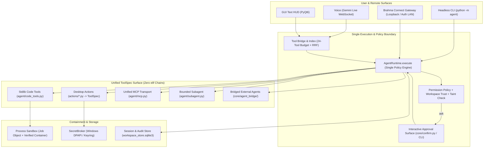

# Brahma Evo — Architectural Recommendations, Design Decisions & Engineering Blueprint

**Status:** Proposed Engineering Blueprint & Decision Record (Companion to [`ARCHITECTURE-SPEC.md`](file:///c:/Users/Admin/Brahma-Ai-Evo/docs/ARCHITECTURE-SPEC.md))  
**Created:** 2026-11-01  
**Baseline:** `main` @ `531b961` (744 passed / 1 skipped; `agent/` 387 passed)  
**Objective:** Elevate Brahma Evo from a functionally rich but structurally uneven desktop assistant into a **top-tier, production-grade professional software system** with unified trust boundaries, deterministic execution, zero god-objects, and verifiable security guarantees.

---

## 1. Executive Assessment: The Path to Top-Tier Software

[`ARCHITECTURE-SPEC.md`](file:///c:/Users/Admin/Brahma-Ai-Evo/docs/ARCHITECTURE-SPEC.md) captures a critical truth: **Brahma Evo has a world-class core (`agent/`) surrounded by pre-harness legacy plumbing (`main.py`, `core/tool_exec.py`, `features/`, `agent/executor.py`).**

To become top-tier professional software, Brahma Evo does not need more surface features first—it needs **structural convergence**. Specifically, five systemic gaps currently separate the repository from production-grade software engineering:

1. **Split-Brain Execution & Permission Boundaries:** Harness tools pass through [`AgentRuntime.execute`](file:///c:/Users/Admin/Brahma-Ai-Evo/agent/runtime.py), whereas ~60 native actions execute via a 1,500-line `elif` chain in [`core/tool_exec.py`](file:///c:/Users/Admin/Brahma-Ai-Evo/core/tool_exec.py) with no policy engine, and `agent_task` runs a pre-fork autonomous loop ([`agent/executor.py`](file:///c:/Users/Admin/Brahma-Ai-Evo/agent/executor.py)) with zero gates.
2. **Uncontained RCE Surfaces in Default Workflows:** The Skills Forge ([`core/skill_forge.py`](file:///c:/Users/Admin/Brahma-Ai-Evo/core/skill_forge.py)), Crucible ([`core/skill_crucible.py`](file:///c:/Users/Admin/Brahma-Ai-Evo/core/skill_crucible.py)), auto-imported plugins ([`plugin_manager.py`](file:///c:/Users/Admin/Brahma-Ai-Evo/plugin_manager.py)), unauthenticated LAN gateway ([`brahma_connect/gateway/server.py`](file:///c:/Users/Admin/Brahma-Ai-Evo/brahma_connect/gateway/server.py)), and unsigned git-reset updaters ([`updater.py`](file:///c:/Users/Admin/Brahma-Ai-Evo/updater.py)) violate the principle of least privilege.
3. **God-Object Concentration in the Host Shell:** [`main.py`](file:///c:/Users/Admin/Brahma-Ai-Evo/main.py) (4,833 lines) and [`ui.py`](file:///c:/Users/Admin/Brahma-Ai-Evo/ui.py) (827 lines) have breached their complexity budgets, mixing lifecycle orchestration, tool schema declarations, voice WebSocket callbacks, and UI state.
4. **Protocol Fragility on Deferred Voice Tools (`1008` Crash):** Gemini Live terminates the WebSocket when the model directly calls a tool discovered via `search_tools` that was not in the initial 24-tool setup frame.
5. **Dual-Stack Drift (Voice vs. Harness):** MCP lifecycle management ([`core/mcp_manager.py`](file:///c:/Users/Admin/Brahma-Ai-Evo/core/mcp_manager.py) vs. [`agent/mcp.py`](file:///c:/Users/Admin/Brahma-Ai-Evo/agent/mcp.py)) and reasoning loops are duplicated across voice and text paths.

> [!IMPORTANT]
> **Core Engineering Thesis:** Every capability in Brahma Evo—whether invoked by Voice, GUI Text, CLI, MCP, or an external Orchestrator—must become a canonical [`ToolSpec`](file:///c:/Users/Admin/Brahma-Ai-Evo/agent/spec.py), indexed by [`core/tool_index.py`](file:///c:/Users/Admin/Brahma-Ai-Evo/core/tool_index.py), gated by [`AgentRuntime.execute`](file:///c:/Users/Admin/Brahma-Ai-Evo/agent/runtime.py), and observed via structured runtime events.

---

## 2. Proposed Decisions for All Open Items

### 2.1 Resolution of Owner Decisions (`O-1` through `O-8`)

| ID | Topic | Proposed Decision | Architectural Rationale |
|---|---|---|---|
| **O-1** | Confinement for `run_command` (`N4`) | **Adopt Container-First Verified Confinement (`require_confined` + `sandbox doctor`).** | Windows AppContainer silently breaks standard Python/Win32 user toolchains (`D36`). A policy-enforced `exec.sandbox.require_confined` boolean paired with a startup/CLI health probe (`python -m agent sandbox doctor`) that verifies workspace-only mount, network namespace isolation, and non-root execution in WSL2/Docker/Podman gives deterministic, verifiable isolation without false security. |
| **O-2** | Subagent Fan-Out (`N5`) | **Keep Mutation Sequential; Introduce `run_subagent_batch` for Read-Only Parallel Exploration.** | Parallel mutating subagents create unresolvable workspace race conditions and approval storms. However, allowing 2–4 concurrent *read-only* subagents (`tool_classes={"read"}`) sharing the parent's `AgentRuntime` and cancellation token yields massive latency wins for codebase research while preserving a single enforcement boundary (`I-08`). |
| **O-3** | Security Phase 0 Scope | **Split into Two Atomic, High-Velocity Batches (`Q0-A` Execution/Code, `Q0-B` Network/Storage).** | Splitting reduces blast radius and review surface: `Q0-A` locks down Forge, Crucible `pip`, TLS bypass, `confirmed` spoofing, and `agent_task`. `Q0-B` locks down Gateway loopback/auth, DPAPI secrets, plugin allowlists, and unsigned auto-updates. |
| **O-4** | Agent & Orchestrator Bridge | **Re-base onto `AgentRuntime` via `ADR-018` ("Bridge as a Tool Source, Never a Runtime").** | Keep discovery, `AgentRecord`, durable artifacts (`output_ref`), and `dry_run` budgets. Reject routing through `DynamicToolRegistry` and reject creating a third MCP client. Every bridged agent verb registers as a `ToolSpec` gated by `AgentRuntime.execute`. |
| **O-5** | Upstream Integration Timing | **Freeze Upstream Porting Until `Q0-A`, `Q0-B`, and `O-6` Phase 1 Land.** | Upstream commit `9dd02cf` introduces raw `bash`, `python_repl`, and unauthenticated `/gateway/execute`. Porting before boundary hardening imports critical vulnerabilities directly into `main`. |
| **O-6** | Native-Tool Policy & Dispatch | **Incremental Strangler-Fig Migration of `actions/*` into `ToolSpec` Packages; Retire the `elif` Chain.** | Do not leave ~60 desktop actions ungated. Migrate by risk class (`exec` → `write` → `network/smart_home` → `read`), replacing `TOOL_DECLARATIONS` dicts in `main.py` and `elif` branches in `core/tool_exec.py` with declarative `@tool_spec` registrations. |
| **O-7** | Legacy `agent_task` Executor | **Disable Immediately in `Q0-A`; Delete `agent/planner.py`, `executor.py`, `task_queue.py`, `error_handler.py` in `Q1`.** | Having legacy ungated files inside `agent/` violates module cohesion and creates a fourth, unmonitored execution door. Multi-step autonomous execution is already natively handled by `AgentLoop` and `run_subagent`. |
| **O-8** | Deferred-Tool `1008` Voice Crash | **Implement a 3-Layer Defense: Call-Template Search Output + `search_and_call` Meta-Tool + Reconnect Auto-Pinning.** | Because Gemini Live closes the WebSocket at the server protocol layer before client code receives the undeclared tool call, client-side interception of the raw call is impossible. See §3.3 for the concrete architectural design. |

---

### 2.2 Resolution of Open Architectural Questions (`§13.1` – `§13.7`)

1. **Relationship between Native Actions and the Harness (§13.1):**
   - **Decision:** **One Unified `ToolSpec` Registry.** The distinction between "harness tools" and "native tools" is an artifact of history, not domain modeling. Every action in `actions/*.py` must become a `ToolSpec` with an explicit `tool_class` (`"read"`, `"write"`, `"exec"`, `"desktop_ui"`, `"network"`, `"smart_home"`) and risk level, governed by `AgentRuntime.execute`. The only difference is *portability*: `agent/code_tools.py` remains stdlib-only (`I-15`), while `actions/*.py` registers OS/desktop `ToolSpec`s when the host app starts.
2. **Gateway Product Positioning (§13.2):**
   - **Decision:** **Opt-In Companion Product Feature with Zero-Trust LAN Posture.** Bind to `127.0.0.1` by default. Enabling LAN mode requires an explicit user toggle in Settings, mDNS advertisement with TLS/pinned self-signed cert, cryptographic challenge-response pairing (SPAKE2 or Ed25519 token exchange), and FastAPI dependency injection requiring a valid Bearer session on **every** HTTP and WebSocket route.
3. **Orchestrator Topology — Hierarchy vs. Peer Fleet (§13.3):**
   - **Decision:** **Strict DAG Hierarchy (Supervisor → Worker).** Brahma Evo acts strictly as the root supervisor (`depth=0`) or a bounded leaf worker (`depth=1`, refusing further delegation via `X-Brahma-Hop-Count` / env markers). Peer-to-peer mesh orchestration introduces distributed consensus, cycle detection, and unbounded token spend Problems that dilute desktop assistant reliability.
4. **Trusted-Input & Taint Policy for Cloned Repositories (§13.4):**
   - **Decision:** **Workspace Trust Fingerprinting (VS Code / Claude Code Model) + Untrusted Tool-Output Tagging.** Before `agent/prompts.py` loads `.brahma/AGENTS.md`, `.brahma/skills`, or `.mcp.json` from a workspace, the workspace path must be recorded in a user-scoped DPAPI/SQLite trust table (`trusted_workspaces`). For untrusted workspaces, repo-local `.mcp.json` and auto-loaded instructions are withheld until the user approves the workspace banner once. External content returned by `read_file`/`grep_files`/web tools is wrapped in `<untrusted_data>` delimiters in the transcript.
5. **Future of the Skills Forge (§13.5):**
   - **Decision:** **Developer Draft Studio Only (Never Hot-Executed).** `skill_forge` becomes a code-generation assistant that writes candidate skills to a quarantined staging folder (`%LOCALAPPDATA%\BrahmaAI\staged_skills\<id>\`), runs static AST + `ruff` + isolated subprocess syntax checks, and opens a diff review in the HUD. Promoting a staged skill to `user_skills` requires explicit user approval in the HUD (`core/confirm.py`) and cryptographic SHA-256 manifest recording.
6. **Release & Update Model (§13.6):**
   - **Decision:** **Signed GitHub Release Artifacts for End-Users; Notify-Only for Git Clones.** Delete `git reset --hard` from `updater.py` and `core/updater.py` permanently. If `.git` is present, the updater may only run `git fetch --dry-run` (opt-in) and display a non-destructive "Updates available upstream" badge. For packaged builds, updates must download a versioned release manifest + SHA-256 checksum verified against an embedded Ed25519 public key.
7. **Voice Loop Convergence with the Harness (§13.7):**
   - **Decision:** **Keep Gemini Live Audio Transport Separate, but Delegate Multi-Step Reasoning to `AgentLoop` via `run_subagent`.** Gemini Live is a real-time audio WebSocket (`I-20`), so it cannot be replaced by a text completion loop. However, voice should become a thin conversational router: single-shot desktop commands run directly through `AgentRuntime.execute`, while any multi-step coding, research, or planning request from voice invokes `run_subagent` (backed by the text provider router and `AgentLoop`).

---

## 3. Target Architecture & Subsystem Redesigns



### 3.1 Eradicating the Legacy `elif` Chain & Unifying `ToolSpec`

Currently, [`main.py`](file:///c:/Users/Admin/Brahma-Ai-Evo/main.py) defines `TOOL_DECLARATIONS` (60 dicts), and [`core/tool_exec.py`](file:///c:/Users/Admin/Brahma-Ai-Evo/core/tool_exec.py) routes them via a giant `if/elif` cascade.

**Engineering Design:**
1. **Extend `ToolSpec` Metadata (`agent/spec.py`):**
   Add optional fields while keeping `agent/` stdlib-only:
   - `tool_class`: expand from `{"read", "write", "exec", "mcp", "native"}` to support fine-grained desktop classes (`"desktop_read"`, `"desktop_input"`, `"system_control"`, `"network_egress"`, `"smart_home"`) mapped cleanly in `agent/permissions.py`.
   - `is_async`: allow async handlers or automatic worker-thread offloading so `core/tool_exec.py` does not need bespoke per-tool threading glue.
   - `ui_feedback`: optional declarative metadata (HUD status label, TTS announcement template) replacing hardcoded `self._host` calls inside `core/tool_exec.py`.
2. **Co-locate Declarations with Implementations (`actions/*.py`):**
   Each module in `actions/` exports a `TOOLS: list[ToolSpec]` tuple alongside its handler functions. At startup, `core/action_registry.py` collects all `actions/*` specs and registers them into `agent/spec.py` and `core/tool_index.py`.
3. **Shrink `core/tool_exec.py` to <150 Lines:**
   `ToolExecutor.execute(fc)` becomes:
   - If `tool_bridge.is_meta_tool(name)` → `await tool_bridge.execute_meta(name, args)`
   - Else → dispatch through `AgentRuntime.execute(name, args, context)` on a worker thread, emit HUD/TTS feedback from `ToolSpec.ui_feedback`, and return `FunctionResponse`.
   - Zero `elif` branches. Invariant `I-01` now covers **100% of tools** across Voice, GUI Text, and CLI.

---

### 3.2 Decomposing the `main.py` and `ui.py` God-Objects

`main.py` (4,833 lines) violates single-responsibility by acting simultaneously as the entry point, schema repository, voice session orchestrator, text turn runner, Forge controller, and tray action router.

**Target Decomposition Plan (Target: `main.py` ≤ 900 lines, `ui.py` ≤ 500 lines):**

| Extracted Module | Responsibility Moved Out of `main.py` | Target Size |
|---|---|---|
| `core/native_declarations.py` → `actions/*` | Move all 60 `TOOL_DECLARATIONS` dicts (~1,600 lines) out of `main.py` into declarative `ToolSpec` definitions per `actions/` module. | ~0 lines in `main.py` |
| `core/text_turn_controller.py` | Extract `_finish_tool_turn`, `_agentic_seed_messages`, streaming delta callbacks, and session bridge persistence. | ~450 lines |
| `core/voice_turn_controller.py` | Extract Gemini Live audio turn coordination, voice-to-session archival (`record_voice_turn`), and `run_subagent` bridge for voice. | ~400 lines |
| `core/forge_controller.py` | Extract `_forge_skill` staging workflow, diff preview invocation, and user promotion gate. | ~250 lines |
| `core/app_bootstrap.py` | Extract startup wiring (index priming, MCP workspace initialization, secret migration, crash recovery). | ~300 lines |

> [!TIP]
> Enforce file-size budgets in CI! Add a fast test in `tests/test_architecture_invariants.py` that asserts line counts on `main.py`, `ui.py`, and `core/tool_exec.py` never ratchet upward as each extraction lands.

---

### 3.3 Solving the Gemini Live `1008` Deferred-Tool Crash permanently

As documented in [`DEFERRED-TOOL-PROXY-MISSION.md`](file:///c:/Users/Admin/Brahma-Ai-Evo/docs/DEFERRED-TOOL-PROXY-MISSION.md), when the model calls `search_tools(intent="...")`, it sees `tool_name: mcp_Synapse_cdp_open_tab` and its parameter list, and occasionally emits a direct `function_call(name="mcp_Synapse_cdp_open_tab")` instead of `call_tool(tool_name="mcp_Synapse_cdp_open_tab", ...)`. Gemini's server immediately drops the WebSocket with `1008 Requested entity was not found`.

Because the rejection happens on Google's servers before the frame reaches the client, we must combine **affordance shaping** (so the model never formats a direct call) with **session recovery** (so a rare `1008` self-heals transparently):

1. **Affordance Shaping in `_handle_search` & `_handle_list_tools` ([`core/tool_bridge.py`](file:///c:/Users/Admin/Brahma-Ai-Evo/core/tool_bridge.py)):**
   Stop formatting search results like function declarations (`tool_name: X`, `arguments: a, b`). Models are fine-tuned to turn declaration-shaped text into direct function calls. Instead, format every search hit as a **literal copy-paste `call_tool` invocation template**:
   ```text
   1. [DEFERRED] Group: synapse | Does: Open a browser tab
      Invoke via: call_tool(tool_name="mcp_Synapse_cdp_open_tab", arguments={"url": "<string>"})
   ```
2. **Add an Atomic `run_discovered_tool` / ` auto_execute` Mode or Keep `call_tool` Schema Strict:**
   Add an optional boolean `execute_if_single_match: false` or keep `search_tools` returning structured JSON containing *only* `{"must_call_via": "call_tool", "payload_template": {"tool_name": "...", "arguments": {...}}}`.
3. **Self-Healing `1008` Auto-Pin on Reconnect ([`core/session_lifecycle.py`](file:///c:/Users/Admin/Brahma-Ai-Evo/core/session_lifecycle.py)):**
   Track the tools returned by `search_tools` in the current voice session (`_recently_discovered_tools: deque[str](maxlen=8)`). If the Gemini Live socket closes with `1008` immediately after a `search_tools` or `list_tools` turn:
   - Automatically inject `_recently_discovered_tools` into the **pinned** set of `tool_bridge.build_session_payload()` for the immediate reconnect setup frame (replacing the lowest-ranked top-k slots to stay within the 24-tool budget).
   - Replay the last user intent seamlessly so the tool is now natively declared on the reconnected socket.

---

### 3.4 Unifying MCP Transport Under `agent/mcp.py`

Currently (`I-18`), Brahma Evo maintains two separate MCP stacks:
- [`agent/mcp.py`](file:///c:/Users/Admin/Brahma-Ai-Evo/agent/mcp.py): stdlib-only, synchronous/threaded JSON-RPC stdio client with turn-boundary `tools/list_changed` refresh and single-restart recovery (`D41`).
- [`core/mcp_manager.py`](file:///c:/Users/Admin/Brahma-Ai-Evo/core/mcp_manager.py): async SDK client used by the voice path, lacking `D41` refresh parity.

**Recommendation:**
Make [`agent/mcp.py`](file:///c:/Users/Admin/Brahma-Ai-Evo/agent/mcp.py) (`WorkspaceMCP`) the **single MCP engine for the entire application** (Voice, GUI Text, and CLI).
- `core/mcp_manager.py` becomes a thin async adapter over `WorkspaceMCP` (using `asyncio.to_thread` for stdio calls) that syncs `WorkspaceMCP`'s registered `ToolSpec`s into `core/tool_index.py`.
- Benefits: eliminates SDK dependency drift, gives Voice automatic `D41` dead-server revival and `tools/list_changed` handling, and routes all voice MCP calls through `AgentRuntime.execute`.

---

## 4. Security Architecture & Trust Boundary Engineering

To transition from the open findings in [`SECURITY-ANALYSIS-ISSUE-4.md`](file:///c:/Users/Admin/Brahma-Ai-Evo/docs/SECURITY-ANALYSIS-ISSUE-4.md) to the target model (*"The model may propose. The user may authorize. The policy decides. The sandbox executes. The broker holds the keys"*), execute a two-stage hardening plan.

### 4.1 Stage 1: Immediate In-Process Hardening (`Q0-A` & `Q0-B`)

| Finding | File(s) | Exact Engineering Fix |
|---|---|---|
| **F-1 / F-4 / F-5 / F-7: Unsafe Forge & Crucible** | `core/skill_forge.py`, `core/skill_crucible.py`, `main.py` | 1. Remove `DynamicToolRegistry.execute_sync` from `main.py:_forge_skill` and `agent/executor.py`.<br>2. Strip `verify=False` and `_create_unverified_context` from Forge prompts; add an AST gate rejecting both.<br>3. Delete `pip install` from `SkillCrucible.resolve_dependencies()`; return a structured dependency report instead.<br>4. Write forged code to a non-imported staging directory (`staged_skills/`); require HUD diff approval (`core/confirm.py`) and record a SHA-256 entry in `approved_skills.json` before `DynamicToolRegistry` loads any file from `features/`. |
| **F-2: Arbitrary Plugin Auto-Import** | `plugin_manager.py` | Replace blind `os.listdir("plugins")` + `exec_module` with an explicit user-approved manifest (`%LOCALAPPDATA%\BrahmaAI\approved_plugins.json`) storing `{relpath, sha256, enabled}`. Any modified or unknown `.py` file is skipped and logged as `untrusted_plugin_blocked`. |
| **F-3: Unsigned Git Reset Updater** | `updater.py`, `core/updater.py` | Remove hardcoded `Brahma---personal` remote and delete `git reset --hard` / startup auto-pull. Replace with a read-only release check against configured release metadata. |
| **F-6: Plaintext & Co-located Secrets** | `smart_home/storage.py`, `core/secret_store.py` (new) | Introduce `core/secret_store.py` using Windows **DPAPI** (`CryptProtectData` / `CryptUnprotectData` via `ctypes.windll.crypt32` — zero external dependencies). Encrypt `smart_home.key` and `config/api_keys.json` payloads under the current Windows user logon credential. Delete plaintext keys after a one-time migration. |
| **Extra-1: Unauthenticated LAN Gateway** | `brahma_connect/gateway/server.py` | Change default bind host from `0.0.0.0` to `127.0.0.1` and default `gateway_enabled=False`. Add a FastAPI `Depends(require_paired_device)` security dependency to `/gateway/info`, `/devices`, `/logs`, `/pending`, and approval routes. Require rate-limited 6-digit + random nonce pairing from the local HUD before issuing device tokens. |
| **Extra-2: Model-Supplied `confirmed` Bypass** | `main.py`, `core/confirm.py` | Remove `"confirmed"` from all tool parameter schemas advertised to models. `core/confirm.py` must never read model arguments to bypass `ask_blocking_choice`. |
| **Debt-1: Legacy `agent_task` Door** | `main.py`, `core/tool_exec.py`, `agent/executor.py` | Unregister `agent_task` from `TOOL_DECLARATIONS`, replace its handler in `core/tool_exec.py` with a deprecation redirect to `AgentLoop`, and delete `agent/planner.py`, `agent/executor.py`, `agent/task_queue.py`, and `agent/error_handler.py`. |

### 4.2 Stage 2: Defense-in-Depth Confinement (`Q1` – `Q2`)

1. **Verified Container Sandbox for `run_command` (`agent/sandbox.py`):**
   - Implement `python -m agent sandbox doctor` to test the configured `exec.sandbox.prefix` (e.g., `wsl.exe --`, `docker run --rm --network=none -v ...`, or `podman`).
   - Add policy setting `"require_confined": true|false` under `exec.sandbox`. When `true`, `AgentRuntime` refuses `run_command` if `sandbox doctor` has not verified read-only rootfs, workspace-only bind mount, and disabled network egress.
2. **Cryptographic Audit Log (`agent/audit.py`):**
   - Persist an append-only, hash-chained audit table (`agent_audit_log` in `workspace_store.sqlite3`) recording every policy evaluation, approval prompt, user decision (`allow_once`, `session_allow`, `deny`), environment variable scrub count, and command execution hash.

---

## 5. Engineering Excellence & Quality Bar

To operate as top-tier professional software, Brahma Evo's day-to-day engineering practices should be upgraded across four dimensions:

### 5.1 Automated Architecture & Security Gate (`tests/test_architecture_invariants.py`)
Do not rely on human memory to enforce invariants `I-01` through `I-28`. Build a dedicated, fast (<2s) invariant test suite that runs in every CI job:
- **AST Gate against Raw Subprocesses (`I-24`):** Parse all `.py` files in `agent/`, `core/`, and `actions/` and fail if `subprocess.run`, `subprocess.Popen`, or `os.system` appears outside `agent/process.py` (and explicitly allowlisted legacy wrappers during migration).
- **AST Gate against Qt Thread Violations (`I-25`):** Verify that worker modules never invoke `QWidget` mutators or `runJavaScript` directly outside signal slots.
- **Line-Count Ratchet (`C-4`):** Assert `main.py`, `ui.py`, and `core/tool_exec.py` line counts are $\le$ their current ratcheted ceilings, automatically lowering the ceiling as decomposition batches land.
- **Schema & Policy Coverage Gate (`I-01`, `I-28`):** Assert that every tool registered in `core/tool_index.py` has a corresponding `ToolSpec` and `tool_class` recognized by `agent/permissions.py`.
- **Import Purity Canary (`I-15`):** Run `py -3.11 -c "import sys; import agent.loop, agent.runtime, agent.mcp; assert 'PyQt6' not in sys.modules"` in CI.

### 5.2 Static Type Safety & Modern Python Packaging
- **Standardize on `pyproject.toml`:** Consolidate `ruff`, `pytest`, and `mypy`/`pyright` configuration into a single `pyproject.toml` with locked dependency groups (`[project.optional-dependencies] dev`, `gui`, `voice`).
- **Incremental Strict Typing:** `agent/` is clean and modular—enable `mypy --strict agent/` (or `pyright`) as a required gate first, then expand to `core/tool_index.py`, `core/tool_bridge.py`, and `core/provider_router.py`.
- **Unify Dev Environment:** Document and script `.venv` creation on Python 3.11 (`scripts/setup_dev.ps1`) so developers and coding agents do not hit the Python 3.14 `.venv` mismatch noted in `AGENTS.md`.

### 5.3 Observability, Telemetry & Crash Resilience
- **Structured Event Bus:** Extend `agent/loop.py`'s event stream (`turn_start`, `tool_start`, `permission`, `compaction`, `stop`) to a unified `core/telemetry.py` ring buffer inspectable in a HUD "Diagnostics / Flight Recorder" drawer.
- **Provider Health Pre-Flight:** Solve the gap in §6.2 ("a provider that is enabled but misconfigured fails at the call, not at configuration time") by adding a fast, non-billing `/models` or handshake probe when saving Settings and displaying a live `🟢 Ready / 🔴 Auth Failed / ⚪ Disabled` badge per provider.

---

## 6. Sequenced Execution Roadmap (Batches `B1` – `B8`)

Following the operating model in `ARCHITECTURE-SPEC.md` §10 (one concern per batch, tests + docs in the same commit, all 3.11 gates green):

| Batch | Prefix | Scope & Deliverables | Key Invariants Enforced |
|---|---|---|---|
| **B1** | `security:` | **Phase 0-A (Code & Execution Lockdown):** Forge staging-only (no `execute_sync`), strip TLS bypass from prompts, Crucible returns dependency plan (no `pip`), remove model-facing `confirmed`, disable `agent_task`. | Closes Findings 1, 4, 5, 7, `confirmed`, and 4th door |
| **B2** | `security:` | **Phase 0-B (Network, Secrets & Supply Chain):** DPAPI `core/secret_store.py` for API/smart-home keys, Gateway loopback default + HTTP route auth, SHA-256 plugin allowlist, remove `git reset --hard` from updaters. | Closes Findings 2, 3, 6, and Gateway LAN exposure |
| **B3** | `agent:` | **Architecture Invariant Suite & Legacy Cleanup:** Delete `agent/planner.py`, `executor.py`, `task_queue.py`, `error_handler.py`. Add `tests/test_architecture_invariants.py` (AST gates for `subprocess`, line-count ratchets, `agent/` import purity). | `I-01`, `I-15`, `I-24`, `I-28` |
| **B4** | `agent:` | **Unified `ToolSpec` Migration (Part 1 — `exec` & `write` Native Actions):** Migrate all mutating/exec desktop tools from `main.py` / `core/tool_exec.py` `elif` branches to `ToolSpec`s routed through `AgentRuntime.execute`. | Eliminates Gap `G-1` for mutating actions |
| **B5** | `agent:` | **Unified `ToolSpec` Migration (Part 2 — Remaining Native Actions) & `main.py` Decomposition:** Migrate remaining native tools, delete the `elif` chain in `core/tool_exec.py`, extract `core/text_turn_controller.py` and `core/voice_turn_controller.py` (`main.py` < 1,500 lines). | `I-01` becomes universal; resolves `C-4` |
| **B6** | `voice:` | **Deferred-Tool `1008` Resolution & MCP Unification:** Reformat `search_tools` output to `call_tool(...)` templates, add `1008` auto-pinning on reconnect in `core/session_lifecycle.py`, and route `core/mcp_manager.py` through `WorkspaceMCP`. | Solves `1008` crash; unifies `I-18` and `D41` |
| **B7** | `agent:` | **Verified Confinement (`N4`) & Read-Only Subagent Fan-Out (`N5`):** Add `python -m agent sandbox doctor` + `require_confined` policy flag, workspace trust table (`trusted_workspaces`), and `run_subagent_batch` for read-only parallel subtasks. | Resolves `O-1`, `O-2`, and `§13.4` |
| **B8** | `bridge:` | **Agent Bridge v2 (`ADR-018`) & Selective Upstream Port:** Record `ADR-018`, implement opt-in read-only discovery + durable artifacts + MCP/local adapters as `ToolSpec`s behind `AgentRuntime`, then selectively port upstream features. | Resolves `C-1`..`C-7`, `O-4`, `O-5` |

---

## 7. Summary of Immediate Next Actions

1. **Approve Decisions `O-1` through `O-8` (§2.1)** and record them in [`ARCHITECTURE-SPEC.md`](file:///c:/Users/Admin/Brahma-Ai-Evo/docs/ARCHITECTURE-SPEC.md) §11.3.
2. **Start Batch `B1` (`security: phase 0-A execution lockdown`)** immediately—it requires zero new architecture, eliminates the highest-severity RCE vectors in under 300 lines of targeted diffs, and clears the path for unified `ToolSpec` migration.
