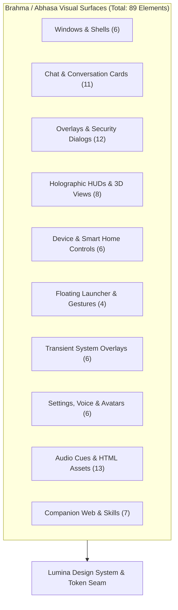

# Abhasa / Brahma Evo — Complete Visual & UI Surface Inventory

| Field | Value |
|---|---|
| **Document** | `docs/CURRENT-VISUAL-INVENTORY.md` |
| **Status** | Complete Codebase Inventory & Surface Mapping |
| **Date** | 2026-11-10 |
| **Scope** | 100% of visual, graphical, windowing, overlay, HUD, and audio surfaces in the codebase |
| **Verified Totals** | **60 Qt Widget/Dialog Classes**, **8 Interactive HTML/WebGL Assets**, **3 Web Companion Pages**, **5 Sound Design Assets**, **4 Visual Skills**, **9 Action-Triggered HUDs** |
| **Companion Specification** | [`docs/VISUAL-REDESIGN-PROPOSAL.md`](VISUAL-REDESIGN-PROPOSAL.md) |
| **Governing Authority** | [`docs/ARCHITECTURE-SPEC.md`](ARCHITECTURE-SPEC.md), [`docs/REBRAND-PROPOSITION.md`](REBRAND-PROPOSITION.md) |

---

## 0. Executive Summary & Inventory Purpose

This document serves as the **exhaustive visual register** of the entire codebase. Before refactoring or implementing the "Abhasa Lumina" design system, every single screen, dialog, floating HUD, transient overlay, telemetry bar, sound cue, and web companion is cataloged and mapped.

**The Golden Invariant**: *No existing capability, telemetry channel, device tile, or security dialog may be dropped or forgotten.* Every element identified here has an explicit redesign treatment within the "Abhasa Lumina" architectural specification.

---

## 1. Primary Windows, Shells & Stage Architecture

| Class Name | Source File | Base Type | Current Role & Visual Description | Redesigned "Abhasa Lumina" Treatment |
|---|---|---|---|---|
| `MainWindow` | [`ui.py`](../ui.py#L380) | `QMainWindow` | Root application container combining 17 mixins. Houses left navigation rail, central stage stack, and right inline workspace. | Retained as root QMainWindow. Stripped of monkeypatched QSS; styled with pure semantic design tokens and single-pixel frosted obsidian border. |
| `BrahmaUI` | [`ui.py`](../ui.py#L750) | Controller | Facade class managing window visibility, tray lifecycle, audio levels, and shell delegates. | Retained as `AbhasaUI` / `BrahmaUI` bridge. Connects cleanly to the new token and icon registry. |
| `BackgroundWidget` | [`core/ui_bg.py`](../core/ui_bg.py#L49) | `QWidget` | Background container hosting `QWebEngineView` (Three.js WebGL resonator, Live2D, or VRM) with fallback pixmap. | Refactored into **Layer 0 (Background Canvas)**. Mark as `WA_OpaquePaintEvent`, add framerate throttling (60fps -> 15fps -> 0fps idle), and add support for Mode 0 (Pure Lumina 0% CPU). |
| `GlobeWindow` | [`core/globe_window.py`](../core/globe_window.py#L70) | `QWidget` | Dedicated window rendering 3D Earth, Leaflet maps, flight paths, satellite telemetry, and day/night shaders. | Frameless dark obsidian glass chrome with single-pixel cyan border and compact status badge. |
| `SpaceCleanerWindow` | [`core/space_cleaner_hud.py`](../core/space_cleaner_hud.py#L180) | `QWidget` | Standalone window for cosmic junk analysis and disk space reclamation. | Styled with dark glass cards and refined storage progress bars. |
| `InstallWizard` / `UninstallWizard` | [`installer/install_wizard.py`](../installer/install_wizard.py), [`uninstall_wizard.py`](../installer/uninstall_wizard.py) | `QWidget` | Multi-step Windows installer/uninstaller wizard with setup steps and progress bars. | Rebranded to "Abhasa Evo", styled with Lumina Frosted Obsidian setup cards, Inter typography, and clean SVG brand glyphs. |

---

## 2. Conversation, Chat & Workspace Components

| Class Name | Source File | Base Type | Current Role & Visual Description | Redesigned "Abhasa Lumina" Treatment |
|---|---|---|---|---|
| `MessageCard` | [`core/ui_chat.py`](../core/ui_chat.py#L61) | `QFrame` | Renders user and assistant messages with colored left-borders (blue, white, red, green). | Replaced by `LuminaMessageCard` with subtle optical elevation, top cyan hairline accent, Inter typography, and action chips. |
| `TaskCard` | [`core/ui_chat.py`](../core/ui_chat.py#L220) | `QFrame` | Displays agent task breakdowns, status pills, and subtask execution trees. | Translucent obsidian card with collapsible task tree and pulsing status indicators. |
| `AttachmentCard` | [`core/ui_chat.py`](../core/ui_chat.py#L380) | `QFrame` | Displays uploaded/inspected files, MIME types, file sizes, and thumbnail previews. | Compact glass card with vector file icons (`IconFile`, `IconImage`, `IconCode`) and remove button. |
| `EventCard` | [`core/ui_chat.py`](../core/ui_chat.py#L520) | `QFrame` | Visual event notification card for calendar triggers, reminders, and timers. | Pill-shaped glass alert with calendar icon and time badge. |
| `ArtifactCard` | [`core/ui_chat.py`](../core/ui_chat.py#L680) | `QFrame` | Displays generated documents, diffs, code files, and specs with "Open" / "Copy" buttons. | Bento-style artifact preview card with syntax-highlighted thumbnail and one-click clipboard action. |
| `ChatBubble` | [`core/ui_chat.py`](../core/ui_chat.py#L820) | `QFrame` | Compact conversational bubble for voice live transcripts and quick responses. | Minimalist frosted glass wafer with 18px backdrop blur and high-contrast typography. |
| `HistoryConversationItem` | [`core/ui_chat.py`](../core/ui_chat.py#L960) | `QFrame` | List item for browsing and resuming past agent sessions. | Clean list item with active session indicator dot and timestamp. |
| `ConversationFeed` | [`core/ui_chat.py`](../core/ui_chat.py#L1100) | `QScrollArea` | Smooth-scrolling viewport hosting the conversation cards. | Hidden scrollbar, kinetic scrolling physics, zero content clipping. |
| `TaskDock` | [`core/ui_chat.py`](../core/ui_chat.py#L1350) | `QFrame` | Bottom workspace dock displaying active background tasks. | Integrated into the **Context & Telemetry Drawer**. |
| `WorkspaceSidebar` | [`core/ui_chat.py`](../core/ui_chat.py#L1520) | `QWidget` | Collapsible left rail with file tree and git repository status. | Replaced by the 60px Slim Nav Rail with SVG icons. |
| `InlineChatWorkspace` | [`core/ui_chat.py`](../core/ui_chat.py#L1800) | `QFrame` | The entire right-side chat container hosting conversation feed, input bar, and buttons. | Restructured into the unified Bento Stage and floating Lumina Dock. |

---

## 3. Command Inputs, Wings & Telemetry

| Class Name | Source File | Base Type | Current Role & Visual Description | Redesigned "Abhasa Lumina" Treatment |
|---|---|---|---|---|
| `CommandBar` | [`core/ui_commandbar.py`](../core/ui_commandbar.py#L15) | `QWidget` | Bottom floating input bar (580x48px) with Hindi `ब्र` logo, mic, attach, and dev mode buttons. | Replaced by **`LuminaDock` (52px floating island)** with integrated audio visualizer, multiline expander, and SVG icons. |
| `BrahmaTelemetryWing` | [`core/ui_telemetry.py`](../core/ui_telemetry.py#L279) | `QFrame` | Fixed 310px floating card showing live tool telemetry with a 10-second auto-dismiss countdown. | **10s auto-dismiss removed**. Replaced by persistent "Live Ops" tab inside the **Context & Telemetry Drawer**. |
| `BrahmaResultWing` | [`core/ui_telemetry.py`](../core/ui_telemetry.py#L591) | `QFrame` | Fixed floating card displaying tool execution return values, stdout, and images. | Replaced by persistent "Artifacts" tab inside the **Context & Telemetry Drawer**. |
| `LauncherControlPanel`| [`core/ui_telemetry.py`](../core/ui_telemetry.py#L22) | `QDialog` | Frameless floating utility dialog to open workspace, dev mode, restart, or quit app. | Refined frosted obsidian palette (`rgba(16, 20, 28, 0.95)`), Inter typography, and crisp buttons. |
| `SmallPanelCard` | [`core/ui_telemetry.py`](../core/ui_telemetry.py#L240) | `QFrame` | Compact telemetry card for quick metrics. | Converted to a reusable `LuminaCard` atomic component. |
| `StatCard` | [`core/ui_telemetry.py`](../core/ui_telemetry.py#L820) | `QFrame` | Displays CPU, RAM, and GPU stats with mini bar meters. | Relocated to the "Vitals" tab of the Telemetry Drawer with smooth progress bars. |
| `LogWidget` | [`core/ui_telemetry.py`](../core/ui_telemetry.py#L980) | `QScrollArea` | Raw scrolling log console for engine debug traces. | Styled in JetBrains Mono with colored log-level badges (INFO, WARN, ERR). |
| `MetricBar` | [`core/ui_widgets.py`](../core/ui_widgets.py#L28) | `QWidget` | Custom painted widget with `Courier New` text rendering a progress meter for CPU/RAM. | Modernized: `JetBrains Mono` 10pt, smooth rounded bar (4px), dynamic color thresholds (Cyan -> Amber -> Red). |

---

## 4. Specialized Holographic HUDs & Computer Vision

| Class Name / Surface | Source File | Base Type | Current Role & Visual Description | Redesigned "Abhasa Lumina" Treatment |
|---|---|---|---|---|
| `CircuitPopupOverlay` | [`core/circuit_hud.py`](../core/circuit_hud.py#L120) | `QWidget` | Holographic hardware circuit diagram popup showing microcontroller wiring to sensors with SVG schematic. | Frosted dark glass overlay with clean pin-out callouts, SVG wiring paths, and breadboard diagrams. |
| `RadarPopupOverlay` | [`core/radar_hud.py`](../core/radar_hud.py#L90) | `QWidget` | Local network device radar scanner overlay with sweeping beam, ping ripples, and detected IP nodes. | Modernized radar sweep with Lumina Cyan phosphor glow, high-DPI device markers, and signal strength bars. |
| `SpaceCleanerPopupOverlay`| [`core/space_cleaner_hud.py`](../core/space_cleaner_hud.py#L80) | `QWidget` | Cosmic space debris cleanup overlay with disk usage sector map and clean-up trigger buttons. | Bento-box disk visualizer with circular sector gauges and instant cleanup feedback. |
| `GestureCameraPreview` | [`core/ui_gesture.py`](../core/ui_gesture.py#L80) | `QFrame` | Webcam video preview card displaying MediaPipe hand landmarks, skeletal lines, and gesture tags. | Clean picture-in-picture floating glass card with smooth joint lines (`#00E5FF`) and gesture recognized chips. |
| `_GestureRenderCanvas` | [`core/ui_gesture.py`](../core/ui_gesture.py#L20) | `QWidget` | Custom QPainter canvas drawing hand skeletal joints and gesture bounding circles. | Antialiased high-DPI joint rendering with subtle glowing nodes. |
| Pushup / Pose HUD | [`actions/pushup_counter.py`](../actions/pushup_counter.py) | OpenCV / CV2 | Webcam overlay counting pushups, squats, and exercise posture with live skeleton and counter HUD. | Modern high-tech rep counter HUD with angle indicators, form feedback badges, and sound synchronization. |
| Calorie Counter Vision | [`actions/calorie_counter.py`](../actions/calorie_counter.py) | OpenCV / CV2 | Live camera overlay identifying food items and rendering bounding boxes with calorie estimates. | Clean bounding boxes with nutrition summary chips and macro breakdown cards. |
| Screen Processor / OCR | [`actions/screen_processor.py`](../actions/screen_processor.py)| Screen Overlay | Captures screen regions, highlights text with bounding boxes, and performs OCR extraction. | Subtle cyan selection marquee with coordinate rulers and instant extraction preview. |

---

## 5. Transient Overlays, Boot Sequences & Alerts

| Class Name | Source File | Base Type | Current Role & Visual Description | Redesigned "Abhasa Lumina" Treatment |
|---|---|---|---|---|
| `SetupOverlay` | [`core/ui_setup.py`](../core/ui_setup.py#L18) | `QWidget` | 8-stage first-run setup overlay (System check, Identity, Owner, Behavior, Shared, Audio, Keys, Done). | Multi-step frosted obsidian glass carousel with progress step markers, vector illustrations, and Inter typography. |
| `BootSequenceOverlay` | [`core/ui_transients.py`](../core/ui_transients.py#L210)| `QWidget` | Animated startup sequence with shockwaves, particle convergence flash, sparks, and "BRAHMA" logo. | Updated to "ABHASA EVO", featuring sleek optical refraction rays, prismatic diamond convergence, and boot diagnostics. |
| `ScanningOverlay` | [`core/ui_transients.py`](../core/ui_transients.py#L21) | `QWidget` | Full-screen cyber scanning overlay with animated sweep lines, OCR bounding boxes, and particles. | High-tech optical scan grid with subtle Lumina Cyan laser line and detected element chips. |
| `MeetingOverlay` | [`core/ui_transients.py`](../core/ui_transients.py#L909)| `QWidget` | Floating meeting bar (collapsible 58px to 142px) with live speaker transcription and "Stop" button. | Floating pill-shaped meeting island with live voice waveform, speaker avatar, and attention choice prompt. |
| `IncomingAlertDialog` | [`core/ui_transients.py`](../core/ui_transients.py#L790)| `QDialog` | Urgent popup for incoming phone calls ("Pick up", "Ignore", "Cut call") and messages ("Hear it", "Reply"). | Frosted glass dialog with caller ID badge, animated phone icon, and high-contrast action buttons. |
| `DailyBriefingOverlay` | [`core/ui_overlays.py`](../core/ui_overlays.py#L180) | `QWidget` | Executive morning summary overlay showing weather, calendar events, active tasks, and news headlines. | Elegant Bento-grid executive dashboard with weather widget, calendar timeline, and task priorities. |
| `ConfirmationOverlay` | [`core/ui_overlays.py`](../core/ui_overlays.py#L380) | `QWidget` | Security approval banner with "ALWAYS ALLOW", "ALLOW ONCE", "DENY" buttons and diff preview. | High-visibility security warning card with amber/red hairline accent, AST diff viewer, and clear action buttons. |
| `MemoryInspectorOverlay`| [`core/ui_overlays.py`](../core/ui_overlays.py#L780) | `QWidget` | Interactive memory browser displaying second-brain memories, knowledge tags, and recall tools. | Searchable knowledge tree with semantic tag chips, recall frequency bars, and memory deletion triggers. |
| `RemoteKeyOverlay` | [`core/ui_overlays.py`](../core/ui_overlays.py#L14) | `QWidget` | QR code display and pairing code modal for connecting mobile devices (`Brahma Connect`). | Clean glass card with centered high-contrast QR code, one-click manual pairing code copy, and timer badge. |

---

## 6. Smart Home & Device Management

| Class Name | Source File | Base Type | Current Role & Visual Description | Redesigned "Abhasa Lumina" Treatment |
|---|---|---|---|---|
| `SmartDevicesSection` | [`core/ui_devices.py`](../core/ui_devices.py#L20) | `QFrame` | Inline stage section displaying connected home smart devices (lights, plugs, AC, TV) with count chip. | Bento-box smart home grid with device status dots, energy usage metrics, and quick toggle buttons. |
| `BrahmaConnectDevicesPage`| [`core/ui_devices.py`](../core/ui_devices.py#L360)| `QFrame` | Device pairing and remote control management page for Android and external tablets. | Clean device grid displaying connected phones, battery %, link quality, and remote clipboard sync status. |
| `_ConnectDeviceCard` | [`core/ui_devices.py`](../core/ui_devices.py#L240) | `QFrame` | Individual card representing a paired phone or tablet with remote control buttons. | Frosted glass card with phone silhouette, battery meter, and "Disconnect" / "Ping" actions. |
| `BrahmaHomePage` | [`smart_home_page_new.py`](../smart_home_page_new.py#L210) | `QWidget` | Standalone smart home dashboard page featuring rooms, device categories, and control sliders. | Cohesive smart home hub styled with Lumina token sliders, color wheels, and temperature toggles. |
| `_DeviceTile` | [`smart_home_page_new.py`](../smart_home_page_new.py#L120) | `QFrame` | Interactive device tile with toggle switch, brightness slider, and device photo. | Translucent tile with smooth toggle animations and state glow (Warm Amber = On, Dim Slate = Off). |
| `AddDeviceDialog` | [`smart_home_page_new.py`](../smart_home_page_new.py#L40) | `QDialog` | Dialog to discover or manually add smart home devices via IP address and token. | Clean modal dialog with input fields, protocol picker (Tuya, Tasmota, HomeAssistant), and test ping button. |

---

## 7. Floating Desktop Widgets & System Tray

| Class Name | Source File | Base Type | Current Role & Visual Description | Redesigned "Abhasa Lumina" Treatment |
|---|---|---|---|---|
| `FloatingLauncher` | [`core/ui_floating.py`](../core/ui_floating.py#L11) | `QWidget` | Draggable 88x88 floating desktop orb with spring physics, particle angles, breathing aura, and context menu. | Re-rendered as the **Lumina Floating Prism (64x64)** with smooth particle physics, state glow, and drag repositioning. |
| `FloatingGestureCard` | [`core/ui_floating.py`](../core/ui_floating.py#L340)| `QWidget` | Compact floating card showing active gesture tracking state. | Minimal pill widget anchored near floating launcher. |
| `_ShellTrayMixin` | [`core/ui_shell_tray.py`](../core/ui_shell_tray.py#L14)| Mixin | Manages Windows system tray icon (`QSystemTrayIcon`) and context menu. | Clean context menu styled with frosted dark glass, checkmarks, shortcuts (`Ctrl+Shift+X` cancel), and status dots. |

---

## 8. Settings, Security & Configuration Dialogs

| Class Name | Source File | Base Type | Current Role & Visual Description | Redesigned "Abhasa Lumina" Treatment |
|---|---|---|---|---|
| `SettingsHubPage` | [`core/ui_connectivity.py`](../core/ui_connectivity.py#L120)| `QWidget` | Main settings hub with navigation categories (General, API Keys, Voice, Network, Appearance). | Restructured into an organized settings canvas with category sidebar and clear toggle switches. |
| `SystemConnectivityPage`| [`core/ui_connectivity.py`](../core/ui_connectivity.py#L320)| `QWidget` | Network port bindings, mDNS service status, Android gateway, and cloud endpoints. | Network diagnostics dashboard with live latency pings and port status chips. |
| `SystemConnectivitySidebar`| [`core/ui_connectivity.py`](../core/ui_connectivity.py#L20)| `QFrame` | Navigation sidebar inside the settings page. | Sleek vertical tab bar with SVG category icons. |
| `AvatarLibraryDialog` | [`core/ui_avatar_library.py`](../core/ui_avatar_library.py#L60)| `QDialog` | 3-tab dialog to browse/install Live2D models, VRM avatars, and HDR panoramic backgrounds. | Glassmorphic 3-tab modal with model preview thumbnails, verified SHA256 badge, and drag-and-drop import. |
| `VoiceLibraryDialog` | [`core/ui_voice_library.py`](../core/ui_voice_library.py#L60) | `QDialog` | Voice browser to preview synthetic voices, test pitch/speed sliders, and select active live voice. | Modern voice catalog with audio playback waveforms, sample play buttons, and latency indicators. |
| `DeveloperModeDialog` | [`core/ui_devmode.py`](../core/ui_devmode.py#L15) | `QDialog` | Developer copilot configuration dialog to select workspace roots and toggle verbose logging. | Clean developer modal with folder picker and debug flags. |
| `SecurityPanelDialog` | [`core/ui_security_panel.py`](../core/ui_security_panel.py#L40)| `QDialog` | Security console displaying cryptographic audit events, tamper hash verification, and capability grants. | Terminal-grade audit inspector with table gridlines, tamper status check, and grant revocation buttons. |
| `SkillReviewDialog` | [`core/ui_skill_review.py`](../core/ui_skill_review.py#L22) | `QDialog` | Human-in-the-loop review interface for staged JIT skills displaying SHA-256 hashes and capabilities. | Code review modal with syntax-highlighted skill code, grant check-boxes, and "Approve & Install" CTA. |
| `OpenAIPortCard` | [`core/ui_openai_port.py`](../core/ui_openai_port.py#L15) | `QFrame` | Card displaying local OpenAI-compatible API server status, listening port, and token auth. | High-tech server status card with live request counter, port selector, and token regenerate button. |
| `AgentBridgeCard` | [`core/ui_agent_panel.py`](../core/ui_agent_panel.py#L40) | `QFrame` | Real-time agent bridge display showing active agent iterations, turn budget, and token burn. | Bento cell inside the Telemetry Drawer showing turn progress bar and token counter. |
| `FileDropZone` / `_DropCanvas`| [`core/ui_filedrop.py`](../core/ui_filedrop.py#L15) | `QWidget` | Drag-and-drop file upload overlay covering the window when files are dragged over it. | Elegant dashed cyan border with glowing drop target icon and blur backdrop. |

---

## 9. Interactive HTML / WebGL Assets

| Asset Path | Technology Stack | Function & Interactive Elements | Redesigned "Abhasa Lumina" Role |
|---|---|---|---|
| `assets/web_background/index.html` | Three.js + UnrealBloomPass | Quantum Core Resonator: 3D rotating rings, glowing singularity, wave particles reacting to audio. | Serves as **Mode 1 (`three_reactive`)** avatar background. Throttled on idle, masked by optical scrim. |
| `assets/avatar_live2d/index.html` | Live2D Cubism SDK | Interactive 2D illustrated character with eye tracking, blinking, breathing, and emotion tags. | Serves as **Mode 2 (`live2d`)** avatar background. Translucent stage allows character to live in background. |
| `assets/avatar_vrm/index.html` | Three.js + `@pixiv/three-vrm` | 3D humanoid character with MToon shaders, spring bones (hair/cloth), and facial blendshapes. | Serves as **Mode 3 (`vrm`)** avatar background. Positioned waist-up, offset right. |
| `assets/globe/index.html` | Leaflet.js + Three.js | Interactive 3D Earth globe with night lights, topology texture, satellite tracks, and flight arcs. | Displayed inside `GlobeWindow`. Frameless dark glass wrapper. |
| `assets/radar/index.html` | HTML5 Canvas / CSS3 | High-tech circular radar sweep with rotating beam, distance rings, and detected device blips. | Displayed inside `RadarPopupOverlay`. Stylized with Lumina Cyan phosphor sweep. |
| `assets/space_cleaner/index.html`| Three.js Particle Mesh | Cosmic space debris cleanup visualization showing fragmented asteroid junk being reclaimed. | Displayed inside `SpaceCleanerPopupOverlay`. Clean glass container. |
| `assets/backgrounds/index.html` | Three.js HDR / Poly Haven | Panoramic HDRI 3D environment viewer for custom virtual backgrounds. | Selectable inside `AvatarLibraryDialog` as a custom background scene. |

---

## 10. Web Companion Dashboards (`dashboard/`)

| File Path | Stack | Purpose & Features | Redesigned "Abhasa Lumina" Treatment |
|---|---|---|---|
| `dashboard/static/app.html` | Vanilla HTML5 / CSS / JS | Web companion app allowing mobile and browser control of Brahma assistant over local WiFi. | Restructured with the exact same CSS variables and design tokens (`tokens.css`) as the desktop app. |
| `dashboard/static/voice.html`| WebRTC / Audio Stream | Web-based bidirectional voice streaming interface for remote audio conversations. | Styled with the Lumina Dock waveform and circular optical core. |
| `dashboard/static/login.html`| CryptoJS / PIN input | Pairing and authentication screen for mobile clients with PIN and session tokens. | Obsidian glass card with centered PIN entry and QR pairing instructions. |

---

## 11. Audio Cues & Sound Design (`assets/sounds/`)

| Sound File | Event Trigger | Auditory Function | Harmonization in Redesign |
|---|---|---|---|
| `deploy_whoosh.wav` | Window show / slide-in | Smooth aerodynamic acoustic whoosh confirming window deployment. | Synchronized with 180ms `OutCubic` window fade-in. |
| `listening_start.wav` | Push-to-Talk / Wake word | Clean crystalline upward chime (C5 -> G5) confirming listening mode. | Synchronized with Lumina Dock cyan waveform pulse. |
| `listening_stop.wav` | Speech silence / PTT release | Subtle downward acoustic confirmation confirming audio capture complete. | Synchronized with dock transition to violet Thinking state. |
| `mission_complete.wav`| Agent / subagent batch done | Triumphant yet understated glass chime confirming long task success. | Synchronized with Telemetry Drawer success banner. |
| `telemetry_chirp.wav` | Tool execution / tool return | Micro-millisecond mechanical click / chirp (5ms) during tool calls. | Subtle audio tick giving tactile feedback during code execution. |

---

## 12. Visual Skills (`features/`)

| Skill / Feature | Location | Visual Output & Function |
|---|---|---|
| `ascii_banner` | `features/ascii_banner/skill.py` | Generates high-impact terminal ASCII art headers for agent outputs. |
| `show_gif` | `features/show_gif/skill.py` | Displays animated GIFs and instructional image loops inside the chat workspace. |
| `show_headphones_image`| `features/show_headphones_image/skill.py`| Renders equipment and hardware setup diagrams. |
| `system_monitor_ascii` | `features/system_monitor_ascii/skill.py` | Generates ASCII sparklines and hardware usage graphs for CLI and chat feeds. |

---

## 13. Feature Preservation & Migration Checklist

To guarantee that **zero** functionality is missed during development, use this checklist across implementation:

- [ ] **Main Shell**: Window framing, left rail, bento stage, docked telemetry drawer, status bar.
- [ ] **Input & Audio**: Lumina Dock, auto-expanding input, live waveform, PTT mic button, mode selector, attachment tray.
- [ ] **Chat Feed**: User cards, assistant cards, tool execution accordions, code blocks, task cards, event cards, artifact previews.
- [ ] **Telemetry & Ops**: Persistent Live Ops tab, Artifacts tab, System Vitals tab, memory/token counters (no auto-dismiss timer).
- [ ] **Avatar Subsystem**: 4 modes fully selectable (None / Pure Lumina, 3D Core, Live2D, VRM) + Dashboard Transparency slider.
- [ ] **Specialized HUDs**: Circuit HUD, Radar HUD, Space Cleaner HUD, 3D Globe Window, Gesture Preview, Pushup/Exercise HUD.
- [ ] **Transient Overlays**: Setup wizard (8 stages), Boot sequence, Scanning matrix, Meeting overlay, Daily briefing, Incoming call/alert dialog, Confirmation banner.
- [ ] **Device & Home**: Smart home device tiles, Brahma Connect mobile pairing, QR code modal, device discovery dialog.
- [ ] **Settings & Modals**: Avatar library (3 tabs), Voice library, Security console, Developer mode, Skill review, File drop zone, OpenAI port card.
- [ ] **Desktop & Tray**: 64x64 Floating Lumina Prism, gesture card, system tray icon with full context menu.
- [ ] **Web Companion**: Synchronize CSS design tokens across `dashboard/static/app.html`, `voice.html`, and `login.html`.
- [ ] **Sound Design**: Maintain all 5 audio cues mapped to visual state transitions.

---

*Verified and cataloged against the live codebase.*
