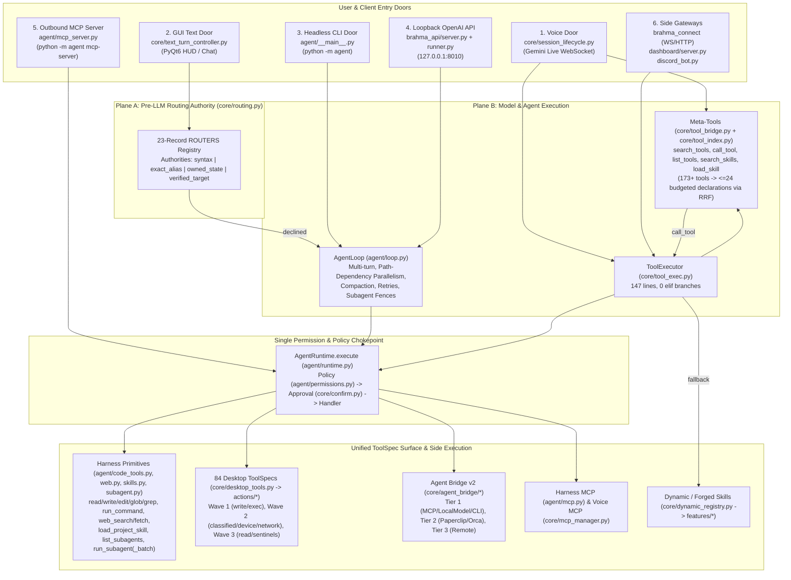
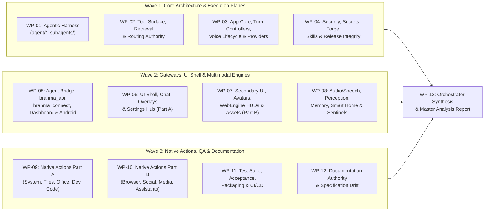

# Brahma AI Evo — Full System Scan & Analysis Master Plan

**Document Role:** Master Orchestration & Commission Blueprint for Multi-Agent Codebase Analysis  
**Created:** 2026-11-07  
**Baseline Commit:** `main` @ `6439b2e` (`Make the subagent library visible on voice and first-call surfaces`)  
**Orchestrator Scope:** Whole-repository high-level architectural scan, complete file inventory, subsystem decomposition, invariant audit matrix, and executable work-package specifications for downstream analysis agents.

---

## 1. Executive Summary & Orchestration Strategy

Brahma AI Evo is a **Windows-first, single-process PyQt6 multimodal desktop assistant and autonomous agent platform**. Over its evolution (1.0.1 $\rightarrow$ 1.1.1+, 25+ agentic harness batches, ADR-001 through ADR-022, Decisions D1–D49, Security Queues Q0–Q4, and Routing/Retrieval phases R0–R3), the repository has grown into a sophisticated, multi-surface system spanning **~460 core source, test, configuration, and documentation files** (~115,000+ lines of Python, TypeScript, Kotlin, HTML/JS, and Markdown), plus **607 vendored specialist subagent templates** in `subagents/`.

Because no single agent context window can deeply inspect ~115,000 lines of code without skimming or losing cross-file precision, this commission uses a **Hub-and-Spoke Orchestrator Model**:

1. **Gentle Comprehensive Orchestrator Scan (Completed in §2–§4):** Maps every directory, subsystem, entry point ("door"), execution seam, architectural invariant (`I-01`–`I-28`), and preliminary anomaly across the repository.
2. **Partitioned Deep-Scan Work Packages (§5, `WP-01` through `WP-12`):** Divides 100% of the repository into **12 bounded, self-contained agent assignments** (~5,000–12,000 lines each) with explicit file manifests, cross-boundary trace targets, and copy-pasteable agent prompts.
3. **Standardized Finding Schema & Synthesis Protocol (§6–§7):** Enforces a strict, machine- and human-readable reporting format (`Critical` / `High` / `Medium` / `Low` / `Info`) with mandatory file/symbol/line evidence, culminating in `WP-13` (Master Synthesis & Remediation Roadmap).

---

## 2. High-Level System Overview (From Orchestrator Scan)

### 2.1 Repository Scale & Telemetry at `HEAD` (`6439b2e`)

| Directory / Layer | File Count | Size (KB) | Primary Language / Contents | Role in System |
|---|---:|---:|---|---|
| **Root (`/` top-level)** | 53 | ~615.0 | Python, PowerShell, Batch, Markdown | Entry points (`main.py`, `ui.py`), LLM clients (`llm_client.py`, `or_client.py`), `workspace_store.py`, `discord_bot.py`, `smart_home_page_new.py`, acceptance harnesses (`accept_*.py`). |
| **`agent/`** | 25 | 462.9 | Python (100% stdlib-only) | Bounded agentic loop, tool specs, permission engine, process/job-object sandbox, stdio MCP client & outbound server, sessions, skills, web tools, subagent dispatch & library loader. |
| **`core/`** | 153 | 3,461.9 | Python (PyQt6, asyncio, SQLite, Win32) | De-facto architecture layer: tool dispatch (`tool_exec.py`), RRF tool index (`tool_index.py`), 84 desktop `ToolSpec` adapters (`desktop_tools.py`), routing authority (`routing.py`), Agent Bridge (`core/agent_bridge/`), security/DPAPI/audit, voice/TTS/STT, avatars, and ~55 `ui_*` modules. |
| **`actions/`** | 80 | 1,053.0 | Python (55 modules) + TypeScript (25 files) | Native desktop capability implementations (files, Office/PDF, browser, computer control, Spotify MCP server, Instagram MCP, dev agent, sentinels). |
| **`brahma_api/`** | 11 | 124.6 | Python (FastAPI / HTTP / SSE) | Loopback OpenAI-compatible server (`127.0.0.1:8010`), hashed bearer tokens, capability presets (`chat`/`reader`/`worker`/`operator`), passthrough lane, pinned sessions. |
| **`brahma_connect/`** | 16 | 81.9 | Python (FastAPI / WebSocket / mDNS) | Companion phone/device gateway, pairing, capability routing, mobile portal. |
| **`brahma-connect-android/`** | 40 | 420.0 | Kotlin / Jetpack Compose / WebGL | Native Android companion app, accessibility service, WebSocket client, device command handler. |
| **`dashboard/`** | 6 | 176.1 | Python (FastAPI) + HTML/JS (AES-CBC) | Local HTTP web dashboard (`port 8000`) with static web UI (`app.html`, `voice.html`, `login.html`). |
| **`memory/`** | 9 | 53.6 | Python | Memory extraction, config, and modular connectors (`local.py`, `mem0.py`, `letta.py`). |
| **`smart_home/`** | 6 | 65.7 | Python | Smart home device service, DPAPI `CredentialVault` (`storage.py`), built-in provider drivers (`builtin.py`). |
| **`features/`** | 33 | 102.6 | Python + JSON manifests | Model-forged / dynamic skills (`DynamicToolRegistry` targets) and staged skill bundles. |
| **`skills/` & `.brahma/skills/`** | 24 | 26.2 | Markdown (`SKILL.md` frontmatter) | 12 project skill playbooks mirrored in `skills/` and `.brahma/skills/` (`code-review`, `security-auditor`, etc.). |
| **`skills_library/`** | 5 | 8.2 | Markdown, YAML, Python | Core JIT Skills Library builtin entries (`reasoning-rigor`, `web-research`, `word-count`). |
| **`subagents/`** | ~618 | ~11,200.0 | JSON (`catalog.json`) + Markdown | Vendored specialist subagent library (607 agent templates + taxonomy + orchestration guides). |
| **`sandbox/`** | 2 | 8.3 | Python (Win32 AppContainer) | Windows AppContainer launcher (`launcher_win.py`) and out-of-process skill host (`host_main.py`). |
| **`config/`** | 12 | 7.8 | JSON, PowerShell | Example and runtime configs (`app_settings.json`, `identity.json`, `brahma_api.json`, permission/MCP examples). |
| **`installer/`, `scripts/`, `tools/`** | 19 | 108.0 | Python, PowerShell, Shell, PyInstaller `.spec` | Build pipeline, Ed25519 release signing, key rotation, CycloneDX SBOM generator, precommit checks, setup/uninstall wizards. |
| **`assets/`** | 79 | 10,618.7 | JS/Three.js/WebGL, Shaders, HTML, Audio, Icons | Vendored VRM, Live2D, 3D Globe, Radar, Space Cleaner, and reactive orb WebGL runtimes + sound effects. |
| **`tests/`** | 145 | 1,070.2 | Python (`pytest`) | 142 test modules + `architecture_ratchet.json`, `api_support.py`, `conftest.py` (>1,490 tests). |
| **`docs/`** | 33 | 1,114.7 | Markdown | Architecture spec, harness docs, ADRs 001–022, security roadmaps, routing/retrieval designs, user notes. |

*(Note: Build output directories `build/` [1.38 GB] and `dist/` [2.75 GB] are compiled PyInstaller artifacts and are excluded from source scanning, except when verifying packaging integrity in `WP-10`.)*

---

### 2.2 Master Runtime Topology & Execution Doors



---

### 2.3 Core Architectural Invariants (`I-01` through `I-28` + Ratchet Gates)

Every scanning agent must evaluate its assigned files against these system-wide invariants:

1. **Single Permission Boundary (`I-01`, `I-03`, `I-04`, `I-06`, `I-28`):** Every tool call across CLI, GUI, Voice, API, and Outbound MCP must route through `AgentRuntime.execute`. Policy `deny` is final; `requires_approval=True` is never cached in `session_allow`; malformed policy reloads fail closed (`ok=False`). `core/tool_exec.py` must have **0 `elif` branches** (ratchet ceiling: `147` lines).
2. **Stdlib-Only Harness Isolation (`I-15`):** `agent/` must import with only Python stdlib (and `pytest` in tests) at module scope. No `PyQt6`, `google.genai`, `comtypes`, `pywin32`, or `core.*` top-level imports in `agent/`. `agent/__init__.py` remains empty.
3. **Subprocess & Sandbox Containment (`I-12`, `I-13`, `I-14`, `I-24`):** Shell commands execute through `agent.process.run_captured` with `stdin=DEVNULL`, whole-tree termination on timeout (Windows Job Object / `taskkill /F /T`), and environment scrubbing via `agent/sandbox.py`. No rogue `subprocess.run(..., shell=True)` paths in tools.
4. **Qt Threading & Lazy WebEngine Contract (`I-05`, `I-25`, `I-26`):** All Qt widget mutations occur on the GUI main thread via queued signals. `core/confirm.py:ask_blocking_choice` refuses to run on the Qt main thread. `PyQt6.QtWebEngineWidgets` must never be imported eagerly at `ui.py` import time (prevents Chromium teardown heap corruption `0xC0000374`).
5. **OpenAI Transcript & Parallel Dispatch Protocol (`I-09`, `I-10`, `I-11`, `I-23`):** Every assistant `tool_calls` entry receives exactly one matching `tool` message in submission order—even on cancellation (`CANCELLED_TOOL_OUTPUT`). Unrelated reads/writes overlap only when path-dependency analysis proves non-interference; writes never overlap each other.
6. **Budgeted Tool Surface & Routing Authority (`I-07`, `I-19`, `I-20`, Plane-A):** Gemini Live setup frames stay within the 24-declaration budget (`ToolIndex.resolve`). Pre-LLM routing in Plane A (`core/routing.py`) must use one of the four deterministic authorities (`syntax`, `exact_alias`, `owned_state`, `verified_target`) with zero fuzzy/confidence-score hijacks.
7. **Ratchet Ceilings (`tests/architecture_ratchet.json`):** `main.py` $\le 3,265$ lines (currently `2,964`–`3,236`), `ui.py` $\le 827$ lines (currently `699`–`820`), `core/tool_exec.py` $\le 147$ lines and `0` `elif` branches.

---

## 3. Preliminary Observations from the Orchestrator's Gentle Scan

During the initial top-level scan to construct this plan, several concrete cross-cutting tensions were spotted that downstream agents **must** investigate deeply:

> [!WARNING]
> **Early Leads for Downstream Agents to Verify**
> 1. **Bypassed DPAPI & Subprocess Helper in `dashboard/server.py`:** `dashboard/server.py:83-89` (`_get_gemini_key`) reads `config/api_keys.json` via raw `json.load()` instead of `core.secret_store.load_api_keys()`, and defines its own `_quiet_run` (`subprocess.run`) at line 74. Furthermore, `dashboard/server.py` defaults to `PORT = 8000`—the same default port as `BRAHMA_GATEWAY_PORT` (`8000`).
> 2. **DynamicToolRegistry Fallback Outside `AgentRuntime` (`core/tool_exec.py:120-144`):** While all 84 native desktop specs route through `AgentRuntime.execute`, the fallback branch in `ToolExecutor.execute` for `DynamicToolRegistry.has_tool(name)` calls `DynamicToolRegistry.execute_sync` directly. Agents in `WP-02` and `WP-04` must verify whether forged/dynamic skills in `features/` bypass `AgentRuntime` policy or `SkillHost` containment.
> 3. **Duplicate Skill Trees (`skills/` vs `.brahma/skills/`):** Both directories contain identical 12 `SKILL.md` files. `WP-04` should verify how `agent/skills.py` and `core/skills_library.py` deduplicate or prioritize them and whether maintaining two copies in git introduces drift risk.
> 4. **Dormant vs Active Legacy Modules in `core/` and `actions/`:** Modules like `core/intent_dispatcher.py` (957 lines), `core/execution_reflection.py` (134 lines), `actions/dev_agent.py` vs `actions/brahma_dev_agent.py`, `actions/office_builder.py` vs `actions/office_generator.py`, and `actions/instagram_chat.py` vs `actions/instagram_mcp.py` coexist. Downstream agents must map what is live, what is aliased, and what is dead weight.
> 5. **Giant UI Modules (`core/ui_connectivity.py` at 4,538 lines, `core/ui_chat.py` at 2,044 lines, `smart_home_page_new.py` at 1,314 lines):** While `ui.py` was slimmed to ~820 lines, `core/ui_connectivity.py` has become a 4,538-line monolith holding Settings Hub cards, provider forms, voice controls, and bridge wiring.
> 6. **Documentation Baseline & Environment Drift:** `docs/ARCHITECTURE-SPEC.md` was last baselined around `58a773d` (1,020 tests), whereas `HEAD` (`6439b2e`) includes the Routing & Retrieval overhaul (`ROUTING-AUDIT.md`, `ROUTING-IMPLEMENTATION.md`), the vendored 607-subagent library (`agent/subagent_library.py`), and >1,490 passing tests. Furthermore, `AGENTS.md` and `scripts/setup_dev.ps1` mandate `py -3.11` and claim default `python` is 3.14 without dev tools, whereas on this host `py` is absent and `python` is Python `3.12.10` with `pytest` and `ruff` installed.

---

## 4. Multi-Agent Scan & Analysis Architecture

To guarantee **100% file coverage with zero context overload**, the codebase is divided into **12 Domain Work Packages (`WP-01` to `WP-12`)** and **1 Master Synthesis Package (`WP-13`)**.



### Universal Rules for All Scanning Agents

1. **Read-Only Audit Posture:** Do **not** modify production source files during the scan. Your mission is deep static and behavioral analysis.
2. **100% Assigned File Read:** You must read every file listed in your Work Package's **Assigned File Manifest**. Do not infer a file's behavior from its filename or docstring alone.
3. **Environment Compliance (if running read-only diagnostic commands or tests):**
   - `AGENTS.md` specifies `py -3.11 -m pytest ...` / `py -3.11 -m ruff check ...`, **however on this specific host machine**, `py.exe` and `.venv` are not present; the active system interpreter with `pytest 9.1.1` and `ruff 0.17.1` installed is `python` (`Python 3.12.10` at `C:\Users\Admin\AppData\Local\Microsoft\WindowsApps\python.exe`). If `py -3.11` is unavailable in your shell, fall back to `python -m ruff check .` and `python -m pytest ...`.
   - Set `$env:QT_QPA_PLATFORM="offscreen"` when running Qt-dependent tests.
   - Shell is PowerShell; never chain commands with `&&`.
4. **Structured Output Contract:** Write your completed work-package report to the designated path (or return it directly to the Orchestrator) following the exact template in **§6**.

---

## 5. Detailed Work Packages (`WP-01` – `WP-13`)

---

### WP-01 — Agentic Harness Core, Execution Loop, Sandbox & Subagent Library

- **Target Agent Role:** Harness & Execution Systems Auditor
- **Estimated Volume:** 25 Python files in `agent/` (~10,300 lines) + `subagents/` index/orchestration docs + 2 config files.
- **Output Artifact:** `docs/scan-reports/WP-01-agent-harness.md`

#### Assigned File Manifest
| File Path | Lines | Focus Area |
|---|---:|---|
| `agent/__init__.py` | 5 | Must remain inert/empty (`I-15`). |
| `agent/__main__.py` | 752 | CLI entry (`run`, `resume`, `sessions`, `tools`, `skills`, `mcp`, `permissions`, `sandbox doctor`, `mcp-server`). |
| `agent/approval_detail.py` | 211 | Human-readable approval details, path scoping, remember hints. |
| `agent/code_tools.py` | 472 | Core 6 primitives (`read_file`, `write_file`, `edit_file`, `glob_files`, `grep_files`, `run_command`). |
| `agent/context.py` | 199 | Context window management, token estimation, protocol-safe compaction (`I-11`). |
| `agent/loop.py` | 1,135 | `AgentLoop`, path-dependency parallel scheduler, repeat detection, fences, cancellation (`I-09`, `I-23`). |
| `agent/mcp.py` | 1,531 | Stdlib JSON-RPC stdio MCP client, `StdioServer`, `MCPSession`, `WorkspaceMCP`, `core.tool_index` registration. |
| `agent/mcp_server.py` | 291 | Outbound stdio MCP server exposing Brahma tools, prompts, and resources (D47). |
| `agent/permissions.py` | 528 | Policy evaluation (`allow`/`ask`/`deny`), path rules, `trusted_roots`, `protected_globs`, `require_confined`. |
| `agent/process.py` | 311 | `run_captured`, Windows Job Object lifetime containment, `taskkill` fallback, closed stdin (`I-12`). |
| `agent/prompts.py` | 404 | `build_system_prompt`, `project_context`, `AGENTS.md` upward/subdirectory walk, `<untrusted-instructions>`. |
| `agent/providers.py` | 545 | Stdlib provider adapters (`local`, `custom`, `openrouter`, `gemini`, `stub`), first-call failover (D48). |
| `agent/retry.py` | 126 | Transient error classification and exponential backoff with cancellation awareness. |
| `agent/runtime.py` | 502 | `AgentRuntime.execute` single chokepoint (`I-01`), `session_allow`, hot policy reload (`I-06`). |
| `agent/sandbox.py` | 472 | `exec.sandbox` env scrubbing (`I-14`), prefix shaping, resource limits, `check_confinement` behavioral probe. |
| `agent/session.py` | 307 | SQLite session persistence (`agent_sessions`, `agent_messages`, `agent_events`). |
| `agent/session_bridge.py` | 170 | GUI/Voice session seeding, `messages_after`, `record_voice_turn` (`I-16`). |
| `agent/skills.py` | 467 | `load_project_skill`, frontmatter parser, multi-root discovery (`.brahma/skills`, `skills/`). |
| `agent/spec.py` | 271 | `ToolSpec` dataclass, global registry, canonical lowercase schema conversion (`I-10`). |
| `agent/streaming.py` | 226 | SSE stream parser, tool-call delta assembly, fallback handling. |
| `agent/subagent.py` | 335 | `run_subagent`, `run_subagent_batch` (5-part read-only contract, D44), `list_subagents`. |
| `agent/subagent_library.py` | 645 | Vendored 607-subagent catalogue loader, tiered disclosure, resident category index, 24 KB body clamp. |
| `agent/term.py` | 134 | ANSI colour formatting, `NO_COLOR`/`TERM=dumb`/non-TTY detection (`Rule 6`). |
| `agent/usage.py` | 78 | Token usage aggregation across turns and providers (`I-22`). |
| `agent/web.py` | 574 | Stdlib `web_search` and `web_fetch` with private-IP/SSRF guards (D48). |
| `config/agent_permissions.example.json` | 57 | Default permission policy template. |
| `config/subagents.example.json` | 4 | Subagent library path override config example. |
| `subagents/README.md`, `taxonomy.md`, `orchestration/*.md` | ~1,010 | Vendored subagent library structure and metadata (spot-check `subagents/catalog.json` schema). |

#### Specific Audit Questions for WP-01
1. **Import Hygiene (`I-15`):** Are all lazy imports into `core.*` (e.g. in `agent/mcp.py`, `agent/providers.py`, `agent/skills.py`) strictly inside functions with fail-soft `try...except` blocks so `agent/` runs standalone?
2. **Parallel Scheduler Soundness (`agent/loop.py`):** Can any combination of relative paths, symlinks, case-insensitive Windows paths, or glob patterns trick `_call_effect` into running conflicting read/write operations concurrently?
3. **Permission & Batch Subagent Bypass (`agent/runtime.py`, `agent/permissions.py`, `agent/subagent.py`):** Is there any edge case where `session_allow`, `trusted_roots`, or `batch_readonly=True` widens a `deny` or permits an outside-workspace read in `run_subagent_batch`?
4. **SSRF & DNS Rebinding in `agent/web.py`:** Does `web_fetch` resolve DNS before connecting and re-verify on HTTP redirects (e.g., public URL redirecting to `127.0.0.1:8010` or `169.254.169.254`)?
5. **MCP Lifecycle & Thread Safety (`agent/mcp.py`, `agent/mcp_server.py`):** Are `StdioServer` reader threads, pipe closes, and `core.tool_index` unregistrations race-free when servers crash or restart at turn boundaries?

#### Ready-to-Forward Agent Prompt (WP-01)
```markdown
You are assigned **WP-01 (Agentic Harness Core, Execution Loop, Sandbox & Subagent Library)** of the Brahma AI Evo Full System Scan.
1. Read `docs/FULL-SYSTEM-SCAN-AND-ANALYSIS-PLAN.md` (§2, §4, §5 WP-01, §6) and `AGENTS.md`.
2. Read every file in the WP-01 Assigned File Manifest in full.
3. Audit against Invariants I-01 through I-28 and the 5 Specific Audit Questions for WP-01.
4. Produce a comprehensive analysis report at `docs/scan-reports/WP-01-agent-harness.md` using the mandatory §6 Report Template (Subsystem Map, Invariant Verification Table, Detailed Findings with exact file:line citations and severity, Cross-Seam Risks, and Prioritized Recommendations). Do not modify production code.
```

---

### WP-02 — Tool Surface, Retrieval Index, Routing Authority & Unified Dispatch

- **Target Agent Role:** Tooling, Retrieval & Routing Architecture Auditor
- **Estimated Volume:** 12 core modules (~8,160 lines) + 3 routing/retrieval design docs.
- **Output Artifact:** `docs/scan-reports/WP-02-tool-surface-and-routing.md`

#### Assigned File Manifest
| File Path | Lines | Focus Area |
|---|---:|---|
| `core/tool_exec.py` | 124 | `ToolExecutor`: `AgentRuntime` dispatch, meta-tools, and `DynamicToolRegistry` fallback. |
| `core/tool_index.py` | 1,914 | SQLite FTS5 + TF-IDF + ONNX RRF hybrid index, `resolve(pinned_extra=...)`, `server_manifest()`, ambiguity detection. |
| `core/tool_bridge.py` | 1,344 | Meta-tools (`search_tools`, `call_tool`, `list_tools`, `get_skill_manual`, `search_skills`, `load_skill`), turn context R2, `1008` ring buffer. |
| `core/tool_policy.py` | 181 | Tool visibility, disabled tools, policy helpers. |
| `core/desktop_tools.py` | 1,403 | All 84 desktop `ToolSpec` adapters (`WAVE1`, `WAVE2`, `WAVE3`), per-call classifiers (`file_controller`, `smart_organizer`), aliases. |
| `core/desktop_host.py` | 386 | `HostServices` bundle (`player`, `speak`, `ui`, `main_module`), runtime event HUD presenters (`present_start`/`present_end`). |
| `core/dynamic_registry.py` | 554 | `DynamicToolRegistry`: hot-loading `features/*.py`, exact trigger matching, `execute_sync`. |
| `core/routing.py` | 325 | Plane-A `Authority` enum, `RoutingClaim`, 23-record `ROUTERS` inventory, word-bounded phrase helpers. |
| `core/intent_dispatcher.py` | 957 | Dormant intent dispatcher (verify it is truly unreachable in production and evaluate cleanup vs retention). |
| `core/execution_reflection.py` | 134 | Dormant execution reflection module (verify dormancy). |
| `core/undo.py` | 90 | Undo stack for reversible file/desktop operations. |
| `core/diff_preview.py` | 119 | Unified diff generation and hunk folding for confirmation overlays. |

#### Specific Audit Questions for WP-02
1. **Completeness of `core/desktop_tools.py` Mapping:** Cross-check all 59 declarations in `main.py:TOOL_DECLARATIONS` and all aliases against `WAVE1`, `WAVE2`, and `WAVE3` in `core/desktop_tools.py`. Are any tool declarations missing, mismatched in parameter names, or classified under too permissive a `tool_class`?
2. **`DynamicToolRegistry` Fallback in `core/tool_exec.py`:** When `ToolExecutor.execute` falls through to `DynamicToolRegistry.execute_sync` (lines 120–144), does that execution bypass `AgentRuntime.execute` and the permission policy? How does that interact with `features/*.py`?
3. **`call_tool` Meta-Tool Security & Loop Prevention:** When a model invokes `call_tool(tool_name=..., arguments=...)` via `core/tool_bridge.py`, trace the exact call chain back into `ToolExecutor.execute_via_bridge` $\rightarrow$ `AgentRuntime.execute`. Can `call_tool` be used to invoke disabled tools, recursive `call_tool`, or bypass ambiguity guards?
4. **Plane-A Routing Authority (`core/routing.py`):** Verify every entry in the 23-record `ROUTERS` table against its actual call site in `main.py`, `core/text_turn_controller.py`, `core/device_flow.py`, etc. Are there any remaining uncatalogued pre-LLM regex/keyword traps?
5. **Thread Safety in `ToolIndex` & `tool_bridge`:** `ToolIndex` uses SQLite and in-memory caches across the GUI thread, asyncio voice thread, and `AgentLoop` worker threads (`_index_spec`/`_unindex_spec` from `agent/mcp.py`, `set_turn_context`). Audit for SQLite thread-sharing bugs or race conditions.

#### Ready-to-Forward Agent Prompt (WP-02)
```markdown
You are assigned **WP-02 (Tool Surface, Retrieval Index, Routing Authority & Unified Dispatch)** of the Brahma AI Evo Full System Scan.
1. Read `docs/FULL-SYSTEM-SCAN-AND-ANALYSIS-PLAN.md` (§2, §4, §5 WP-02, §6), `docs/ROUTING-AUDIT.md`, `docs/TOOL-RETRIEVAL-DESIGN.md`, and `docs/ROUTING-IMPLEMENTATION.md`.
2. Read every file in the WP-02 Assigned File Manifest in full.
3. Audit against Invariants I-01, I-02, I-07, I-19, I-20, I-28, and the 5 Specific Audit Questions for WP-02.
4. Produce a comprehensive analysis report at `docs/scan-reports/WP-02-tool-surface-and-routing.md` using the mandatory §6 Report Template. Do not modify production code.
```

---

### WP-03 — App Entry (`main.py`), Session Lifecycle, Text Turn Controller & Provider Chain

- **Target Agent Role:** Core Runtime, Orchestration & Provider Systems Auditor
- **Estimated Volume:** 14 files (~8,700 lines).
- **Output Artifact:** `docs/scan-reports/WP-03-app-core-and-providers.md`

#### Assigned File Manifest
| File Path | Lines | Focus Area |
|---|---:|---|
| `main.py` | 2,964 | `BrahmaLive`, `TOOL_DECLARATIONS`, startup lifecycle, background daemons, provider routing, controller delegation. |
| `core/session_lifecycle.py` | 924 | Gemini Live WebSocket setup, audio send/receive loops, `1008` reconnect pinning, GoAway handling, voice turn archival. |
| `core/text_turn_controller.py` | 1,628 | GUI text command pipeline, Plane-A routing checks, `AgentLoop` invocation, streaming UI updates, MCP session wiring. |
| `core/agent_delegation.py` | 309 | Background `AgentLoop` delegation for Gemini Live voice (`delegate_agent_task`, status, cancel, proactive completion speech). |
| `core/provider_router.py` | 165 | Provider order (`gemini > openrouter > local > custom`), kill-switch enforcement (`I-21`). |
| `core/provider_failover.py` | 33 | Quota / `429` / `resource_exhausted` throttle detection. |
| `core/llm_gateway.py` | 315 | Choke point for auxiliary LLM calls across actions/core. |
| `core/local_brain.py` | 698 | Local LLM manager (Ollama / LM Studio / llama.cpp), VRAM probing, profile timeouts, streaming. |
| `llm_client.py` | 507 | OpenAI-compatible client, custom endpoint streaming, Gemini text fallback, usage extraction. |
| `or_client.py` | 375 | OpenRouter client, model fallback pool, DPAPI key reload. |
| `workspace_store.py` | 492 | SQLite workspace store (tasks, notes, history, settings, `agent_*` session tables). |
| `core/boot_sentry.py` | 59 | Startup health check and crash recovery sentry. |
| `core/qt_bootstrap.py` | 158 | Python 3.11 runtime auto-forwarding, Chromium WebGL flags, warning filters (D45). |
| `core/user_paths.py` | 161 | `%LOCALAPPDATA%\BrahmaAI` path resolution, `atomic_write_json` (`I-17`), `trusted_workspaces` store. |

#### Specific Audit Questions for WP-03
1. **Egress & Kill-Switch Completeness (`I-21`):** Do *all* outbound model calls in `main.py`, `llm_client.py`, `or_client.py`, `core/local_brain.py`, and `core/llm_gateway.py` check `provider_router.guard` before opening a network connection?
2. **Duplicate Reply & Voice/Text Race Conditions:** Commit `26daa83` fixed two duplicate-reply paths. Audit `core/text_turn_controller.py`, `core/session_lifecycle.py`, and `main.py` for any remaining paths where a tool result or fallback triggers two assistant responses or overlapping speech.
3. **`BrahmaLive` Thread & Asyncio Loop Safety:** `main.py` runs an `asyncio` event loop on a worker thread, spawns daemon threads (clipboard monitor, attention monitor, proactive loop, IG daemon, dashboard, gateway, `brahma_api`), and communicates with the Qt main thread. Audit for deadlocks, unawaited coroutines, or unsynchronized shared state on `self`.
4. **Gemini Live Reconnect & `1008` State:** In `core/session_lifecycle.py`, verify what happens during rapid disconnects, `GoAway` frames, `1008` policy errors, and manual mute/unmute toggles. Are audio streams, tasks, and MCP sessions cleaned up without leaking sockets or threads?
5. **`workspace_store.py` Concurrency & SQLite Locking:** Multiple threads read/write `workspace_store.sqlite3` (GUI thread, `AgentLoop` session store, memory, tasks). Check connection handling, WAL mode, timeouts, and transaction boundaries.

#### Ready-to-Forward Agent Prompt (WP-03)
```markdown
You are assigned **WP-03 (App Entry, Session Lifecycle, Text Turn Controller & Provider Chain)** of the Brahma AI Evo Full System Scan.
1. Read `docs/FULL-SYSTEM-SCAN-AND-ANALYSIS-PLAN.md` (§2, §4, §5 WP-03, §6) and `docs/ARCHITECTURE-SPEC.md` (§2, §4, §6).
2. Read every file in the WP-03 Assigned File Manifest in full.
3. Audit against Invariants I-01 through I-28 and the 5 Specific Audit Questions for WP-03.
4. Produce a comprehensive analysis report at `docs/scan-reports/WP-03-app-core-and-providers.md` using the mandatory §6 Report Template. Do not modify production code.
```

---

### WP-04 — Security Architecture, Trust Boundaries, Secrets, Skills Forge/Crucible & Release Integrity

- **Target Agent Role:** Application Security & Cryptography Auditor
- **Estimated Volume:** ~78 files (~6,800 lines, including small `features/*` and `skills/*` files).
- **Output Artifact:** `docs/scan-reports/WP-04-security-skills-and-forge.md`

#### Assigned File Manifest
| File Path | Lines | Focus Area |
|---|---:|---|
| `core/secret_store.py` | 191 | Windows DPAPI encryption/decryption for `api_keys.json` with read-only fallback. |
| `core/secret_broker.py` | 269 | Scoped secret retrieval broker integrated with audit logging. |
| `core/audit.py` | 202 | Tamper-evident SHA-256 hash-chained JSONL audit log (`verify_audit_log`). |
| `core/redaction.py` | 89 | Automated secret/token redaction before logging or display. |
| `core/capabilities.py` | 112 | Canonical capability model (`fs.read`, `fs.write`, `net.client`, `process.spawn`, `secret.read`). |
| `core/grants.py` | 67 | Cryptographic capability grants for reviewed skills. |
| `core/taint_policy.py` | 145 | Untrusted content taint tracking and action digest replay protection. |
| `core/trust.py` | 98 | Trust tier classification. |
| `core/quarantine.py` | 57 | Quarantined markdown/HTML/script sanitization. |
| `core/confirm.py` | 247 | Interactive HUD confirmation bridge (`ask_blocking_choice`), worker-thread enforcement (`I-05`). |
| `core/dep_broker.py` | 275 | Dependency validation and wheelhouse/package policy broker. |
| `core/skill_forge.py` | 408 | LLM code synthesis into `staged_skills/`, prompt safety rules. |
| `core/skill_crucible.py` | 266 | AST denylist validation and subprocess test harness. |
| `core/skill_store.py` | 303 | Staged vs promoted skill lifecycle and manifest verification. |
| `core/skill_host.py` | 80 | Out-of-process skill host wrapper. |
| `core/skill_runner.py` | 46 | Skill execution runner. |
| `core/skill_discovery.py` | 59 | Skill discovery helper. |
| `core/skills_library.py` | 1,000 | Core JIT Skills Library (builtin, user, `.brahma/skills`, `skills/`). |
| `core/plugin_sign.py` | 89 | Ed25519 plugin bundle signing and verification. |
| `core/plugin_store.py` | 247 | Plugin installation, zip-slip protection, revocation check. |
| `plugin_manager.py` | 136 | Startup plugin loader with opt-in allowlist enforcement (`plugins/__init__.py`). |
| `core/release_manager.py` | 269 | Ed25519 release manifest verification, A/B staging, automated rollback. |
| `sandbox/launcher_win.py` & `sandbox/host_main.py` | 184 | Windows AppContainer token/process launcher and sandbox entry point. |
| `features/*.py` & `features/*/*` | ~2,100 | All 21 `.py` files and 4 subdirectories (`ascii_banner`, `show_gif`, `show_headphones_image`, `system_monitor_ascii`) in `features/`. |
| `skills/*/SKILL.md` & `.brahma/skills/*/SKILL.md` | ~540 | 12 project skill playbooks in both directories. |
| `skills_library/*` | 198 | `README.md`, `reasoning-rigor`, `web-research`, `word-count`. |

#### Specific Audit Questions for WP-04
1. **End-to-End Forge $\rightarrow$ Crucible $\rightarrow$ Promotion $\rightarrow$ Execution Audit:** Trace how a skill is forged (`skill_forge.py`), tested (`skill_crucible.py`), staged (`skill_store.py`), reviewed (`ui_skill_review.py` / `grants.py`), and executed (`skill_host.py` / `dynamic_registry.py`). Are `core/skill_store.py`, `core/skill_host.py`, `core/taint_policy.py`, and `core/secret_broker.py` wired into the live runtime paths (`main.py` / `core/tool_exec.py`), or are some security modules only called by unit tests?
2. **Existing `features/*.py` Trust & Execution:** Does `DynamicToolRegistry.initialize()` still auto-import all 21 `.py` files in `features/` at startup? Do any files in `features/*.py` contain unsafe `subprocess`, `os.system`, unverified HTTP requests, or import-time side effects?
3. **DPAPI & Secret Leakage Audit:** Search the entire codebase for any direct reads of `api_keys.json` or `smart_home.key` that bypass `core/secret_store.py` (such as `dashboard/server.py:86`).
4. **AppContainer & Crucible Escape Vectors:** In `core/skill_crucible.py` and `sandbox/launcher_win.py`, what happens when `CreateAppContainerProfile` fails or falls back? Can a synthesized skill execute arbitrary code on the host during Crucible validation?
5. **Duplicate `skills/` vs `.brahma/skills/`:** Compare every file in `skills/` and `.brahma/skills/`. Are they byte-identical? How do `agent/skills.py` and `core/skills_library.py` handle both roots?

#### Ready-to-Forward Agent Prompt (WP-04)
```markdown
You are assigned **WP-04 (Security Architecture, Trust Boundaries, Secrets, Skills Forge/Crucible & Release Integrity)** of the Brahma AI Evo Full System Scan.
1. Read `docs/FULL-SYSTEM-SCAN-AND-ANALYSIS-PLAN.md` (§2, §3, §4, §5 WP-04, §6), `docs/SECURITY-ANALYSIS-ISSUE-4.md`, and `docs/SECURITY-ARCHITECTURE-ROADMAP.md`.
2. Read every file in the WP-04 Assigned File Manifest in full.
3. Audit against all security invariants and the 5 Specific Audit Questions for WP-04 (paying special attention to whether security modules are wired into production execution vs only tested in isolation).
4. Produce a comprehensive analysis report at `docs/scan-reports/WP-04-security-skills-and-forge.md` using the mandatory §6 Report Template. Do not modify production code.
```

---

### WP-05 — Agent Bridge v2, Loopback OpenAI API (`brahma_api`), Mobile Gateway (`brahma_connect`), Dashboard & Android

- **Target Agent Role:** Distributed Systems, API & Companion Gateway Auditor
- **Estimated Volume:** ~85 files (~9,800 lines across Python, HTML/JS, and Kotlin).
- **Output Artifact:** `docs/scan-reports/WP-05-bridges-apis-and-gateways.md`

#### Assigned File Manifest
| File Path | Lines | Focus Area |
|---|---:|---|
| `core/agent_bridge/__init__.py`, `adapter.py`, `artifacts.py`, `bridge.py`, `constants.py`, `detectors.py`, `errors.py`, `models.py`, `registry.py` | 1,289 | Bridge v2 core: discovery layers A–D, `AgentRegistry`, durable artifacts (`read_agent_artifact`), `AgentBridge` facade. |
| `core/agent_bridge/adapters/__init__.py`, `cli_agent.py`, `local_model.py`, `mcp_server.py`, `orchestrator.py`, `remote.py` | 977 | Tier 1 (MCP, LocalModel, CLIAgent), Tier 2 (Paperclip, Orca ADE), Tier 3 (Remote A2A with SSRF blocklists). |
| `brahma_api/__init__.py`, `__main__.py`, `auth.py`, `config.py`, `errors.py`, `models.py`, `runner.py`, `schemas.py`, `server.py`, `streaming.py`, `translate.py` | 2,911 | Loopback OpenAI-compatible API (`127.0.0.1:8010`), token hashing, capability presets, SSE streaming, passthrough lane, pinned sessions. |
| `config/brahma_api.json`, `config/brahma_api.example.json`, `config/brahma_api/tokens.json` | 72 | API runtime configuration and token store. |
| `brahma_connect/__init__.py`, `service.py`, `README.md`, `agents/PROTOCOL.md` | 166 | Brahma Connect service wrapper and protocol spec. |
| `brahma_connect/gateway/*.py` (12 files) & `core/gateway_auth.py` | 1,980 | FastAPI/WebSocket gateway (`server.py`, `mobile_portal.py`, `device_manager.py`, `pairing.py`, `command_router.py`, `gateway_auth.py`). |
| `dashboard/__init__.py`, `dashboard/server.py`, `dashboard/static/*.html` | 2,777 | Local HTTP Dashboard (`port 8000`), AES-256-CBC client/server crypto, file uploads, voice/chat web UI. |
| `discord_bot.py` | 378 | Discord bot integration and command routing. |
| `brahma-connect-android/**` (Kotlin & config files) | ~1,450 | Android companion app (`BrahmaWebSocketClient.kt`, `DeviceCommandHandler.kt`, `BrahmaAccessibilityService.kt`, `BrahmaConnectApp.kt`). |

#### Specific Audit Questions for WP-05
1. **Port 8000 Collision & Authentication in `dashboard/server.py` vs `brahma_connect/gateway/server.py`:** Both `dashboard/server.py` (`PORT = 8000`) and `brahma_connect` default to port `8000`. Furthermore, audit `dashboard/server.py` for authentication bypasses, unauthenticated endpoints, CORS wildcarding, arbitrary file upload/path traversal (`MAX_UPLOAD_MB = 500`), raw `api_keys.json` reads, and whether its tool/command execution routes through `AgentRuntime.execute`.
2. **`brahma_api` Transport-Only Invariant (ADR-022):** Verify that no endpoint in `brahma_api/server.py` or `brahma_api/runner.py` can execute a tool outside `AgentRuntime.execute` or escalate a `chat`/`reader` token into `exec`/`write` capabilities.
3. **Agent Bridge Integration in Live Runtime:** Is `AgentBridge` (`core/agent_bridge/bridge.py`) wired into `main.py` / `core/tool_index.py` during normal app startup so discovered agent `ToolSpec`s are usable in chat/voice, or is it only invoked from `core/ui_agent_panel.py`?
4. **`brahma_connect` & `discord_bot.py` Execution Boundaries:** When a command arrives over `brahma_connect` (`command_router.py` / `websocket.py` / `mobile_portal.py`) or `discord_bot.py`, trace how it executes tools or LLM calls. Does it honour `AgentRuntime` permissions and provider kill switches?
5. **Android Companion Security (`brahma-connect-android`):** Review `BrahmaAccessibilityService.kt`, `DeviceCommandHandler.kt`, and `PairingStorage.kt` for insecure credential storage, cleartext WebSocket traffic, or overly broad shell/intent execution.

#### Ready-to-Forward Agent Prompt (WP-05)
```markdown
You are assigned **WP-05 (Agent Bridge v2, Loopback OpenAI API, Mobile Gateway, Dashboard & Android Companion)** of the Brahma AI Evo Full System Scan.
1. Read `docs/FULL-SYSTEM-SCAN-AND-ANALYSIS-PLAN.md` (§2, §3, §4, §5 WP-05, §6), `docs/ADR-018-AGENT-BRIDGE-RUNTIME-BOUNDARY.md`, and `docs/OPENAI-COMPATIBLE-API-DESIGN.md`.
2. Read every file in the WP-05 Assigned File Manifest in full.
3. Audit against Invariants I-01 through I-28, ADR-018, ADR-022, and the 5 Specific Audit Questions for WP-05.
4. Produce a comprehensive analysis report at `docs/scan-reports/WP-05-bridges-apis-and-gateways.md` using the mandatory §6 Report Template. Do not modify production code.
```

---

### WP-06 — PyQt6 UI Shell, Chat HUD, Overlays & Settings Hub (UI Part A)

- **Target Agent Role:** Desktop GUI Architecture & Thread-Safety Auditor (Part A)
- **Estimated Volume:** 27 files (~10,900 lines).
- **Output Artifact:** `docs/scan-reports/WP-06-ui-shell-chat-and-settings.md`

#### Assigned File Manifest
| File Path | Lines | Focus Area |
|---|---:|---|
| `ui.py` | 699 | `BrahmaUI` (`MainWindow`) composition root, theme stylesheet monkey-patch, module bindings. |
| `core/ui_chat.py` | 2,044 | `ChatBubble`, `EventCard`, streaming text animation, click-to-reveal, message history feed. |
| `core/ui_connectivity.py` | 4,538 | Settings Hub monolith: Provider config, API keys, Speech/Voice settings, MCP, Memory, Identity, Popups. |
| `core/ui_overlays.py` | 991 | `ConfirmationOverlay`, `DailyBriefingOverlay`, `RemoteKeyOverlay`, `MemoryInspectorOverlay`. |
| `core/ui_overlays_cards.py` | 145 | Task / event overlay cards. |
| `core/ui_secondary_overlays.py` | 138 | Secondary modal/overlay dialogs. |
| `core/ui_commandbar.py` | 199 | Bottom command input bar, slash command interception (`/sessions`, `/resume`, `/new`). |
| `core/ui_mute_send.py` | 120 | Mic mute toggle, text send handler, result card formatting. |
| `core/ui_runtime.py` | 160 | Runtime event sink wiring to HUD, file attachment handling in Live sessions. |
| `core/ui_thread.py` | 25 | GUI thread marshalling utilities. |
| `core/ui_theme.py` | 83 | Theme palette (`C` class) and colour tokens. |
| `core/ui_widgets.py` | 65 | Shared custom PyQt6 widgets. |
| `core/ui_wiring.py` | 59 | Signal/slot wiring helper. |
| `core/ui_apply_state.py` & `core/ui_state_appliers.py` | 245 | Visual state machine (`IDLE`, `LISTENING`, `THINKING`, `SPEAKING`) appliers. |
| `core/ui_appsettings.py` & `core/popup_settings.py` | 179 | App settings persistence and popup auto-dismiss / approval timeout configuration. |
| `core/ui_shell_actions.py`, `ui_shell_boot.py`, `ui_shell_controlpanel.py`, `ui_shell_delegates.py`, `ui_shell_devmode.py`, `ui_shell_discord.py`, `ui_shell_launcher.py`, `ui_shell_panel_settings.py`, `ui_shell_settings.py`, `ui_shell_sidebar.py`, `ui_shell_tray.py`, `ui_shell_window.py` | 885 | 12 `ui_shell_*` delegation seams extracted from `ui.py`. |

#### Specific Audit Questions for WP-06
1. **Qt Thread Marshalling (`I-05`, `I-25`):** Audit every callback in `ui.py`, `core/ui_chat.py`, `core/ui_overlays.py`, `core/ui_runtime.py`, and `core/ui_connectivity.py` that can be invoked from `BrahmaLive`'s asyncio loop or an `AgentLoop` worker thread. Are any `QWidget` methods, `QTimer.start()`, or `setStyleSheet()` calls invoked directly off the main thread?
2. **Global `QWidget.setStyleSheet` Monkey-Patch (`ui.py:85-100`):** Notice lines 88–90 repeat `style.replace("#00e5ff", ...)` three times and patch `QWidget.setStyleSheet` globally at import time (`I-26`). Evaluate its performance impact on high-frequency UI updates and import-time side-effect rules.
3. **`core/ui_connectivity.py` (4,538 Lines) Complexity & Settings Persistence:** Audit how `core/ui_connectivity.py` reads/writes `app_settings.json` and `api_keys.json`. Does it always use `atomic_write_json` (`I-17`) and `core/secret_store.py`? Are there duplicate settings keys or dead UI controls that don't actually affect runtime behavior?
4. **Confirmation Overlay Deadlock / Timeout Edge Cases (`core/ui_overlays.py` & `core/confirm.py`):** What happens if two approvals arrive back-to-back, or if the window is minimized to tray when an approval is requested?

#### Ready-to-Forward Agent Prompt (WP-06)
```markdown
You are assigned **WP-06 (PyQt6 UI Shell, Chat HUD, Overlays & Settings Hub — UI Part A)** of the Brahma AI Evo Full System Scan.
1. Read `docs/FULL-SYSTEM-SCAN-AND-ANALYSIS-PLAN.md` (§2, §3, §4, §5 WP-06, §6).
2. Read every file in the WP-06 Assigned File Manifest in full.
3. Audit against Invariants I-05, I-17, I-25, I-26, and the 4 Specific Audit Questions for WP-06.
4. Produce a comprehensive analysis report at `docs/scan-reports/WP-06-ui-shell-chat-and-settings.md` using the mandatory §6 Report Template. Do not modify production code.
```

---

### WP-07 — Secondary UI Panels, Avatars/Voice UI, WebEngine HUDs & Visual Assets (UI Part B)

- **Target Agent Role:** Desktop GUI, WebEngine & Visual Subsystems Auditor (Part B)
- **Estimated Volume:** 32 Python modules (~10,900 lines) + HTML/JS WebEngine scenes in `assets/`.
- **Output Artifact:** `docs/scan-reports/WP-07-ui-panels-webengine-and-assets.md`

#### Assigned File Manifest
| File Path | Lines | Focus Area |
|---|---:|---|
| `core/ui_agent_panel.py` | 260 | Settings Hub Agent Bridge discovery & probe card (`_AsyncBridgeWorker`). |
| `core/ui_openai_port.py` | 282 | Settings Hub OpenAI-compatible API port control & token management card. |
| `core/ui_security_panel.py` | 266 | Settings Hub Security & Trust panel. |
| `core/ui_skill_review.py` | 542 | Quarantined skill review dialog, AST/diff viewer, capability grant signing. |
| `core/ui_avatar_library.py` & `core/ui_avatar_audio.py` | 926 | Avatar selector UI, model downloaders, audio-reactive lip-sync routing. |
| `core/ui_voice_library.py` | 747 | Voice catalogue browser, Piper/Kokoro/Gemini voice selection and downloads. |
| `core/ui_devices.py` | 1,217 | Brahma Connect paired devices & Smart Home UI management panel. |
| `smart_home_page_new.py` | 1,314 | Standalone/embedded Smart Home control page UI. |
| `core/ui_setup.py` & `core/ui_setup_flow.py` | 991 | First-run onboarding wizard and setup flow. |
| `core/ui_telemetry.py` & `core/ui_sysmetrics.py` | 1,141 | Telemetry HUD, CPU/RAM/GPU graphs, token/latency counters. |
| `core/ui_transients.py` | 956 | Transient notifications, toast cards, status popups. |
| `core/ui_floating.py` | 447 | Floating mini-orb / desktop widget mode. |
| `core/ui_gesture.py` & `gesture_utils.py` | 750 | MediaPipe hand-gesture camera overlay and gesture recognition helpers. |
| `core/ui_bg.py` | 356 | Lazy `QWebEngineView` background host, reactive orb/avatar rendering, JS bridge. |
| `core/ui_panels.py`, `ui_nav.py`, `ui_branding.py`, `ui_filedrop.py`, `ui_devmode.py`, `ui_discord.py`, `ui_meeting.py`, `ui_remote.py`, `ui_startup.py`, `ui_startup_os.py` | 1,073 | Navigation, drag-and-drop, Discord UI, meeting mode UI, OS startup registration. |
| `core/globe_window.py`, `core/circuit_hud.py`, `core/radar_hud.py`, `core/space_cleaner_hud.py` | 1,685 | Specialized `QWebEngineView` / PyQt HUD windows (3D Geospatial Globe, Circuit HUD, Radar HUD, Space Cleaner HUD). |
| `assets/avatar_vrm/index.html`, `assets/avatar_live2d/index.html`, `assets/backgrounds/index.html`, `assets/web_background/index.html`, `assets/globe/index.html`, `assets/radar/index.html`, `assets/space_cleaner/index.html` | ~255 KB | HTML/Three.js/WebGL scene controllers loaded inside `QWebEngineView` (spot-check JS injection & asset paths). |

#### Specific Audit Questions for WP-07
1. **Lazy `QtWebEngineWidgets` Import & `runJavaScript` Safety (`I-25`, `I-26`):** Verify whether `core/globe_window.py`, `core/circuit_hud.py`, `core/radar_hud.py`, `core/space_cleaner_hud.py`, or `core/ui_bg.py` ever import `QtWebEngineWidgets` at module top-level or call `page().runJavaScript(...)` from a worker thread or with unescaped string interpolation (XSS/JS injection into local `QWebEngineView`).
2. **Duplicate Smart Home UI (`core/ui_devices.py` vs `smart_home_page_new.py`):** How do `core/ui_devices.py` and `smart_home_page_new.py` relate? Is one dead or partially duplicated?
3. **Background `QThread` / Worker Lifecycle:** Check `_AsyncBridgeWorker` (`ui_agent_panel.py`), voice/avatar download workers (`ui_voice_library.py`, `ui_avatar_library.py`), and camera threads (`ui_gesture.py`). Are threads properly stopped on window close, or can they raise `RuntimeError: wrapped C/C++ object of type ... has been deleted`?
4. **Frozen PyInstaller Asset Paths:** Verify that all `assets/...` paths in `core/ui_bg.py`, `globe_window.py`, `radar_hud.py`, `space_cleaner_hud.py`, and `avatar_runtime.py` resolve properly under both source checkout and `sys._MEIPASS` frozen builds.

#### Ready-to-Forward Agent Prompt (WP-07)
```markdown
You are assigned **WP-07 (Secondary UI Panels, Avatars/Voice UI, WebEngine HUDs & Visual Assets — UI Part B)** of the Brahma AI Evo Full System Scan.
1. Read `docs/FULL-SYSTEM-SCAN-AND-ANALYSIS-PLAN.md` (§2, §4, §5 WP-07, §6) and `docs/ONE-391-avatar-backends.md`.
2. Read every Python file and HTML scene controller in the WP-07 Assigned File Manifest.
3. Audit against Invariants I-25, I-26, and the 4 Specific Audit Questions for WP-07.
4. Produce a comprehensive analysis report at `docs/scan-reports/WP-07-ui-panels-webengine-and-assets.md` using the mandatory §6 Report Template. Do not modify production code.
```

---

### WP-08 — Audio/Speech Pipeline, Avatars, Perception, Memory, Smart Home & Core Sentinels

- **Target Agent Role:** Multimodal Audio, Memory & Autonomous Engine Auditor
- **Estimated Volume:** 51 files (~14,200 lines).
- **Output Artifact:** `docs/scan-reports/WP-08-audio-memory-and-engines.md`

#### Assigned File Manifest
| File Path | Lines | Focus Area |
|---|---:|---|
| `core/audio_devices.py`, `core/audio_io.py`, `core/echo.py`, `sound_manager.py` | 1,277 | PortAudio device enumeration, `RawOutputStream`, `EchoGuard` acoustic gating, proactive speech gating, WAV playback. |
| `core/live_voice_engine.py`, `core/speech_stt.py`, `core/speech_tts.py`, `core/voice_catalog.py` | 2,084 | Offline/hybrid STT (Whisper/Vosk), TTS (Piper, Kokoro, Edge, SAPI, Gemini), voice catalog & download verification. |
| `core/avatar_catalog.py`, `core/avatar_runtime.py`, `fetch_live2d_model.py`, `fetch_vrm_model.py`, `vendor_vrm_runtime.py`, `vrm_license_report.py` | 2,982 | 4 avatar backends (`three_reactive`, `live2d`, `vrm`, `osc_vmc`), VRM license flag parser, emotion multipliers. |
| `core/mcp_manager.py` | 990 | Official MCP SDK asyncio client for Gemini Live voice path, dynamic refresh (B22). |
| `core/identity.py`, `core/instruction_injector.py`, `core/prompt.txt`, `core/prompt_parts.py`, `core/learned_rules.py`, `config/identity.json` | 795 | Identity singleton, 5 behavior presets, custom instructions, tiered system prompt assembly (`core`/`lite`), learned rules. |
| `core/memory_cortex.py`, `memory/__init__.py`, `memory/config_manager.py`, `memory/memory_manager.py`, `memory/connectors/*.py` (6 files) | 1,618 | Memory extraction, semantic fact store, modular connectors (`LocalMemoryConnector`, `Mem0MemoryConnector`, `LettaMemoryConnector`). |
| `smart_home/__init__.py`, `smart_home/service.py`, `smart_home/smart_device_manager.py`, `smart_home/storage.py`, `smart_home/providers/base.py`, `smart_home/providers/builtin.py` | 1,423 | Smart home service, DPAPI `CredentialVault`, Tuya/Hue/Kasa/Tapo/SwitchBot/Broadlink drivers. |
| `core/sensorium.py`, `core/window_context.py`, `core/clipboard_sentry.py`, `core/hotkey.py`, `core/anticipatory_watcher.py`, `core/attention_flow.py`, `core/realtime_flow.py`, `core/reply_flow.py`, `core/device_flow.py`, `core/device_location.py`, `core/file_download.py`, `core/protocols.py` | 2,213 | System telemetry, active window tracking, clipboard sentry, global hotkeys, attention/reply flows, location, protocols. |
| `core/flowstate.py`, `core/game_sentinel.py`, `core/net_sentinel.py`, `core/shopping_agent.py`, `core/space_cleaner.py`, `core/study_guard.py`, `core/mem_reduct.py` | 4,089 | Core sentinel & autonomous feature engines (FlowState, Game Sentinel, Net Sentinel, Shopping Agent, Space Cleaner, Study Guard, RAM reducer). |

#### Specific Audit Questions for WP-08
1. **Proactive Commentary & Duplicate Speech Gating:** Verify how `core/identity.py` (`proactive_voice_comments_enabled`), `core/audio_io.py`, `core/attention_flow.py`, and `actions/attention_monitor.py` interact. Are there any remaining paths where unsolicited speech fires when proactive mode is disabled?
2. **Audio & TTS Re-entrancy / Resource Leaks:** In `core/audio_io.py`, `core/speech_tts.py`, and `core/live_voice_engine.py`, check how PortAudio streams, temp WAV files, and TTS synthesis threads are managed when turns are interrupted mid-sentence.
3. **Dual Code in `core/` vs `actions/` vs `features/`:** Notice `game_sentinel.py`, `net_sentinel.py`, `study_guard.py`, `flowstate.py`, and `shopping_agent.py` exist in `core/`, `actions/`, and `features/`! Trace which module is authoritative, how they delegate to one another, and whether any are stale duplicates.
4. **Memory Subsystem & Provider Gate (`memory/` & `core/memory_cortex.py`):** When `memory_manager.py` extracts memories using an LLM, does it route through `core/llm_gateway.py` and respect the active provider / kill switch (`I-21`), or does it hardcode Gemini?
5. **Voice MCP Manager (`core/mcp_manager.py`):** Check subprocess spawning in `core/mcp_manager.py` (ensure no `shell=True`, check workspace trust gating per ADR-020, and verify cleanup on exit).

#### Ready-to-Forward Agent Prompt (WP-08)
```markdown
You are assigned **WP-08 (Audio/Speech Pipeline, Avatars, Perception, Memory, Smart Home & Core Sentinels)** of the Brahma AI Evo Full System Scan.
1. Read `docs/FULL-SYSTEM-SCAN-AND-ANALYSIS-PLAN.md` (§2, §4, §5 WP-08, §6).
2. Read every file in the WP-08 Assigned File Manifest in full.
3. Audit against Invariants I-01 through I-28 and the 5 Specific Audit Questions for WP-08.
4. Produce a comprehensive analysis report at `docs/scan-reports/WP-08-audio-memory-and-engines.md` using the mandatory §6 Report Template. Do not modify production code.
```

---

### WP-09 — Native Capability Actions Part A: System, Files, Office/Documents, Code & Dev Agents

- **Target Agent Role:** Native Desktop Actions & OS Automation Auditor (Part A)
- **Estimated Volume:** 27 files in `actions/` (~9,250 lines).
- **Output Artifact:** `docs/scan-reports/WP-09-actions-system-files-office-dev.md`

#### Assigned File Manifest
| File Path | Lines | Focus Area |
|---|---:|---|
| `actions/__init__.py`, `actions/test_action.py` | 14 | Package init & test stub. |
| `actions/computer_control.py` | 390 | PyAutoGUI / keyboard / mouse / window automation. |
| `actions/computer_settings.py` | 838 | Windows volume, brightness, power, display, Wi-Fi/Bluetooth, registry/system settings. |
| `actions/desktop.py` | 352 | Wallpaper, desktop icons, window snapping, virtual desktops. |
| `actions/desktop_organizer_mcp.py` | 489 | Smart file/desktop organization engine (`smart_organizer` / `desktop_organizer`). |
| `actions/file_controller.py` | 589 | File CRUD, copy/move/delete, search, recycle bin, undo integration. |
| `actions/file_processor.py` | 737 | Multi-format file analysis, summarization, conversion. |
| `actions/open_app.py` | 225 | Application launcher, UWP/Start Menu discovery, exact alias matching. |
| `actions/system_diagnostics_mcp.py` | 449 | Hardware/OS health diagnostics, process inspection, network stats. |
| `actions/system_manager.py` | 71 | System power/lock/shutdown helpers. |
| `actions/unlock_device.py` | 68 | Device lock/unlock helper. |
| `actions/clipboard_processor.py` | 27 | Clipboard text/image analysis action. |
| `actions/docx_tools.py` | 442 | Microsoft Word `.docx` creation and editing. |
| `actions/pdf_tools.py` | 713 | PDF generation, merging, extraction, layout engine. |
| `actions/office_builder.py` | 545 | Excel/Word/PowerPoint COM & library document builder. |
| `actions/office_generator.py` | 196 | Secondary Office generator (verify relationship to `office_builder.py`). |
| `actions/ppt_template_workflow.py` | 975 | PowerPoint presentation template & slide builder workflow. |
| `actions/auto_heal_engine.py` | 493 | AST-verified self-patch, backup, and rollback engine (`auto_heal`, `self_patch`, `rollback`). |
| `actions/brahma_dev_agent.py` | 395 | Autonomous project scaffolder and multi-file builder (`brahma_dev`). |
| `actions/dev_agent.py` | 482 | Developer agent action (verify relationship to `brahma_dev_agent.py`). |
| `actions/claude_code_bridge.py` | 45 | Claude Code CLI bridge helper. |
| `actions/code_helper.py` | 449 | Code generation, explanation, debugging action. |
| `actions/reverse_engineer.py` | 356 | Binary/script/web reverse-engineering and inspection tool. |
| `actions/circuit_assembler.py` | 474 | Electronic circuit schematic & netlist generator. |

#### Specific Audit Questions for WP-09
1. **Subprocess & Shell Safety (`I-12`, `I-24`):** Audit every `subprocess.run` / `subprocess.Popen` / `os.system` / `os.startfile` call across all 27 files. Do any actions pass unsanitized model arguments into `shell=True` or PowerShell strings (command injection even after `AgentRuntime` approval)?
2. **Path Traversal & Destructive File Ops:** In `file_controller.py`, `desktop_organizer_mcp.py`, `docx_tools.py`, `pdf_tools.py`, and `auto_heal_engine.py`, verify how paths are validated, whether `core/undo.py` records destructive operations, and whether `file_controller`'s per-call classifier in `core/desktop_tools.py` can be tricked into classifying a mutating action as `"read"`.
3. **LLM Gateway & Hardcoded `google.genai` Calls (`I-21`):** Which actions in WP-09 instantiate `genai.Client` or read `api_keys.json` directly instead of routing through `core/llm_gateway.py`?
4. **Redundant / Overlapping Modules:** Compare `brahma_dev_agent.py` vs `dev_agent.py`, and `office_builder.py` vs `office_generator.py`. Document which functions are wired into `core/desktop_tools.py` and which are dead code.

#### Ready-to-Forward Agent Prompt (WP-09)
```markdown
You are assigned **WP-09 (Native Capability Actions Part A: System, Files, Office, Code & Dev Agents)** of the Brahma AI Evo Full System Scan.
1. Read `docs/FULL-SYSTEM-SCAN-AND-ANALYSIS-PLAN.md` (§2, §4, §5 WP-09, §6) and `docs/ADR-019-ACTION-HOST-INJECTION.md`.
2. Read every file in the WP-09 Assigned File Manifest in full.
3. Audit against Invariants I-01, I-12, I-21, I-24, and the 4 Specific Audit Questions for WP-09.
4. Produce a comprehensive analysis report at `docs/scan-reports/WP-09-actions-system-files-office-dev.md` using the mandatory §6 Report Template. Do not modify production code.
```

---

### WP-10 — Native Capability Actions Part B: Browser, Web/Social, Media, Sentinels & Embedded Spotify MCP

- **Target Agent Role:** Native Desktop Actions, Web Automation & Media Auditor (Part B)
- **Estimated Volume:** 28 Python files (~7,500 lines) + 25 TypeScript/JS files in `actions/spotify_mcp_server/` (~3,200 lines).
- **Output Artifact:** `docs/scan-reports/WP-10-actions-browser-social-media.md`

#### Assigned File Manifest
| File Path | Lines | Focus Area |
|---|---:|---|
| `actions/browser_control.py` | 658 | Playwright / CDP browser automation, tab control, DOM interaction. |
| `actions/playwright_mcp_client.py` | 392 | Playwright MCP client integration. |
| `actions/rea_mcp_client.py` | 373 | Reverse-Engineer Anything (REA) / web cloning MCP client. |
| `actions/google_workspace_mcp.py` | 458 | Gmail, Google Calendar, Drive, Docs, Sheets integration (`google_workspace`). |
| `actions/web_search.py` | 158 | Desktop `web_search` action (compare with `agent/web.py`). |
| `actions/weather_report.py` | 202 | Weather telemetry (`wttr.in` + Open-Meteo fallback). |
| `actions/flight_finder.py` | 281 | Flight search and tracking action. |
| `actions/geospatial_globe.py` | 559 | 3D Globe data provider (flights, satellites, earthquakes, telemetry). |
| `actions/image_generator.py` | 169 | AI image generation action. |
| `actions/screen_processor.py` | 419 | Screenshot capture, OCR, vision model screen analysis. |
| `actions/instagram_mcp.py` & `actions/instagram_chat.py` | 979 | Instagram DM/post/reel automation and background daemon. |
| `actions/send_message.py` | 240 | Multi-platform messaging (WhatsApp / Telegram / Discord / SMS). |
| `actions/brahma_connect.py` | 314 | Action wrappers for `connect_list_devices`, `connect_execute`, etc. |
| `actions/mobile_autopilot.py` | 130 | Android UI automation autopilot over ADB / Brahma Connect. |
| `actions/call_assistant.py` | 569 | Phone/voice call assistant and live call screening. |
| `actions/meeting_assistant.py` | 336 | Meeting transcription, notes, and action-item extraction. |
| `actions/daily_briefing.py` | 362 | Morning/daily briefing compiler (weather, calendar, tasks, news). |
| `actions/calendar_scheduler.py` & `actions/reminder.py` | 341 | Local calendar events and Windows `schtasks` reminders. |
| `actions/spotify_controller.py` | 418 | Spotify playback & playlist controller. |
| `actions/spotify_mcp_server/**` (25 TS/JS/JSON files) | ~3,200 | Embedded Node/TypeScript Spotify MCP server (`src/play.ts`, `read.ts`, `playlist.ts`, `albums.ts`, `auth.ts`, `utils.ts`). |
| `actions/youtube_video.py` & `actions/upload_video.py` | 523 | YouTube search/playback/summary and video upload automation. |
| `actions/attention_monitor.py`, `actions/background_monitor.py`, `actions/proactive.py` | 887 | Webcam posture/attention monitor, background task monitor, proactive check-in engine. |
| `actions/calorie_counter.py` & `actions/pushup_counter.py` | 722 | Vision-based nutrition analyzer and MediaPipe fitness/pushup counter. |
| `actions/game_sentinel.py`, `actions/game_updater.py`, `actions/net_sentinel.py`, `actions/study_guard.py` | 974 | Action wrappers for Game Sentinel, Game Updater, Net Sentinel, and Study Guard. |

#### Specific Audit Questions for WP-10
1. **Credential & API Key Handling Across Social/Workspace Actions:** How do `instagram_mcp.py`, `instagram_chat.py`, `google_workspace_mcp.py`, `spotify_controller.py`, and `upload_video.py` store and load user credentials/tokens? Are any credentials stored in plaintext or logged to `ig_debug.log` / stdout?
2. **LLM Gateway & Provider Kill-Switch Compliance (`I-21`):** Check `screen_processor.py`, `image_generator.py`, `meeting_assistant.py`, `call_assistant.py`, `calorie_counter.py`, and `daily_briefing.py`. Do any of them call Gemini or OpenRouter directly, bypassing `core/llm_gateway.py` and provider kill switches?
3. **Browser & MCP Subprocess Containment:** How do `browser_control.py`, `playwright_mcp_client.py`, `rea_mcp_client.py`, and `spotify_controller.py` launch external browsers or Node/NPX processes? Can orphaned Chromium/Node processes leak when a session ends?
4. **Windows Task Scheduler Injection (`actions/reminder.py`):** Check how `reminder.py` constructs `schtasks` commands. Are task names, times, and message strings properly escaped against command/argument injection?

#### Ready-to-Forward Agent Prompt (WP-10)
```markdown
You are assigned **WP-10 (Native Capability Actions Part B: Browser, Web/Social, Media, Sentinels & Embedded Spotify MCP)** of the Brahma AI Evo Full System Scan.
1. Read `docs/FULL-SYSTEM-SCAN-AND-ANALYSIS-PLAN.md` (§2, §4, §5 WP-10, §6) and `docs/ADR-019-ACTION-HOST-INJECTION.md`.
2. Read every Python file in the WP-10 Assigned File Manifest and inspect the TypeScript sources in `actions/spotify_mcp_server/src/`.
3. Audit against Invariants I-01, I-12, I-14, I-21, I-24, and the 4 Specific Audit Questions for WP-10.
4. Produce a comprehensive analysis report at `docs/scan-reports/WP-10-actions-browser-social-media.md` using the mandatory §6 Report Template. Do not modify production code.
```

---

### WP-11 — Test Suite, Acceptance Harnesses, Packaging, Build Pipeline & CI/CD

- **Target Agent Role:** Quality Assurance, Build Engineering & Supply-Chain Auditor
- **Estimated Volume:** 145 files in `tests/` (~26,500 lines) + 12 root test/acceptance scripts + 28 build/installer/CI files.
- **Output Artifact:** `docs/scan-reports/WP-11-tests-packaging-and-ci.md`

#### Assigned File Manifest
| File Path | Lines | Focus Area |
|---|---:|---|
| `tests/conftest.py`, `tests/api_support.py`, `tests/architecture_ratchet.json` | 104 | Pytest fixtures, API test harness, ratchet ceilings. |
| `tests/test_agent_*.py` (41 files) | ~9,850 | Stdlib-only portable harness & bridge test suite (`I-15`). |
| `tests/test_api_*.py` (13 files) | ~1,450 | Loopback OpenAI API (`brahma_api`) test suite. |
| `tests/test_*.py` (remaining 88 files) | ~15,100 | Security (`test_redteam.py`, `test_security_phase0.py`, `test_security_q0b.py`), routing (`test_routing_authority.py`), tool index/bridge, UI, memory, audio, release packaging. |
| `accept_391.py`, `accept_avatar.py`, `accept_instructions.py`, `accept_live_toggle.py`, `accept_local_speech.py`, `accept_providers.py`, `accept_util.py`, `accept_voice_downloads.py`, `accept_wakeword.py` | 3,667 | Root-level interactive/automated acceptance harnesses. |
| `test_local_brain.py`, `test_self_heal.py`, `test_sensorium_live.py`, `live_handshake_probe.py` | 370 | Root-level ad-hoc test/probe scripts. |
| `installer/BrahmaEvo.spec`, `BrahmaEvo_Setup.spec`, `BrahmaEcho.spec`, `BrahmaEcho_Setup.spec`, `Uninstall.spec`, `install_wizard.py`, `uninstall_wizard.py`, `install.sh`, `uninstall.cmd`, `uninstall.sh` | 1,237 | PyInstaller specs (`git status` shows modified `installer/BrahmaEvo.spec`—inspect diff!) and installer/uninstaller wizards. |
| `scripts/generate_sbom.py`, `precommit_check.py`, `setup_dev.ps1`, `install_optional_deps.ps1`, `setup_live2d_cubism.ps1` | 970 | SBOM generator, pre-commit secret/lint checks, dev environment setup. |
| `tools/build_release.py`, `build_wheelhouse.py`, `rotate_release_key.py`, `sign_release.py` | 317 | Ed25519 release signing, key rotation, wheelhouse builder. |
| `.github/workflows/ci.yml`, `build.yml`, `build-all-platforms.yml` | 276 | GitHub Actions CI & release workflows. |
| `pyproject.toml`, `pytest.ini`, `setup.py`, `requirements.txt`, `requirements-dev.txt`, `requirements-build.txt`, `deps.lock`, `bootstrap.ps1`, `build_all.ps1`, `install_speech_deps.ps1`, `EVO.bat`, `start_brahma.bat`, `start_brahma.vbs`, `version.txt`, `version_setup.txt` | ~890 | Dependencies, lockfiles, launchers, and build orchestration scripts. |

#### Specific Audit Questions for WP-11
1. **Untested Modules & Coverage Blind Spots:** Cross-reference all modules in `core/`, `actions/`, `brahma_connect/`, and `dashboard/` against `tests/`. Which production modules have **zero** unit tests or rely purely on mocked/synthetic tests that don't exercise real failure modes?
2. **CI Workflow vs Local Gate Parity (`.github/workflows/ci.yml`):** Does `.github/workflows/ci.yml` run the full `pytest tests` suite or only a subset? Are any newly added `test_agent_*.py` files importing non-stdlib modules that would break the `harness-pythons` (3.11/3.12/3.13) CI job?
3. **Packaging & Modified `installer/BrahmaEvo.spec`:** Inspect the uncommitted change on `installer/BrahmaEvo.spec` and compare all `BrahmaEvo.spec` `datas` and `hiddenimports` against newly added packages (`brahma_api`, `subagents`, `skills`, `skills_library`, `core/agent_bridge`, `memory/connectors`). Would a frozen `.exe` built today crash on missing imports or data files?
4. **Root Clutter & Ad-Hoc Scripts:** Evaluate the 13 root-level `accept_*.py` and `test_*.py` scripts, plus `ig_debug.log` and `download_offline_voices.py`. Do any contain hardcoded paths, stale imports, or sensitive debug data committed to git?

#### Ready-to-Forward Agent Prompt (WP-11)
```markdown
You are assigned **WP-11 (Test Suite, Acceptance Harnesses, Packaging, Build Pipeline & CI/CD)** of the Brahma AI Evo Full System Scan.
1. Read `docs/FULL-SYSTEM-SCAN-AND-ANALYSIS-PLAN.md` (§2, §4, §5 WP-11, §6) and `AGENTS.md`.
2. Inspect all build/packaging/CI/root scripts and systematically audit the `tests/` directory against the production codebase.
3. Run `python -m ruff check .` and `python -m pytest tests -q -k agent` (or `py -3.11` if present; read-only verification) and answer the 4 Specific Audit Questions for WP-11.
4. Produce a comprehensive analysis report at `docs/scan-reports/WP-11-tests-packaging-and-ci.md` using the mandatory §6 Report Template. Do not modify production code.
```

---

### WP-12 — Documentation Authority, ADRs & Specification Drift Audit

- **Target Agent Role:** Principal Technical Writer & Architecture Consistency Auditor
- **Estimated Volume:** 33 files in `docs/` (~12,500 lines) + 7 root markdown files (`AGENTS.md`, `README.md`, `SECURITY.md`, `PRIVACY_POLICY.md`, `CONTRIBUTING.md`, `CODE_OF_CONDUCT.md`, `TRADEMARK.md`).
- **Output Artifact:** `docs/scan-reports/WP-12-documentation-and-drift.md`

#### Assigned File Manifest
| File Path | Lines | Tier / Role |
|---|---:|---|
| `AGENTS.md`, `README.md`, `SECURITY.md`, `PRIVACY_POLICY.md`, `CONTRIBUTING.md`, `CODE_OF_CONDUCT.md`, `TRADEMARK.md` | 512 | Root repository governance and onboarding docs. |
| `docs/ARCHITECTURE-SPEC.md` & `docs/ARCHITECTURE-RECOMMENDATIONS.md` | 790 | Master system map and architectural decision synthesis. |
| `docs/AGENTIC-HARNESS.md`, `AGENTIC-HARNESS-STATUS.md`, `AGENTIC-HARNESS-NEXT.md` | 2,376 | Authoritative harness architecture, D1–D49 log, and next work tracker. |
| `docs/ADR-018-AGENT-BRIDGE-RUNTIME-BOUNDARY.md`, `ADR-019-ACTION-HOST-INJECTION.md`, `ADR-020-TRUSTED-USER-ROOTS.md`, `ADR-021-PINNED-EXTRA-SEMANTICS.md`, `AGENT-BRIDGE-ADR.md` | 780 | Architectural Decision Records (ADR-001 through ADR-021). |
| `docs/OPENAI-COMPATIBLE-API-DESIGN.md` | 773 | Loopback OpenAI API specification and proposed ADR-022. |
| `docs/ROUTING-AUDIT.md`, `ROUTING-IMPLEMENTATION.md`, `TOOL-RETRIEVAL-DESIGN.md` | 867 | Plane-A routing authority and Plane-B R0–R3 retrieval specifications. |
| `docs/SECURITY-ANALYSIS-ISSUE-4.md`, `SECURITY-ARCHITECTURE-ROADMAP.md` | 1,001 | Upstream issue #4 findings and WS-1…WS-10 target security architecture. |
| `docs/ONE-391-tool-index.md`, `ONE-391-avatar-backends.md`, `ONE-391-changes.md`, `ONE-391-next-steps.md`, `skills-library-jit-on-demand-skills.md`, `DEFERRED-TOOL-PROXY-MISSION.md` | 1,131 | Feature-level design records. |
| `docs/UPSTREAM-INTEGRATION-PLAN.md`, `PRODUCTION-RELEASE-REPORT.md`, `REBRAND-PROPOSITION.md`, `USER-GUIDE.md`, `user-notes.md`, `user-notes-2.md` | 1,230 | Release reports, user guides, rebrand proposal (Brahma $\rightarrow$ Abhasa), and user punchlists. |
| `docs/CODE-REVIEW-TODO.md`, `VERSION-1.0.1-LOG.md`, `VERSION-1.0.1-CHANGES.md`, `agent-orchestrator-bridge.md`, `AGENT-BRIDGE-BUILD-TODO.md` | 4,771 | Historical changelogs and superseded pre-harness bridge specs. |

#### Specific Audit Questions for WP-12
1. **Internal Contradictions Inside `docs/ARCHITECTURE-SPEC.md`:** Note that sections §5.2 ("Built-partial") and Appendix B ("Glossary") of `ARCHITECTURE-SPEC.md` still contain stale statements (e.g., claiming native tool dispatch has no policy engine or only 9 tools are migrated, or that gateway binds `0.0.0.0`) that contradict §1, §2, §7.1, and §12 in the *same* document! Catalogue every internal contradiction in `ARCHITECTURE-SPEC.md`.
2. **Post-`58a773d` Drift:** Document every capability landed between `58a773d` and `6439b2e` (e.g., Routing Authority `core/routing.py`, Retrieval R0–R3, D47–D49, `agent/web.py`, `agent/subagent_library.py` & `subagents/`, `REBRAND-PROPOSITION.md`) that is missing from `ARCHITECTURE-SPEC.md` and `USER-GUIDE.md`.
3. **Open vs Closed Items in `user-notes.md` & `user-notes-2.md`:** Verify whether all 3 items in `docs/user-notes-2.md` and all items in `docs/user-notes.md` have actually been resolved in code (`26daa83` / `6439b2e`) and whether the markdown checkboxes/notes reflect reality.
4. **`README.md` & `USER-GUIDE.md` Accuracy:** Does `README.md` accurately describe how to install, configure, test, and run Brahma AI Evo today (Python 3.11 requirement, CLI commands, `brahma_api`, security posture)?

#### Ready-to-Forward Agent Prompt (WP-12)
```markdown
You are assigned **WP-12 (Documentation Authority, ADRs & Specification Drift Audit)** of the Brahma AI Evo Full System Scan.
1. Read `docs/FULL-SYSTEM-SCAN-AND-ANALYSIS-PLAN.md` (§2, §3, §4, §5 WP-12, §6).
2. Read all root markdown files and all 33 documents in `docs/` (skimming only Tier 3/4 historical sections while deeply auditing Tier 0, Tier 1, and Tier 2 documents against current code reality).
3. Answer the 4 Specific Audit Questions for WP-12 with exact file and line citations.
4. Produce a comprehensive analysis report at `docs/scan-reports/WP-12-documentation-and-drift.md` using the mandatory §6 Report Template. Do not modify production code.
```

---

### WP-13 — Orchestrator Synthesis & Master System Analysis Report (Final Phase)

- **Target Agent Role:** Lead Project Orchestrator (runs after `WP-01` through `WP-12` complete)
- **Inputs:** `docs/scan-reports/WP-01-*.md` through `docs/scan-reports/WP-12-*.md` + live test/gate verification.
- **Output Artifact:** `docs/SYSTEM-ANALYSIS-MASTER-REPORT.md`

#### Synthesis Responsibilities
1. **Cross-Seam Trace Verification:** Connect findings that cross work-package boundaries (e.g., how `WP-02` `DynamicToolRegistry` connects to `WP-04` `features/*`, how `WP-05` `dashboard/server.py` connects to `WP-03` `main.py` and `WP-04` `secret_store.py`, how `WP-09`/`WP-10` `actions/*` connect to `WP-03` `llm_gateway.py`).
2. **Master Finding Ledger & Deduplication:** Merge, deduplicate, and assign canonical IDs (`FIND-001`, `FIND-002`, ...) sorted by severity (`Critical` $\rightarrow$ `High` $\rightarrow$ `Medium` $\rightarrow$ `Low` $\rightarrow$ `Info`).
3. **Invariant Health Scorecard (`I-01`–`I-28`):** Grade each of the 28 architectural invariants (`PASS`, `PARTIAL / SCOPED GAP`, `VIOLATED`) with concrete code proof.
4. **Dead / Redundant Code Inventory:** Consolidate the complete list of dormant, shadowed, or duplicate modules across `core/`, `actions/`, `features/`, `skills/`, and root scripts.
5. **Ranked Remediation Batches:** Group actionable fixes into atomic, test-gated engineering batches (`Batch R-1: Critical Security & Boundary Fixes`, `Batch R-2: Runtime Correctness & Concurrency`, `Batch R-3: Dead Code & Monolith Decomposition`, `Batch R-4: Packaging, Test Gaps & Doc Reconciliation`).

---

## 6. Mandatory Report Template for Downstream Agents

Every agent executing a Work Package (`WP-01` through `WP-12`) **must** structure its output document (`docs/scan-reports/WP-XX-<slug>.md`) using the exact template below:

```markdown
# WP-XX: <Work Package Title> — Deep Scan & Analysis Report

- **Work Package:** WP-XX
- **Baseline Commit:** `<git sha>`
- **Files Scanned:** <count> files (<total lines> lines)
- **Overall Subsystem Health:** <Healthy | Minor Drift | Needs Hardening | Critical Issues Found>

## 1. Subsystem Architecture & Data-Flow Summary
- Concise explanation of how the files in this work package fit together.
- Entry points, internal state/storage, thread/process model, and external dependencies.

## 2. File-by-File Inventory & Health Matrix
| File | Lines | Primary Symbols / Classes | Status (`Active` / `Adapter` / `Dormant` / `Legacy`) | Risk Level | Notes |
|---|---:|---|---|---|---|

## 3. Invariant & Specific Audit Question Verdicts
| Invariant / Question ID | Verdict (`PASS` / `PARTIAL` / `FAIL` / `N/A`) | Evidence (`file:line` & symbol) | Explanation |
|---|---|---|---|

## 4. Detailed Findings
*(Order from highest severity to lowest. Every finding MUST include all fields below.)*

### [WP-XX-F01] <Short Descriptive Title>
- **Severity:** `Critical` | `High` | `Medium` | `Low` | `Informational`
- **Category:** `Security` | `Architecture/Invariant` | `Correctness/Bug` | `Concurrency/Threading` | `Performance/Resource` | `Dead/Duplicate Code` | `Test Gap` | `Doc Drift`
- **Location:** `path/to/file.py:L100-L145` (`ClassName.method_name`)
- **Evidence & Mechanism:** Exact description of what the code does and how the issue manifests or can be triggered.
- **Impact:** Concrete consequence if left unaddressed.
- **Recommended Fix:** Targeted, minimal code/architectural change required, plus the test needed to guard it.

## 5. Cross-Package Seams & Handoff Notes for Orchestrator
- Calls into or from modules outside this Work Package that need cross-verification during `WP-13`.

## 6. Prioritized Action Queue for This Subsystem
1. **Immediate (P0/P1):** ...
2. **Near-Term (P2):** ...
3. **Cleanup / Refactor (P3):** ...
```

---

## 7. Execution Schedule & Dispatch Playbook

The Orchestrator (or operator) can dispatch these 12 Work Packages in **3 parallel waves of 4 agents each** (or sequentially in batches):

| Wave | Work Packages | Why Grouped Together |
|---|---|---|
| **Wave 1: Core Foundations** | `WP-01` (Agent Harness), `WP-02` (Tool Surface & Routing), `WP-03` (App Core & Providers), `WP-04` (Security, Forge & Skills) | Establishes the ground truth on the execution boundary (`AgentRuntime`), tool indexing, model egress, and security posture. |
| **Wave 2: Surfaces & Engines** | `WP-05` (Bridge, API, Connect & Dashboard), `WP-06` (UI Shell & Settings), `WP-07` (Secondary UI & WebEngine), `WP-08` (Audio, Memory & Sentinels) | Audits all user/network surfaces and multimodal background engines against Wave 1 boundaries. |
| **Wave 3: Actions, QA & Docs** | `WP-09` (Actions Part A), `WP-10` (Actions Part B), `WP-11` (Tests, Packaging & CI), `WP-12` (Documentation Drift) | Audits the 55 native action implementations, verifies test coverage and installer readiness, and reconciles documentation. |
| **Wave 4: Synthesis** | `WP-13` (Master Orchestrator Synthesis) | Consolidates `WP-01`–`WP-12` into `docs/SYSTEM-ANALYSIS-MASTER-REPORT.md` and produces the actionable engineering queue. |
