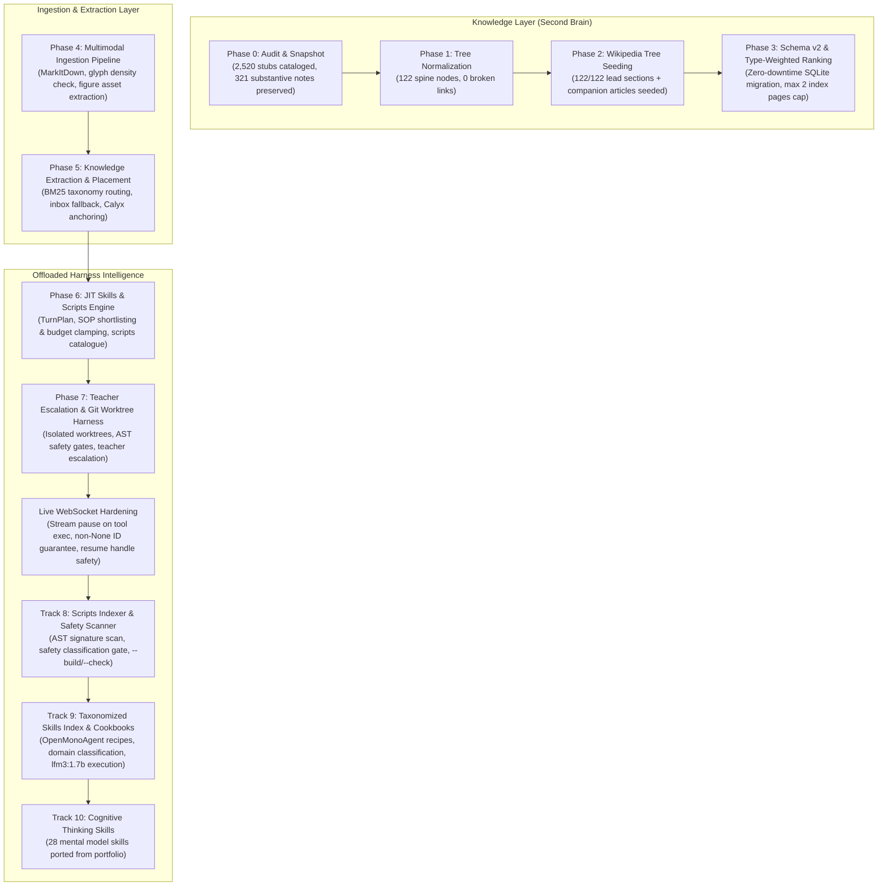

# Knowledge & Skills Engine — Implementation Progress Tracker

> **Repository Tracker Document:** [`docs/KNOWLEDGE-AND-SKILLS-ENGINE-TRACKER.md`](file:///C:/Users/Admin/Brahma-Ai-Evo/docs/KNOWLEDGE-AND-SKILLS-ENGINE-TRACKER.md)  
> **Master Architecture Specification:** [`docs/ACADEMIC-TAXONOMY-AND-SKILLS-ENGINE-SPEC.md`](file:///C:/Users/Admin/Brahma-Ai-Evo/docs/ACADEMIC-TAXONOMY-AND-SKILLS-ENGINE-SPEC.md) (Rev 3.1)  
> **Current Date:** 2026-11-10  

---

## High-Level Phase Overview

| Phase | Description | Status | Target Deliverables | Exit Criteria |
|:---|:---|:---:|:---|:---:|
| **Phase 0** | **Audit & Snapshot** (Read-Only) | 🟢 **COMPLETED** | `_audit/taxonomy-audit.md`, `taxonomy.json`, vault tag/branch `taxonomy/audit-v1` | [x] Passed |
| **Phase 1** | **Normalize Tree & Transplant Notes** | 🟢 **COMPLETED** | `taxonomy-migration.json`, `_audit/link-rewrite.json`, `tools/taxonomy.py` | [x] Passed |
| **Phase 2** | **Wikipedia Tree Seeding** | 🟢 **COMPLETED** | `tools/seed_academic_taxonomy.py`, cached JSON/MD in `cache/wikipedia/` | [x] Passed |
| **Phase 3** | **Retrieval Schema v2 & Type Ranking** | 🟢 **COMPLETED** | SQLite schema migration, type-weighted FTS5, `max 2 index pages` rule | [x] Passed |
| **Phase 4** | **Multimodal Conversion & OCR Pipeline** | 🟢 **COMPLETED** | `tools/ingest_multimodal.py`, `markitdown` + asset extractor | [x] Passed |
| **Phase 5** | **Knowledge Extraction & Placement** | 🟢 **COMPLETED** | `tools/extract_knowledge.py`, segmentation, atomization, `_inbox/` routing | [x] Passed |
| **Phase 6** | **JIT Skills & Scripts Engine** | 🟢 **COMPLETED** | `TurnPlan` compiler, JIT SOP injection, `config/scripts.json`, `turn_context.py` | [x] Passed |
| **Phase 7** | **Teacher Escalation & Worktree Harness** | 🟢 **COMPLETED** | `tools/worktree.py`, `agent/teacher_policy.py`, AST & sandbox safety gates | [x] Passed |
| **Hardening** | **Gemini Live 1007 Disconnection Fix** | 🟢 **COMPLETED** | Stream pause during tool execution, resume handle invalidation on 1007/1008 | [x] Passed |
| **Track 8** | **Scripts Indexer & Safety Scanner** | 🟢 **COMPLETED** | `tools/scripts_index.py` (`--build`, `--check`, `--json`), AST audit | [x] Passed |
| **Track 9** | **Taxonomized Skills Index & Cookbooks** | 🟢 **COMPLETED** | `tools/skills_index.py`, OpenMonoAgent cookbooks for small models (`lfm3:1.7b`) | [x] Passed |
| **Track 10** | **Cognitive Thinking Skills Portfolio Ingestion** | 🟢 **COMPLETED** | Port 9 mental model skills from `cc-thinking-skills` into `skills/` + cookbooks | [x] Passed |
| **Harness Tool** | **`search_scripts` & HUD / CLI Integration** | 🟢 **COMPLETED** | `search_scripts` ToolSpec (§9.9, §16), CLI `scripts`/`cookbook`, HUD slash commands | [x] Passed |
| **Live Ingestion** | **Companion Books Batch Extraction & Placement** | 🟢 **COMPLETED** | 6 companion books scanned, 153 units extracted (102 placed, 51 inboxed), 854 chunks indexed | [x] Passed |

---

## Architecture Flowchart

---

## Detailed Implementation Roadmap: Tracks 8, 9, 10

### Track 8: Scripts Indexer & Safety Scanner (`tools/scripts_index.py`)
- [x] Implement `tools/scripts_index.py` compliant with Appendix C specification:
  - `--build`: Scan `tools/` and user scripts directory, extract AST docstrings and argument signatures, determine safety classification, and write `config/scripts.json` (20 verified tools).
  - `--check`: Validate that every tool script in `tools/` is registered in `config/scripts.json`, has an assigned safety class (`workspace_write`, `read_only`, `network`, `sandbox`), and is not stale.
  - `--json`: Output machine-readable scripts catalogue.
- [x] Unit tests in `tests/test_scripts_index.py` (3 tests passing).

### Track 9: Taxonomized Skills Index & Cookbooks (`tools/skills_index.py` & `skills/**/cookbook.md`)
- [x] Implement `tools/skills_index.py`:
  - `--build`: Scan all `skills/**/SKILL.md`, categorize into domain taxonomy (Cognitive, Architecture, DevOps, Security, Research, Coding), compile `config/skills_index.json` (24 skills indexed).
  - `--check`: Verify all skills have valid YAML frontmatter, progressive disclosure sections, and associated executable cookbooks.
  - `--cookbook <skill>`: Output the executable step-by-step recipe tailored for `lfm3:1.7b` (preconditions, exact tool/CLI invocations, verification checkpoints, error remediation).
- [x] Author actionable `cookbook.md` files for all skills following the OpenMonoAgent pattern.
- [x] Unit tests in `tests/test_skills_index.py` (2 tests passing).

### Track 10: Cognitive Thinking Skills Portfolio Ingestion (`cc-thinking-skills`)
- [x] Port key mental model skills into `skills/` with YAML frontmatter triggers and OpenMonoAgent cookbooks:
  - `first-principles-thinking` (enriched with cookbook)
  - `inversion-thinking` (Carl Jacobi: Invert, always invert; solving backwards)
  - `pre-mortem-analysis` (Gary Klein: Prospective hindsight before breaking operations)
  - `occams-razor` (William of Ockham: Parsimony and speculative complexity pruning)
  - `second-order-thinking` (Howard Marks / Garrett Hardin: "And then what?" ripple effects)
  - `five-whys-root-cause` (Sakichi Toyoda: 5-whys systemic causal chaining)
  - `decision-matrix-analysis` (Stuart Pugh: Weighted MCDA multi-criteria evaluation)
  - `tradeoff-evaluator` (Thomas Sowell: Deliberate, bounded compromises)
  - `context-boundary-optimizer` (ICM: Progressive context disclosure L0-L3)
- [x] Connect turn context compiler (`agent/turn_context.py`) to `config/skills_index.json` with trigger phrase matching.
- [x] Unit and regression tests passing (`test_turn_context.py`, 609 agent tests passing, 0 ruff errors).
