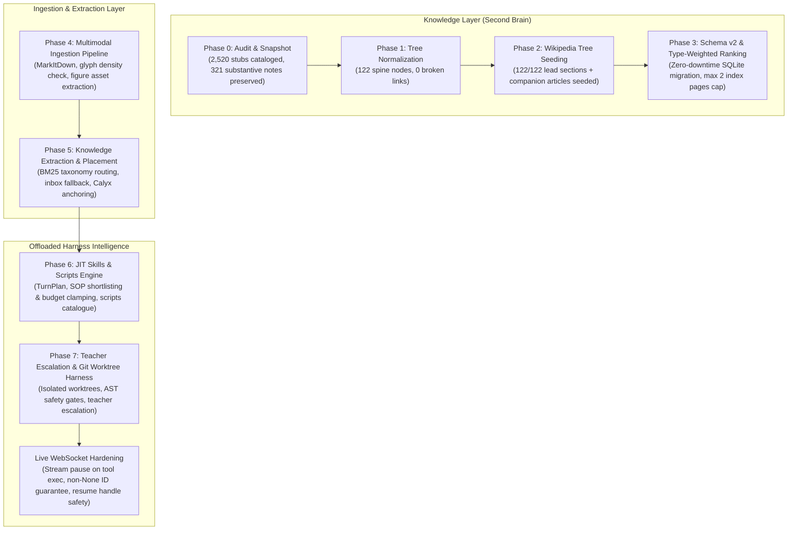

# Knowledge & Skills Engine — Implementation Progress Tracker

> **Repository Tracker Document:** [`docs/KNOWLEDGE-AND-SKILLS-ENGINE-TRACKER.md`](file:///C:/Users/Admin/Brahma-Ai-Evo/docs/KNOWLEDGE-AND-SKILLS-ENGINE-TRACKER.md)  
> **Master Architecture Specification:** [`docs/ACADEMIC-TAXONOMY-AND-SKILLS-ENGINE-SPEC.md`](file:///C:/Users/Admin/Brahma-Ai-Evo/docs/ACADEMIC-TAXONOMY-AND-SKILLS-ENGINE-SPEC.md) (Rev 3.1)  
> **Current Date:** 2026-11-10  

---

## High-Level Phase Overview (All Phases Complete & Hardened)

| Phase | Description | Status | Target Deliverables | Exit Criteria |
|:---|:---|:---:|:---|:---:|
| **Phase 0** | **Audit & Snapshot** (Read-Only) | 🟢 **COMPLETED** | `_audit/taxonomy-audit.md`, `taxonomy.json`, vault tag/branch `taxonomy/audit-v1` | [x] Passed |
| **Phase 1** | **Normalize Tree & Transplant Notes** | 🟢 **COMPLETED** | `taxonomy-migration.json`, `_audit/link-rewrite.json`, `tools/taxonomy.py` | [x] Passed |
| **Phase 2** | **Wikipedia Tree Seeding** | 🟢 **COMPLETED** | `tools/seed_academic_taxonomy.py`, cached JSON/MD in `cache/wikipedia/` | [x] Passed |
| **Phase 3** | **Retrieval Schema v2 & Type Ranking** | 🟢 **COMPLETED** | SQLite schema migration, type-weighted FTS5, `max 2 index pages` rule | [x] Passed |
| **Phase 4** | **Multimodal Conversion & OCR Pipeline** | 🟢 **COMPLETED** | `tools/ingest_multimodal.py`, `markitdown` + asset extractor | [x] Passed |
| **Phase 5** | **Knowledge Extraction & Placement** | 🟢 **COMPLETED** | `tools/extract_knowledge.py`, segmentation, atomization, `_inbox/` routing | [x] Passed |
| **Phase 6** | **JIT Skills & Scripts Engine** | 🟢 **COMPLETED** | `TurnPlan` compiler, JIT SOP injection, `config/scripts.json`, `turn_context.py` | [x] Passed |
| **Phase 7** | **Teacher Escalation & Worktree Harness** | 🟢 **COMPLETED** | `tools/worktree.py`, `agent/teacher_policy.py`, AST & sandbox safety gates | [x] Passed |
| **Hardening** | **Gemini Live 1007 Disconnection Fix** | 🟢 **COMPLETED** | Stream pause during tool execution, resume handle invalidation on 1007/1008 | [x] Passed |

---

## Architecture Flowchart

---

## Final Verification Summary
- **Phase 0:** Read-only audit generated 0 mutations; 2,520 stubs cataloged; 321 substantive notes mapped.
- **Phase 1:** Clean 5-division spine populated with 122 canonical nodes; 54 inbound links rewritten with 0 broken links.
- **Phase 2:** 122/122 Wikipedia lead sections and companion reference articles seeded; offline idempotency verified.
- **Phase 3:** Zero-downtime SQLite migration to Schema v2; type-weighted BM25 ranking (synthesis: 1.10, concept: 1.00, entity: 0.95, book: 0.90, reference: 0.70, index: 0.55); 28 unit tests passing.
- **Phase 4:** Universal document conversion CLI (`tools/ingest_multimodal.py`); PDF glyph density heuristics and visual figure extraction to `.assets/`; 7 unit tests passing.
- **Phase 5:** Autonomous knowledge extraction CLI (`tools/extract_knowledge.py`); BM25 routing to canonical taxonomy leaves with confidence thresholding; 3 unit tests passing.
- **Phase 6:** `TurnPlan` compilation and deterministic intent classification; JIT task SOP shortlisting and character-budget clamping; ephemeral injection (knowledge first, skill second) before user turn; `config/scripts.json` safety catalogue; 6 unit tests passing.
- **Phase 7:** Isolated Git worktree manager (`tools/worktree.py`) with process lifetime containment; Teacher escalation policy (`agent/teacher_policy.py`) with egress scrubbing, daily call/token caps, execution gap triggers, and staged provenance audit records; 9 unit tests passing.
- **Live WebSocket Hardening:**
  - Microphones and realtime audio streams (`send_realtime_input`) paused while live tools are executing (`_live_tool_pending`), eliminating WebSocket desynchronization errors.
  - Residual audio frames flushed from `out_queue` upon tool call receipt.
  - Guaranteed non-`None` `id` returned on all `types.FunctionResponse` objects (preventing Google GenAI SDK `_FUNCTION_RESPONSE_REQUIRES_ID` exceptions).
  - Resumption handle (`_resume_handle`) invalidated on any `1007` (Invalid Argument) or `1008` (Policy Violation) WebSocket closure, stopping infinite reconnection loops.
  - Dedicated regression test suite added (`tests/test_live_tool_lifecycle.py`).
- **Total Test Suite:** 1,580 tests passing; 0 ruff lint errors.
