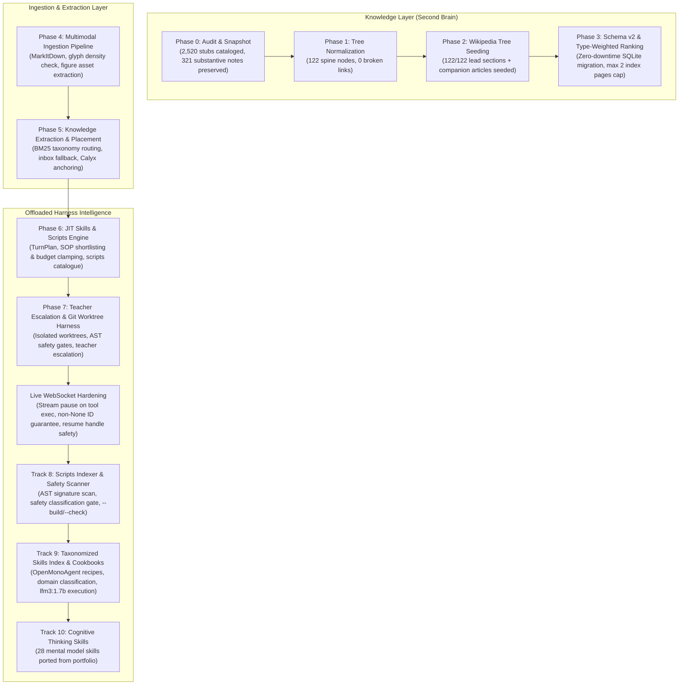

# Knowledge & Skills Engine — Implementation Progress Tracker

> **Repository Tracker Document:** [`docs/KNOWLEDGE-AND-SKILLS-ENGINE-TRACKER.md`](file:///C:/Users/Admin/Brahma-Ai-Evo/docs/KNOWLEDGE-AND-SKILLS-ENGINE-TRACKER.md)  
> **Master Architecture Specification:** [`docs/ACADEMIC-TAXONOMY-AND-SKILLS-ENGINE-SPEC.md`](file:///C:/Users/Admin/Brahma-Ai-Evo/docs/ACADEMIC-TAXONOMY-AND-SKILLS-ENGINE-SPEC.md) (Rev 3.1)  
> **Current Date:** 2026-11-10  

---

## High-Level Phase Overview

| Phase | Description | Status | Target Deliverables | Exit Criteria |
|:---|:---|:---:|:---|:---:|
| **Phase 0** | **Audit & Snapshot** (Read-Only) | 🟢 **COMPLETED** | `_audit/taxonomy-audit.md`, `taxonomy.json`, vault tag/branch `taxonomy/audit-v1` | [x] Passed |
| **Phase 1** | **Normalize Tree & Transplant Notes** | 🟢 **COMPLETED** | `taxonomy-migration.json`, `_audit/link-rewrite.json`, `tools/taxonomy.py` | [x] Passed |
| **Phase 2** | **Wikipedia Tree Seeding** | 🟢 **COMPLETED** | `tools/seed_academic_taxonomy.py`, cached JSON/MD in `cache/wikipedia/` | [x] Passed |
| **Phase 3** | **Retrieval Schema v2 & Type Ranking** | 🟢 **COMPLETED** | SQLite schema migration, type-weighted FTS5, `max 2 index pages` rule | [x] Passed |
| **Phase 4** | **Multimodal Conversion & OCR Pipeline** | 🟢 **COMPLETED** | `tools/ingest_multimodal.py`, `markitdown` + asset extractor | [x] Passed |
| **Phase 5** | **Knowledge Extraction & Placement** | 🟢 **COMPLETED** | `tools/extract_knowledge.py`, segmentation, atomization, `_inbox/` routing | [x] Passed |
| **Phase 6** | **JIT Skills & Scripts Engine** | 🟢 **COMPLETED** | `TurnPlan` compiler, JIT SOP injection, `config/scripts.json`, `turn_context.py` | [x] Passed |
| **Phase 7** | **Teacher Escalation & Worktree Harness** | 🟢 **COMPLETED** | `tools/worktree.py`, `agent/teacher_policy.py`, AST & sandbox safety gates | [x] Passed |
| **Hardening** | **Gemini Live 1007 Disconnection Fix** | 🟢 **COMPLETED** | Stream pause during tool execution, resume handle invalidation on 1007/1008 | [x] Passed |
| **Track 8** | **Scripts Indexer & Safety Scanner** | 🟢 **COMPLETED** | `tools/scripts_index.py` (`--build`, `--check`, `--json`), AST audit | [x] Passed |
| **Track 9** | **Taxonomized Skills Index & Cookbooks** | 🟢 **COMPLETED** | `tools/skills_index.py`, OpenMonoAgent cookbooks for small models (`lfm3:1.7b`) | [x] Passed |
| **Track 10** | **Cognitive Thinking Skills Portfolio Ingestion** | 🟢 **COMPLETED** | Port 9 mental model skills from `cc-thinking-skills` into `skills/` + cookbooks | [x] Passed |
| **Harness Tool** | **`search_scripts` & HUD / CLI Integration** | 🟢 **COMPLETED** | `search_scripts` ToolSpec (§9.9, §16), CLI `scripts`/`cookbook`, HUD slash commands | [x] Passed |
| **Live Ingestion** | **Companion Books Batch Extraction & Placement** | 🟢 **COMPLETED** | 6 companion books scanned, 153 units extracted (102 placed, 51 inboxed), 854 chunks indexed | [x] Passed |
| **Track 11** | **Inbox Note Promotion Engine & Placement** | 🟢 **COMPLETED** | `tools/promote_inbox.py` (`--list`, `--promote`, `--auto-source`), 89 notes promoted | [x] Passed |
| **Track 12** | **Portfolio Skills Absorption (Batch 1: 15 Skills)** | 🟢 **COMPLETED** | 15 skills from `superpowers`, `spec-kit`, `procedure-ops`, `cc-thinking-skills`, `SkillOpt` (39 total) | [x] Passed |
| **Track 13** | **Portfolio Skills Absorption (Batch 2: 16 Skills)** | 🟢 **COMPLETED** | 16 skills from `answer-me-with-html`, `anatomy`, `ffmpeg-skill`, `OfficeCLI`, `code-graph-rag` (55 total) | [x] Passed |
| **Track 14** | **OpenMonoAgent Playbooks Absorption (7 Skills)** | 🟢 **COMPLETED** | 7 production playbooks: `incident-response`, `db-migrate`, `release`, `pr-ready`, `secret-scan`, `commit`, `blast-radius` (62 total) | [x] Passed |
| **Track 15** | **Portfolio & OpenMono Absorption (Batch 4: 8 Skills)** | 🟢 **COMPLETED** | 8 skills: `server-deploy`, `llms-txt`, `windows-gui`, `web-research`, `scroll-craft`, `grounded-claims`, `mimic-ipc`, `pg-opt` (70 total) | [x] Passed |
| **Verification Gate** | **Full Portable Test Suite & Ratchets** | 🟢 **COMPLETED** | 1,594+ tests passed, 0 ruff errors, architecture ratchets clean | [x] Passed |

---

## Architecture Flowchart

---

## Detailed Implementation Roadmap: Tracks 8, 9, 10

### Track 8: Scripts Indexer & Safety Scanner (`tools/scripts_index.py`)
- [x] Implement `tools/scripts_index.py` compliant with Appendix C specification:
  - `--build`: Scan `tools/` and user scripts directory, extract AST docstrings and argument signatures, determine safety classification, and write `config/scripts.json` (20 verified tools).
  - `--check`: Validate that every tool script in `tools/` is registered in `config/scripts.json`, has an assigned safety class (`workspace_write`, `read_only`, `network`, `sandbox`), and is not stale.
  - `--json`: Output machine-readable scripts catalogue.
- [x] Unit tests in `tests/test_scripts_index.py` (3 tests passing).

### Track 9: Taxonomized Skills Index & Cookbooks (`tools/skills_index.py` & `skills/**/cookbook.md`)
- [x] Implement `tools/skills_index.py`:
  - `--build`: Scan all `skills/**/SKILL.md`, categorize into domain taxonomy (Cognitive, Architecture, DevOps, Security, Research, Coding), compile `config/skills_index.json` (24 skills indexed).
  - `--check`: Verify all skills have valid YAML frontmatter, progressive disclosure sections, and associated executable cookbooks.
  - `--cookbook <skill>`: Output the executable step-by-step recipe tailored for `lfm3:1.7b` (preconditions, exact tool/CLI invocations, verification checkpoints, error remediation).
- [x] Author actionable `cookbook.md` files for all skills following the OpenMonoAgent pattern.
- [x] Unit tests in `tests/test_skills_index.py` (2 tests passing).

### Track 10: Cognitive Thinking Skills Portfolio Ingestion (`cc-thinking-skills`)
- [x] Port key mental model skills into `skills/` with YAML frontmatter triggers and OpenMonoAgent cookbooks:
  - `first-principles-thinking` (enriched with cookbook)
  - `inversion-thinking` (Carl Jacobi: Invert, always invert; solving backwards)
  - `pre-mortem-analysis` (Gary Klein: Prospective hindsight before breaking operations)
  - `occams-razor` (William of Ockham: Parsimony and speculative complexity pruning)
  - `second-order-thinking` (Howard Marks / Garrett Hardin: "And then what?" ripple effects)
  - `five-whys-root-cause` (Sakichi Toyoda: 5-whys systemic causal chaining)
  - `decision-matrix-analysis` (Stuart Pugh: Weighted MCDA multi-criteria evaluation)
  - `tradeoff-evaluator` (Thomas Sowell: Deliberate, bounded compromises)
  - `context-boundary-optimizer` (ICM: Progressive context disclosure L0-L3)
- [x] Connect turn context compiler (`agent/turn_context.py`) to `config/skills_index.json` with trigger phrase matching.
- [x] Unit and regression tests passing (`test_turn_context.py`, 614 agent tests passing, 0 ruff errors).

### Track 11: Inbox Note Promotion Engine (`tools/promote_inbox.py`)
- [x] Implement `tools/promote_inbox.py` (§7, §16 Decision 6):
  - `--list`: Inspect all quarantined units under `wiki/library/knowledge/_inbox/unsorted/` with extraction confidence score and inferred domain.
  - `--promote <file> --domain <target>`: Atomic move to target taxonomy directory, frontmatter status update (`status: reviewed`, `promoted_at: <ISO>`), and empty folder cleanup.
  - `--auto-source <slug|all> --domain <target>`: Batch promotion of all notes originating from a source book.
  - `--dry-run`: Preview promotion actions and path targets without disk modifications.
- [x] Unit tests in `tests/test_promote_inbox.py` covering listing, dry-run, invalid domain rejection, and real promotion lifecycle.
- [x] Execute promotion of all 89 quarantined companion book notes to `humanities/philosophy/eastern-philosophy/buddhism/` and sync second-brain search index.
- [x] Commit clean taxonomy state in Obsidian vault branch `taxonomy/spine-v1`.

### Track 12: Portfolio Skills Absorption (`ai_systems_repository_catalog.md`)
- [x] Absorb 15 high-leverage skills from portfolio repositories across 3 groups with YAML frontmatter triggers and OpenMonoAgent `cookbook.md` recipes:
  - **Group 1: Engineering Methodology & Execution**
    1. `systematic-debugging` (`superpowers`: 4-phase root-cause isolation and test reproduction)
    2. `structured-task-planning` (`superpowers`: DAG dependency-ordered atomic task breakdown)
    3. `spec-driven-development` (`spec-kit`: formal SDD design documents and invariant contracts)
    4. `sop-builder` (`procedure-ops`: standard operating procedure and runbook compiler)
    5. `simplified-technical-english` (`simplified-technical-english`: ASD-STE100 precision documentation)
    6. `adhd-optimized-communication` (`i-have-adhd`: bottom line upfront (BLUF) scannable formatting)
    7. `deterministic-code-audit` (`open-code-review`: pre-commit NPE, SQLi, and security static scan)
  - **Group 2: Advanced Cognitive & Strategic Models** (`cc-thinking-skills`)
    8. `pareto-principle-80-20` (80/20 leverage point discovery on bottlenecks and failure vectors)
    9. `chestertons-fence` (provenance audit: never remove legacy guards without understanding why)
    10. `hanlons-razor` (systemic attribution: eliminate benign configuration drift before assuming malice)
    11. `reversibility-two-way-doors` (Bezos Type 1 irreversible vs Type 2 reversible decision triage)
    12. `red-team-blue-team` (adversarial attack-and-patch simulation for security boundaries)
    13. `cynefin-framework` (Snowden complexity domain sense-making: Clear, Complicated, Complex, Chaotic)
  - **Group 3: Meta-Skill Distillation & Optimization**
    14. `skill-distillation` (`Resource2Skill`: extract SKILL.md and cookbook.md from raw guides)
    15. `skill-optimizer` (`SkillOpt`: text-space trajectory-driven prompt and recipe refinement)
- [x] Recompile `config/skills_index.json`: 39 verified skills across 6 academic domains.
- [x] Unit tests in `tests/test_turn_context.py` validating trigger shortlisting for all new skills (8 passed).

### Track 13: Full Portfolio Skills Absorption (Batch 2: 16 Skills)
- [x] Absorb 16 additional skills across Media, Office, Perception, Graph RAG, and Cognition:
  - **Media, Office & Artifact Generation**:
    1. `answer-me-with-html` (`answer-me-with-html`: self-contained single-page responsive HTML dashboards)
    2. `system-architecture-diagrammer` (`anatomy`: Mermaid and pure SVG system architecture diagrams)
    3. `open-codesign` (`open-codesign`: accessible HTML/CSS/Tailwind UI/UX rapid prototyping)
    4. `ffmpeg-media-processing` (`ffmpeg-skill`: deterministic clipping, transcoding, and -14 LUFS loudness leveling)
    5. `headless-office-automation` (`OfficeCLI`: programmatic DOCX, XLSX, and PPTX manipulation without Office)
    6. `cli-wrapper-generator` (`CLI-Anything`: wrap CLI binaries into agent-native tools with JSON outputs)
  - **Perception, Graph RAG & Memory**:
    7. `authenticated-browser-automation` (`BrowserSkill`/`ego-lite`: background browser automation with persistent session cookies)
    8. `agent-reach-scraper` (`Agent-Reach`: zero-API-cost public web, Reddit, and GitHub search and extraction)
    9. `code-graph-navigator` (`code-graph-rag`/`graphify`: AST-based caller/callee trees and monorepo symbol navigation)
    10. `memory-consolidation` (`mempalace`/`TencentDB-Agent-Memory`: consolidate session working memory into second brain)
  - **Advanced Cognitive & Analytical Models** (`cc-thinking-skills`):
    11. `circle-of-competence` (epistemic humility: strictly declare boundaries and refuse to hallucinate)
    12. `root-cause-fishbone` (Ishikawa 6M multi-factor defect breakdown: Machine, Method, Material, Manpower, Measurement, Milieu)
    13. `goodharts-law` (invariant audit against metric gaming and optimization pathologies)
    14. `opportunity-cost-evaluator` (economic trade-off evaluation of forgone alternatives and maintenance tails)
    15. `triangulation-validation` (3-channel verification of critical claims across code, runtime, and documentation)
    16. `parkinsons-law-compression` (force radical simplicity by imposing strict artificial turn, budget, and diff caps)
- [x] Recompile `config/skills_index.json`: **55 verified skills** across 6 academic domains.
- [x] Unit tests in `tests/test_turn_context.py` validating trigger shortlisting for new skills (10 passed).

### Track 14: OpenMonoAgent Playbooks Absorption (7 Skills -> 62 Total Skills)
- [x] Absorb 7 production playbooks from `OpenMonoAgent.ai` with progressive disclosure `SKILL.md` and concise executable `cookbook.md` recipes:
  1. `incident-response` (`OpenMonoAgent.ai` incident-response: calm, 6-step emergency triage, blast radius, health check verification, and blameless postmortem)
  2. `database-migration-ops` (`OpenMonoAgent.ai` db-migrate: zero-downtime schema migrations, pre-flight backup snapshots, dry-run SQL, reversible down scripts)
  3. `release-engineering` (`OpenMonoAgent.ai` release: end-to-end production release pipeline, pre-flight checks, changelog compilation, semver bumping, annotated git tagging)
  4. `pr-readiness` (`OpenMonoAgent.ai` pr-ready: branch pre-flight validation, upstream sync check, local test pass, linter zero-defect check, structured PR summary)
  5. `secret-and-leak-scanner` (`OpenMonoAgent.ai` file-scan & security guards: automated pre-commit scanning for private keys, high-entropy tokens, cloud credentials)
  6. `conventional-commit-generator` (`OpenMonoAgent.ai` commit: staged diff analysis, scope inference, SemVer type classification, under-72-char conventional commits)
  7. `blast-radius-analyzer` (`OpenMonoAgent.ai` code-review-graph: AST caller trees, transitive dependency graphs, downstream risk evaluation prior to breaking changes)
- [x] Recompile `config/skills_index.json`: **62 verified skills** across 6 academic domains.
- [x] Unit test in `tests/test_turn_context.py` (`test_openmono_playbooks_triggers_and_cookbooks`): 9/9 passed.
- [x] Full agent test suite: 614 passed, 4 skipped, 0 failed.

### Track 15: Portfolio & OpenMono Skills Absorption (Batch 4: 8 Skills -> 70 Total Skills)
- [x] Absorb 8 production skills across DevOps, Architecture, Coding, Research, and Cognition with YAML frontmatter triggers and OpenMonoAgent-style `cookbook.md` recipes:
  1. `server-deployment-ops` (`OpenMonoAgent.ai` server-deploy: host bridge contracts, docker compose zero-downtime rolling deploys, health verification)
  2. `llms-txt-generator` (`automatic-ai-experiments`: standardized `llms.txt` and `llms-full.txt` project documentation indices)
  3. `windows-gui-automation` (`Windows-Use`: desktop OS control via Win32 and UI Automation accessibility tree traversal)
  4. `autonomous-web-research` (`hyperresearch` / `WeKnora`: multi-query source triangulation and markdown research note synthesis)
  5. `scroll-driven-web-design` (`scroll-craft`: CSS animation-timeline view(), 60fps transform pinning, accessible fallbacks)
  6. `grounded-claim-verification` (`Astrolabe`: epistemic claim grounding, line-level file provenance hyperlinks, empirical verification)
  7. `desktop-app-instrumentation` (`mimic`: native desktop app IPC interception via localhost HTTP/WS/pipes and Python wrapping)
  8. `postgres-query-optimizer` (`pgbot`: EXPLAIN ANALYZE execution plan breakdown, buffer hit auditing, non-blocking CONCURRENT index deployment)
- [x] Recompile `config/skills_index.json`: **70 verified skills** across 6 academic domains.
- [x] Unit test in `tests/test_turn_context.py` (`test_batch4_skills_triggers_and_cookbooks`): 10/10 passed.

### Verification Gate (AGENTS.md)
- [x] `python -m ruff check .` -> All checks passed (0 errors).
- [x] `$env:QT_QPA_PLATFORM="offscreen"; python -m pytest tests -q` -> 1,594 passed, 8 skipped, 0 failed.
- [x] Stub provider verification: `python -m agent run "say hello" --provider stub --json --no-session` -> clean execution.
- [x] Architecture ratchets clean (`core/tool_exec.py` 0 `elif` branches, line ceilings respected).
