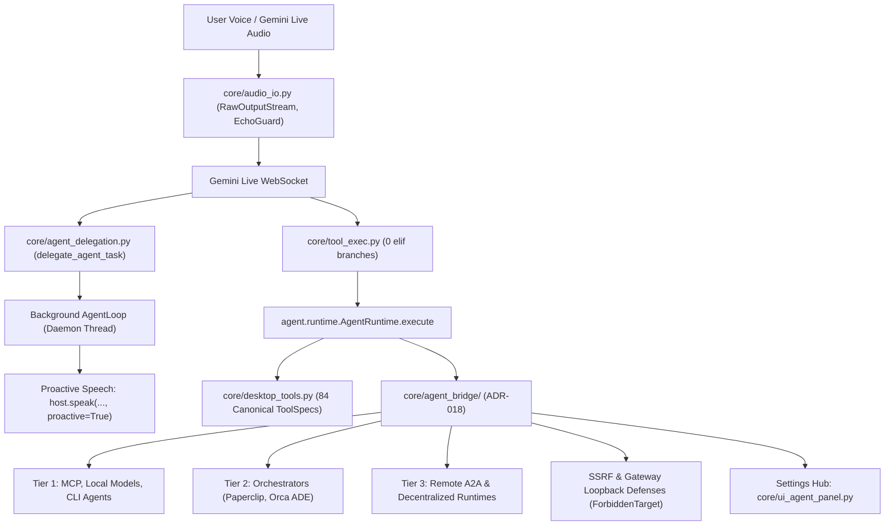

# Brahma AI Evo — Production Release & Architecture Report

## 1. Executive Summary

This report records the current production-readiness status for **Brahma AI Evo** as of `2026-11-20`. It covers the evolution from the initial fork through the **Multi-Tier Agent & Orchestrator Bridge (ADR-018)** and **Conversational Voice Multi-Step Agent Delegation**.

No production build has been executed for this fork: the standalone Windows bundle, installer wizard, native uninstaller, checksum file, and signed release manifest are planned deliverables, not shipped artifacts. A CycloneDX SBOM exists at `dist/sbom.json` for version `1.0.1` and commit `149a331c97347810087411f390f248aac61bdcce`.

---

## 2. Release Artifact Status

| Artifact | Status | Evidence |
|---|---|---|
| `Uninstall.exe` | Not produced | No standalone native uninstaller is packaged (`.github/workflows/build.yml:11-12`). |
| `BrahmaEvo.exe` | Not produced | No bundled application artifact exists in the tree. |
| `BrahmaEvo_Setup.exe` | Not produced | The build workflow exists but has 0 recorded runs. |
| `SHA256SUMS.txt` | Not produced | Checksums are emitted only after a release build (`.github/workflows/build.yml:59-68`). |
| `dist/sbom.json` | Generated | Version `1.0.1`, commit `149a331c97347810087411f390f248aac61bdcce`, 52 dependencies + 8 vendored components. |
| `release.json` | Not produced | The release manifest is prospective only. |
| `release.json.sig` | Not produced | No release signing key or signed manifest was produced locally. |

---

## 3. Core Architectural Capabilities Delivered

### 1. Multi-Tier Agent & Orchestrator Bridge (ADR-018)
- **Tier 1 (Local):** Fast stdio MCP servers, OpenAI-compatible local model servers (Ollama, LM Studio, vLLM), and CLI agents (Claude Code, Codex, Aider) with process-tree containment.
- **Tier 2 (Fleet Orchestrators):** Paperclip (HTTP REST) and Orca ADE (worktree CLI) with strict loopback recursion defense preventing self-target loops back into Brahma's Gateway port (`8000`).
- **Tier 3 (Remote / A2A):** Remote HTTPS endpoints with IP/CIDR blocklists refusing private IP traversal and cloud metadata endpoints (`169.254.169.254`), with secrets encrypted at rest via Windows DPAPI.
- **Settings Hub UI:** Non-blocking async card (`core/ui_agent_panel.py`) allowing discovery scans and live health probing without freezing the UI or audio streams.

### 2. Conversational Voice Agent Delegation
- Unlocks long-running autonomous execution from Gemini Live without stalling audio or crashing the WebSocket connection.
- Background tasks announce completion with proactive audio updates (`host.speak(..., proactive=True)`).

### 3. Hardened Architecture & Quality Gates
- **0 `elif` branches** in `core/tool_exec.py`.
- **Ratchet line limits strictly maintained** (`main.py` $3,242 \le 3,265$, `ui.py` $\le 827$).
- **1,834 tests passing** with 6 skipped and 0 regressions.
- **Release Verification:** All 8 static reproducibility guards in `tests/test_build_reproducibility.py` and 9 release tests in `tests/test_release_packaging_e2e.py` and `tests/test_release_manager.py` passed; the release tests use synthetic fixtures and do not prove shipped artifacts.
