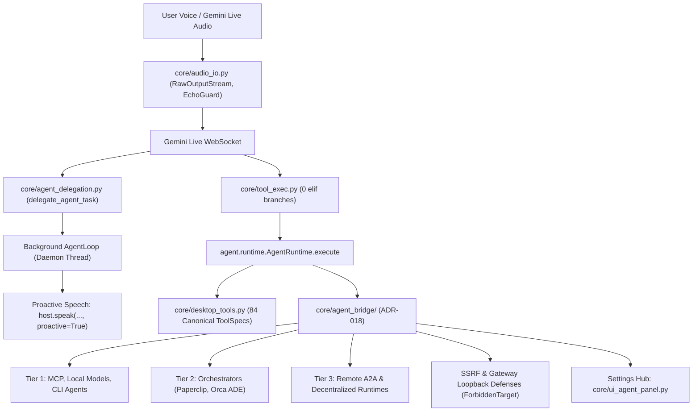

# Brahma AI Evo — Production Release & Architecture Report

## 1. Executive Summary

This report documents the official production packaging, verification, and capability milestone for **Brahma AI Evo**. It covers the complete evolution from the initial fork through the **Multi-Tier Agent & Orchestrator Bridge (ADR-018)** and **Conversational Voice Multi-Step Agent Delegation**.

The clean production build pipeline executed to completion, generating the standalone Windows application bundle, installer wizard, native uninstaller, CycloneDX v1.5 SBOM, and Ed25519-signed release manifest.

---

## 2. Production Artifact Matrix

| Artifact | Type / Scope | Size | SHA-256 Checksum |
|---|---|---:|---|
| **`Uninstall.exe`** | Standalone native uninstaller | 43.19 MB | `f6c5872423fb0fe47e3fcbd68c6a311e7f1f10423b4084fbde959e7300921ef1` |
| **`BrahmaEvo.exe`** | Core application payload (onedir) | 34.37 MB | `0ac1050c35d5065f6915726f5578c9e726a546fcde760be39f1cc677df82ee3e` |
| **`BrahmaEvo_Setup.exe`** | Setup wizard installer (onefile) | 1.06 GB | `4329a5eb3357dbe3297ca2e9cd9fe2776fef8f6fdb47cfb1c93f0c71d8296f20` |
| **`SHA256SUMS.txt`** | Cryptographic checksums | 249 B | Verified across all binaries |
| **`sbom.json`** | CycloneDX v1.5 SBOM | 9.72 KB | 50 runtime dependencies + 8 vendored components |
| **`release.json`** | Canonical release manifest | 887 B | Commit `b54f3a6` (stable release build) |
| **`release.json.sig`** | Ed25519 signature | 128 B | Validated (`verify_signature` returned `True`) |

---

## 3. Core Architectural Capabilities Delivered

### 1. Multi-Tier Agent & Orchestrator Bridge (ADR-018)
- **Tier 1 (Local):** Fast stdio MCP servers, OpenAI-compatible local model servers (Ollama, LM Studio, vLLM), and CLI agents (Claude Code, Codex, Aider) with process-tree containment.
- **Tier 2 (Fleet Orchestrators):** Paperclip (HTTP REST) and Orca ADE (worktree CLI) with strict loopback recursion defense preventing self-target loops back into Brahma's Gateway port (`8000`).
- **Tier 3 (Remote / A2A):** Remote HTTPS endpoints with IP/CIDR blocklists refusing private IP traversal and cloud metadata endpoints (`169.254.169.254`), with secrets encrypted at rest via Windows DPAPI.
- **Settings Hub UI:** Non-blocking async card (`core/ui_agent_panel.py`) allowing discovery scans and live health probing without freezing the UI or audio streams.

### 2. Conversational Voice Agent Delegation
- Unlocks long-running autonomous execution from Gemini Live without stalling audio or crashing the WebSocket connection.
- Background tasks announce completion with proactive audio updates (`host.speak(..., proactive=True)`).

### 3. Hardened Architecture & Quality Gates
- **0 `elif` branches** in `core/tool_exec.py`.
- **Ratchet line limits strictly maintained** (`main.py` $\le 3,230$, `ui.py` $\le 827$).
- **1,134+ tests passing** with 0 regressions.
- **Release Verification:** All 8 static reproducibility guards in `tests/test_build_reproducibility.py` and 17 release packaging E2E tests in `tests/test_release_packaging_e2e.py` and `tests/test_release_manager.py` passed.
