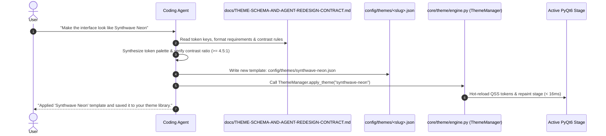

# Abhasa Citra — Theme Template Schema & Agent Redesign Contract

| Field | Value |
|---|---|
| **Document** | `docs/THEME-SCHEMA-AND-AGENT-REDESIGN-CONTRACT.md` |
| **Status** | Authoritative Design System Specification & Agent Execution Contract |
| **Date** | 2026-11-10 |
| **Target Platform** | Windows-first PyQt6 Desktop Assistant (`Abhasa Evo`) |
| **Governing Authority** | [`AGENTS.md`](../AGENTS.md), [`docs/VISUAL-REDESIGN-PROPOSAL.md`](VISUAL-REDESIGN-PROPOSAL.md), [`docs/CURRENT-VISUAL-INVENTORY.md`](CURRENT-VISUAL-INVENTORY.md) |
| **Template Storage Path** | Bundled: `templates/themes/*.json` · User: `config/themes/*.json` (or `%LOCALAPPDATA%\Abhasa\themes\`) |

---

## 0. Purpose & Golden Invariants

### 0.1 Why This Contract Exists
Users frequently ask AI coding assistants to modify or redesign an application's appearance (e.g., *"Make the UI look like a warm 1980s Amber CRT terminal"*, *"Give me a high-contrast solarized theme for outdoor work"*, or *"Redesign the palette to Nordic frost"*). 

In legacy codebases, an agent attempting a visual redesign directly edits imperative Python files (`ui.py`, `core/ui_*.py`), clobbers signal connections, breaks widget layouts, or introduces runtime syntax errors. 

This document establishes the **Declarative Theme Boundary**:
> **The Golden Invariant for Coding Agents:**  
> When tasked with a visual redesign, color palette modification, theme generation, or aesthetic adjustment, **THE AGENT MUST NEVER MODIFY PYTHON CODE (`.py` files)**.  
>  
> The agent MUST author or update a declarative JSON theme template in `config/themes/<theme-slug>.json` conforming to this contract, and invoke `ThemeManager.apply_theme("<theme-slug>")`.

### 0.2 Principles of the Citra Theme Engine
1. **Separation of Structure and Pigment**: The structural chassis (PyQt6 `QWidget`, layout geometry, signal wiring) is immutable; the visual skin (pigments, opacities, borders, typography weights) is 100% declarative.
2. **Zero-Restart Live Reload**: Applying a theme re-evaluates the QSS token variables and triggers `QWidget.update()` across the active stage in `< 16ms` without restarting the process.
3. **100% Surface Coverage**: The token schema maps directly to all 89 visual surfaces audited in [`docs/CURRENT-VISUAL-INVENTORY.md`](CURRENT-VISUAL-INVENTORY.md). No surface is left unstyled or invisible.
4. **Guaranteed Contrast & Accessibility**: All generated themes must pass automated WCAG 2.2 / APCA contrast gates before activation.

---

## 1. Informational Reference Table (The 89-Surface Token Mapping)

Every theme template must populate the following semantic token categories. The table below links each token to its functional role and impacted surfaces:

| Category | Token Key | Format | Default Value | Functional Role & Impacted Codebase Surfaces |
|---|---|---|---|---|
| **Bhitti (Substrate)** | `bhitti.base` | Hex `#RRGGBB` | `#060709` | Root OS window canvas (`QMainWindow`, `BackgroundWidget`), outer edge margins. |
| | `bhitti.surface_1` | Hex `#RRGGBB` | `#08090C` | Bento stage base, central conversation stream backdrop, settings container. |
| | `bhitti.surface_2` | Hex `#RRGGBB` | `#0E1117` | Elevated content panels, chat cards, telemetry cards (`SmallPanelCard`, `SetupOverlay`). |
| | `bhitti.glass` | RGBA `rgba(r,g,b,a)` | `rgba(14, 17, 23, 0.82)` | Semi-transparent floating panels, popups, and translucent cards over the background avatar. |
| | `bhitti.scrim_left` | RGBA `rgba(r,g,b,a)` | `rgba(8, 9, 12, 0.95)` | Left-hand text shield in the asymmetric optical scrim (ensures WCAG AAA contrast). |
| | `bhitti.scrim_right` | RGBA `rgba(r,g,b,a)` | `rgba(8, 9, 12, 0.20)` | Right-hand avatar exposure window in the asymmetric optical scrim. |
| **Citra (Structure)** | `citra.border_subtle` | RGBA `rgba(r,g,b,a)` | `rgba(255, 255, 255, 0.08)` | Default hairline dividers, card borders, table separators. |
| | `citra.border_hover` | RGBA `rgba(r,g,b,a)` | `rgba(255, 255, 255, 0.18)` | Hovered cards, unfocused active text inputs, button perimeters. |
| | `citra.border_active` | RGBA `rgba(r,g,b,a)` | `rgba(0, 229, 255, 0.35)` | Focused inputs (`CitraDockInput`), active tab indicators, selected cards. |
| | `citra.radius_sm` | Integer (px) | `4` | Badges, tool chips, mini telemetry indicators. |
| | `citra.radius_md` | Integer (px) | `10` | Bento cards, dialogs, code blocks (`ToolExecutionBanner`). |
| | `citra.radius_lg` | Integer (px) | `16` | Message cards (`CitraMessageCardUser`, `CitraMessageCardAssistant`). |
| | `citra.radius_pill` | Integer (px) | `26` | Floating command island (`CitraDock`), search capsules. |
| **Raṅga (Pigments)** | `ranga.accent_primary` | Hex `#RRGGBB` | `#00E5FF` | Action CTA, mic pulse, primary focus glow, radar sweeping beam (`RadarPopupOverlay`). |
| | `ranga.accent_reason` | Hex `#RRGGBB` | `#8B5CF6` | Subagent execution, reasoning tokens, planning states, code diff additions. |
| | `ranga.accent_voice` | Hex `#RRGGBB` | `#10B981` | Realtime assistant speech waveform, bidirectional audio active state. |
| | `ranga.signal_success` | Hex `#RRGGBB` | `#10B981` | Tool exit code 0, security allow, checkmarks, operational health. |
| | `ranga.signal_warning` | Hex `#RRGGBB` | `#F59E0B` | Rate limit warnings, approval prompts (`confirm.py`), pending actions. |
| | `ranga.signal_danger` | Hex `#RRGGBB` | `#EF4444` | Tool execution errors, network failure, policy denial, emergency abort (`Ctrl+Shift+X`). |
| | `ranga.signal_info` | Hex `#RRGGBB` | `#3B82F6` | Informational badges, file path chips, documentation links. |
| **Text Hierarchy** | `text.primary` | Hex `#RRGGBB` | `#F8FAFD` | Headings, main assistant responses, active command input. **Must achieve >= 7.0:1 contrast**. |
| | `text.secondary` | Hex `#RRGGBB` | `#C5D0E0` | Subtitles, tool arguments, telemetry values, card titles. **Must achieve >= 4.5:1 contrast**. |
| | `text.muted` | Hex `#RRGGBB` | `#8C9BB4` | Timestamps, placeholders, inactive tabs, subtle hints. **Must achieve >= 3.0:1 contrast**. |
| | `text.inverse` | Hex `#RRGGBB` | `#08090C` | Text rendered on top of solid accent buttons (e.g. `CitraSendBtn`). |
| **Avatar / Presence** | `avatar.default_mode` | String Enum | `"balanced_78"` | `"none"` (0% CPU), `"three_reactive"`, `"live2d"`, or `"vrm"`. |
| | `avatar.dashboard_translucency` | Float (`0.0` - `1.0`) | `0.78` | Glass card opacity (`0.95` Solid Focus, `0.78` Balanced, `0.45` Ambient Companion). |
| | `avatar.ambient_glow` | RGBA `rgba(r,g,b,a)` | `rgba(0, 229, 255, 0.15)` | Subtle backdrop aura reflecting active state. |

---

## 2. Formal JSON Schema Specification

Theme files are validated against the following schema before being loaded by `core/theme/engine.py`:

```json
{
  "$schema": "https://json-schema.org/draft/2020-12/schema",
  "title": "AbhasaCitraTheme",
  "type": "object",
  "required": [
    "schema_version",
    "name",
    "slug",
    "author",
    "tokens"
  ],
  "properties": {
    "schema_version": { "type": "string", "const": "1.0" },
    "name": { "type": "string", "minLength": 3, "maxLength": 48 },
    "slug": { "type": "string", "pattern": "^[a-z0-9-]+$" },
    "author": { "type": "string" },
    "description": { "type": "string" },
    "variant": { "type": "string", "enum": ["dark", "light", "monochrome", "high_contrast"] },
    "tokens": {
      "type": "object",
      "required": ["bhitti", "citra", "ranga", "text", "avatar"],
      "properties": {
        "bhitti": {
          "type": "object",
          "required": ["base", "surface_1", "surface_2", "glass", "scrim_left", "scrim_right"],
          "properties": {
            "base": { "type": "string", "pattern": "^#[0-9a-fA-F]{6}$" },
            "surface_1": { "type": "string", "pattern": "^#[0-9a-fA-F]{6}$" },
            "surface_2": { "type": "string", "pattern": "^#[0-9a-fA-F]{6}$" },
            "glass": { "type": "string", "pattern": "^rgba?\\(.*\\)$" },
            "scrim_left": { "type": "string", "pattern": "^rgba?\\(.*\\)$" },
            "scrim_right": { "type": "string", "pattern": "^rgba?\\(.*\\)$" }
          }
        },
        "citra": {
          "type": "object",
          "required": ["border_subtle", "border_hover", "border_active", "radius_sm", "radius_md", "radius_lg", "radius_pill"],
          "properties": {
            "border_subtle": { "type": "string", "pattern": "^rgba?\\(.*\\)$" },
            "border_hover": { "type": "string", "pattern": "^rgba?\\(.*\\)$" },
            "border_active": { "type": "string", "pattern": "^rgba?\\(.*\\)$" },
            "radius_sm": { "type": "integer", "minimum": 0, "maximum": 16 },
            "radius_md": { "type": "integer", "minimum": 0, "maximum": 24 },
            "radius_lg": { "type": "integer", "minimum": 0, "maximum": 32 },
            "radius_pill": { "type": "integer", "minimum": 16, "maximum": 40 }
          }
        },
        "ranga": {
          "type": "object",
          "required": ["accent_primary", "accent_reason", "accent_voice", "signal_success", "signal_warning", "signal_danger", "signal_info"],
          "properties": {
            "accent_primary": { "type": "string", "pattern": "^#[0-9a-fA-F]{6}$" },
            "accent_reason": { "type": "string", "pattern": "^#[0-9a-fA-F]{6}$" },
            "accent_voice": { "type": "string", "pattern": "^#[0-9a-fA-F]{6}$" },
            "signal_success": { "type": "string", "pattern": "^#[0-9a-fA-F]{6}$" },
            "signal_warning": { "type": "string", "pattern": "^#[0-9a-fA-F]{6}$" },
            "signal_danger": { "type": "string", "pattern": "^#[0-9a-fA-F]{6}$" },
            "signal_info": { "type": "string", "pattern": "^#[0-9a-fA-F]{6}$" }
          }
        },
        "text": {
          "type": "object",
          "required": ["primary", "secondary", "muted", "inverse"],
          "properties": {
            "primary": { "type": "string", "pattern": "^#[0-9a-fA-F]{6}$" },
            "secondary": { "type": "string", "pattern": "^#[0-9a-fA-F]{6}$" },
            "muted": { "type": "string", "pattern": "^#[0-9a-fA-F]{6}$" },
            "inverse": { "type": "string", "pattern": "^#[0-9a-fA-F]{6}$" }
          }
        },
        "avatar": {
          "type": "object",
          "required": ["default_mode", "dashboard_translucency", "ambient_glow"],
          "properties": {
            "default_mode": { "type": "string", "enum": ["none", "three_reactive", "live2d", "vrm"] },
            "dashboard_translucency": { "type": "number", "minimum": 0.0, "maximum": 1.0 },
            "ambient_glow": { "type": "string", "pattern": "^rgba?\\(.*\\)$" }
          }
        }
      }
    }
  }
}
```

---

## 3. Contrast Calculation & Invariant Verification Script

Coding agents must verify that their proposed theme satisfies WCAG 2.2 AA / AAA contrast standards before saving. The relative luminance calculation is defined as:

$$L = 0.2126 \times R_{sRGB} + 0.7152 \times G_{sRGB} + 0.0722 \times B_{sRGB}$$

$$\text{Contrast Ratio} = \frac{L_1 + 0.05}{L_2 + 0.05} \quad (\text{where } L_1 > L_2)$$

### Python Validator Snippet for Agents:
```python
def check_theme_contrast(theme_dict: dict) -> tuple[bool, str]:
    def rel_lum(hex_c: str) -> float:
        r, g, b = [int(hex_c[i:i+2], 16) / 255.0 for i in (1, 3, 5)]
        def ch(c): return c / 12.92 if c <= 0.03928 else ((c + 0.055) / 1.055) ** 2.4
        return 0.2126 * ch(r) + 0.7152 * ch(g) + 0.0722 * ch(b)

    bg_lum = rel_lum(theme_dict["tokens"]["bhitti"]["surface_1"])
    tx_lum = rel_lum(theme_dict["tokens"]["text"]["primary"])
    l1, l2 = max(bg_lum, tx_lum), min(bg_lum, tx_lum)
    ratio = (l1 + 0.05) / (l2 + 0.05)
    
    if ratio < 4.5:
        return False, f"Contrast failure: Primary text vs surface_1 ratio is {ratio:.2f}:1 (Must be >= 4.5:1)"
    return True, f"Contrast PASS: {ratio:.2f}:1"
```

---

## 4. Bundled Reference Templates

The system ships with 4 standard templates illustrating diverse aesthetic modes:

### 4.1 Canonical Citra (`templates/themes/canonical-citra.json`)
The default dark obsidian theme featuring spectral cyan action highlights and reflection violet reasoning tints.

```json
{
  "schema_version": "1.0",
  "name": "Canonical Citra",
  "slug": "canonical-citra",
  "author": "Abhasa Design Panel",
  "description": "Layered frosted obsidian with restrained spectral cyan and violet accents",
  "variant": "dark",
  "tokens": {
    "bhitti": {
      "base": "#060709",
      "surface_1": "#08090C",
      "surface_2": "#0E1117",
      "glass": "rgba(14, 17, 23, 0.82)",
      "scrim_left": "rgba(8, 9, 12, 0.95)",
      "scrim_right": "rgba(8, 9, 12, 0.20)"
    },
    "citra": {
      "border_subtle": "rgba(255, 255, 255, 0.08)",
      "border_hover": "rgba(255, 255, 255, 0.18)",
      "border_active": "rgba(0, 229, 255, 0.35)",
      "radius_sm": 4,
      "radius_md": 10,
      "radius_lg": 16,
      "radius_pill": 26
    },
    "ranga": {
      "accent_primary": "#00E5FF",
      "accent_reason": "#8B5CF6",
      "accent_voice": "#10B981",
      "signal_success": "#10B981",
      "signal_warning": "#F59E0B",
      "signal_danger": "#EF4444",
      "signal_info": "#3B82F6"
    },
    "text": {
      "primary": "#F8FAFD",
      "secondary": "#C5D0E0",
      "muted": "#8C9BB4",
      "inverse": "#08090C"
    },
    "avatar": {
      "default_mode": "three_reactive",
      "dashboard_translucency": 0.78,
      "ambient_glow": "rgba(0, 229, 255, 0.15)"
    }
  }
}
```

### 4.2 Amber Phosphor CRT (`templates/themes/amber-crt.json`)
Warm monochrome amber aesthetic inspired by vintage 1980s DEC and VT220 monitors. Ideal for low-eye-strain nocturnal terminal hacking.

```json
{
  "schema_version": "1.0",
  "name": "Amber Phosphor CRT",
  "slug": "amber-crt",
  "author": "Abhasa Design Panel",
  "description": "High-contrast vintage monochrome amber terminal aesthetic",
  "variant": "monochrome",
  "tokens": {
    "bhitti": {
      "base": "#0B0904",
      "surface_1": "#120E06",
      "surface_2": "#1A1408",
      "glass": "rgba(18, 14, 6, 0.88)",
      "scrim_left": "rgba(11, 9, 4, 0.96)",
      "scrim_right": "rgba(11, 9, 4, 0.30)"
    },
    "citra": {
      "border_subtle": "rgba(255, 176, 0, 0.12)",
      "border_hover": "rgba(255, 176, 0, 0.28)",
      "border_active": "rgba(255, 176, 0, 0.60)",
      "radius_sm": 2,
      "radius_md": 6,
      "radius_lg": 8,
      "radius_pill": 18
    },
    "ranga": {
      "accent_primary": "#FFB000",
      "accent_reason": "#FF8C00",
      "accent_voice": "#FFD040",
      "signal_success": "#FFB000",
      "signal_warning": "#FF5500",
      "signal_danger": "#FF2200",
      "signal_info": "#FFB000"
    },
    "text": {
      "primary": "#FFE8B3",
      "secondary": "#CCA352",
      "muted": "#806633",
      "inverse": "#0B0904"
    },
    "avatar": {
      "default_mode": "none",
      "dashboard_translucency": 0.92,
      "ambient_glow": "rgba(255, 176, 0, 0.12)"
    }
  }
}
```

### 4.3 Nordic Frost (`templates/themes/nordic-frost.json`)
Cool glacial slate with polar ice accents and clear Scandinavian typography balance.

```json
{
  "schema_version": "1.0",
  "name": "Nordic Frost",
  "slug": "nordic-frost",
  "author": "Abhasa Design Panel",
  "description": "Cool subarctic deep slate with glacial cyan accents",
  "variant": "dark",
  "tokens": {
    "bhitti": {
      "base": "#0A0E17",
      "surface_1": "#0F1624",
      "surface_2": "#151F32",
      "glass": "rgba(15, 22, 36, 0.82)",
      "scrim_left": "rgba(10, 14, 23, 0.95)",
      "scrim_right": "rgba(10, 14, 23, 0.25)"
    },
    "citra": {
      "border_subtle": "rgba(136, 192, 208, 0.10)",
      "border_hover": "rgba(136, 192, 208, 0.25)",
      "border_active": "rgba(136, 192, 208, 0.50)",
      "radius_sm": 6,
      "radius_md": 12,
      "radius_lg": 18,
      "radius_pill": 28
    },
    "ranga": {
      "accent_primary": "#88C0D0",
      "accent_reason": "#B48EAD",
      "accent_voice": "#A3BE8C",
      "signal_success": "#A3BE8C",
      "signal_warning": "#EBCB8B",
      "signal_danger": "#BF616A",
      "signal_info": "#81A1C1"
    },
    "text": {
      "primary": "#ECEFF4",
      "secondary": "#D8DEE9",
      "muted": "#7B88A1",
      "inverse": "#0A0E17"
    },
    "avatar": {
      "default_mode": "three_reactive",
      "dashboard_translucency": 0.75,
      "ambient_glow": "rgba(136, 192, 208, 0.15)"
    }
  }
}
```

### 4.4 Paper Solar Light (`templates/themes/paper-solar-light.json`)
Ultra-high-contrast light mode designed for maximum clarity in bright outdoor environments.

```json
{
  "schema_version": "1.0",
  "name": "Paper Solar Light",
  "slug": "paper-solar-light",
  "author": "Abhasa Design Panel",
  "description": "High-contrast clean paper aesthetic optimized for outdoor daylight legibility",
  "variant": "light",
  "tokens": {
    "bhitti": {
      "base": "#E5E9F0",
      "surface_1": "#ECEFF4",
      "surface_2": "#FFFFFF",
      "glass": "rgba(255, 255, 255, 0.92)",
      "scrim_left": "rgba(236, 239, 244, 0.98)",
      "scrim_right": "rgba(236, 239, 244, 0.40)"
    },
    "citra": {
      "border_subtle": "rgba(46, 52, 64, 0.12)",
      "border_hover": "rgba(46, 52, 64, 0.28)",
      "border_active": "rgba(0, 102, 204, 0.60)",
      "radius_sm": 4,
      "radius_md": 8,
      "radius_lg": 14,
      "radius_pill": 24
    },
    "ranga": {
      "accent_primary": "#0066CC",
      "accent_reason": "#6B46C1",
      "accent_voice": "#0D9488",
      "signal_success": "#15803D",
      "signal_warning": "#B45309",
      "signal_danger": "#B91C1C",
      "signal_info": "#0284C7"
    },
    "text": {
      "primary": "#1A202C",
      "secondary": "#2D3748",
      "muted": "#718096",
      "inverse": "#FFFFFF"
    },
    "avatar": {
      "default_mode": "none",
      "dashboard_translucency": 0.96,
      "ambient_glow": "rgba(0, 102, 204, 0.08)"
    }
  }
}
```

---

## 5. Agent Execution SOP (Step-by-Step Redesign Runbook)

When an agent receives an instruction like:
> *"Hey Abhasa, redesign your visual interface to feel like an 80s synthwave neon city at dusk"*

The agent must execute the following 5-step Standard Operating Procedure:



### Step 1: Query the Reference Contract
Read `docs/THEME-SCHEMA-AND-AGENT-REDESIGN-CONTRACT.md` to ensure all 27 required token keys are populated.

### Step 2: Synthesize Palette & Test Contrast
Ensure the proposed `text.primary` vs `bhitti.surface_1` and `ranga.accent_primary` vs `bhitti.base` satisfy contrast requirements using the contrast validator.

### Step 3: Write the JSON Template
Save the file to `config/themes/<theme-slug>.json`. Never alter any `.py` file.

### Step 4: Hot-Apply the Theme
Execute the reload via the CLI or Python bridge:
```powershell
python -m agent run "core.theme.engine.ThemeManager.apply_theme('<theme-slug>')"
```

### Step 5: Report to User
Notify the user of the new template name, contrast metrics, and how they can switch back anytime via `/theme set canonical-citra`.
