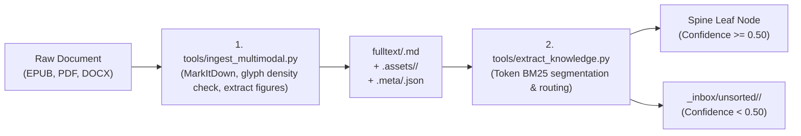

# Brahma AI — Second Brain, Calyx Grounding & Skills Setup Guide

> **Document Status:** Official Deployment & User Onboarding Guide  
> **Applicable Version:** Brahma AI v0.2+  
> **Protocols:** Open Knowledge Framework (OKF v0.2) & Interpretable Context Methodology (ICM)  

---

## 1. Architectural Philosophy: Offloaded Harness Intelligence

Brahma AI is engineered around a core architectural invariant: **offload the intelligence onto the harness and filesystem architecture, so that a compact local function-calling model (such as `lfm3:1.7b` or `qwen2.5-coder:1.5b`) can operate with the depth and reliability of frontier models.**

Instead of forcing a compact model to rely on an ephemeral prompt or hallucinated recall:
1. **The Second Brain (`wiki/library/knowledge/`)** provides a persistent, taxonomized academic world model.
2. **The Turn Context Compiler (`agent/turn_context.py`)** extracts and injects only the specific knowledge units required for the immediate query into ephemeral request context (`ConversationContext.as_payload()`).
3. **The JIT Skills Engine (`skills/`)** supplies bounded Standard Operating Procedures (SOPs) based on task intent (`procedural`, `interrogative`, `mixed`).
4. **Calyx Grounding Engine** anchors knowledge claims and extractions into deterministic, verifiable constellations.

---

## 2. Quickstart: One-Command Vault Bootstrap

Any user cloning the repository can generate a fully functional, taxonomized Obsidian Second Brain from scratch in **one command**:

```powershell
# Create and seed a clean second brain vault at ~/Documents/Obsidian/Brahma Vault
python tools/bootstrap_vault.py
```

### Custom Location
To place the vault in a specific directory or bind to an existing Obsidian workspace:

```powershell
python tools/bootstrap_vault.py --vault-dir "D:\MyObsidian\ResearchVault"
```

### What the Bootstrap Tool Does Automatically:
1. **Scaffolds the 5 Academic Divisions:**
   - `wiki/library/knowledge/humanities/`
   - `wiki/library/knowledge/social-sciences/`
   - `wiki/library/knowledge/natural-sciences/`
   - `wiki/library/knowledge/formal-sciences/`
   - `wiki/library/knowledge/applied-sciences/`
2. **Seeds 122 Canonical Spine Nodes:** Each node receives an `index.md` (OKF v0.2 frontmatter, Level 0 core thesis, subfields directory) and a companion `wikipedia.md` reference article with CC BY-SA 4.0 attribution.
3. **Installs Standard OKF Templates:**
   - `wiki/library/knowledge/_templates/ConceptNote.md`
   - `wiki/library/knowledge/_templates/BookNote.md`
   - `wiki/library/knowledge/_templates/SynthesisNote.md`
4. **Scaffolds Methodology Docs:**
   - `wiki/library/methodology/OKF-Protocol.md` (Progressive summarization L0 &rarr; L3).
   - `wiki/library/methodology/ICM-Protocol.md` (Folder structure as agent architecture).
5. **Configures Brahma AI Automatically:** Updates `%LOCALAPPDATA%\BrahmaAI\second_brain\config.json` to point to the new vault path.
6. **Builds SQLite FTS5 Search Database:** Indexes all notes into `%LOCALAPPDATA%\BrahmaAI\second_brain\index.db` in seconds.

---

## 3. Ingestion & Document Processing Workflow

When you acquire new books, papers, or technical manuals (EPUB, PDF, DOCX, XLSX, TXT, or MD), Brahma AI provides a two-stage autonomous ingestion pipeline:



### Step 1: Multimodal Document Ingestion
Converts documents to clean Markdown, verifies PDF glyph density, and extracts embedded diagrams and figures to `.assets/<slug>/`:

```powershell
python tools/ingest_multimodal.py "path\to\book.epub"
python tools/ingest_multimodal.py "path\to\paper.pdf" --force
```

### Step 2: Autonomous Knowledge Extraction & Taxonomy Routing
Segments converted markdown into bounded 400–4,000 character sections, evaluates BM25 token similarity against the 122 canonical taxonomy leaves, formats OKF frontmatter, and commits the units:

```powershell
# Extract knowledge and route to canonical leaves (or _inbox/ if low confidence)
python tools/extract_knowledge.py "book-library\fulltext\quantum-mechanics-principles.md"

# Also anchor extracted notes into Calyx constellation engine
python tools/extract_knowledge.py "book-library\fulltext\quantum-mechanics-principles.md" --calyx
```

---

## 4. Calyx Grounding Engine Integration

[Calyx](https://github.com/SynapticSmith) is a local, high-precision knowledge constellation and provenance engine.

### How Brahma AI Interacts with Calyx
- **Automatic Anchoring:** When notes are extracted via `tools/extract_knowledge.py --calyx`, Calyx anchors the note path, content hash, and source metadata as immutable constellation beads.
- **Verification Trace:** When Brahma AI answers questions using second brain notes, Calyx provides cryptographic provenance verifying that the cited propositions originate directly from your curated notes.
- **Zero-Dependency Fallback:** Calyx is **completely optional**. If Calyx is not running or not installed, Brahma AI falls back seamlessly to its internal SQLite FTS5 keyword and vector ranking engine with zero errors or disruption.

---

## 5. JIT Task Skills Engine

Skills reside in `skills/<skill-name>/SKILL.md` (with YAML frontmatter declaring name, description, academic domain, and tags).

### How JIT Injection Works:
1. When a user sends a prompt, [`agent.turn_context.classify_intent`](file:///C:/Users/Admin/Brahma-Ai-Evo/agent/turn_context.py#L73) determines if the turn is `conversational`, `procedural`, `interrogative`, or `mixed`.
2. For procedural turns, the engine shortlists skills matching the query and academic domain.
3. The selected skill SOP is clamped to the turn's skill budget (default 1,200 chars) and injected dynamically into ephemeral memory:
   ```text
   [SYSTEM PROMPT]
   [SECOND BRAIN — notes retrieved for this turn...]
   [TASK SKILL — procedural SOP guidance...]
   [USER MESSAGE]
   ```
4. **Invariant:** Neither the Second Brain notes nor the Task Skill SOPs are ever written to the saved session history. The transcript stays clean and replayable across any standard OpenAI endpoint.

---

## 6. Safety, Isolation & Teacher Escalation

### Isolated Git Worktrees
To prevent coding agents from breaking the main repository working tree during experimental tasks:

```powershell
# Create an isolated task worktree under .brahma/worktrees/
python tools/worktree.py create --task experiment-refactor --base main

# Check worktree dirtiness and git status
python tools/worktree.py status --task experiment-refactor

# Run automated verification (ruff + pytest) inside the worktree
python tools/worktree.py verify --task experiment-refactor

# Fast-forward merge only after clean verification
python tools/worktree.py merge --task experiment-refactor

# Clean up
python tools/worktree.py remove --task experiment-refactor
```

### Teacher Escalation Safety Layer
When an agent encounters a capability gap or repeated failures (2+ failures on the same command):
1. **Budget Enforcement:** Caps daily teacher invocations (default 10) and tokens (default 50,000) in `.brahma/teacher_budget.json`.
2. **Egress Scrubbing:** Redacts workspace directory paths, user home directory, email addresses, and API credentials before sending prompts to external teacher models.
3. **No Auto-Install Invariant:** Generated skills are **never** installed automatically. They are staged in `staged_skills/<skill-name>/` with SHA-256 provenance records and test cases awaiting explicit user approval.
