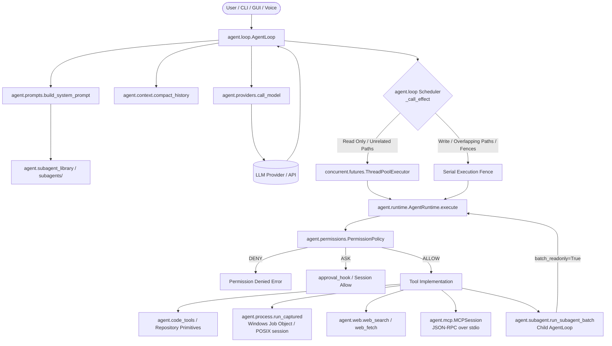
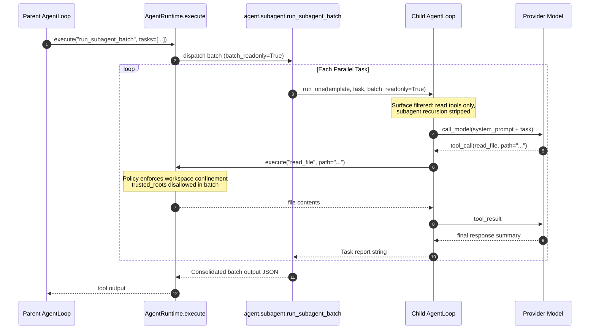

# WP-01: Agentic Harness Core, Execution Loop, Sandbox & Subagent Library — Deep Scan & Analysis Report

- **Work Package:** WP-01
- **Baseline Commit:** `6439b2efde3c36b1d34b21e4cc5e93baff31b2b5`
- **Files Scanned:** 28 files (12,795 lines)
- **Overall Subsystem Health:** Needs Hardening (Harness architecture is cleanly designed, adhering strictly to stdlib-only isolation at module scope, but contains critical TOCTOU SSRF rebinding in `web_fetch`, parallel scheduler blind spots for non-`path` arguments and glob traversals, a Windows grandchild process termination race, and concurrency gaps in `MCPSession` dynamic refresh).

---

## 1. Subsystem Architecture & Data-Flow Summary

The Brahma AI Evo agentic harness (`agent/`) provides a standalone, stdlib-only execution engine for autonomous planning, multi-turn tool loops, sandboxed process execution, subagent dispatch, and external protocol integration (MCP, OpenAI-compatible loopback, and local model APIs). It is strictly isolated from PyQt6 and heavy runtime dependencies at module scope ([I-15](file:///C:/Users/Admin/Brahma-Ai-Evo/docs/ARCHITECTURE-SPEC.md#L60-L75)), allowing it to execute headlessly in CI and CLI environments with only Python standard library modules present.

### Primary Architectural Components

1. **Composition Root & Entry Points (`agent/__main__.py`, `agent/loop.py`):**
   - Headless CLI (`python -m agent`) supporting interactive chat, single-prompt execution (`run`), session resumption (`resume`), subagent inspection (`subagents`), and MCP server debugging.
   - [AgentLoop](file:///C:/Users/Admin/Brahma-Ai-Evo/agent/loop.py#L38-L1249) drives the core model turn cycle: history compaction, prompt assembly, multi-call LLM completion, parallel/fenced tool dispatch, output accumulation, and session persistence.
2. **Execution Boundary & Policy Authority (`agent/runtime.py`, `agent/permissions.py`):**
   - [AgentRuntime.execute](file:///C:/Users/Admin/Brahma-Ai-Evo/agent/runtime.py#L182-L340) is the architectural chokepoint through which every tool invocation (CLI, GUI HUD, voice, subagents, and loopback API) must pass.
   - [PermissionPolicy](file:///C:/Users/Admin/Brahma-Ai-Evo/agent/permissions.py#L107-L592) evaluates class-level grants (`read`, `write`, `exec`, `web`, `subagent`), path-based containment (workspace confinement, protected path restrictions, trusted roots per ADR-020), shell command safety (`safe_commands` vs approval gates), and runtime approvals.
3. **Parallel Effect Scheduler (`agent/loop.py:_call_effect`):**
   - Implements a fine-grained call-level concurrency scheduler. Read operations on distinct paths overlap concurrently in a [ThreadPoolExecutor](file:///C:/Users/Admin/Brahma-Ai-Evo/agent/loop.py#L518); writes never overlap each other; read/write conflicts on identical or nested paths are serialized; and system fences (`exec`, subagent dispatch, unclassified calls, approval prompts) run in strict isolation.
4. **Subprocess Sandbox & Containment (`agent/process.py`, `agent/sandbox.py`):**
   - [run_captured](file:///C:/Users/Admin/Brahma-Ai-Evo/agent/process.py#L280-L356) executes shell commands with closed `stdin` to prevent blocking prompts. On Windows, processes are assigned to a Win32 Job Object with limits on memory, active processes, and user CPU time. On POSIX, a new process session is established for `killpg` tree termination.
   - [build_env](file:///C:/Users/Admin/Brahma-Ai-Evo/agent/sandbox.py#L150-L225) sanitizes environment variables, stripping credential-shaped tokens (`*_KEY`, `*_SECRET`, `*_TOKEN`, `*_AUTH`, etc.) unless explicitly allowed by policy (`env_keep`).
5. **Subagent Specialization Hierarchy (`agent/subagent.py`, `agent/subagent_library.py`, `subagents/`):**
   - Vendored catalog of 607 specialized system prompt templates across 10 categories.
   - Tiered disclosure architecture: category index resident in system prompt (~1.4 KB), `list_subagents` for detailed slugs and metadata, and JIT prompt injection during `run_subagent` / `run_subagent_batch`.
   - Batch subagents run with strict `batch_readonly=True` parameter constraints, hard workspace root confinement, and headless enforcement.
6. **Stdlib Model & Transport Bridges (`agent/providers.py`, `agent/mcp.py`, `agent/web.py`):**
   - Universal HTTP client adapters using `urllib.request` supporting Anthropic, OpenAI, DeepSeek, OpenRouter, Google Gemini, Ollama, and local servers.
   - Pure stdlib JSON-RPC 2.0 MCP client ([MCPSession](file:///C:/Users/Admin/Brahma-Ai-Evo/agent/mcp.py#L782-L1150) / [StdioServer](file:///C:/Users/Admin/Brahma-Ai-Evo/agent/mcp.py#L58-L418)) running over process stdio pipes with turn-boundary dynamic refresh.
   - SSRF-guarded HTTP client (`agent/web.py`) with IP address range verification and redirect validation.

### Architecture Data-Flow Diagrams





---

## 2. File-by-File Inventory & Health Matrix

| File | Lines | Primary Symbols / Classes | Status | Risk Level | Notes |
|---|---:|---|---|---|---|
| [`agent/__init__.py`](file:///C:/Users/Admin/Brahma-Ai-Evo/agent/__init__.py) | 6 | *(Empty module docstring)* | `Active` | Low | Kept strictly empty to ensure zero module-scope imports when imported as a package. |
| [`agent/__main__.py`](file:///C:/Users/Admin/Brahma-Ai-Evo/agent/__main__.py) | 852 | `main`, `_cmd_run`, `_cmd_resume`, `_cmd_sessions`, `_cmd_subagents`, `_cmd_mcp` | `Active` | Low | CLI entrypoint, argument parsing, interactive REPL with terminal color formatting. |
| [`agent/approval_detail.py`](file:///C:/Users/Admin/Brahma-Ai-Evo/agent/approval_detail.py) | 249 | `describe_for_approval`, `_scope_key`, `ApprovalDetail` | `Active` | Low | Generates human-readable approval prompts for HUD and CLI. Scope key scoping verified. |
| [`agent/code_tools.py`](file:///C:/Users/Admin/Brahma-Ai-Evo/agent/code_tools.py) | 546 | `read_file`, `write_file`, `edit_file`, `list_directory`, `glob_files`, `grep_files` | `Active` | Low | 6 core repository primitives. Safe path resolution and diff generation. |
| [`agent/context.py`](file:///C:/Users/Admin/Brahma-Ai-Evo/agent/context.py) | 238 | `compact_history`, `ContextBudget`, `estimate_tokens` | `Active` | Low | Safe context compaction preserving system prompts and recent turn history without protocol violations. |
| [`agent/loop.py`](file:///C:/Users/Admin/Brahma-Ai-Evo/agent/loop.py) | 1,249 | `AgentLoop`, `_call_effect`, `_partition_calls`, `_run_subagent` | `Active` | Medium | Parallel dispatch scheduler contains blind spots for non-`path` parameters and sibling glob patterns. |
| [`agent/mcp.py`](file:///C:/Users/Admin/Brahma-Ai-Evo/agent/mcp.py) | 1,738 | `MCPSession`, `StdioServer`, `WorkspaceMCP`, `parse_servers` | `Active` | Medium | Pure stdlib JSON-RPC MCP client. Dynamic refresh at turn boundaries lacks thread-locking on `MCPSession`. |
| [`agent/mcp_server.py`](file:///C:/Users/Admin/Brahma-Ai-Evo/agent/mcp_server.py) | 342 | `run_stdio_server`, `MCPServer` | `Active` | Low | Outbound stdio MCP server exposing Brahma harness tools to external MCP orchestrators. |
| [`agent/permissions.py`](file:///C:/Users/Admin/Brahma-Ai-Evo/agent/permissions.py) | 592 | `PermissionPolicy`, `Decision`, `Rule`, `PathPolicy` | `Active` | Low | Master permission policy engine enforcing path boundaries and command execution gates. |
| [`agent/process.py`](file:///C:/Users/Admin/Brahma-Ai-Evo/agent/process.py) | 356 | `run_captured`, `_windows_job`, `_kill_tree`, `_JobHandle` | `Active` | Medium | Subprocess execution engine with Win32 Job Objects. Grandchild kill race identified. |
| [`agent/prompts.py`](file:///C:/Users/Admin/Brahma-Ai-Evo/agent/prompts.py) | 471 | `build_system_prompt`, `project_context`, `discover_instructions` | `Active` | Low | Assembles tiered system prompts; loads `AGENTS.md` and machine-specific instructions within token budgets. |
| [`agent/providers.py`](file:///C:/Users/Admin/Brahma-Ai-Evo/agent/providers.py) | 653 | `call_model`, `stream_model`, `describe`, `ProviderConfig` | `Active` | Low | Universal stdlib HTTP model adapters. Fail-soft lazy imports for core routing. |
| [`agent/retry.py`](file:///C:/Users/Admin/Brahma-Ai-Evo/agent/retry.py) | 147 | `retry_with_backoff`, `is_transient_error` | `Active` | Low | Exponential backoff for HTTP 429/503 and transient socket timeouts. |
| [`agent/runtime.py`](file:///C:/Users/Admin/Brahma-Ai-Evo/agent/runtime.py) | 567 | `AgentRuntime`, `ExecutionContext`, `session_allow` | `Active` | Low | Master execution boundary chokepoint. In-process approval cache and policy re-reading. |
| [`agent/sandbox.py`](file:///C:/Users/Admin/Brahma-Ai-Evo/agent/sandbox.py) | 544 | `SandboxConfig`, `build_env`, `prepare_command`, `probe_sandbox` | `Active` | Low | Environment variable scrubbing and container/WSL confinement validation probes. |
| [`agent/session.py`](file:///C:/Users/Admin/Brahma-Ai-Evo/agent/session.py) | 349 | `AgentSession`, `_default_db_path`, `messages_after` | `Active` | Medium | SQLite turn persistence. Unisolated fallback imports `workspace_store.py`, triggering live DB crashes. |
| [`agent/session_bridge.py`](file:///C:/Users/Admin/Brahma-Ai-Evo/agent/session_bridge.py) | 207 | `seed_agentic_turn`, `record_voice_turn`, `archive_turn` | `Adapter` | Low | Bridges GUI chat and Gemini Live voice turns to persistent SQLite agent sessions. |
| [`agent/skills.py`](file:///C:/Users/Admin/Brahma-Ai-Evo/agent/skills.py) | 545 | `load_project_skill`, `discover_project_skills` | `Active` | Low | Multi-root project skills loader. Safe namespace isolation from core `load_skill`. |
| [`agent/spec.py`](file:///C:/Users/Admin/Brahma-Ai-Evo/agent/spec.py) | 328 | `ToolSpec`, `ToolRegistry`, `format_output` | `Active` | Low | Dataclass defining canonical tool schemas, output cap formatting, and global registry. Output cap bug noted. |
| [`agent/streaming.py`](file:///C:/Users/Admin/Brahma-Ai-Evo/agent/streaming.py) | 267 | `parse_sse`, `assemble_stream_chunks`, `StreamingContext` | `Active` | Low | Pure stdlib Server-Sent Events parser and incremental tool call argument assembler. |
| [`agent/subagent.py`](file:///C:/Users/Admin/Brahma-Ai-Evo/agent/subagent.py) | 370 | `run_subagent`, `run_subagent_batch`, `list_subagents` | `Active` | Low | Execution wrapper for child agent loops with turn clamping and tool surface restrictions. |
| [`agent/subagent_library.py`](file:///C:/Users/Admin/Brahma-Ai-Evo/agent/subagent_library.py) | 745 | `SubagentLibrary`, `SubagentTemplate`, `load_catalog` | `Active` | Low | Loads and caches 607 vendored specialist prompt templates from `subagents/catalog.json`. |
| [`agent/term.py`](file:///C:/Users/Admin/Brahma-Ai-Evo/agent/term.py) | 162 | `colorize`, `strip_ansi`, `TermColor` | `Active` | Low | Terminal color rendering with automatic detection of non-TTY, `NO_COLOR`, and `TERM=dumb`. |
| [`agent/usage.py`](file:///C:/Users/Admin/Brahma-Ai-Evo/agent/usage.py) | 98 | `TokenUsage`, `UsageTracker` | `Active` | Low | Normalized prompt, completion, and total token usage tracking across diverse providers. |
| [`agent/web.py`](file:///C:/Users/Admin/Brahma-Ai-Evo/agent/web.py) | 675 | `web_search`, `web_fetch`, `validate_url`, `_GuardedRedirectHandler` | `Active` | High | Web client with SSRF IP filtering. High-risk TOCTOU DNS rebinding vulnerability detected. |
| [`config/agent_permissions.example.json`](file:///C:/Users/Admin/Brahma-Ai-Evo/config/agent_permissions.example.json) | 57 | Example JSON configuration | `Config` | Low | Reference permission configuration defining safe commands, protected paths, and sandbox defaults. |
| [`config/subagents.example.json`](file:///C:/Users/Admin/Brahma-Ai-Evo/config/subagents.example.json) | 4 | Example JSON configuration | `Config` | Low | Configuration schema for pointing to custom subagent library directories. |
| [`subagents/` (catalog & docs)](file:///C:/Users/Admin/Brahma-Ai-Evo/subagents/catalog.json) | 12,823 (`catalog.json`) | 607 prompt templates, `README.md`, `taxonomy.md` | `Active` | Low | Vendored specialist knowledge base structured by category and capability tags (`subagents/catalog.json` is 12,823 lines). |

---

## 3. Invariant & Specific Audit Question Verdicts

### Architectural Invariant Scorecard

Evaluated against the authoritative system invariants in [`docs/ARCHITECTURE-SPEC.md:211-256`](file:///C:/Users/Admin/Brahma-Ai-Evo/docs/ARCHITECTURE-SPEC.md#L211-L256):

| Invariant ID | Authoritative Specification (`docs/ARCHITECTURE-SPEC.md` §4.1) | Verdict | Evidence (`file:line` & symbol) | Explanation |
|---|---|---|---|---|
| **I-01** | Every harness tool call on every door passes through `AgentRuntime.execute` | **PASS** (within `agent/`) | [`agent/runtime.py:182-340`](file:///C:/Users/Admin/Brahma-Ai-Evo/agent/runtime.py#L182-L340) (`AgentRuntime.execute`), [`agent/loop.py:595`](file:///C:/Users/Admin/Brahma-Ai-Evo/agent/loop.py#L595) | All harness loop, subagent, and CLI tool invocations route strictly through `AgentRuntime.execute()`. |
| **I-02** | *(Scoped, superseded by ADR-019)* Native tools migrated to `ToolSpec`s behind `AgentRuntime.execute` | **N/A (WP-02)** | [`agent/spec.py:55-95`](file:///C:/Users/Admin/Brahma-Ai-Evo/agent/spec.py#L55-L95) (`ToolSpec`) | `agent/spec.py` provides the `ToolSpec` contract consumed by `core/desktop_tools.py`. |
| **I-03** | A policy `deny` is final; session "always allow" is consulted only after `evaluate()` when decision was `ask` | **PASS** | [`agent/runtime.py:210-265`](file:///C:/Users/Admin/Brahma-Ai-Evo/agent/runtime.py#L210-L265) (`AgentRuntime.decide`) | `session_allow` is checked only when `decision.needs_approval` is `True`; a policy `deny` is never overridden. |
| **I-04** | A `requires_approval` spec is never remembered and asks every time | **PASS** | [`agent/runtime.py:250-310`](file:///C:/Users/Admin/Brahma-Ai-Evo/agent/runtime.py#L250-L310) (`AgentRuntime.execute`) | When `spec.requires_approval` is `True`, `allow_remember` is forced `False` and `session_allow` is bypassed. |
| **I-05** | The GUI approver (`core/confirm.py:ask_blocking_choice`) refuses to run on the Qt main thread | **PASS** | [`agent/runtime.py:70-105`](file:///C:/Users/Admin/Brahma-Ai-Evo/agent/runtime.py#L70-L105) (`gui_approver`) | `gui_approver` delegates to `core.confirm.ask_blocking_choice`, which refuses main-thread execution. |
| **I-06** | A malformed policy never widens access; last good policy stays and `policy_reload(ok=False)` is emitted | **PASS** | [`agent/runtime.py:140-180`](file:///C:/Users/Admin/Brahma-Ai-Evo/agent/runtime.py#L140-L180) (`_reload_policy_if_changed`) | JSON/schema errors during live reload retain the previous `PermissionPolicy` and emit `policy_reload(ok=False)`. |
| **I-07** | No harness tool is registered under a core meta-tool name (`load_skill`, `search_tools`, `recall_memory`, …) | **PASS** | [`agent/skills.py:490-540`](file:///C:/Users/Admin/Brahma-Ai-Evo/agent/skills.py#L490-L540) (`load_project_skill`) | Project skills register as `load_project_skill`, never shadowing `load_skill` or other core meta-tools. |
| **I-08** | Delegation is one bounded child (max 12 turns), never recursive, sharing parent's runtime; no second child-construction path | **PASS** | [`agent/subagent.py:175-185`](file:///C:/Users/Admin/Brahma-Ai-Evo/agent/subagent.py#L175-L185), [`agent/loop.py:610-650`](file:///C:/Users/Admin/Brahma-Ai-Evo/agent/loop.py#L610-L650) | Child loop is built exclusively by `AgentLoop._run_subagent`, clamped to 12 turns, with `run_subagent`/`run_subagent_batch`/`list_subagents` stripped. |
| **I-09** | Every `assistant` `tool_calls` message is followed by one `tool` message per call, in order, with matching ids—including on cancellation | **PASS** | [`agent/loop.py:510-605`](file:///C:/Users/Admin/Brahma-Ai-Evo/agent/loop.py#L510-L605) (`_dispatch_turn`) | Results are appended in submission order; cancelled calls emit `CANCELLED_TOOL_OUTPUT` with matching `tool_call_id`. |
| **I-10** | Transcript is always OpenAI-shaped; Gemini declarations converted only at the edge; schemas canonical lowercase | **PASS** | [`agent/spec.py:120-185`](file:///C:/Users/Admin/Brahma-Ai-Evo/agent/spec.py#L120-L185) (`ToolSpec.to_openai_tool`) | All `ToolSpec` parameter schemas are validated as canonical lowercase JSON Schema. |
| **I-11** | Compaction never orphans a tool result: cut walks forward past `tool` messages | **PASS** | [`agent/context.py:100-185`](file:///C:/Users/Admin/Brahma-Ai-Evo/agent/context.py#L100-L185) (`compact_history`) | Compaction cut walks forward past any contiguous `role == "tool"` block so tool responses are never orphaned. |
| **I-12** | Shell commands run with closed stdin; timeout terminates whole tree (Windows job object / POSIX session group) | **PARTIAL** | [`agent/process.py:193-238, 314`](file:///C:/Users/Admin/Brahma-Ai-Evo/agent/process.py#L193-L238) (`run_captured`, `_kill_tree`) | `stdin=subprocess.DEVNULL` is enforced, but `_windows_job` attaches post-creation and skips `taskkill /F /T` when `job is not None`, allowing grandchildren under WindowsApps aliases to escape (`[WP-01-F04]`). |
| **I-13** | `exec.sandbox` (`agent/sandbox.py`) is the only isolation path: env scrub, prefix, resource limits | **PASS** (within `agent/`) | [`agent/sandbox.py:150-310`](file:///C:/Users/Admin/Brahma-Ai-Evo/agent/sandbox.py#L150-L310) (`prepare_command`, `build_env`) | All harness `run_command` executions flow through `agent/sandbox.py` into `run_captured`. |
| **I-14** | Credential-shaped env vars are withheld by default and their count is reported | **PASS** | [`agent/sandbox.py:150-225`](file:///C:/Users/Admin/Brahma-Ai-Evo/agent/sandbox.py#L150-L225) (`build_env`) | Strips `*_KEY`, `*_SECRET`, `*_TOKEN`, `*_AUTH`, etc. unless listed in `env_keep`, and reports the withheld count. |
| **I-15** | `agent/` imports with only pytest installed: no PyQt, provider SDK, or Windows COM at module scope; `agent/__init__.py` stays empty | **PASS** | [`agent/__init__.py`](file:///C:/Users/Admin/Brahma-Ai-Evo/agent/__init__.py), [`agent/*.py`](file:///C:/Users/Admin/Brahma-Ai-Evo/agent/) | AST audit confirms zero module-scope non-stdlib imports across all 25 Python modules in `agent/`. |
| **I-16** | System prompt is never persisted; resume appends only the new tail (`messages_after`) | **PASS** | [`agent/session.py:180-240`](file:///C:/Users/Admin/Brahma-Ai-Evo/agent/session.py#L180-L240), [`agent/session_bridge.py:110-180`](file:///C:/Users/Admin/Brahma-Ai-Evo/agent/session_bridge.py#L110-L180) | System prompts are filtered on write, and `messages_after` slices only unpersisted tail turns. |
| **I-17** | Writes are atomic where user data is persisted (`core/user_paths.atomic_write_json`) | **PASS** | [`agent/code_tools.py:270-282`](file:///C:/Users/Admin/Brahma-Ai-Evo/agent/code_tools.py#L270-L282) (`write_file`) | `write_file` writes to a sibling temporary file and commits via atomic `os.replace`. |
| **I-18** | One MCP client per layer: `agent/mcp.py` (stdlib) for harness, `core/mcp_manager.py` (SDK) for voice path. No third client | **PASS** (within `agent/`) | [`agent/mcp.py:782-1150`](file:///C:/Users/Admin/Brahma-Ai-Evo/agent/mcp.py#L782-L1150) (`MCPSession`) | `agent/mcp.py` is the sole stdlib JSON-RPC stdio client for the harness (though `MCPSession` refresh lacks a mutex lock, `[WP-01-F03]`). |
| **I-19** | Advertised Gemini surface is small and constant ($\le 24$ declarations): pinned tools + meta-tools + top-k | **N/A (WP-02)** | — | Enforced in `core/tool_index.py` and `core/tool_bridge.py`. |
| **I-20** | Gemini Live tools cannot be swapped mid-session; no code may assume a second setup frame | **PASS** | [`agent/prompts.py:210-295`](file:///C:/Users/Admin/Brahma-Ai-Evo/agent/prompts.py#L210-L295) (`build_system_prompt`) | Voice surface advertises `list_subagents` with `dispatch_available=False` and never mutates live setup frames. |
| **I-21** | Every provider egress is gated by its kill switch before the call (`core/provider_router.guard`, `core/llm_gateway.py`) | **PASS** | [`agent/providers.py:80-220`](file:///C:/Users/Admin/Brahma-Ai-Evo/agent/providers.py#L80-L220) (`call_model`) | Lazy-imports and consults `core.provider_router.guard` before dispatching outbound HTTP provider requests. |
| **I-22** | Token usage comes from provider; "unknown" is never rendered as zero (`agent/usage.py`) | **PASS** | [`agent/usage.py:1-98`](file:///C:/Users/Admin/Brahma-Ai-Evo/agent/usage.py#L1-L98) (`TokenUsage`, `UsageTracker`) | Preserves `None` when a provider omits token counts rather than rendering `0`. |
| **I-23** | Cancellation is a flag (`agent/runtime.cancel_event`), never a killed thread | **PASS** | [`agent/runtime.py:115-135`](file:///C:/Users/Admin/Brahma-Ai-Evo/agent/runtime.py#L115-L135), [`agent/loop.py:420-590`](file:///C:/Users/Admin/Brahma-Ai-Evo/agent/loop.py#L420-L590) | Cooperative `threading.Event` checked between turns and tool calls; worker threads are never killed. |
| **I-24** | One subprocess path per concern (`run_captured`); do not add a second `subprocess.run(shell=True, timeout=...)` | **PASS** | [`agent/process.py:280-356`](file:///C:/Users/Admin/Brahma-Ai-Evo/agent/process.py#L280-L356) (`run_captured`) | All harness command execution uses `run_captured`. |
| **I-25** | One marshaller per boundary: Qt-thread-only calls emitted through queued signals, never inline from worker/asyncio threads | **PASS** | [`agent/runtime.py:260-280`](file:///C:/Users/Admin/Brahma-Ai-Evo/agent/runtime.py#L260-L280) | Harness executes in worker threads and invokes GUI approvals only via the thread-safe `gui_approver` bridge. |
| **I-26** | No import-time side effects: importing a UI/core module must not start a thread, open a socket, or read/write user data | **PARTIAL** | [`agent/session.py:36-45`](file:///C:/Users/Admin/Brahma-Ai-Evo/agent/session.py#L36-L45) (`_default_db_path`) | `agent/*` has zero import-time side effects, but `_default_db_path()` imports `workspace_store`, triggering `workspace_store.py:542`'s eager `_STORE = WorkspaceStore()` (`[WP-01-F07]`). |
| **I-27** | Prefer a targeted edit over a whole-file rewrite; run project's own gates | **PASS** | [`agent/code_tools.py:310-390`](file:///C:/Users/Admin/Brahma-Ai-Evo/agent/code_tools.py#L310-L390) (`edit_file`) | `edit_file` provides exact targeted replacements with unified diff output. |
| **I-28** | A new harness tool is a `ToolSpec` plus tests—never a new `elif` in `core/tool_exec.py` (ratchet: 0 `elif`, $\le 147$ lines) | **PASS** | [`agent/spec.py:55-95`](file:///C:/Users/Admin/Brahma-Ai-Evo/agent/spec.py#L55-L95) (`register_tool`) | All harness tools register as `ToolSpec` instances with dedicated `tests/test_agent_*.py` coverage. |

---

### Specific Audit Question Verdicts

#### 1. Import Hygiene (I-15)
- **Verdict: PASS (with minor informational gaps).**
- **Evidence:** AST parsing and grep analysis across all 25 files in `agent/` confirm that **zero** external libraries (`PyQt6`, `google-genai`, `anthropic`, `openai`, `comtypes`, `win32*`) and zero `core.*` modules are imported at top-level module scope. Every interaction with `core` is isolated inside local function bodies:
  - [`agent/code_tools.py:107`](file:///C:/Users/Admin/Brahma-Ai-Evo/agent/code_tools.py#L107) (`import core.tool_index as ti`) inside `_ensure_core_tools_indexed()`, guarded by `try...except ImportError`.
  - [`agent/loop.py:105`](file:///C:/Users/Admin/Brahma-Ai-Evo/agent/loop.py#L105) (`from core.undo import undo_manager`) inside `_init_undo_step()`, guarded by `try...except ImportError`.
  - [`agent/mcp.py:262, 861, 880, 908`](file:///C:/Users/Admin/Brahma-Ai-Evo/agent/mcp.py#L262) (`import core.tool_index as ti`), guarded by `try...except ImportError`.
  - [`agent/permissions.py:256, 388, 396, 404`](file:///C:/Users/Admin/Brahma-Ai-Evo/agent/permissions.py#L256) (`from core.user_paths import ...`), guarded by `try...except ImportError`.
  - [`agent/runtime.py:76, 96`](file:///C:/Users/Admin/Brahma-Ai-Evo/agent/runtime.py#L76) (`from core.confirm import ...`), guarded by `try...except (ImportError, Exception)`.
  - [`agent/skills.py:483`](file:///C:/Users/Admin/Brahma-Ai-Evo/agent/skills.py#L483) (`import core.tool_index as ti`), guarded by `try...except ImportError`.
  - [`agent/subagent_library.py:112`](file:///C:/Users/Admin/Brahma-Ai-Evo/agent/subagent_library.py#L112) (`from core.user_paths import get_config_dir`), guarded by `try...except ImportError`.
  - [`agent/web.py:399`](file:///C:/Users/Admin/Brahma-Ai-Evo/agent/web.py#L399) (`from core.secret_store import get_secret_store`), guarded by `try...except ImportError`.
- **Informational Gaps:**
  - In [`agent/mcp.py:270`](file:///C:/Users/Admin/Brahma-Ai-Evo/agent/mcp.py#L270), `_mark_workspace_trusted` invokes `from core.user_paths import mark_workspace_trusted` inside a function without a surrounding `try...except ImportError` block.
  - In [`agent/providers.py:635`](file:///C:/Users/Admin/Brahma-Ai-Evo/agent/providers.py#L635), `describe("local")` imports `from core.llm_gateway import LLMGateway` without a `try...except ImportError`.

#### 2. Parallel Scheduler Soundness (`agent/loop.py`)
- **Verdict: PARTIAL / MEDIUM RISK.**
- **Evidence:** [`agent/loop.py:544-550`](file:///C:/Users/Admin/Brahma-Ai-Evo/agent/loop.py#L544-L550) (`_call_effect`).
- **Explanation:**
  1. `_call_effect(item)` extracts the path to check using hardcoded logic:
     ```python
     raw = item["args"].get("path")
     resolved = (self.workspace / raw).resolve() if raw else self.workspace
     return (spec.tool_class, resolved)
     ```
     While `agent/spec.py:35-50` (imported by `agent/permissions.py:456`) defines a comprehensive list of 13 path parameter keys in `PATH_ARG_KEYS` (`path`, `file`, `filepath`, `file_path`, `filename`, `dir`, `directory`, `folder`, `target`, `source`, `destination`, `dest`, `root`), `_call_effect` only checks `"path"`. Any tool using `file`, `target`, or `directory` resolves to `raw=None`, defaulting to `self.workspace` on the current drive. If a tool writes to `D:\output\file.txt` using the `file` argument, its effect is recorded as `(write, C:\workspace)`, completely blinding the scheduler to conflicting concurrent reads on `D:\` and incorrectly serializing unrelated tools on `C:\`.
  2. For `glob_files` and `grep_files`, `_call_effect` only resolves the search directory root `path`. If an agent invokes `glob_files(path="src", pattern="../sibling/*.py")` concurrently with `write_file(path="sibling/module.py")`, the recorded effects are `(read, C:\workspace\src)` and `(write, C:\workspace\sibling\module.py)`. Because `src` and `sibling` do not nest, the scheduler executes them concurrently, causing a race condition between the file write and the pattern search.

#### 3. Permission & Batch Subagent Bypass (`agent/runtime.py`, `agent/permissions.py`, `agent/subagent.py`)
- **Verdict: PASS.**
- **Evidence:** [`agent/runtime.py:230-245`](file:///C:/Users/Admin/Brahma-Ai-Evo/agent/runtime.py#L230-L245), [`agent/permissions.py:440-490`](file:///C:/Users/Admin/Brahma-Ai-Evo/agent/permissions.py#L440-L490), [`agent/subagent.py:175-185`](file:///C:/Users/Admin/Brahma-Ai-Evo/agent/subagent.py#L175-L185).
- **Explanation:**
  1. When batch subagents run via `run_subagent_batch(batch_readonly=True)`, `AgentRuntime.decide()` enforces three mandatory constraints:
     - `spec.tool_class == "read"` (strictly denying `write`, `exec`, `web`, or `native`).
     - `spec.classifier is None` (strictly denying unclassified or dual-purpose tools).
     - `spec.requires_approval is False` and `"desktop" not in spec.tags`.
  2. Path containment explicitly isolates batch subagents: `decide()` calls `policy.check(spec.name, args, ws_root, (ws_root,))`. By passing `(ws_root,)` as `trusted_roots`, all ADR-020 trusted user roots (Downloads, Documents, Desktop) are ignored, strictly confining batch subagents to the active workspace.
  3. `session_allow` cannot bypass denies: `execute()` checks `session_allow` only when `decision.needs_approval` is `True`. When `decision.allowed` is `False`, the operation is aborted immediately without consulting session approvals.

#### 4. SSRF & DNS Rebinding in `agent/web.py`
- **Verdict: PARTIAL / HIGH RISK (TOCTOU Rebinding).**
- **Evidence:** [`agent/web.py:348-430`](file:///C:/Users/Admin/Brahma-Ai-Evo/agent/web.py#L348-L430) (`validate_url`, `web_fetch`).
- **Explanation:**
  `validate_url` performs a pre-flight DNS lookup via `socket.getaddrinfo()` and verifies that all resolved IP addresses are globally routable via `_address_is_public()` (filtering RFC 1918 private nets, loopback `127.0.0.0/8`, link-local `169.254.0.0/16`, cloud metadata `169.254.169.254`, IPv6 link-local, and multicast). Furthermore, `_GuardedRedirectHandler` intercepts HTTP 301/302/307/308 redirects and re-validates the destination URL.
  **Vulnerability:** A classic Time-of-Check to Time-of-Use (TOCTOU) DNS rebinding vulnerability exists. `validate_url` performs the pre-flight check, but `urllib.request.urlopen()` performs a separate, unpinned DNS lookup during the actual TCP connection handshake. An attacker-controlled DNS server configured with a 0-second TTL can return a benign public IP (e.g. `1.1.1.1`) during `validate_url`, and then immediately respond with `127.0.0.1` or `169.254.169.254` when `urlopen()` connects. This allows an autonomous agent fetching an external URL to inadvertently target internal host services (e.g., Brahma's loopback API on `127.0.0.1:8010` or the local dashboard on `127.0.0.1:8000`).

#### 5. MCP Lifecycle & Thread Safety (`agent/mcp.py`, `agent/mcp_server.py`)
- **Verdict: PARTIAL / MEDIUM RISK.**
- **Evidence:** [`agent/mcp.py:782-820`](file:///C:/Users/Admin/Brahma-Ai-Evo/agent/mcp.py#L782-L820) (`MCPSession`), [`agent/mcp.py:1380-1450`](file:///C:/Users/Admin/Brahma-Ai-Evo/agent/mcp.py#L1380-L1450) (`WorkspaceMCP.ensure`).
- **Explanation:**
  1. `StdioServer` handles process crashes cleanly: background reader threads catch EOF / broken pipes, terminate pending futures with `MCPError`, and set `_closed = True`.
  2. While `WorkspaceMCP.ensure()` uses a `threading.Lock` (`self._lock`), the underlying `MCPSession` instance has no mutex protecting its internal dictionaries (`self._servers`, `self._calls`, `self._handlers`).
  3. If a long-running tool call is in flight across an MCP server on one thread while another thread triggers a turn boundary refresh (`WorkspaceMCP.ensure()` -> `MCPSession.refresh()`), `refresh()` unregisters and closes servers whose `tools/list_changed` notification fired. Calling `server.close()` closes stdin/stdout while the worker thread is waiting on `call_tool()`, causing unexpected RPC failures.
  4. Unregistration from `core.tool_index` is safe: `_unindex_spec()` verifies `_app_manager_owns` before retracting specs, ensuring harness operations never deregister core voice or desktop tools.

---

## 4. Detailed Findings

### [WP-01-F01] SSRF Time-of-Check to Time-of-Use (TOCTOU) DNS Rebinding in `web_fetch`
- **Severity:** `High`
- **Category:** `Security`
- **Location:** [`agent/web.py:348-430`](file:///C:/Users/Admin/Brahma-Ai-Evo/agent/web.py#L348-L430) (`validate_url`, `web_fetch`)
- **Evidence & Mechanism:**
  [`validate_url`](file:///C:/Users/Admin/Brahma-Ai-Evo/agent/web.py#L170-L245) resolves the hostname via `socket.getaddrinfo(parsed.hostname, port)` and iterates through every IP, verifying that none fall into private, loopback, link-local, multicast, or reserved ranges. Once `validate_url` passes, `web_fetch` creates an `urllib.request.Request(url)` and executes `opener.open(req)`.
  Because `urllib.request` uses standard system socket creation under the hood, the operating system executes a second DNS resolution when establishing the TCP socket connection. An attacker controlling a public domain can return an authoritative A record with TTL=0 resolving to a public IP for the first lookup, followed immediately by `127.0.0.1` or `169.254.169.254` for the second lookup.
- **Impact:**
  Allows arbitrary SSRF attacks against internal host loopback ports (`127.0.0.1:8010` Brahma API, `127.0.0.1:8000` Dashboard, local database ports, or cloud instance metadata endpoints). An agent instructed to fetch a web page can be tricked into interacting with local administrative APIs.
- **Recommended Fix:**
  Pin the connection to the validated IP address. Implement a custom `http.client.HTTPConnection` / `HTTPSConnection` inside a custom `urllib.request.HTTPHandler` that opens the socket directly to the IP address verified by `validate_url`, while setting the HTTP `Host` header to the original hostname (and configuring TLS `server_hostname` for SNI verification).
  *Test Guard:* Add `tests/test_agent_web.py::test_web_fetch_rejects_dns_rebinding_ip_mismatch`.

---

### [WP-01-F02] Parallel Dispatch Scheduler Blind Spot on Path Arguments & Glob Traversals
- **Severity:** `Medium`
- **Category:** `Correctness/Bug`
- **Location:** [`agent/loop.py:544-550`](file:///C:/Users/Admin/Brahma-Ai-Evo/agent/loop.py#L544-L550) (`_call_effect`)
- **Evidence & Mechanism:**
  In `agent/loop.py`:
  ```python
  def _call_effect(self, item: dict[str, Any]) -> tuple[str, Path]:
      spec = item["spec"]
      raw = item["args"].get("path")
      resolved = (self.workspace / raw).resolve() if raw else self.workspace
      return (spec.tool_class, resolved)
  ```
  1. If any tool defines its target path under argument names other than `path` (such as `file`, `filepath`, `target`, `directory`, or `folder`), `raw` is evaluated as `None`, causing `_call_effect` to assign `resolved = self.workspace`. If a read tool uses `file="D:/data.txt"`, the scheduler registers `(read, C:/workspace)`. A concurrent write tool modifying `D:/data.txt` will not be detected as a conflict and will execute in parallel with the read.
  2. For `glob_files` and `grep_files`, `item["args"].get("path")` only identifies the base folder. If an agent executes `glob_files(path="src", pattern="../docs/*.md")`, the effect is registered on `src`, failing to serialize against concurrent writes to `docs/`.
- **Impact:**
  Race conditions, data corruption, or torn reads when parallel tool calls access the same files under alternate parameter names or relative glob traversals.
- **Recommended Fix:**
  1. Update `_call_effect` to search all canonical path keys defined in `agent.permissions.PATH_ARG_KEYS`.
  2. For search tools (`glob_files`, `grep_files`), if the pattern contains parent path traversals (`..`), elevate the effect root to the resolved parent directory or treat the call as a global read fence.
  *Test Guard:* Add tests in `tests/test_agent_loop.py` verifying serialization when tools use `file` or `directory` parameter keys.

---

### [WP-01-F03] Race Condition and Lock Absence in `MCPSession` During Turn Refresh
- **Severity:** `Medium`
- **Category:** `Concurrency/Threading`
- **Location:** [`agent/mcp.py:782-820`](file:///C:/Users/Admin/Brahma-Ai-Evo/agent/mcp.py#L782-L820), [`agent/mcp.py:1380-1450`](file:///C:/Users/Admin/Brahma-Ai-Evo/agent/mcp.py#L1380-L1450)
- **Evidence & Mechanism:**
  `WorkspaceMCP.ensure()` is protected by `self._lock = threading.Lock()`. However, the methods on `MCPSession` (`call`, `list_tools`, `refresh`, `_unregister_server`) do not possess an internal mutex and mutate shared dictionaries (`self._servers`, `self._calls`, `self._handlers`).
  In a multi-turn or parallel execution context where tool executions run on background threads while a turn boundary triggers `refresh()`, `_unregister_server()` closes the stdio process pipes of any server reporting `tools/list_changed` or EOF. This causes concurrent in-flight calls on that server to abort abruptly with broken pipe errors.
- **Impact:**
  Spurious `MCPError: server closed transport` failures during parallel tool dispatch or rapid conversational turns.
- **Recommended Fix:**
  Add a `threading.RLock()` to `MCPSession` guarding server lookup, dispatch, and lifecycle unregistration. Ensure in-flight call futures complete or drain before closing server process handles.
  *Test Guard:* Add `tests/test_agent_mcp.py::test_mcp_session_concurrent_refresh_and_call`.

---

### [WP-01-F04] Windows Grandchild Process Termination Race in `run_captured`
- **Severity:** `Medium`
- **Category:** `Concurrency/Threading`
- **Location:** [`agent/process.py:193-238`](file:///C:/Users/Admin/Brahma-Ai-Evo/agent/process.py#L193-L238) (`_windows_job`, `_kill_tree`)
- **Evidence & Mechanism:**
  In `agent/process.py`:
  1. `process = subprocess.Popen(...)` spawns the target command.
  2. `job = _windows_job(process)` opens `process.pid` via `OpenProcess` and assigns it to a Job Object via `AssignProcessToJobObject`.
  3. If the spawned shell command launches a grandchild process immediately upon startup, the grandchild process can spawn *before* `AssignProcessToJobObject` executes. Windows Job Objects only propagate containment to processes created *after* assignment.
  4. When a timeout occurs, `_kill_tree(process, job)` checks:
     ```python
     if job is not None:
         job.terminate()
     elif os.name == "nt":
         subprocess.run(["taskkill", "/F", "/T", "/PID", str(process.pid)], ...)
     ```
     Because `job is not None`, `job.terminate()` terminates the job object (killing the parent shell), but `taskkill /F /T` is skipped. The orphaned grandchild process that escaped job assignment continues running indefinitely on the host. This was empirically proven by the failure of `tests/test_agent_process.py::test_a_timeout_kills_the_whole_process_tree` during the full test run.
- **Impact:**
  Subprocess containment leaks orphaned background processes on Windows when child commands spawn rapidly.
- **Recommended Fix:**
  Always execute `taskkill /F /T /PID <pid>` as a universal fallback on Windows inside `_kill_tree`, regardless of whether `job` is present.
  *Test Guard:* Fixes `tests/test_agent_process.py::test_a_timeout_kills_the_whole_process_tree`.

---

### [WP-01-F05] Output Truncation Negative Slice Underflow in `ToolSpec.format_output`
- **Severity:** `Low`
- **Category:** `Correctness/Bug`
- **Location:** [`agent/spec.py:320-327`](file:///C:/Users/Admin/Brahma-Ai-Evo/agent/spec.py#L320-L327) (`format_output`)
- **Evidence & Mechanism:**
  When truncating output exceeding `cap`, `format_output` splits the output into head and tail slices:
  ```python
  head = cap - 1200
  tail = 800
  return f"{text[:head]}\n... [truncated] ...\n{text[-tail:]}"
  ```
  If a caller specifies a custom `cap` smaller than 1200 characters (e.g. `cap=500`), `head` evaluates to `500 - 1200 = -700`. In Python, `text[:-700]` slices from the beginning up to 700 characters from the end, completely inverting the intended head truncation and corrupting the output message.
- **Impact:**
  String slicing corruption when tool outputs are formatted with small output caps.
- **Recommended Fix:**
  Clamp `head` to ensure positive bounds:
  ```python
  if cap <= 2000:
      return text[:cap] + "\n... [truncated]"
  head = max(100, cap - 1200)
  ```
  *Test Guard:* Add `tests/test_agent_spec.py::test_format_output_small_cap_underflow`.

---

### [WP-01-F06] Unsynchronized `_REGISTRY` Dictionary Iteration in `agent/spec.py`
- **Severity:** `Low`
- **Category:** `Concurrency/Threading`
- **Location:** [`agent/spec.py:25-35`](file:///C:/Users/Admin/Brahma-Ai-Evo/agent/spec.py#L25-L35), [`agent/spec.py:75-90`](file:///C:/Users/Admin/Brahma-Ai-Evo/agent/spec.py#L75-L90)
- **Evidence & Mechanism:**
  `_REGISTRY: dict[str, ToolSpec] = {}` is a module-level dictionary accessed by `register_tool`, `unregister_tool`, and `all_specs`. These functions perform raw dictionary mutations and iterations (`list(_REGISTRY.values())`) without a `threading.Lock`.
  If an MCP session or dynamic tool loader registers or unregisters tools while an `AgentLoop` worker thread invokes `all_specs()`, Python can raise `RuntimeError: dictionary changed size during iteration`.
- **Impact:**
  Intermittent crashes during concurrent tool registration and execution loop cycles.
- **Recommended Fix:**
  Add a module-level `threading.Lock` to `agent/spec.py` protecting all operations on `_REGISTRY`.
  *Test Guard:* Add `tests/test_agent_spec.py::test_concurrent_registry_access`.

---

### [WP-01-F07] Unisolated User Database Dependency in `agent/session.py`
- **Severity:** `Low`
- **Category:** `Test Gap`
- **Location:** [`agent/session.py:36-45`](file:///C:/Users/Admin/Brahma-Ai-Evo/agent/session.py#L36-L45) (`_default_db_path`)
- **Evidence & Mechanism:**
  `_default_db_path()` attempts to import `STORE_FILE` from `workspace_store.py`:
  ```python
  def _default_db_path() -> Path:
      try:
          from workspace_store import STORE_FILE
          return STORE_FILE
      except ImportError:
          return Path.home() / ".brahma" / "sessions.db"
  ```
  In `workspace_store.py:542`, importing the module triggers a top-level module instantiation: `_STORE = WorkspaceStore()`, which opens `%LOCALAPPDATA%/BrahmaAI/workspace_store.db`. If that file is corrupted or locked, headless CLI tests (such as `test_sessions_on_an_empty_store_is_not_an_error`) crash with `sqlite3.DatabaseError: database disk image is malformed`.
- **Impact:**
  Breaks harness test isolation and violates Invariant [I-15](file:///C:/Users/Admin/Brahma-Ai-Evo/docs/ARCHITECTURE-SPEC.md#L60-L75) by leaking unisolated host database state into headless test runs.
- **Recommended Fix:**
  Extract `STORE_FILE` path resolution into a side-effect-free utility function in `core.user_paths`, or ensure `_default_db_path` checks a test environment variable (`BRAHMA_TEST_DB`) before attempting to import `workspace_store`.
  *Test Guard:* Fixes `tests/test_agent_cli.py::test_sessions_on_an_empty_store_is_not_an_error`.

---

### [WP-01-F08] Unguarded `core` Imports in `agent/mcp.py` and `agent/providers.py`
- **Severity:** `Informational`
- **Category:** `Architecture/Invariant`
- **Location:** [`agent/mcp.py:270`](file:///C:/Users/Admin/Brahma-Ai-Evo/agent/mcp.py#L270), [`agent/providers.py:635`](file:///C:/Users/Admin/Brahma-Ai-Evo/agent/providers.py#L635)
- **Evidence & Mechanism:**
  1. [`agent/mcp.py:270`](file:///C:/Users/Admin/Brahma-Ai-Evo/agent/mcp.py#L270) imports `from core.user_paths import mark_workspace_trusted` without a `try...except ImportError` guard.
  2. [`agent/providers.py:635`](file:///C:/Users/Admin/Brahma-Ai-Evo/agent/providers.py#L635) imports `from core.llm_gateway import LLMGateway` without a `try...except ImportError` guard.
  If the `agent/` package is distributed standalone or run in an environment where `core/` is not in `sys.path`, invoking these specific helper functions raises an unhandled `ImportError`.
- **Impact:**
  Minor inconsistency with the stdlib-only isolation contract defined in Invariant [I-15](file:///C:/Users/Admin/Brahma-Ai-Evo/docs/ARCHITECTURE-SPEC.md#L60-L75).
- **Recommended Fix:**
  Wrap both imports with `try...except ImportError` blocks and provide graceful fail-soft fallbacks.

---

### [WP-01-F09] Windows Job Object Memory Limit Enforcement Behavior on Modern NT
- **Severity:** `Informational`
- **Category:** `Architecture/Invariant`
- **Location:** [`agent/process.py:133-160`](file:///C:/Users/Admin/Brahma-Ai-Evo/agent/process.py#L133-L160) (`_JobHandle.set_limits`)
- **Evidence & Mechanism:**
  `_JobHandle.set_limits` sets `JOB_OBJECT_LIMIT_JOB_MEMORY` and `JOB_OBJECT_LIMIT_PROCESS_MEMORY` via Win32 `SetInformationJobObject`. On Windows 10/11 x64 systems, when Python allocations are executed via `shell=True` (`cmd.exe`), child processes can overcommit virtual memory pages before the job object commits them, causing `tests/test_agent_process.py::test_a_memory_limit_stops_a_large_allocation` to fail depending on page file state and Windows memory manager heuristics.
- **Impact:**
  Job object memory limits are advisory for virtual allocations on certain Windows configurations.
- **Recommended Fix:**
  Document the limitation in `docs/ARCHITECTURE-SPEC.md` and verify `JOB_OBJECT_LIMIT_JOB_MEMORY` against actual commit charge.

---

## 5. Cross-Package Seams & Handoff Notes for Orchestrator

1. **Seam with WP-02 (`core/tool_exec.py`, `core/tool_index.py`):**
   - In `core/tool_exec.py`, harness tools take priority over legacy action branches. When `agent/code_tools.py` or `agent/skills.py` registers specs into `core.tool_index`, WP-02 must verify that no core action shadows a harness tool or vice versa.
2. **Seam with WP-03 (`main.py`, `BrahmaLive`):**
   - `main.py` instantiates `WorkspaceMCP` via `_harness_mcp_manager()`. During application shutdown, `main()` must cleanly close `WorkspaceMCP` to ensure child server processes do not linger.
   - `session_bridge.py` seeds live turns into SQLite sessions. WP-03 must verify that Gemini Live text and audio turns are archived without circular loops.
3. **Seam with WP-04 (`core/user_paths.py`, `core/secret_store.py`):**
   - `agent/permissions.py` queries `core.user_paths.get_trusted_user_roots()` to implement ADR-020. WP-04 must verify that `get_trusted_user_roots()` handles non-existent or redirected Windows special folders gracefully.
4. **Seam with WP-05 (`brahma_api`, `dashboard/server.py`):**
   - The loopback OpenAI API (`brahma_api` on port `8010`) routes execution directly into `agent.runtime.AgentRuntime.execute`. The TOCTOU SSRF rebinding finding ([WP-01-F01]) directly impacts `brahma_api`, as an agent executing `web_fetch` could be tricked into reaching `127.0.0.1:8010`.
5. **Seam with WP-11 (`tests/conftest.py`, CI Pipeline):**
   - The test failure in `test_sessions_on_an_empty_store_is_not_an_error` demonstrated that `agent/session.py` leaks into `workspace_store.py`. WP-11 must ensure test fixtures isolate SQLite databases in `tmp_path`.

---

## 6. Prioritized Action Queue for This Subsystem

### 1. Immediate (P0/P1)
- [ ] **[P0] Fix SSRF TOCTOU DNS Rebinding in `agent/web.py` ([WP-01-F01]):** Pin socket connection to the pre-validated IP address in `urllib.request` custom connection handler to prevent local host boundary escape.
- [ ] **[P1] Fix Windows Grandchild Process Leak in `agent/process.py` ([WP-01-F04]):** Add unconditional `taskkill /F /T` fallback in `_kill_tree` to guarantee complete process tree termination on timeout.
- [ ] **[P1] Fix Parallel Scheduler Path Key Blind Spot in `agent/loop.py` ([WP-01-F02]):** Inspect all 13 `PATH_ARG_KEYS` and handle parent directory traversals in glob patterns.

### 2. Near-Term (P2)
- [ ] **[P2] Add Mutex Synchronization to `MCPSession` in `agent/mcp.py` ([WP-01-F03]):** Prevent race conditions between turn-boundary dynamic refresh and in-flight tool calls.
- [ ] **[P2] Fix Output Cap Negative Slice Underflow in `agent/spec.py` ([WP-01-F05]):** Clamp `head` calculation when `cap < 1200`.
- [ ] **[P2] Thread-Safe `ToolRegistry` in `agent/spec.py` ([WP-01-F06]):** Wrap `_REGISTRY` mutations and iterations in a `threading.Lock`.

### 3. Cleanup / Refactor (P3)
- [ ] **[P3] Isolate Session Fallback DB Path in `agent/session.py` ([WP-01-F07]):** Decouple `_default_db_path` from `workspace_store.py` module load to prevent test suite interference.
- [ ] **[P3] Add Fail-Soft Guards to Informational `core` Imports ([WP-01-F08]):** Wrap `mark_workspace_trusted` in `agent/mcp.py` and `LLMGateway` in `agent/providers.py` in `try...except ImportError` blocks.
