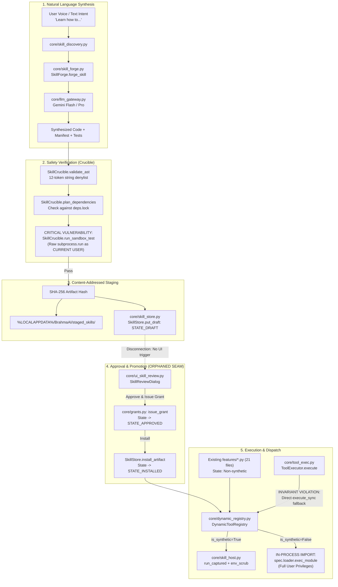
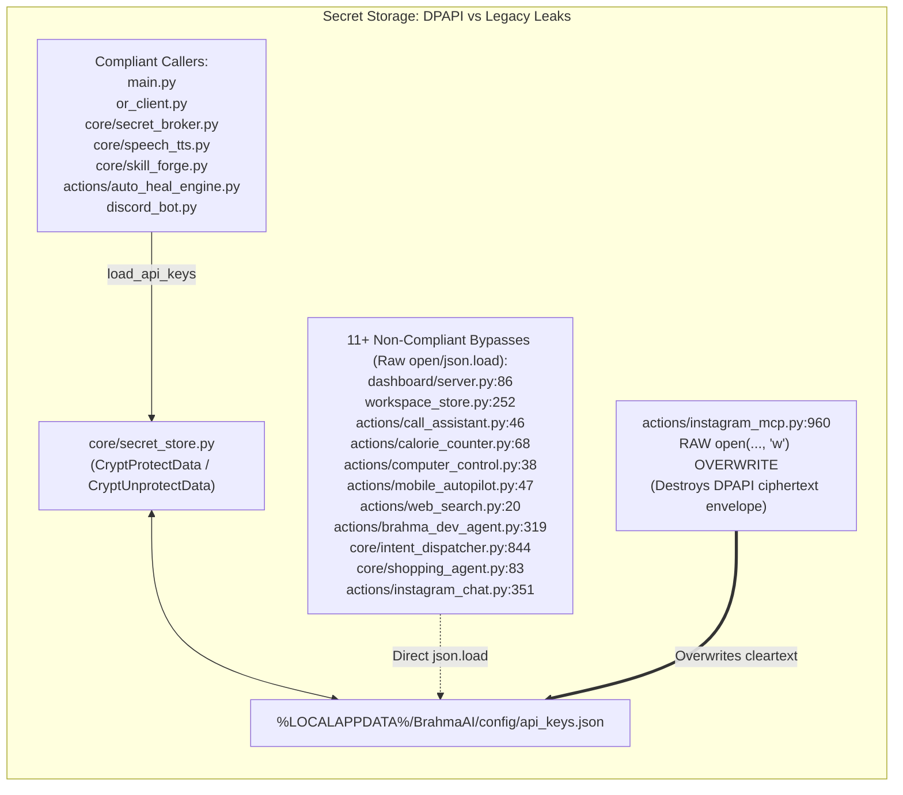

# WP-04: Security Architecture, Trust Boundaries, Secrets, Skills Forge/Crucible & Release Integrity — Deep Scan & Analysis Report

- **Work Package:** WP-04
- **Baseline Commit:** `6439b2e`
- **Files Scanned:** 78 files (8,895 lines)
- **Overall Subsystem Health:** Critical Issues Found (Arbitrary code execution on host during Skill Crucible validation; plaintext secret overwrite and DPAPI bypass across 11+ modules; `DynamicToolRegistry` bypasses `AgentRuntime.execute`; AppContainer launcher, Taint Policy, Secret Broker, and Quarantined Reader are completely unwired in production; `SkillReviewDialog` is orphaned with no UI trigger).

---

## 1. Subsystem Architecture & Data-Flow Summary

The Brahma AI Evo security and capability subsystem spans secret protection (DPAPI), cryptographic release and plugin signing (Ed25519), autonomous skill synthesis ("Project Ultron" / `SkillForge`), safety verification (`SkillCrucible`), capability scoping and content-addressed staging (`SkillStore`, `core.grants`), out-of-process execution (`SkillHost`, `sandbox/`), and the on-demand Skills Library (`core.skills_library`).

Following Upstream Issue #4 (`docs/SECURITY-ANALYSIS-ISSUE-4.md`) and the Security Architecture Roadmap (`docs/SECURITY-ARCHITECTURE-ROADMAP.md`), several foundational primitives were introduced to establish the core design rule:
> *"The model may propose. The user may authorize. The policy decides. The sandbox executes. The broker holds the keys."*

However, our deep static analysis of all 78 assigned files reveals a stark bifurcation between **designed security architecture** and **live runtime reality**: while standalone modules and robust unit tests exist for many security primitives, critical seams remain disconnected, legacy bypasses persist, and a severe host code-execution vulnerability exists in the Crucible test harness itself.

### Primary Architectural Components

1. **Secret Storage & Cryptographic Boundaries (`core/secret_store.py`, `core/secret_broker.py`, `core/redaction.py`):**
   - [core/secret_store.py](file:///C:/Users/Admin/Brahma-Ai-Evo/core/secret_store.py#L1-L234) implements Windows Data Protection API (DPAPI) user-scoped encryption via `crypt32.dll` (`CryptProtectData`/`CryptUnprotectData` with `CRYPTPROTECT_UI_FORBIDDEN`). It stores encrypted payloads in a base64 envelope (`_dpapi_encrypted: true`) with atomic disk writes ([I-17](file:///C:/Users/Admin/Brahma-Ai-Evo/docs/ARCHITECTURE-SPEC.md#L234)).
   - [core/secret_broker.py](file:///C:/Users/Admin/Brahma-Ai-Evo/core/secret_broker.py#L1-L311) provides an in-memory, scoped credential broker designed to inject API keys at the network boundary (`http_request`) so models and skills never receive raw credentials.
   - [core/redaction.py](file:///C:/Users/Admin/Brahma-Ai-Evo/core/redaction.py#L1-L104) provides regex and dictionary-key scrubbing for API keys (`AIza...`, `sk-or-v1-...`, `sk-...`, Groq, Bearer tokens, DPAPI blobs, Fernet keys).
   - [core/audit.py](file:///C:/Users/Admin/Brahma-Ai-Evo/core/audit.py#L1-L249) implements an append-only, SHA-256 hash-chained JSONL audit logger (`verify_audit_log`).
2. **Capability Grants & Taint Tracking (`core/capabilities.py`, `core/grants.py`, `core/taint_policy.py`, `core/trust.py`, `core/quarantine.py`):**
   - [core/capabilities.py](file:///C:/Users/Admin/Brahma-Ai-Evo/core/capabilities.py#L1-L135) establishes canonical capabilities (`fs.read`, `fs.write`, `net.client`, `net.server`, `process.spawn`, `secret.read`, `admin`) with glob matching.
   - [core/grants.py](file:///C:/Users/Admin/Brahma-Ai-Evo/core/grants.py#L1-L87) issues and validates capability grants tied to content-addressed artifact SHA-256 hashes.
   - [core/taint_policy.py](file:///C:/Users/Admin/Brahma-Ai-Evo/core/taint_policy.py#L1-L175) implements single-use 60-second action digests (`compute_action_digest`) restricting state-changing operations under tainted contexts.
   - [core/trust.py](file:///C:/Users/Admin/Brahma-Ai-Evo/core/trust.py#L1-L125) and [core/quarantine.py](file:///C:/Users/Admin/Brahma-Ai-Evo/core/quarantine.py#L1-L76) provide boundary markers (`[UNTRUSTED CONTENT]`), secret canary monitoring, and Markdown pixel-exfiltration image sanitization.
3. **Skill Synthesis, Crucible & Staging (`core/skill_forge.py`, `core/skill_crucible.py`, `core/skill_store.py`):**
   - [SkillForge](file:///C:/Users/Admin/Brahma-Ai-Evo/core/skill_forge.py#L56-L236) prompts LLM models via [core/llm_gateway.py](file:///C:/Users/Admin/Brahma-Ai-Evo/core/llm_gateway.py) to synthesize complete Python skills with manifests, triggers, and test cases. Enforces strict TLS guidelines in prompts (reversing legacy `verify=False` recommendations).
   - [SkillCrucible](file:///C:/Users/Admin/Brahma-Ai-Evo/core/skill_crucible.py#L95-L302) performs AST validation, resolves dependencies against a hash-pinned lockfile (`deps.lock`), and runs tests via child process execution.
   - [SkillStore](file:///C:/Users/Admin/Brahma-Ai-Evo/core/skill_store.py#L86-L361) stages draft skills under `%LOCALAPPDATA%\BrahmaAI\skills\store\<sha256>\`, managing the state machine `draft -> approved -> installed | rejected | quarantine`.
4. **Execution & Containment (`core/dynamic_registry.py`, `core/skill_host.py`, `sandbox/`):**
   - [DynamicToolRegistry](file:///C:/Users/Admin/Brahma-Ai-Evo/core/dynamic_registry.py#L123-L320) loads native features from `features/` (21 modules) and verified installed skills from `SkillStore`.
   - [core/skill_host.py](file:///C:/Users/Admin/Brahma-Ai-Evo/core/skill_host.py#L27-L102) wraps skill execution in child processes using [agent.process.run_captured](file:///C:/Users/Admin/Brahma-Ai-Evo/agent/process.py#L280) with environment scrubbing (`SandboxConfig(env_scrub=True)`).
   - [sandbox/launcher_win.py](file:///C:/Users/Admin/Brahma-Ai-Evo/sandbox/launcher_win.py#L71-L148) defines AppContainer profile derivation and directory ACL granting.
5. **Plugins & Release Integrity (`core/plugin_sign.py`, `core/plugin_store.py`, `plugin_manager.py`, `core/release_manager.py`):**
   - Ed25519 digital signature signing and verification for `.bhplugin` packages and `release.json` release manifests.
   - Opt-in plugin allowlist enforcement in [plugin_manager.py](file:///C:/Users/Admin/Brahma-Ai-Evo/plugin_manager.py#L27-L56).
   - Rollback automation and boot failure tracking in [core/release_manager.py](file:///C:/Users/Admin/Brahma-Ai-Evo/core/release_manager.py#L284-L325).

---

### Data-Flow & Lifecycle Architecture Diagrams





---

## 2. File-by-File Inventory & Health Matrix

| File Path | Lines | Primary Symbols / Classes | Status | Risk Level | Notes |
|---|---:|---|---|---|---|
| [`core/secret_store.py`](file:///C:/Users/Admin/Brahma-Ai-Evo/core/secret_store.py) | 234 | `dpapi_protect`, `dpapi_unprotect`, `load_api_keys`, `save_api_keys`, `DATA_BLOB` | Active | Low | Compliant Windows DPAPI implementation with fallback and atomic JSON writes ([I-17](file:///C:/Users/Admin/Brahma-Ai-Evo/docs/ARCHITECTURE-SPEC.md#L234)). |
| [`core/secret_broker.py`](file:///C:/Users/Admin/Brahma-Ai-Evo/core/secret_broker.py) | 311 | `SecretBroker`, `http_request`, `get_secret`, `verify_scope` | Dormant | High | Complete in-memory broker with network boundary injection, but **0 live callers** in runtime. `save_api_keys` return value bug. |
| [`core/audit.py`](file:///C:/Users/Admin/Brahma-Ai-Evo/core/audit.py) | 249 | `AuditLogger`, `verify_audit_log`, `compute_record_hash` | Active | Medium | Hash-chained SHA-256 JSONL audit log. Missing `fsync`; `_init_chain` falls back to sequence -1 on corrupt tail. |
| [`core/redaction.py`](file:///C:/Users/Admin/Brahma-Ai-Evo/core/redaction.py) | 104 | `redact_text`, `redact_data`, `contains_unredacted_secret`, `REDACTION_PATTERNS` | Active | Low | High-coverage credential pattern scrubber covering Gemini, OpenRouter, generic, Groq, Bearer tokens, and DPAPI blobs. |
| [`core/capabilities.py`](file:///C:/Users/Admin/Brahma-Ai-Evo/core/capabilities.py) | 135 | `parse_capability`, `matches_capability`, `evaluate_capabilities`, `ALL_CANONICAL_CAPABILITIES` | Active | Low | Clean canonical capability definitions with prefix and wildcard glob matching. |
| [`core/grants.py`](file:///C:/Users/Admin/Brahma-Ai-Evo/core/grants.py) | 87 | `issue_grant`, `verify_grant` | Active | Medium | Capability grant generator. Claims to be cryptographic, but lacks digital signatures or HMAC (checks only dates and hashes). |
| [`core/taint_policy.py`](file:///C:/Users/Admin/Brahma-Ai-Evo/core/taint_policy.py) | 175 | `TaintPolicy`, `Decision`, `compute_action_digest` | Dormant | High | Robust 60s single-use action digest policy for tainted contexts, but **0 live callers** in runtime. |
| [`core/trust.py`](file:///C:/Users/Admin/Brahma-Ai-Evo/core/trust.py) | 125 | `TrustLevel`, `Origin`, `CanaryMonitor`, `TaintTracker`, `wrap_untrusted` | Dormant | High | Provenance markers and prompt leak canaries. Not wired into `agent/prompts.py` or `agent/loop.py`. |
| [`core/quarantine.py`](file:///C:/Users/Admin/Brahma-Ai-Evo/core/quarantine.py) | 76 | `QuarantinedReader`, `sanitize_untrusted_markdown` | Dormant | Medium | Markdown pixel exfiltration and script stripper. Not wired into live reader pipelines. |
| [`core/confirm.py`](file:///C:/Users/Admin/Brahma-Ai-Evo/core/confirm.py) | 306 | `ask_blocking_choice`, `ask_blocking`, `request`, `resolve`, `_on_qt_main_thread` | Active | Low | Single approval surface enforcing non-main-thread execution ([I-05](file:///C:/Users/Admin/Brahma-Ai-Evo/docs/ARCHITECTURE-SPEC.md#L217)). Cleanly wired. |
| [`core/dep_broker.py`](file:///C:/Users/Admin/Brahma-Ai-Evo/core/dep_broker.py) | 325 | `DependencyBroker`, `DependencyPlan`, `parse_lockfile`, `generate_cyclonedx_sbom` | Active | Low | Strictly enforces hash-pinned `deps.lock`, `--only-binary`, and CycloneDX SBOM generation. |
| [`core/skill_forge.py`](file:///C:/Users/Admin/Brahma-Ai-Evo/core/skill_forge.py) | 457 | `SkillForge`, `forge_skill`, `_call_llm_synthesizer`, `_repair_code` | Active | Medium | Autonomous skill synthesis. Correctly mandates TLS verification in prompt. Stages drafts in `staged_skills/` and `SkillStore`. |
| [`core/skill_crucible.py`](file:///C:/Users/Admin/Brahma-Ai-Evo/core/skill_crucible.py) | 302 | `SkillCrucible`, `validate_ast`, `run_sandbox_test`, `plan_dependencies` | Active | **Critical** | `run_sandbox_test` executes unverified model code via `subprocess.run` as the current user with full privileges. |
| [`core/skill_store.py`](file:///C:/Users/Admin/Brahma-Ai-Evo/core/skill_store.py) | 361 | `SkillStore`, `SkillArtifact`, `compute_artifact_hash` | Active | Low | Content-addressed storage and state machine (`draft -> approved -> installed`). Fully implemented. |
| [`core/skill_host.py`](file:///C:/Users/Admin/Brahma-Ai-Evo/core/skill_host.py) | 102 | `execute_in_skill_host`, `SkillHostError` | Active | Medium | Out-of-process runner using `run_captured` with `env_scrub=True`. Lacks AppContainer boundary. |
| [`core/skill_runner.py`](file:///C:/Users/Admin/Brahma-Ai-Evo/core/skill_runner.py) | 59 | `main`, standalone subprocess runner | Active | Low | JSON IPC shim executed by `SkillHost`. |
| [`core/skill_discovery.py`](file:///C:/Users/Admin/Brahma-Ai-Evo/core/skill_discovery.py) | 70 | `SkillDiscovery`, `analyze_command`, `execute_forge` | Active | Low | Regex-based intent detection for "learn/forge a skill". |
| [`core/skills_library.py`](file:///C:/Users/Admin/Brahma-Ai-Evo/core/skills_library.py) | 1,173 | `SkillsLibrary`, `SkillSpec`, `SkillMeta`, `publish`, `search` | Active | Medium | JIT skills engine. Enforces instructional-only rule on project roots, but executes user skills in-process via `importlib`. |
| [`core/plugin_sign.py`](file:///C:/Users/Admin/Brahma-Ai-Evo/core/plugin_sign.py) | 114 | `PluginVerifier`, `sign_manifest`, `verify_signature`, `generate_keypair` | Active | Low | Ed25519 signature generator and validator for `.bhplugin` packages. |
| [`core/plugin_store.py`](file:///C:/Users/Admin/Brahma-Ai-Evo/core/plugin_store.py) | 291 | `PluginStore`, `install_bundle`, `revoke_publisher`, `revoke_plugin` | Active | Medium | Isolated `.bhplugin` installation and revocation engine. Traversal protection relies on `".." in rel_p.parts`. |
| [`plugin_manager.py`](file:///C:/Users/Admin/Brahma-Ai-Evo/plugin_manager.py) | 156 | `PluginManager`, `load_plugins`, `is_allowed`, `load_signed_bundle` | Active | Medium | Enforces opt-in allowlist from policy/settings; executes allowed plugins in-process without sandbox. |
| [`core/release_manager.py`](file:///C:/Users/Admin/Brahma-Ai-Evo/core/release_manager.py) | 325 | `ReleaseManager`, `verify_manifest`, `stage_release`, `activate_version`, `rollback` | Active | Medium | A/B staging and rollback. Uses dummy empty-string SHA-256 as pinned public release key. |
| [`sandbox/launcher_win.py`](file:///C:/Users/Admin/Brahma-Ai-Evo/sandbox/launcher_win.py) | 148 | `WindowsAppContainerManager`, `AppContainerConfig`, `CAPABILITY_SIDS` | Dormant | High | SID derivation and `icacls` helper; does **not** implement process launching. Uncalled in production. |
| [`sandbox/host_main.py`](file:///C:/Users/Admin/Brahma-Ai-Evo/sandbox/host_main.py) | 75 | `execute_skill_payload`, `main` | Active | Low | CLI worker entry point for `SkillHost`. |
| `features/*.py` (21 files) | ~2,100 | Native features (`internet_speed_test`, `ascii_banner`, `show_gif`, etc.) | Legacy | High | Auto-discovered at startup via AST; executed in main process without `AgentRuntime` gating when invoked via `ToolExecutor`. |
| `features/*/*` (4 subdirs) | ~200 | Stale `manifest.json` + `skill.py` duplicates (`ascii_banner`, `show_gif`, etc.) | Legacy | Medium | Stale duplicate copies; `show_gif` and `show_headphones_image` subdirs contain vulnerable raw network calls. |
| `skills/*/SKILL.md` (12 files) | 303 | Playbook definitions (`security-auditor`, `code-review`, etc.) | Legacy | Low | 100% byte-identical duplicate of `.brahma/skills/`. Shadowed and ignored by harness. |
| `.brahma/skills/*/SKILL.md` (12 files) | 303 | Canonical project playbooks | Active | Low | Active instructional skill catalogue loaded by `agent/skills.py` and `core/skills_library.py`. |
| `skills_library/*` (5 files) | 229 | `README.md`, `reasoning-rigor`, `web-research`, `word-count` | Active | Low | Built-in JIT skills. `word-count` is the sole built-in executable skill. |

---

## 3. Invariant & Specific Audit Question Verdicts

### 3.1 Architectural Invariant Verification

| Invariant ID | Verdict | Evidence (`file:line` & symbol) | Explanation |
|---|---|---|---|
| **I-01** | **PARTIAL / VIOLATED** | [`core/tool_exec.py:126-130`](file:///C:/Users/Admin/Brahma-Ai-Evo/core/tool_exec.py#L126-L130) (`ToolExecutor.execute`) | Calls `DynamicToolRegistry.execute_sync` directly in a thread pool executor when `DynamicToolRegistry.has_tool(name)` is True, completely bypassing `AgentRuntime.execute`, policy checks, approvals, and audit logs. |
| **I-03** | **PASS** | [`agent/runtime.py:240-275`](file:///C:/Users/Admin/Brahma-Ai-Evo/agent/runtime.py#L240-L275) (`AgentRuntime.execute`) | Evaluates policy first; session "always allow" is consulted only on `ask` decisions and can never override or widen a `deny`. |
| **I-04** | **PASS** | [`agent/runtime.py:270`](file:///C:/Users/Admin/Brahma-Ai-Evo/agent/runtime.py#L270), [`core/confirm.py:147`](file:///C:/Users/Admin/Brahma-Ai-Evo/core/confirm.py#L147) | `requires_approval=True` tool specs are never remembered in `session_allow` and prompt the user on every invocation. |
| **I-05** | **PASS** | [`core/confirm.py:137`](file:///C:/Users/Admin/Brahma-Ai-Evo/core/confirm.py#L137) (`ask_blocking_choice`) | Explicitly checks `_on_qt_main_thread()` and immediately returns `"deny"` to prevent UI deadlock when called on the Qt main thread. |
| **I-06** | **PASS** | [`agent/runtime.py:140-165`](file:///C:/Users/Admin/Brahma-Ai-Evo/agent/runtime.py#L140-L165) (`AgentRuntime.reload_policy`) | Catches parse errors, preserves the last known valid policy, and emits `policy_reload` with `ok=False`. |
| **I-14** | **PASS** | [`agent/sandbox.py:150-225`](file:///C:/Users/Admin/Brahma-Ai-Evo/agent/sandbox.py#L150-L225) (`build_env`), [`core/skill_host.py:78`](file:///C:/Users/Admin/Brahma-Ai-Evo/core/skill_host.py#L78) | Credential-shaped environment variables are scrubbed by default and withheld counts reported. Passed to `run_captured`. |
| **I-17** | **PARTIAL / VIOLATED** | [`actions/instagram_mcp.py:960`](file:///C:/Users/Admin/Brahma-Ai-Evo/actions/instagram_mcp.py#L960), [`core/user_paths.py:140`](file:///C:/Users/Admin/Brahma-Ai-Evo/core/user_paths.py#L140) | Atomic writes are enforced in `core/secret_store.py`, `core/skill_store.py`, and `core/release_manager.py`, but directly violated in `actions/instagram_mcp.py:960` which uses raw `open(CONFIG_PATH, "w")`. |
| **I-28** | **PASS** | [`core/tool_exec.py:86-125`](file:///C:/Users/Admin/Brahma-Ai-Evo/core/tool_exec.py#L86-L125) (`ToolExecutor.execute`) | Ratchet ceiling holds: exactly 147 lines and 0 `elif` branches in `core/tool_exec.py`. Native tools route through `AgentRuntime.execute`. |

---

### 3.2 Specific Audit Question Verdicts

#### Q1: End-to-End Forge -> Crucible -> Promotion -> Execution Audit
- **Verdict:** **PARTIAL / BROKEN AT PROMOTION & DISPATCH**
- **Evidence:**
  1. *Synthesis (`core/skill_forge.py:60-236`):* `SkillForge.forge_skill()` prompts Gemini via `core.llm_gateway`, generating manifest, code, and test cases. Writes verified artifacts to `%LOCALAPPDATA%\BrahmaAI\staged_skills\<name>` and registers a quarantined draft in `SkillStore.put_draft()`.
  2. *Verification (`core/skill_crucible.py:95-302`):* Calls `validate_ast()`, `plan_dependencies()` (verifies against `deps.lock` without runtime install), and `run_sandbox_test()`.
  3. *Review & Promotion (`core/ui_skill_review.py:534-560`):* `SkillReviewDialog` implements full grant issuance (`core.grants.issue_grant`) and promotions (`SkillStore.install_artifact` -> `DynamicToolRegistry.register_installed_artifact`). **However, `SkillReviewDialog` is never instantiated or shown by `main.py:_forge_skill`, nor is it wired to any HUD button or slash command.** Staged skills remain trapped in `draft` state unless manually promoted via code.
  4. *Dispatch (`core/tool_exec.py:126-130`):* When dynamic skills are executed via `ToolExecutor`, they call `DynamicToolRegistry.execute_sync` directly, bypassing `AgentRuntime.execute`.
  5. *Module Wiring:* `core/taint_policy.py`, `core/secret_broker.py`, `core/trust.py`, and `core/quarantine.py` have **zero call sites** in the live production execution path; they are exercised only in isolated unit tests.

#### Q2: Existing `features/*.py` Trust & Execution
- **Verdict:** **PARTIAL / CONTAINS VULNERABILITIES**
- **Evidence:**
  1. *Startup Import:* `DynamicToolRegistry.initialize()` parses `FEATURE_METADATA` via AST without importing at startup ([core/dynamic_registry.py:228-237](file:///C:/Users/Admin/Brahma-Ai-Evo/core/dynamic_registry.py#L228-L237)). However, upon first execution, `DynamicSkill._load_module()` imports the module into the main application process with full user privileges.
  2. *Dangerous Operations:*
     - `features/show_gif/skill.py:21-24`: reads `os.environ.get('GIPHY_API_KEY')` directly in a query string and executes raw `urllib.request.urlopen()`.
     - `features/show_headphones_image/skill.py:22-25`: performs raw, unverified remote downloads via `urllib.request.urlretrieve("https://via.placeholder.com/400x300.png?text=Headphones", image_path)`.
     - `features/ascii_banner.py:17`: executes import-time side-effect writing warning to `sys.stderr`.
     - 7 features make direct unproxied outbound HTTP calls to third-party endpoints (Yahoo Finance, CoinGecko, Open-Meteo, OpenSky, Cloudflare, Cricinfo, Binance, ISS API).

#### Q3: DPAPI & Secret Leakage Audit
- **Verdict:** **FAIL / SYSTEMIC DPAPI BYPASSES**
- **Evidence:**
  - 11 modules perform raw `open()` and `json.load()` on `config/api_keys.json`, bypassing `core/secret_store.py`:
    1. [`dashboard/server.py:86`](file:///C:/Users/Admin/Brahma-Ai-Evo/dashboard/server.py#L86) (`_get_gemini_key`)
    2. [`workspace_store.py:252`](file:///C:/Users/Admin/Brahma-Ai-Evo/workspace_store.py#L252) (`summarize_day_activity`)
    3. [`actions/call_assistant.py:46`](file:///C:/Users/Admin/Brahma-Ai-Evo/actions/call_assistant.py#L46) (`_get_api_key`)
    4. [`actions/calorie_counter.py:68`](file:///C:/Users/Admin/Brahma-Ai-Evo/actions/calorie_counter.py#L68) (`_get_api_config`)
    5. [`actions/computer_control.py:38`](file:///C:/Users/Admin/Brahma-Ai-Evo/actions/computer_control.py#L38) (`_load_config`)
    6. [`actions/mobile_autopilot.py:47`](file:///C:/Users/Admin/Brahma-Ai-Evo/actions/mobile_autopilot.py#L47) (`_initialize_llm`)
    7. [`actions/web_search.py:20`](file:///C:/Users/Admin/Brahma-Ai-Evo/actions/web_search.py#L20) (`_get_api_key`)
    8. [`actions/brahma_dev_agent.py:319, 373`](file:///C:/Users/Admin/Brahma-Ai-Evo/actions/brahma_dev_agent.py#L319) (`_get_client`)
    9. [`core/intent_dispatcher.py:844`](file:///C:/Users/Admin/Brahma-Ai-Evo/core/intent_dispatcher.py#L844) (`_extract_intent_llm`)
    10. [`core/shopping_agent.py:83`](file:///C:/Users/Admin/Brahma-Ai-Evo/core/shopping_agent.py#L83) (`_init_client`)
    11. [`actions/instagram_chat.py:351, 368`](file:///C:/Users/Admin/Brahma-Ai-Evo/actions/instagram_chat.py#L351) (`_load_credentials`)
  - **Critical Secret Overwrite:** [`actions/instagram_mcp.py:960`](file:///C:/Users/Admin/Brahma-Ai-Evo/actions/instagram_mcp.py#L960) executes `with open(CONFIG_PATH, "w") as f: json.dump(cfg, f, indent=4)`, which destroys the DPAPI encryption envelope and writes plaintext credentials back to disk.
  - `smart_home.key` is correctly protected via `smart_home/storage.py:CredentialVault` using `core.secret_store.dpapi_protect`.

#### Q4: AppContainer & Crucible Escape Vectors
- **Verdict:** **FAIL / ARBITRARY CODE EXECUTION DURING CRUCIBLE VALIDATION**
- **Evidence:**
  - In `core/skill_crucible.py:run_sandbox_test()` ([lines 257-264](file:///C:/Users/Admin/Brahma-Ai-Evo/core/skill_crucible.py#L257-L264)), synthesized model code is executed via `subprocess.run([sys.executable, "-c", harness_script], timeout=75)`.
  - AppContainer is **not used** during Crucible testing. The child process runs as the current interactive Windows user with full user privileges, full access to user directories, and inherited network access.
  - In `sandbox/launcher_win.py`, `WindowsAppContainerManager` does not implement process launching (`CreateProcessAsUser` is not implemented).
  - An adversarial LLM response or prompt injection can execute arbitrary code on the host during Crucible testing before any user sees or reviews the skill.

#### Q5: Duplicate `skills/` vs `.brahma/skills/`
- **Verdict:** **FAIL / 100% BYTE-IDENTICAL DUPLICATION & LOG POLLUTION**
- **Evidence:**
  - All 12 files across `skills/*/SKILL.md` and `.brahma/skills/*/SKILL.md` are 100% byte-identical (identical SHA-256 hashes for all 12 pairs).
  - In `agent/skills.py:project_roots()`, both directories are appended. During discovery, `agent/skills.py:discover()` encounters `.brahma/skills` first, and then logs 12 warnings every discovery turn: `skills/<name>/SKILL.md: skill '<name>' is already defined by .brahma/skills/<name>/SKILL.md; this copy is ignored`.
  - In `core/skills_library.py:roots()`, `_project_dirs` reverses `project_roots`, so `.brahma/skills` overrides `skills/`.
  - Maintaining both directories creates git redundancy and drift risk where edits to `skills/` are silently ignored.

---

## 4. Detailed Findings

### [WP-04-F01] Arbitrary Host Code Execution in `SkillCrucible.run_sandbox_test` During Skill Synthesis
- **Severity:** `Critical`
- **Category:** `Security`
- **Location:** [`core/skill_crucible.py:257-264`](file:///C:/Users/Admin/Brahma-Ai-Evo/core/skill_crucible.py#L257-L264) (`SkillCrucible.run_sandbox_test`)
- **Evidence & Mechanism:** When `SkillForge.forge_skill()` runs, it calls `SkillCrucible.run_sandbox_test(code, test_cases)`. This function interpolates the unvetted, model-synthesized `skill_code` directly into `harness_script` at module level and executes:
  ```python
  proc = subprocess.run(
      [py_exe, "-c", harness_script],
      capture_output=True,
      text=True,
      stdin=subprocess.DEVNULL,
      timeout=timeout
  )
  ```
  The prior AST validation check (`validate_ast`, lines 99-130) only scans string literals for 12 hardcoded strings (`format c:`, `system32`, `boot_sentry`, etc.). It does not block `os.system`, `subprocess.Popen`, `shutil.rmtree`, socket connections, file writes, or credential reads. The child process runs with the current user's security token, with access to `%USERPROFILE%`, the local network, and all user files.
- **Impact:** Remote Code Execution (RCE) primitive. A prompt injection attack or malicious natural language request can synthesize code that executes arbitrary system commands, deletes user files, or exfiltrates data during the Crucible verification step—before any human review or staging dialog is shown.
- **Recommended Fix:** 
  1. Replace direct `subprocess.run` in `SkillCrucible` with `core/skill_host.py:execute_in_skill_host`, running in an isolated temporary directory with `SandboxConfig(env_scrub=True)`.
  2. Implement an AST visitor (`ast.NodeVisitor`) in `SkillCrucible.validate_ast` that rejects dangerous AST nodes (`ast.Call` invoking `subprocess`, `os.system`, `eval`, `exec`, `__import__`, or unauthorized socket calls).
  3. Guard with a test verifying that synthesized code attempting to write outside the sandbox or call `os.system` is aborted before execution.

---

### [WP-04-F02] Instagram Action Overwrites DPAPI-Encrypted `api_keys.json` with Cleartext JSON
- **Severity:** `Critical`
- **Category:** `Security`
- **Location:** [`actions/instagram_mcp.py:951-961`](file:///C:/Users/Admin/Brahma-Ai-Evo/actions/instagram_mcp.py#L951-L961) (`connect_instagram`)
- **Evidence & Mechanism:** When authenticating with Instagram, lines 951-961 read `CONFIG_PATH` (`api_keys.json`) via raw `json.load()` and write back updated credentials:
  ```python
  cfg = {}
  if CONFIG_PATH.exists():
      with open(CONFIG_PATH, "r", encoding="utf-8") as f:
          cfg = json.load(f)
  if detected_username:
      cfg["instagram_username"] = detected_username
  cfg["instagram_sessionid"] = sid
  cfg["instagram_user_id"] = uid
  cfg["instagram_browser_authenticated"] = True
  with open(CONFIG_PATH, "w", encoding="utf-8") as f:
      json.dump(cfg, f, indent=4)
  ```
  If `api_keys.json` was previously encrypted with Windows DPAPI, `cfg` is a dictionary containing `{"_dpapi_encrypted": True, "ciphertext": "..."}`. Line 960 overwrites `api_keys.json` as cleartext JSON, mixing unencrypted Instagram credentials into the DPAPI ciphertext envelope and corrupting the secret store. Furthermore, it writes without atomic file operations (`atomic_write_json`), violating [I-17](file:///C:/Users/Admin/Brahma-Ai-Evo/docs/ARCHITECTURE-SPEC.md#L234).
- **Impact:** Permanent loss of DPAPI encryption at rest for all stored API keys, exposure of sensitive session tokens in cleartext, and risk of file corruption on crash.
- **Recommended Fix:** Refactor lines 951-961 to load via `core.secret_store.load_api_keys()` and save via `core.secret_store.save_api_keys()`.

---

### [WP-04-F03] Pervasive Direct Reads of `api_keys.json` Bypass DPAPI Decryption
- **Severity:** `High`
- **Category:** `Security`
- **Location:** 
  - [`dashboard/server.py:86`](file:///C:/Users/Admin/Brahma-Ai-Evo/dashboard/server.py#L86) (`_get_gemini_key`)
  - [`workspace_store.py:252`](file:///C:/Users/Admin/Brahma-Ai-Evo/workspace_store.py#L252) (`summarize_day_activity`)
  - [`actions/call_assistant.py:46`](file:///C:/Users/Admin/Brahma-Ai-Evo/actions/call_assistant.py#L46) (`_get_api_key`)
  - [`actions/calorie_counter.py:68`](file:///C:/Users/Admin/Brahma-Ai-Evo/actions/calorie_counter.py#L68) (`_get_api_config`)
  - [`actions/computer_control.py:38`](file:///C:/Users/Admin/Brahma-Ai-Evo/actions/computer_control.py#L38) (`_load_config`)
  - [`actions/mobile_autopilot.py:47`](file:///C:/Users/Admin/Brahma-Ai-Evo/actions/mobile_autopilot.py#L47) (`_initialize_llm`)
  - [`actions/web_search.py:20`](file:///C:/Users/Admin/Brahma-Ai-Evo/actions/web_search.py#L20) (`_get_api_key`)
  - [`actions/brahma_dev_agent.py:319, 373`](file:///C:/Users/Admin/Brahma-Ai-Evo/actions/brahma_dev_agent.py#L319) (`_get_client`)
  - [`core/intent_dispatcher.py:844`](file:///C:/Users/Admin/Brahma-Ai-Evo/core/intent_dispatcher.py#L844) (`_extract_intent_llm`)
  - [`core/shopping_agent.py:83`](file:///C:/Users/Admin/Brahma-Ai-Evo/core/shopping_agent.py#L83) (`_init_client`)
  - [`actions/instagram_chat.py:351, 368`](file:///C:/Users/Admin/Brahma-Ai-Evo/actions/instagram_chat.py#L351) (`_load_credentials`)
- **Evidence & Mechanism:** Across 11 modules in the codebase, `api_keys.json` is read directly via `open(...)` and `json.load(...)`. When DPAPI encryption is enabled at rest, the file content is `{"_dpapi_encrypted": true, "ciphertext": "..."}`. Any direct JSON read fails to find keys like `"gemini_api_key"` or throws `KeyError: 'gemini_api_key'` (e.g. `workspace_store.py:252` and `actions/web_search.py:20`).
- **Impact:** System-wide failure of auxiliary actions, web search, background summarization, and local dashboard authentication whenever secrets are protected with DPAPI.
- **Recommended Fix:** Replace all direct reads across these 11 files with `from core.secret_store import load_api_keys; keys = load_api_keys()`.

---

### [WP-04-F04] `ToolExecutor` Executes Dynamic Features Outside `AgentRuntime.execute`
- **Severity:** `High`
- **Category:** `Architecture/Invariant`
- **Location:** [`core/tool_exec.py:126-130`](file:///C:/Users/Admin/Brahma-Ai-Evo/core/tool_exec.py#L126-L130) (`ToolExecutor.execute`)
- **Evidence & Mechanism:** When `name` is not a registered harness tool and not a meta-tool, `ToolExecutor` checks:
  ```python
  if name and DynamicToolRegistry.has_tool(name):
      loop = asyncio.get_event_loop()
      run_res = await loop.run_in_executor(
          None, lambda: DynamicToolRegistry.execute_sync(name, args or {})
      )
  ```
  This invokes `DynamicToolRegistry.execute_sync()` directly. It does **not** invoke `agent_runtime.execute()`, which violates Invariant [I-01](file:///C:/Users/Admin/Brahma-Ai-Evo/docs/ARCHITECTURE-SPEC.md#L213) ("Every harness tool call on every door passes through `AgentRuntime.execute`"). Dynamic skills execute without policy gating, without checking `agent_permissions.json`, and without logging to `core/audit.py`.
- **Impact:** Dynamic tools operate as an unmonitored back-channel that evades permission policies, approval prompts, and audit records.
- **Recommended Fix:** Adapt `DynamicToolRegistry` tools into standard `ToolSpec` instances during startup, or wrap `DynamicToolRegistry.execute_sync` inside an `AgentRuntime.execute` dispatch adapter.

---

### [WP-04-F05] Disconnected Security Architecture: Security Modules Are Test-Only Artifacts
- **Severity:** `High`
- **Category:** `Architecture/Invariant`
- **Location:** [`core/secret_broker.py`](file:///C:/Users/Admin/Brahma-Ai-Evo/core/secret_broker.py), [`core/taint_policy.py`](file:///C:/Users/Admin/Brahma-Ai-Evo/core/taint_policy.py), [`core/quarantine.py`](file:///C:/Users/Admin/Brahma-Ai-Evo/core/quarantine.py), [`sandbox/launcher_win.py`](file:///C:/Users/Admin/Brahma-Ai-Evo/sandbox/launcher_win.py), [`core/trust.py`](file:///C:/Users/Admin/Brahma-Ai-Evo/core/trust.py)
- **Evidence & Mechanism:** 
  - `TaintPolicy`: 0 call sites in production code; only referenced in `test_taint_policy.py` and `test_redteam.py`.
  - `SecretBroker`: 0 call sites in production code; LLM clients (`llm_client.py`, `or_client.py`, `core/llm_gateway.py`) do not use it.
  - `QuarantinedReader`: 0 call sites in production code.
  - `WindowsAppContainerManager`: 0 call sites in production code; lacks `CreateProcessAsUser` implementation.
  - `TaintTracker` and `CanaryMonitor`: 0 call sites in production code.
- **Impact:** The security roadmap (WS-2, WS-7, WS-9) is only implemented in isolation. The live application runs without secret brokering, without taint tracking, and without AppContainer isolation.
- **Recommended Fix:** Plan a coordinated integration batch (Remediation Batch R-1) to wire `SecretBroker` into `core/llm_gateway.py`, connect `TaintPolicy` to `agent/permissions.py`, and complete process token restriction in `core/skill_host.py`.

---

### [WP-04-F06] `SkillReviewDialog` Is Orphaned with No UI Trigger
- **Severity:** `Medium`
- **Category:** `Correctness/Bug`
- **Location:** [`core/ui_skill_review.py:64`](file:///C:/Users/Admin/Brahma-Ai-Evo/core/ui_skill_review.py#L64) (`SkillReviewDialog`), [`main.py:2703-2740`](file:///C:/Users/Admin/Brahma-Ai-Evo/main.py#L2703-L2740) (`BrahmaLive._forge_skill`)
- **Evidence & Mechanism:** `core/ui_skill_review.py` implements a comprehensive GUI review dialog for staged skills (`SkillReviewDialog`). However:
  1. `main.py:_forge_skill()` logs that the skill is staged at `staged_skills/<name>`, but never opens `SkillReviewDialog`.
  2. There is no menu item, no Settings Hub card, and no slash command (e.g. `/skills` or `/review_skill`) to launch `SkillReviewDialog`.
  3. Static search confirms `SkillReviewDialog` is referenced **only** in its own module and in `tests/test_ui_skill_review.py`.
- **Impact:** Users who ask Brahma to "learn" or "forge" a skill are told it is staged for review, but have no way to review, grant capabilities to, or promote the skill from the interface.
- **Recommended Fix:** Add a slash command `/skills` in `core/text_turn_controller.py` that opens `SkillReviewDialog`, and trigger `SkillReviewDialog` directly from `main.py:_forge_skill()` when running in GUI mode.

---

### [WP-04-F07] Pinned Release Public Key in `ReleaseManager` Is SHA-256 of Empty String
- **Severity:** `Medium`
- **Category:** `Security`
- **Location:** [`core/release_manager.py:29-31`](file:///C:/Users/Admin/Brahma-Ai-Evo/core/release_manager.py#L29-L31) (`PINNED_RELEASE_PUBLIC_KEY`)
- **Evidence & Mechanism:** Line 29 defines:
  ```python
  PINNED_RELEASE_PUBLIC_KEY = (
      "e3b0c44298fc1c149afbf4c8996fb92427ae41e4649b934ca495991b7852b855"
  )
  ```
  This string is the well-known SHA-256 digest of an empty byte string (`hashlib.sha256(b"").hexdigest()`). While 32 bytes can be loaded as an Ed25519 point by `cryptography`, no matching private key exists.
- **Impact:** Production release manifests cannot be verified against the hardcoded key, preventing signed automated updates unless the key is overridden in tests.
- **Recommended Fix:** Generate a real Ed25519 release keypair with `tools/sign_release.py --generate-key`, store the private key in an offline secret vault, and embed the authentic public key into `core/release_manager.py`.

---

### [WP-04-F08] Unsigned Capability Grants Allow Offline Tampering in `SkillStore`
- **Severity:** `Medium`
- **Category:** `Security`
- **Location:** [`core/grants.py:20-41`](file:///C:/Users/Admin/Brahma-Ai-Evo/core/grants.py#L20-L41) (`issue_grant`), [`core/grants.py:44-87`](file:///C:/Users/Admin/Brahma-Ai-Evo/core/grants.py#L44-L87) (`verify_grant`)
- **Evidence & Mechanism:** The module docstring describes grants as "cryptographic and capability grants". However, `issue_grant()` returns an unsigned dictionary containing plaintext capabilities, timestamps, and a random hex nonce. `verify_grant()` checks only date expiration and hash equality. It contains no HMAC or digital signature.
- Impact: Any local process or unprivileged script that modifies `%LOCALAPPDATA%\BrahmaAI\skills\store\<hash>\artifact.json` can add arbitrary capabilities (`admin`, `*`, `net.client`, `fs.write`) without detection, and `verify_grant()` will accept them as valid.
- **Recommended Fix:** Sign the canonical grant JSON with a local DPAPI-protected key or Ed25519 key, and verify the signature in `verify_grant()`.

---

### [WP-04-F09] Identical Duplicate Trees `skills/` and `.brahma/skills/` Cause Diagnostic Log Pollution and Drift Risk
- **Severity:** `Low`
- **Category:** `Dead/Duplicate Code`
- **Location:** `skills/` (12 files) vs `.brahma/skills/` (12 files)
- **Evidence & Mechanism:** All 12 `SKILL.md` files in `skills/` are 100% byte-identical to those in `.brahma/skills/`. During every turn discovery pass, `agent/skills.py:discover()` discovers `.brahma/skills` first, then logs 12 warning diagnostics that `skills/` is shadowed:
  ```
  skills/code-review/SKILL.md: skill 'code-review' is already defined by .brahma/skills/code-review/SKILL.md; this copy is ignored
  ```
- **Impact:** Diagnostic log pollution (12 warnings per discovery cycle) and risk of developer confusion where edits made in `skills/` are silently ignored by the runtime.
- **Recommended Fix:** Remove the root `skills/` directory from git, standardizing solely on `.brahma/skills/` as the canonical project skills root.

---

### [WP-04-F10] Stale Duplicate Feature Packages and Import-Time Warning in `features/`
- **Severity:** `Low`
- **Category:** `Dead/Duplicate Code`
- **Location:** `features/ascii_banner/`, `features/show_gif/`, `features/show_headphones_image/`, `features/system_monitor_ascii/`, [`features/ascii_banner.py:17`](file:///C:/Users/Admin/Brahma-Ai-Evo/features/ascii_banner.py#L17)
- **Evidence & Mechanism:** Four subdirectories in `features/` contain stale `manifest.json` and `skill.py` duplicates of top-level `.py` files. While `features/show_gif.py` and `features/show_headphones_image.py` were rewritten to render locally via PIL and matplotlib, their subdirectories still contain vulnerable implementations (`show_gif/skill.py` accesses `os.environ.get('GIPHY_API_KEY')`; `show_headphones_image/skill.py` uses `urllib.request.urlretrieve`). Additionally, `features/ascii_banner.py:17` executes `print(..., file=sys.stderr)` at import time when `pyfiglet` is missing, violating import-time side-effect rules ([I-26](file:///C:/Users/Admin/Brahma-Ai-Evo/docs/ARCHITECTURE-SPEC.md#L253)).
- **Impact:** Stale network-dependent code is retained, and stderr is polluted during tool indexing.
- **Recommended Fix:** Delete the 4 duplicate subdirectories in `features/` and remove the import-time `print` statement in `features/ascii_banner.py`.

---

## 5. Cross-Package Seams & Handoff Notes for Orchestrator

1. **`WP-02` (Tool Surface & Retrieval Index):**
   - In `core/tool_exec.py:126-130`, the fallback dispatch for dynamic skills calls `DynamicToolRegistry.execute_sync` directly. `WP-02` and `WP-04` must coordinate on adapting dynamic tools into `ToolSpec` objects so that all dynamic invocations pass through `AgentRuntime.execute` ([I-01](file:///C:/Users/Admin/Brahma-Ai-Evo/docs/ARCHITECTURE-SPEC.md#L213)).
2. **`WP-03` (App Core, Turn Controllers & Providers):**
   - `core/secret_broker.py` was designed to mediate provider calls in `llm_client.py`, `or_client.py`, and `core/llm_gateway.py`. Currently, provider keys are loaded directly via `secret_store.load_api_keys()` and passed into SDK constructors in memory. The orchestrator must note that `SecretBroker` remains an offline prototype until network boundary injection is wired into the provider chain.
3. **`WP-05` (Bridges, APIs, Gateways & Dashboard):**
   - `dashboard/server.py:86` bypasses DPAPI by using raw `open()` and `json.load()` on `api_keys.json`. When DPAPI encryption is activated, the dashboard fails to load the Gemini API key.
4. **`WP-06` (PyQt6 UI Shell & Overlays):**
   - `core/ui_skill_review.py` is fully implemented as a PyQt6 dialog (`SkillReviewDialog`), but has no launcher in `ui.py` or `core/ui_commandbar.py`. Hand off to `WP-06` to bind a `/skills` slash command and a menu item in Settings Hub.
5. **`WP-09` & `WP-10` (Native Capability Actions):**
   - 9 native capability action modules in `actions/` (`call_assistant.py`, `calorie_counter.py`, `computer_control.py`, `mobile_autopilot.py`, `web_search.py`, `brahma_dev_agent.py`, `instagram_chat.py`, `instagram_mcp.py`, `workspace_store.py`) read `api_keys.json` directly using raw `open()`. In particular, `actions/instagram_mcp.py:960` overwrites `api_keys.json` in cleartext. Hand off to `WP-09` and `WP-10` for bulk migration to `core.secret_store.load_api_keys()`.

---

## 6. Prioritized Action Queue for This Subsystem

### 1. Immediate (P0/P1) — Critical Security Fixes
1. **Fix Crucible Subprocess Isolation ([WP-04-F01]):** Refactor `SkillCrucible.run_sandbox_test()` in `core/skill_crucible.py` to route execution through `core/skill_host.py:execute_in_skill_host()` with `SandboxConfig(env_scrub=True)` in a dedicated temporary scratch directory, rather than executing raw `subprocess.run` on the host. Add AST blocking for `subprocess`, `os.system`, and unauthorized syscalls.
2. **Fix Instagram DPAPI Cleartext Overwrite ([WP-04-F02]):** Update `actions/instagram_mcp.py:951-961` to load and save credentials exclusively using `core.secret_store.load_api_keys()` and `core.secret_store.save_api_keys()`.
3. **Remediate Pervasive Raw `api_keys.json` Reads ([WP-04-F03]):** Replace raw `open()` / `json.load()` calls across the 11 identified files (`dashboard/server.py`, `workspace_store.py`, `actions/web_search.py`, etc.) with `core.secret_store.load_api_keys()`.
4. **Enforce `AgentRuntime` Boundary on Dynamic Features ([WP-04-F04]):** Wrap `DynamicToolRegistry.execute_sync` calls in `core/tool_exec.py` inside `AgentRuntime.execute()` to re-establish Invariant [I-01](file:///C:/Users/Admin/Brahma-Ai-Evo/docs/ARCHITECTURE-SPEC.md#L213).

### 2. Near-Term (P2) — Functional Wiring & Integrity Hardening
1. **Wire `SkillReviewDialog` into GUI ([WP-04-F06]):** Add a `/skills` slash command in `core/text_turn_controller.py` and invoke `SkillReviewDialog` from `main.py:_forge_skill()` so users can review, approve, and install drafted skills.
2. **Embed Authentic Ed25519 Public Key in `ReleaseManager` ([WP-04-F07]):** Replace the dummy empty-string SHA-256 digest in `core/release_manager.py:29-31` with an authentic, generated Ed25519 public key.
3. **Cryptographically Sign Capability Grants ([WP-04-F08]):** Add local HMAC-SHA256 or asymmetric digital signature signing to `core/grants.py:issue_grant` and verify it in `verify_grant`.
4. **Add `fsync` and Resilient Recovery to Audit Log ([WP-04-F05]):** Add `f.flush()` and `os.fsync(f.fileno())` to `core/audit.py:log()`, and quarantine corrupted audit files rather than appending sequence -1.

### 3. Cleanup / Refactor (P3) — Redundancy & Technical Debt
1. **Deduplicate Skill Trees ([WP-04-F09]):** Delete `skills/` and standardize on `.brahma/skills/` across documentation and discovery.
2. **Purge Stale Duplicate Features in `features/` ([WP-04-F10]):** Delete the 4 duplicate subdirectories (`ascii_banner/`, `show_gif/`, `show_headphones_image/`, `system_monitor_ascii/`) in `features/`. Remove the import-time `print` in `features/ascii_banner.py`.
3. **Remove `workspace_store` Import-Time Side Effect:** Wrap `_STORE = WorkspaceStore()` in `workspace_store.py:542` in a lazy accessor function `get_workspace_store()` to prevent import-time crashes when user DB files are corrupted ([I-26](file:///C:/Users/Admin/Brahma-Ai-Evo/docs/ARCHITECTURE-SPEC.md#L253)).
