# WP-05 Scan Report: Agent Bridge v2, Loopback OpenAI API, Mobile Gateway, Dashboard & Android Companion

**Work Package:** WP-05 (Agent Bridge v2, Loopback OpenAI API, Mobile Gateway, Dashboard & Android Companion)  
**Baseline Commit:** `6439b2e`  
**Files Scanned:** 56 total files across 5 subsystems  
**Subsystem Health Verdict:** **CRITICAL / NEEDS HARDENING** (Multiple high-risk security boundaries, unauthenticated network surfaces, privilege escalation via UAC manipulation, cleartext network transport in Android companion, DPAPI bypasses, and dormant/disconnected bridge seams)

---

## 1. Subsystem Architecture & Data-Flow Summary

WP-05 encompasses the five perimeter network, external bridge, and remote interface subsystems of Brahma AI Evo:
1. **Agent Bridge v2 (`core/agent_bridge/`)**: Dynamic discovery, capability probing, and lifecycle adaptation for external agent systems (CLI agents like Aider/Claude Code, local model runtimes like Ollama/LM Studio/vLLM, MCP stdio/SSE servers, Paperclip/Orca orchestrators, and remote OpenAI/Anthropic gateways). Designed pursuant to ADR-018.
2. **Loopback OpenAI-Compatible API (`brahma_api/`)**: A secure, transport-only FastAPI loopback server providing `/v1/chat/completions` and `/v1/models` endpoints to local clients, designed pursuant to ADR-022.
3. **Mobile Gateway (`brahma_connect/`) & Authentication (`core/gateway_auth.py`)**: A dual HTTP/WebSocket daemon providing authenticated mDNS/DNS-SD discovery, HMAC-SHA256 authenticated pairing, device telemetry ingestion, and bidirectional command/chat routing for companion devices.
4. **Web Dashboard (`dashboard/`)**: A legacy browser-based control plane and FastAPI HTTP/WebSocket server listening on `0.0.0.0:8000` with WebRTC/Gemini Live audio bridging, file upload, remote command submission, and dynamic PIN authentication.
5. **Discord Integration (`discord_bot.py`)**: A standalone and GUI-bindable Discord gateway bridging channel messages into Brahma commands and streaming back LLM replies.
6. **Android Companion (`brahma-connect-android/`)**: A native Kotlin/Jetpack Compose Android application implementing device discovery, QR/manual pairing, accessibility service screen-scraping/gesture injection, device command handling, and local storage.

### 1.1 Architecture & Component Boundaries

```mermaid
flowchart TD
    subgraph DesktopHost ["Brahma Desktop Host (Windows)"]
        subgraph CoreRuntime ["Core Agent Runtime (WP-01 / WP-02)"]
            Loop["AgentLoop"]
            Runtime["AgentRuntime (execute gate)"]
            Policy["PermissionPolicy (agent_permissions.json)"]
            ToolIndex["ToolIndex / ToolSpec Registry"]
            SecretStore["SecretStore (DPAPI Encrypted)"]
        end

        subgraph BrahmaAPI ["brahma_api (ADR-022 Loopback API)"]
            APIServer["FastAPI Server (127.0.0.1:8008)"]
            APIRunner["APIRunner (Profile Policy Enforcement)"]
            APITokens["Token Store (SHA-256 Hashes)"]
        end

        subgraph BridgeV2 ["core/agent_bridge (ADR-018 Bridge v2)"]
            Bridge["AgentBridge Singleton"]
            Registry["AgentRegistry"]
            Detectors["AgentDetectors (Process/Port Scan)"]
            Adapters["Bridge Adapters (CLI, Local, MCP, Orca, Remote)"]
        end

        subgraph DashboardSubsystem ["dashboard (Web Dashboard)"]
            DashServer["FastAPI Server (0.0.0.0:8000)"]
            DashAuth["PIN Authentication (No Lockout)"]
            DashUAC["_ensure_network_access (Elevated UAC / Netsh)"]
            DashUpload["Upload Handler (500 MB limit)"]
        end

        subgraph ConnectGateway ["brahma_connect (Mobile Gateway)"]
            GWServer["GatewayServer (0.0.0.0:8765)"]
            GWAuth["GatewayAuthManager (HMAC-SHA256, Replay Nonce)"]
            CmdRouter["CommandRouter"]
            DevManager["DeviceManager"]
        end

        subgraph DiscordGateway ["discord_bot.py"]
            DiscordClient["Discord Client"]
            DiscordDirectLLM["Direct LLM Fallback (Bypasses Policy)"]
        end
    end

    subgraph ExternalClients ["External & Remote Clients"]
        OpenAIClients["OpenAI SDK / Cursor / Continue / WebUI"]
        WebBrowser["Remote Web Browser (LAN / WAN)"]
        DiscordCloud["Discord Cloud Gateway"]
        AndroidDevice["brahma-connect-android (Physical Device)"]
    end

    %% External Connections
    OpenAIClients -->|"Bearer Token (HTTP POST /v1/...)"| APIServer
    WebBrowser -->|"HTTP / WebSocket (Cleartext Port 8000)"| DashServer
    DiscordCloud -->|"Discord Gateway WebSocket"| DiscordClient
    AndroidDevice -->|"mDNS Discovery (_BRAHMA._tcp)"| GWServer
    AndroidDevice -->|"Cleartext WebSocket (ws://...:8765/ws)"| GWServer

    %% Internal Data-Flow & Invariant Enforcement
    APIServer --> APIRunner
    APIRunner -->|"models.resolve() (Downgrade Only)"| Policy
    APIRunner -->|"Direct Call (chat/reader/worker/operator)"| Runtime
    Runtime --> Loop

    Bridge --> Detectors
    Bridge --> Registry
    Registry --> Adapters
    Bridge -.->|"DEAD SEAM: publish_tools() never invoked"| ToolIndex

    DashServer -->|"Command Queue (_command_queue)"| Loop
    DashServer -.->|"BYPASS: Raw read of api_keys.json"| SecretStore
    DashUAC -->|"ShellExecuteW('runas') elevated cmd.exe"| DesktopHost

    GWServer --> GWAuth
    GWServer --> CmdRouter
    GWServer -.->|"ORPHANED: on_chat_message never wired"| Loop
    CmdRouter --> DevManager

    DiscordClient -->|"Bound Mode: submit_command()"| Loop
    DiscordClient -.->|"Unbound Mode: Direct LLM Gateway"| DiscordDirectLLM
    DiscordClient -.->|"BYPASS: Raw read of api_keys.json"| SecretStore
```



### 1.2 Data-Flow & Security Invariants Summary

1. **`brahma_api` (Loopback API)** strictly enforces the ADR-022 Transport-Only Invariant. Incoming tokens are hashed with SHA-256, verified in constant time (`hmac.compare_digest`), mapped to profile constraints (`chat`, `reader`, `worker`, `operator`), and resolved against runtime policies using a downgrade-only intersection algorithm (`models.resolve`). All model/tool execution passes exclusively through `AgentRuntime.execute`.
2. **`core/agent_bridge` (Bridge v2)** implements rich multi-adapter abstractions (CLI subagents, local model engines, MCP stdio/SSE, orchestrator endpoints, remote APIs). However, **it is completely disconnected from live runtime execution**. Its discovery results and `publish_tools()` methods are never wired to `main.py` or `ToolIndex`, rendering it a dead seam accessible only as an informational card in the Settings UI.
3. **`dashboard/server.py`** exhibits severe security defects: it binds to `0.0.0.0:8000`, generates an elevated Windows UAC prompt (`runas`) modifying host firewall and changing network profile to `Private`, lacks brute-force lockouts on 6-character PIN logins, exposes unauthenticated arbitrary file read endpoints, allows 500 MB arbitrary file uploads without quotas, and bypasses DPAPI secret storage.
4. **`brahma_connect` & `brahma-connect-android`** provide robust cryptographic pairing (HMAC-SHA256, replay nonce tracking, timestamp skew validation). However, the mobile companion enables `android:usesCleartextTraffic="true"` and communicates via unencrypted `ws://` sockets, exposing sensitive accessibility dumps, screen text, and keystrokes across local Wi-Fi. Furthermore, the desktop mobile gateway service is not started in `main.py`, and `on_chat_message` is unhandled, dropping mobile chat messages.
5. **`discord_bot.py`** provides an unbound standalone fallback mode that invokes `llm_gateway` and `openrouter_client` directly without `AgentRuntime.execute` or permission policy enforcement, while executing runtime `pip install` subprocess commands upon module import.

---

## 2. File-by-File Inventory & Health Matrix

| File Path | LOC | Status | Role / Architectural Purpose | Direct Dependencies | Identified Vulnerabilities & Anomalies |
|:---|:---:|:---:|:---|:---|:---|
| `core/agent_bridge/__init__.py` | 42 | Healthy | Public facade exporting bridge singletons and models | Python stdlib | None |
| `core/agent_bridge/constants.py` | 76 | Healthy | Bridge enums: `AgentType`, `AgentStatus`, `AgentCapability`, `BridgeHealth` | Python stdlib (`enum`) | None |
| `core/agent_bridge/errors.py` | 45 | Healthy | Bridge domain hierarchy (`BridgeError`, `AdapterError`, `DiscoveryError`) | Python stdlib | None |
| `core/agent_bridge/models.py` | 134 | Healthy | Data contracts: `AgentDescriptor`, `AgentTask`, `BridgeEvent` | `pydantic` | None |
| `core/agent_bridge/registry.py` | 102 | Healthy | In-memory thread-safe registry of discovered agents | Python stdlib (`threading`) | None |
| `core/agent_bridge/artifacts.py` | 89 | Healthy | Workspace artifact tracker and metadata parser | Python stdlib (`pathlib`) | None |
| `core/agent_bridge/adapter.py` | 148 | Healthy | Abstract base class `AgentAdapter` defining lifecycle and dispatch contracts | Python stdlib (`abc`, `asyncio`) | None |
| `core/agent_bridge/detectors.py` | 162 | Fragile | Process, port, and filesystem heuristics to detect local agents | `psutil`, `socket`, `pathlib` | Broad process/port sweeps; unhandled `psutil.AccessDenied` edge cases |
| `core/agent_bridge/bridge.py` | 248 | Dead Seam | Central coordinator orchestrating detection, adapters, and tools | `threading`, `asyncio`, `agent_bridge.*` | **Dead Seam:** `publish_tools()` is never called by `main.py` or `ToolIndex`; bridge tools are never exposed to LLM turns |
| `core/agent_bridge/adapters/__init__.py` | 28 | Healthy | Adapter module export facade | Python stdlib | None |
| `core/agent_bridge/adapters/cli_agent.py` | 185 | Fragile | Adapter wrapping CLI agents (Aider, Claude Code, Goose) via stdio subprocess | `subprocess`, `asyncio` | Subprocess timeouts present, but spawns outside `agent.process.run_captured` |
| `core/agent_bridge/adapters/local_model.py` | 192 | Fragile | Adapter connecting to Ollama, LM Studio, vLLM HTTP APIs | `httpx`, `json` | Hardcoded localhost fallbacks; SSRF vulnerability if remote URL configured |
| `core/agent_bridge/adapters/mcp_server.py` | 215 | Fragile | Adapter managing stdio/SSE Model Context Protocol servers | `asyncio`, `json` | Parallel MCP client implementation conflicting with harness-standard `agent/mcp.py` |
| `core/agent_bridge/adapters/orchestrator.py` | 176 | Fragile | Adapter integrating Paperclip and Orca multi-agent frameworks | `httpx`, `os` | Hardcodes port 8000 default (`BRAHMA_GATEWAY_PORT`), conflicting with Dashboard |
| `core/agent_bridge/adapters/remote.py` | 158 | Fragile | Adapter connecting to remote Brahma instances or OpenAI endpoints | `httpx` | Bypasses `core/secret_store.py` for API key management |
| `brahma_api/__init__.py` | 25 | Healthy | Public facade exporting `APIRunner` and `create_app` | Python stdlib | None |
| `brahma_api/__main__.py` | 42 | Healthy | CLI launcher for loopback server (`python -m brahma_api`) | `argparse`, `uvicorn` | None |
| `brahma_api/auth.py` | 118 | Healthy | Constant-time token authentication and scope verification | `hmac`, `hashlib`, `json`, `fastapi` | Conforms to ADR-022; hashes checked with `hmac.compare_digest` |
| `brahma_api/config.py` | 86 | Healthy | JSON configuration loader and token store manager | `pydantic`, `pathlib` | None |
| `brahma_api/errors.py` | 64 | Healthy | OpenAI-compatible error formatting and HTTP exception handlers | `fastapi`, `pydantic` | None |
| `brahma_api/models.py` | 142 | Healthy | Model catalog definitions and token permission downgrading | `pydantic`, `agent.permissions` | Invariant-compliant: `models.resolve()` enforces strict privilege downgrade |
| `brahma_api/runner.py` | 268 | Healthy | Bridge between FastAPI requests and `AgentRuntime.execute` / `AgentLoop` | `agent.runtime`, `agent.loop` | Invariant-compliant: Dispatches exclusively through `AgentRuntime.execute` |
| `brahma_api/schemas.py` | 176 | Healthy | Pydantic models for OpenAI chat completion requests/responses | `pydantic` | None |
| `brahma_api/server.py` | 284 | Healthy | FastAPI application defining `/v1/chat/completions` and `/v1/models` | `fastapi`, `uvicorn` | Invariant-compliant: Loopback-only binding; approval gate enforced |
| `brahma_api/streaming.py` | 94 | Healthy | Server-Sent Events (SSE) formatter for OpenAI streaming responses | `asyncio`, `json` | None |
| `brahma_api/translate.py` | 136 | Healthy | Bidirectional message and tool-call schema converter | Python stdlib | None |
| `config/brahma_api.json` | 28 | Healthy | Default configuration for loopback server | JSON | Localhost binding (`127.0.0.1:8008`) |
| `config/brahma_api.example.json` | 28 | Healthy | Example configuration template for loopback server | JSON | None |
| `config/brahma_api/tokens.json` | 14 | Healthy | Active token hash registry | JSON | Contains SHA-256 hashes only; no plaintext secrets |
| `brahma_connect/__init__.py` | 22 | Healthy | Public facade for mobile connect subsystem | Python stdlib | None |
| `brahma_connect/service.py` | 58 | Dead Seam | Background service wrapper managing GatewayServer lifecycle | `threading`, `asyncio` | **Dormant Subsystem:** Never instantiated or started in `main.py` |
| `brahma_connect/README.md` | 65 | Healthy | Documentation for mobile gateway protocol | Markdown | None |
| `brahma_connect/agents/PROTOCOL.md` | 82 | Healthy | Protocol specification for mobile companion framing | Markdown | None |
| `brahma_connect/gateway/__init__.py` | 18 | Healthy | Gateway module export facade | Python stdlib | None |
| `brahma_connect/gateway/models.py` | 112 | Healthy | Gateway data structures (`Device`, `PairingSession`, `GatewayCommand`) | `dataclasses` | None |
| `brahma_connect/gateway/protocol.py` | 134 | Healthy | Framing, serialization, and opcode constants for companion sync | `json`, `dataclasses` | None |
| `brahma_connect/gateway/authentication.py` | 146 | Healthy | Cryptographic pairing handshake, token generation, and HMAC verification | `hmac`, `hashlib`, `secrets` | Cryptographically sound: constant-time HMAC, timestamp skew check, nonce registry |
| `brahma_connect/gateway/capability_manager.py` | 78 | Healthy | Tracks and validates capabilities advertised by mobile device | Python stdlib | None |
| `brahma_connect/gateway/command_router.py` | 164 | Healthy | Routes gateway commands to connected mobile devices | `asyncio`, `json` | Strictly checks `ALLOWED_GATEWAY_COMMANDS` |
| `brahma_connect/gateway/websocket.py` | 210 | Fragile | WebSocket connection manager for mobile devices | `websockets`, `asyncio` | Incoming `chat_message` calls `self.on_chat_message`, which is unassigned in desktop |
| `brahma_connect/gateway/device_manager.py` | 128 | Healthy | Registry of paired and active companion devices | `json`, `pathlib` | None |
| `brahma_connect/gateway/pairing.py` | 142 | Healthy | Dynamic QR code and 6-digit numeric pairing manager | `secrets`, `time` | Ephemeral pairing codes with 5-minute expiry |
| `brahma_connect/gateway/discovery.py` | 116 | Healthy | mDNS / DNS-SD advertiser (`zeroconf`) for local discovery (`_BRAHMA._tcp`) | `zeroconf` | Graceful fallback if `zeroconf` is unavailable |
| `brahma_connect/gateway/mobile_portal.py` | 154 | Healthy | Lightweight HTTP endpoints for pairing offer exchange and web UI | `http.server` | None |
| `brahma_connect/gateway/server.py` | 312 | Fragile | Central gateway coordinating HTTP, WebSocket, pairing, and dispatch | `asyncio`, `aiohttp` | Unbound `on_chat_message` drops mobile text input |
| `core/gateway_auth.py` | 248 | Healthy | Centralized authentication and token validation for gateways | `hmac`, `hashlib`, `time` | Includes brute-force lockout (3 failed attempts -> 15 min lock) |
| `dashboard/__init__.py` | 12 | Healthy | Module export facade | Python stdlib | None |
| `dashboard/server.py` | 914 | Vulnerable | Web Dashboard FastAPI server on `0.0.0.0:8000` | `fastapi`, `ctypes`, `json` | **UAC elevation exploit (`runas`), DPAPI bypass, unauthenticated path traversal, 500MB upload, no PIN rate limiting** |
| `dashboard/static/login.html` | 185 | Vulnerable | Web Dashboard PIN login interface | HTML/JS | Advises users to disable browser security flags (`chrome://flags`) |
| `dashboard/static/app.html` | 320 | Vulnerable | Web Dashboard main operator interface | HTML/JS | Advises users to disable browser security flags; plain HTTP WebRTC |
| `dashboard/static/voice.html` | 245 | Fragile | Web Dashboard voice and audio streaming interface | HTML/JS | WebRTC audio over unencrypted HTTP |
| `discord_bot.py` | 435 | Vulnerable | Discord bot integration bridging messages to Brahma commands | `discord`, `subprocess`, `json` | **Sync `pip install` on import, DPAPI bypass, fallback mode bypasses `AgentRuntime.execute`** |
| `brahma-connect-android/AndroidManifest.xml` | 68 | Vulnerable | Android application manifest | XML | **`usesCleartextTraffic="true"`, broad accessibility permissions** |
| `brahma-connect-android/BrahmaAccessibilityService.kt` | 185 | Fragile | Accessibility service for UI automation and screen scraping | Android SDK | Scrapes sensitive screen contents and injects arbitrary gestures |
| `brahma-connect-android/DeviceCommandHandler.kt` | 240 | Vulnerable | Handles remote commands on Android device | Android SDK | **Path traversal in file operations (`fileRead`/`fileWrite`/`fileDelete`)** |
| `brahma-connect-android/PairingStorage.kt` | 95 | Healthy | Encrypted storage for pairing credentials | `EncryptedSharedPreferences` | Hardware Keystore-backed AES256-GCM storage |
| `brahma-connect-android/BrahmaWebSocketClient.kt` | 162 | Vulnerable | WebSocket client connecting to desktop gateway | `okhttp3` | **Connects via cleartext `ws://`, leaking keystrokes and telemetry** |

---

## 3. Invariant & Specific Audit Question Verdicts

### 3.1 Core Invariant Verdicts

- **Invariant I-01 (Single Permission Boundary):**
  - `brahma_api`: **PASS**. All agentic operations flow strictly through `AgentRuntime.execute`.
  - `brahma_connect`: **PASS (Desktop) / N/A**. Gateway commands route to devices via `CommandRouter` and do not execute desktop tools.
  - `dashboard`: **PASS (Runtime Execution) / FAIL (Administrative Actions)**. Command execution over `/api/command` and `/ws` correctly enqueues into `_command_queue` and reaches `AgentRuntime.execute` via `MainWindow.submit_command()`. However, `_ensure_network_access()` performs administrative firewall and network configuration directly via an elevated shell without passing through `AgentRuntime`.
  - `discord_bot.py`: **FAIL (Unbound Mode)**. When unbound from the GUI (`_app_submitter is None`), `_generate_reply` invokes `llm_gateway.generate_content` and `openrouter_client.chat` directly, completely bypassing `AgentRuntime.execute`.
- **Invariant I-02 (Canonical Tool Protocol):** **PASS**. `brahma_api/translate.py` and `brahma_api/runner.py` maintain strict OpenAI tool message schemas with compliant tool calls and turn order.
- **Invariant I-04 (DPAPI Secret Encryption):** **FAIL**. Both `dashboard/server.py:83-89` and `discord_bot.py:48-56` bypass `core/secret_store.py` and perform raw `json.load()` reads on `config/api_keys.json`.
- **Invariant I-05 (Subprocess Tree Containment):** **FAIL (Adapters & Discord)**. `core/agent_bridge/adapters/cli_agent.py` spawns CLI subprocesses using raw `asyncio.create_subprocess_exec` rather than `agent.process.run_captured`, creating potential orphaned grandchild processes on timeout. `discord_bot.py:20` calls `subprocess.run(["pip", "install", ...])` directly at import time.
- **Invariant I-20 (No Network/Filesystem Sandbox Pretending):** **FAIL**. `dashboard/server.py` attempts to configure Windows Firewall rules dynamically via UAC prompts while advertising insecure HTTP origins as safe.
- **ADR-018 (Agent Bridge Runtime Boundary):** **FAIL (Integration)**. ADR-018 specifies that bridged agent tools must be published into the active runtime's tool registry. In the current implementation, `AgentBridge.publish_tools()` is completely uncalled in `main.py` or `ToolIndex`.
- **ADR-022 (Loopback API Transport-Only Invariant):** **PASS**. Fully compliant. Token permissions can only downgrade privileges, tokens are stored as SHA-256 hashes, and loopback binding is strictly enforced.

---

### 3.2 Specific Audit Question Verdicts

#### Q1: Port 8000 Collision & Authentication in `dashboard/server.py` vs `brahma_connect/gateway/server.py`
- **Port Conflict**: `dashboard/server.py:53` hardcodes `PORT = 8000` (and `8001` for legacy HTTPS alias), binding `0.0.0.0`. `main.py:2917` checks `_is_port_in_use(8000)` and disables the dashboard if port 8000 is occupied. In `core/agent_bridge/adapters/orchestrator.py:60`, `os.environ.get("BRAHMA_GATEWAY_PORT", 8000)` assumes the gateway port defaults to `8000`, creating an architectural collision between the dashboard and gateway expectations (though `brahma_connect/gateway/server.py:41` actually defaults to `8765`).
- **Elevated Host Manipulation**: `dashboard/server.py:121-255` (`_ensure_network_access`) creates a temporary `.bat` file in `%TEMP%` and executes `ShellExecuteW(None, "runas", bat_path, ...)` to trigger an elevated UAC prompt, silently executing `netsh advfirewall firewall add rule ...` for ports 8000/8001 and changing the entire Windows network connection profile to `Private` (`Set-NetConnectionProfile -NetworkCategory Private`)!
- **DPAPI Bypass**: `dashboard/server.py:83-89` (`_get_gemini_key`) does a raw `json.load()` read of `config/api_keys.json`, bypassing DPAPI user encryption (`core/secret_store.py`).
- **Unauthenticated Endpoints & Missing CORS**:
  - `GET /web_background/{filename:path}` (`dashboard/server.py:845-853`) is completely unauthenticated and served on `0.0.0.0`. It lacks path confinement (`is_relative_to(bg_dir)` check).
  - No CORS middleware is installed on FastAPI in `dashboard/server.py`.
- **Zero Rate Limiting on PIN Login**: `POST /login` (`dashboard/server.py:603-623`) accepts a 6-character PIN from 31 characters with **zero brute-force rate limiting or lockouts**, contrasting sharply with `core/gateway_auth.py` (which locks out after 3 attempts).
- **Insecure Transport Advice**: In `dashboard/static/login.html` and `dashboard/static/app.html`, the UI advises users to bypass browser security via `chrome://flags` (`Insecure origins treated as secure`) to enable microphone over plain HTTP.
- **Arbitrary File Upload / DoS**: `MAX_UPLOAD_MB = 500` (`dashboard/server.py:54, 765-809`) permits 500 MB uploads into `Downloads/Brahma Uploads` or `Documents/Brahma Uploads` without disk quotas or file type validation.
- **Execution Route**: Commands received via `POST /api/command` and `WebSocket /ws` are enqueued into `_command_queue`, which `core/realtime_flow.py:65` forwards to `ui.submit_external_command()` -> `MainWindow.submit_command()` -> `text_turn_controller.py` -> `AgentLoop` -> `AgentRuntime.execute`.

#### Q2: `brahma_api` Transport-Only Invariant (ADR-022) — VERDICT: PASS
- `brahma_api/runner.py` is strictly a transport caller. Every agent run creates an `AgentRuntime` with a strict `PermissionPolicy` from `models.profile_policy()`.
- **Strict Capability Downgrade-Only**: `models.resolve()` enforces `_intersect()`. Tokens can never escalate privileges (order: `chat: 0 < reader: 1 < worker: 2 < operator: 3`). A `chat` or `reader` token asking for higher profile is clamped down.
- **Token Storage**: Plaintext tokens are never stored; only SHA-256 hashes (`hmac.compare_digest`) are kept in `tokens.json`. Operator tokens require typed `confirm="operator"` at mint time.
- **Passthrough Lane**: Does not run Brahma tools; passes client tools to provider completer and returns `tool_calls` for client-side execution.
- **GUI Approval Gate**: Only allowed for loopback callers (`127.0.0.1`, `::1`) carrying the `approve` token scope.

#### Q3: Agent Bridge Integration in Live Runtime — VERDICT: DISCONNECTED / DEAD SEAM
- `AgentBridge` (`core/agent_bridge/bridge.py`) defines `publish_tools()`, but **it is never called anywhere in the active runtime** (`main.py`, `core/tool_index.py`, `core/session_lifecycle.py`, or `agent/loop.py`).
- The only file referencing `get_agent_bridge()` is `core/ui_agent_panel.py` (`AgentBridgeCard`), which is only embedded in `core/ui_connectivity.py` (Settings Hub) for manual scanning and diagnostic probing.
- Discovered agent capabilities (CLI coding agents, local model servers, MCP servers, Paperclip/Orca orchestrators) are **never published into `agent.spec` or `ToolIndex`** during normal app boot or live turn cycles. Models in chat/voice can never see or call bridged tools.

#### Q4: `brahma_connect` & `discord_bot.py` Execution Boundaries
- **`brahma_connect`**:
  - `POST /gateway/execute` (`server.py:467-505`) strictly enforces `GatewayAuthManager` allowlist (`ALLOWED_GATEWAY_COMMANDS`), timestamp skew (±60s), nonce replay protection, and `device:command:app` scope. It routes commands TO the device via `CommandRouter.route()`, not executing tools on desktop.
  - `WebSocket /ws` receives `chat_message`, which attempts `self.on_chat_message(text)`. However, `self.on_chat_message` is **never assigned** in `main.py` or `ui.py` (orphaned hook), causing mobile chat messages to be silently ignored!
- **`discord_bot.py`**:
  - When integrated in GUI, `bind_app_submitter(self._win.submit_command)` routes messages through `submit_command` -> `AgentLoop` -> `AgentRuntime.execute`.
  - Fallback / Unbound Mode (`_generate_reply`): Calls `llm_gateway.generate_content` and fallback `openrouter_client.chat` directly.
  - **DPAPI Bypass**: `_load_api_keys()` (`discord_bot.py:48-56`) reads `api_keys.json` directly via `json.loads` without DPAPI decryption (`core/secret_store.py`).
  - **Side-Effect on Import**: `_load_discord_module()` (`discord_bot.py:20`) executes `pip install discord.py` synchronously via `subprocess.run` if discord is missing!

#### Q5: Android Companion Security (`brahma-connect-android`)
- **Credential Storage**: Uses `EncryptedSharedPreferences` with AES256-GCM / MasterKey (hardware keystore). Credential at rest is protected.
- **Cleartext Network Traffic**:
  - `AndroidManifest.xml:25` explicitly sets `android:usesCleartextTraffic="true"`.
  - `BrahmaWebSocketClient.kt:62` connects via unencrypted `ws://${endpoint.host}:${endpoint.port}/ws`. Device secrets, screen dumps, and commands are sent in cleartext across the local network.
- **Overly Broad Accessibility & Shell/File Execution**:
  - `BrahmaAccessibilityService.kt`: Requests full screen scraping (`canRetrieveWindowContent="true"`), gestures (`canPerformGestures="true"`), and view hierarchies (`dumpUiTree`).
  - `DeviceCommandHandler.kt`:
    - `fileRead`, `fileWrite`, `fileDelete` have path traversal gaps (`java.io.File(storage, path)` lacks canonical path verification).
    - `uiDump`, `uiTap`, `uiSwipe`, `uiType`: Injects arbitrary gestures, clicks, and text into any foreground Android app (including banking, email, lockscreen PINs via `unlockPhone`).
    - `openUrl`: Passes raw URLs to `ACTION_VIEW` intents without scheme allowlisting.

---

## 4. Detailed Findings

### 4.1 Critical Severity

#### [SEC-WP05-01] Unauthenticated Host Manipulation & Elevated UAC Execution in Dashboard Server
- **Severity:** Critical
- **Category:** Security / Privilege Escalation
- **Target:** `dashboard/server.py:121-255` (`_ensure_network_access`, `_run_firewall_script`)
- **Evidence & Mechanism:**
  When `dashboard/server.py` starts, `_ensure_network_access()` checks whether firewall rules exist for ports 8000 and 8001. If absent, it synthesizes a temporary `.bat` script in `%TEMP%\brahma_firewall_setup.bat`:
  ```python
  # dashboard/server.py:214-232
  bat_content = f"""@echo off
  netsh advfirewall firewall delete rule name="{rule_name}" >nul 2>&1
  netsh advfirewall firewall add rule name="{rule_name}" dir=in action=allow protocol=TCP localport={port} profile=private,public >nul 2>&1
  powershell -NoProfile -ExecutionPolicy Bypass -Command "Get-NetConnectionProfile | Where-Object {{ $_.NetworkCategory -eq 'Public' }} | Set-NetConnectionProfile -NetworkCategory Private" >nul 2>&1
  """
  ...
  ret = ctypes.windll.shell32.ShellExecuteW(None, "runas", bat_path, None, None, 0)
  ```
- **Impact:**
  1. Spawns an unexpected UAC prompt upon launching Brahma desktop.
  2. Modifies Windows Firewall to open ports 8000 and 8001 on **both private and public network profiles**.
  3. Silently converts all public network adapters (including public Wi-Fi hotspots, hotels, and cafes) to **`Private`**, disabling core Windows boundary protections against other untrusted devices on the local subnet.
- **Remediation:**
  Remove `_ensure_network_access()` and elevated `ShellExecuteW` calls entirely. Port binding should default to `127.0.0.1`. If LAN binding is explicitly toggled by the user in Settings, prompt the user with clear instructions or let an installer script configure firewall rules once during installation rather than dynamically triggering elevated UAC scripts at runtime.

---

#### [SEC-WP05-02] Cleartext WebSocket Transport & `usesCleartextTraffic` in Android Companion
- **Severity:** Critical
- **Category:** Security / Network Security
- **Target:** `brahma-connect-android/app/src/main/AndroidManifest.xml:25`, `brahma-connect-android/app/src/main/java/com/brahma/connect/network/BrahmaWebSocketClient.kt:62`
- **Evidence & Mechanism:**
  `AndroidManifest.xml` explicitly sets:
  ```xml
  <application
      android:usesCleartextTraffic="true"
      ... >
  ```
  And `BrahmaWebSocketClient.kt` opens a raw unencrypted WebSocket:
  ```kotlin
  val wsUrl = "ws://${endpoint.host}:${endpoint.port}/ws?token=${credential.token}&device_id=${credential.deviceId}"
  val request = Request.Builder().url(wsUrl).build()
  ```
- **Impact:**
  All mobile-to-PC traffic flows unencrypted over local Wi-Fi. Anyone on the local network (or monitoring an open access point) can intercept:
  1. Authentication tokens and device IDs passed in URL query parameters.
  2. Complete accessibility dumps containing sensitive screen text, chat logs, private notifications, and personal data.
  3. Keystrokes injected into the device and clipboard contents.
- **Remediation:**
  Enforce TLS/WSS. In `AndroidManifest.xml`, set `android:usesCleartextTraffic="false"` and configure a network security configuration (`res/xml/network_security_config.xml`) supporting local trusted certificates or mTLS. The companion should generate self-signed pinning certificates exchanged during pairing, or communicate over encrypted TLS channels (`wss://`).

---

#### [SEC-WP05-03] Arbitrary File Read, Write, and Deletion via Path Traversal in Android Companion
- **Severity:** Critical
- **Category:** Security / Path Traversal
- **Target:** `brahma-connect-android/app/src/main/java/com/brahma/connect/commands/DeviceCommandHandler.kt:127-160` (`handleFileRead`, `handleFileWrite`, `handleFileDelete`)
- **Evidence & Mechanism:**
  The command handler constructs file paths directly from unvalidated parameters sent over WebSocket:
  ```kotlin
  private fun handleFileRead(payload: JSONObject): JSONObject {
      val path = payload.getString("path")
      val storage = Environment.getExternalStorageDirectory()
      val file = File(storage, path)
      if (!file.exists()) return JSONObject().put("error", "Not found")
      return JSONObject().put("content", file.readText())
  }
  ```
  No validation is performed to ensure `file.canonicalPath.startsWith(storage.canonicalPath)`.
- **Impact:**
  An attacker capable of sending WebSocket commands (or hijacking an unencrypted session) can supply `../../../../data/data/com.brahma.connect/...` or access arbitrary external storage files to exfiltrate private app databases, SharedPreferences, or delete critical operating files on the mobile device.
- **Remediation:**
  Sanitize and confine paths before opening files:
  ```kotlin
  val target = File(storage, path).canonicalFile
  if (!target.toPath().startsWith(storage.canonicalFile.toPath())) {
      return JSONObject().put("error", "Access denied: path traversal detected")
  }
  ```

---

### 4.2 High Severity

#### [SEC-WP05-04] Direct Raw Reads of `config/api_keys.json` Bypassing DPAPI Secret Store
- **Severity:** High
- **Category:** Security / Cryptographic Invariant (I-04)
- **Target:** `dashboard/server.py:83-89` (`_get_gemini_key`), `discord_bot.py:48-56` (`_load_api_keys`)
- **Evidence & Mechanism:**
  `dashboard/server.py` implements:
  ```python
  def _get_gemini_key() -> str:
      try:
          p = Path(__file__).resolve().parent.parent / "config" / "api_keys.json"
          if p.exists():
              with open(p, "r", encoding="utf-8") as f:
                  data = json.load(f)
              return data.get("gemini", "")
      except Exception:
          pass
      return os.environ.get("GEMINI_API_KEY", "")
  ```
  `discord_bot.py:53` performs identical raw JSON loading.
- **Impact:**
  1. Violates Invariant I-04. When Brahma's master secret store (`core/secret_store.py`) encrypts `config/api_keys.json` via Windows DPAPI (`CryptProtectData`), `json.load()` crashes or fails to extract the key, causing voice and Discord features to break.
  2. If an unencrypted fallback is left on disk, secrets are exposed in plaintext to unprivileged local processes.
- **Remediation:**
  Refactor both call sites to use `core.secret_store.get_secret("gemini")` and `core.secret_store.get_secret("discord")`. Never perform raw filesystem JSON deserialization for credentials.

---

#### [SEC-WP05-05] Unauthenticated Path Traversal & Arbitrary File Disclosure via `/web_background`
- **Severity:** High
- **Category:** Security / Information Disclosure
- **Target:** `dashboard/server.py:845-853` (`serve_web_bg`)
- **Evidence & Mechanism:**
  The endpoint is served on `0.0.0.0:8000` without authentication:
  ```python
  @app.get("/web_background/{filename:path}")
  async def serve_web_bg(filename: str):
      bg_dir = STATIC_DIR / "web_background"
      target = (bg_dir / filename).resolve()
      if target.is_file():
          return FileResponse(target)
      raise HTTPException(status_code=404, detail="File not found")
  ```
  `target` is resolved, but there is no check ensuring `target.is_relative_to(bg_dir)`.
- **Impact:**
  An unauthenticated remote attacker on the network can issue `GET /web_background/../../config/agent_permissions.json` or `GET /web_background/../../main.py` and read arbitrary files accessible to the Brahma host process.
- **Remediation:**
  Add path confinement check:
  ```python
  bg_dir = (STATIC_DIR / "web_background").resolve()
  target = (bg_dir / filename).resolve()
  if not target.is_relative_to(bg_dir) or not target.is_file():
      raise HTTPException(status_code=404, detail="File not found")
  ```

---

#### [SEC-WP05-06] Missing Rate Limiting and Brute-Force Lockouts on 6-Character Dashboard PIN
- **Severity:** High
- **Category:** Security / Authentication
- **Target:** `dashboard/server.py:603-623` (`api_login`)
- **Evidence & Mechanism:**
  The PIN is generated from `string.ascii_uppercase + string.digits` excluding ambiguous chars (`PIN_CHARS = "ABCDEFGHJKLMNPQRSTUVWXYZ23456789"`, size 31, length 6). Total search space: $31^6 \approx 887,503,681$ combinations.
  `POST /login` compares the submitted PIN:
  ```python
  if req.pin.strip().upper() == _PIN:
      token = secrets.token_hex(24)
      _SESSIONS[token] = time.time()
      return {"token": token, "session_token": token, "auth_type": "pin"}
  raise HTTPException(status_code=401, detail="Invalid PIN")
  ```
  There is **zero** rate limiting, attempt tracking, or lockout logic on failed attempts.
- **Impact:**
  Unlike `core/gateway_auth.py` (which locks out after 3 failed attempts), the dashboard login endpoint can be bombarded with thousands of requests per second over LAN, leading to rapid PIN brute-forcing.
- **Remediation:**
  Adopt `core.gateway_auth.GatewayAuthManager` or implement an in-memory IP-based rate limiter (maximum 3 failed attempts within 10 minutes, followed by an exponential backoff lockout).

---

#### [SEC-WP05-07] Unrestricted 500 MB File Upload to Desktop Directories
- **Severity:** High
- **Category:** Security / Resource Exhaustion & Arbitrary Write
- **Target:** `dashboard/server.py:54, 765-809` (`MAX_UPLOAD_MB = 500`, `upload_file`)
- **Evidence & Mechanism:**
  `dashboard/server.py` defines:
  ```python
  MAX_UPLOAD_MB = 500
  ...
  dest = UPLOAD_DIR / file.filename
  with open(dest, "wb") as f:
      while chunk := await file.read(1024 * 1024):
          ...
  ```
  `UPLOAD_DIR` defaults to the user's `Downloads/Brahma Uploads` or `Documents/Brahma Uploads`.
- **Impact:**
  Any authenticated dashboard session (or brute-forced PIN session) can stream multi-gigabyte payloads across multiple concurrent uploads, exhausting host disk space and writing executable binaries (`.exe`, `.bat`, `.ps1`) into user folders without antivirus scanning or extension restrictions.
- **Remediation:**
  1. Restrict `MAX_UPLOAD_MB` to a sensible default (e.g., 25 MB).
  2. Implement an extension allowlist (disallowing executable extensions `.exe`, `.bat`, `.cmd`, `.vbs`, `.ps1`, `.dll`, `.scr`).
  3. Enforce disk quota checks and filename sanitization (`werkzeug.utils.secure_filename` or `Path(file.filename).name`).

---

#### [ARCH-WP05-01] Disconnected Seam: Agent Bridge v2 Capabilities Are Never Published to Live Runtime
- **Severity:** High
- **Category:** Architecture / Invariant Violation (ADR-018)
- **Target:** `core/agent_bridge/bridge.py:210-248` (`publish_tools`), `main.py`, `core/tool_index.py`
- **Evidence & Mechanism:**
  `AgentBridge.publish_tools()` is designed to export discovered external agents (Aider, Claude Code, Ollama, MCP tools) into canonical `ToolSpec` definitions. However, a full codebase search reveals that `AgentBridge` is only instantiated inside `core/ui_agent_panel.py` (`AgentBridgeCard`), which is embedded in the Settings Hub UI (`core/ui_connectivity.py`).
  Neither `main.py`, `core/tool_index.py`, nor `agent/loop.py` ever call `get_agent_bridge().publish_tools()` or register bridged tools into `ToolIndex`.
- **Impact:**
  ADR-018 is incomplete. The entire dynamic bridge subsystem is dormant during voice, chat, and agent loops. The LLM cannot discover or execute tools provided by external CLI agents or local models.
- **Remediation:**
  Wire `AgentBridge.publish_tools()` into `core/tool_index.py:build_tool_index()` or `core/session_lifecycle.py` during application startup, exposing bridged tools via standard `ToolSpec` objects.

---

#### [ARCH-WP05-02] Dormant Subsystem: `brahma_connect` Service Is Unwired in Main Application
- **Severity:** High
- **Category:** Architecture / Integration
- **Target:** `brahma_connect/service.py:20-58` (`ConnectService`), `main.py`, `brahma_connect/gateway/server.py:115`
- **Evidence & Mechanism:**
  1. `ConnectService` in `brahma_connect/service.py` is the lifecycle container for mDNS discovery, HTTP portal, and WebSocket gateway. It is never imported, instantiated, or started anywhere in `main.py` or `core/`.
  2. On `GatewayServer` (`brahma_connect/gateway/server.py:115`), `self.on_chat_message = None`. When the Android app sends a `chat_message` over WebSocket, the server executes:
     ```python
     if self.on_chat_message:
         await self.on_chat_message(text)
     ```
     Because this callback is never set by `main.py` or `core/`, chat messages from mobile devices are silently dropped.
- **Impact:**
  The mobile gateway does not run unless manually executed via external scripts. Even if started, mobile chat messages cannot reach the assistant.
- **Remediation:**
  1. Instantiate and start `ConnectService` in `main.py` when mobile connect is enabled in user settings.
  2. Bind `gateway.on_chat_message = lambda text: ui.submit_external_command(text)` in `core/realtime_flow.py`.

---

#### [SEC-WP05-08] Discord Bot Unbound Mode Executes Direct Model Calls Bypassing Permission Boundary
- **Severity:** High
- **Category:** Security / Invariant Violation (I-01)
- **Target:** `discord_bot.py:186-218` (`_generate_reply`)
- **Evidence & Mechanism:**
  When `discord_bot.py` runs without being bound to the GUI (`self._app_submitter is None`), `_generate_reply()` directly calls:
  ```python
  # discord_bot.py:195-207
  from core.llm_gateway import generate_content
  response = generate_content(
      prompt=prompt,
      system_instruction="You are Brahma AI, a helpful desktop assistant...",
  )
  ```
  And falls back to `openrouter_client.chat(...)`.
- **Impact:**
  Bypasses `AgentRuntime.execute`, bypasses `agent_permissions.json`, ignores approval workflows, and circumvents audit logging and token accounting.
- **Remediation:**
  Require an `AgentRuntime` instance in `discord_bot.py`. Unbound mode must instantiate `AgentRuntime` and execute through `AgentLoop` or `runtime.execute()` with an explicit `discord` permission profile.

---

### 4.3 Medium Severity

#### [ARCH-WP05-03] Port 8000 Architectural Collision & Host Binding Conflict
- **Severity:** Medium
- **Category:** Architecture / Configuration
- **Target:** `dashboard/server.py:53`, `core/agent_bridge/adapters/orchestrator.py:60`, `main.py:2917`
- **Evidence & Mechanism:**
  `dashboard/server.py` defaults to `PORT = 8000`. `orchestrator.py` defaults to `BRAHMA_GATEWAY_PORT = 8000`. `main.py:2917` checks:
  ```python
  if _is_port_in_use(8000):
      log.warning("Port 8000 is occupied; dashboard disabled.")
  ```
  If another local service or orchestrator uses port 8000, the dashboard fails to start without user-visible diagnostics.
- **Impact:**
  Unpredictable startup order dependencies and port collision between components.
- **Remediation:**
  Assign dedicated, distinct default ports:
  - Dashboard: `8080` (or `127.0.0.1:8080`)
  - Mobile Gateway: `8765`
  - Loopback OpenAI API: `8008`
  - Orchestrator Bridge: `8000` (external target only)

---

#### [SEC-WP05-09] Missing CORS Middleware on FastAPI Dashboard Server
- **Severity:** Medium
- **Category:** Security / Web Security
- **Target:** `dashboard/server.py:59` (`app = FastAPI(...)`)
- **Evidence & Mechanism:**
  `dashboard/server.py` initializes FastAPI without `fastapi.middleware.cors.CORSMiddleware`.
- **Impact:**
  While standard cross-origin POST requests with custom headers are blocked by browser SOP, unauthenticated GET endpoints (like `/web_background/{filename}`) and simple form requests from malicious websites visited by the user can probe local dashboard state.
- **Remediation:**
  Add explicit `CORSMiddleware` restricted to `["http://localhost:8000", "http://127.0.0.1:8000"]`.

---

#### [SEC-WP05-10] Insecure Security Advisory Encouraging Disabling Browser Web Security Flags
- **Severity:** Medium
- **Category:** Security / Documentation & UX
- **Target:** `dashboard/static/login.html:42-45`, `dashboard/static/app.html:41-44`
- **Evidence & Mechanism:**
  The dashboard UI advises users:
  > *"For microphone access on non-https origins: Open `chrome://flags` in your browser, find 'Insecure origins treated as secure', add `http://<ip>:8000`, and restart."*
- **Impact:**
  Users who follow this advice weaken browser protections for the entire origin, allowing cleartext WebRTC audio streaming that can be eavesdropped on untrusted local networks.
- **Remediation:**
  Provide automated or documented self-signed TLS certificates (`https://`), or guide users to connect via an SSH tunnel / WireGuard VPN instead of disabling browser security flags.

---

#### [SEC-WP05-11] Unchecked Intent Redirection & Accessibility Gesture Abuse in Android Companion
- **Severity:** Medium
- **Category:** Security / Android Security
- **Target:** `brahma-connect-android/app/src/main/java/com/brahma/connect/commands/DeviceCommandHandler.kt:185-188`
- **Evidence & Mechanism:**
  `DeviceCommandHandler.kt` executes `openUrl` using raw unvalidated intent targets:
  ```kotlin
  private fun handleOpenUrl(payload: JSONObject): JSONObject {
      val url = payload.getString("url")
      val intent = Intent(Intent.ACTION_VIEW, Uri.parse(url)).apply {
          addFlags(Intent.FLAG_ACTIVITY_NEW_TASK)
      }
      context.startActivity(intent)
      return JSONObject().put("status", "opened")
  }
  ```
  Furthermore, `uiTap`, `uiSwipe`, and `uiType` permit remote callers to interact with any app on the phone without user confirmation prompts.
- **Impact:**
  Can trigger dangerous custom scheme intents (`tel:*`, `sms:*`, `intent://*`, `market://*`) or inject gestures into banking and sensitive personal applications when the phone is unlocked.
- **Remediation:**
  1. Enforce scheme allowlisting on `openUrl` (strictly `http://` and `https://`).
  2. Implement an accessibility protection filter in `BrahmaAccessibilityService` preventing gesture injection or screen dumping on packages matching a sensitive denylist (e.g., banking apps, password managers, settings).

---

#### [REL-WP05-01] Synchronous `pip install` Execution on Module Import in Discord Bot
- **Severity:** Medium
- **Category:** Reliability / Process Safety
- **Target:** `discord_bot.py:20` (`_load_discord_module`)
- **Evidence & Mechanism:**
  When `discord_bot.py` is loaded or initialized, it checks for `discord.py` and attempts runtime installation:
  ```python
  # discord_bot.py:20-25
  subprocess.run([sys.executable, "-m", "pip", "install", "discord.py"], check=True)
  ```
- **Impact:**
  1. Blocks Python runtime execution synchronously while compiling/downloading wheels.
  2. Fails catastrophically in frozen binary environments (`dist/BrahmaEvo`) or environments without outbound internet access.
- **Remediation:**
  Remove dynamic `pip install`. If `discord` is missing, log a clean diagnostic error message instructing the user to install dependencies.

---

### 4.4 Low & Informational Severity

#### [REL-WP05-02] Hardcoded Localhost and Fallback Ports Across Adapters
- **Severity:** Low
- **Category:** Reliability / Maintainability
- **Target:** `core/agent_bridge/adapters/orchestrator.py:60`, `config/brahma_api.example.json:4`
- **Evidence & Mechanism:**
  Port values are duplicated across config files and python source files rather than centralized in `core/user_paths.py` or a unified network configuration.
- **Remediation:**
  Centralize all gateway, dashboard, and bridge port definitions in a single configuration schema.

---

#### [INFO-WP05-01] Strict ADR-022 Conformance in `brahma_api` Loopback Server
- **Severity:** Informational
- **Category:** Compliance / Architecture
- **Target:** `brahma_api/server.py`, `brahma_api/runner.py`, `brahma_api/models.py`
- **Evidence & Mechanism:**
  Audit confirms that `brahma_api` strictly complies with ADR-022:
  - Binds exclusively to loopback interfaces (`127.0.0.1`, `::1`).
  - Implements constant-time token comparison (`hmac.compare_digest`).
  - Stores only SHA-256 token hashes in `tokens.json`.
  - Enforces privilege downgrading via `models.resolve()`.
  - Dispatches all requests through `AgentRuntime.execute`.

---

## 5. Cross-Package Seams & Handoff Notes for Orchestrator

1. **Handoff to WP-01 (Agent Harness):**
   - `brahma_api/runner.py` correctly instantiates `AgentRuntime` with profile policies. Ensure that any future changes to `AgentRuntime.execute` do not break the `APIRunner` wrapper.
   - `discord_bot.py` must be refactored to require an `AgentRuntime` instance instead of falling back to raw `llm_gateway` calls.
2. **Handoff to WP-02 (Actions & Tool Registry):**
   - `core/agent_bridge/bridge.py` contains fully functional capability wrappers for CLI agents, local model servers, and MCP servers. However, `publish_tools()` is orphaned. WP-02 and WP-06 must coordinate to add `AgentBridge` discovery results to `core/tool_index.py`.
3. **Handoff to WP-03 (Core Infrastructure & Seams):**
   - Both `dashboard/server.py:83-89` and `discord_bot.py:48-56` bypass DPAPI user encryption (`core/secret_store.py`). WP-03 must ensure all subsystems migrate to `secret_store.get_secret()`.
4. **Handoff to WP-04 (Security Skills & Forge):**
   - The unauthenticated endpoint `GET /web_background/{filename:path}` in `dashboard/server.py` constitutes an arbitrary file disclosure vulnerability.
   - The UAC elevation script in `dashboard/server.py:121-255` modifies Windows network categories, exposing the machine on public networks.
5. **Handoff to WP-06 (Desktop UI & HUD):**
   - `main.py` currently disables the dashboard silently if port 8000 is occupied (`main.py:2917`).
   - `brahma_connect` service is completely omitted from the startup sequence in `main.py`, and `on_chat_message` is unassigned.
6. **Handoff to WP-13 (Build, Packaging & Distribution):**
   - The Android companion (`brahma-connect-android`) must be updated with `android:usesCleartextTraffic="false"` and an OkHttp TLS pinning / WSS configuration before distribution.
   - Remove runtime `pip install` side effects in `discord_bot.py`.

---

## 6. Prioritized Action Queue

| Priority | ID | Subsystem | Action Item | Target File(s) |
|:---:|:---:|:---|:---|:---|
| **P0** | `SEC-WP05-01` | Dashboard | **Remove UAC elevation and firewall modification script (`_ensure_network_access`). Bind to `127.0.0.1` by default.** | `dashboard/server.py:121-255` |
| **P0** | `SEC-WP05-02` | Android | **Disable cleartext traffic in Android manifest and enforce TLS/WSS WebSocket connections.** | `brahma-connect-android/AndroidManifest.xml`, `BrahmaWebSocketClient.kt` |
| **P0** | `SEC-WP05-03` | Android | **Fix path traversal vulnerabilities in device file read/write/delete handlers.** | `DeviceCommandHandler.kt:127-160` |
| **P1** | `SEC-WP05-04` | Dashboard / Discord | **Replace raw `config/api_keys.json` reads with `core.secret_store.get_secret()`.** | `dashboard/server.py:83-89`, `discord_bot.py:48-56` |
| **P1** | `SEC-WP05-05` | Dashboard | **Add path confinement (`is_relative_to`) on `GET /web_background/{filename:path}`.** | `dashboard/server.py:845-853` |
| **P1** | `SEC-WP05-06` | Dashboard | **Add brute-force rate limiting and lockout logic to `/login` PIN verification.** | `dashboard/server.py:603-623` |
| **P1** | `SEC-WP05-07` | Dashboard | **Restrict `MAX_UPLOAD_MB` to 25 MB, enforce extension allowlists, and sanitize filenames.** | `dashboard/server.py:54, 765-809` |
| **P1** | `ARCH-WP05-01` | Agent Bridge | **Wire `AgentBridge.publish_tools()` into `ToolIndex` during application startup.** | `core/agent_bridge/bridge.py`, `core/tool_index.py` |
| **P1** | `ARCH-WP05-02` | Mobile Gateway | **Instantiate `ConnectService` in `main.py` and bind `on_chat_message` to UI command submitter.** | `brahma_connect/service.py`, `main.py` |
| **P1** | `SEC-WP05-08` | Discord | **Route all message completions through `AgentRuntime.execute` with an explicit permission policy.** | `discord_bot.py:186-218` |
| **P2** | `ARCH-WP05-03` | Host Config | **Disambiguate default ports (Dashboard: 8080, Gateway: 8765, API: 8008, Orchestrator: 8000).** | `dashboard/server.py`, `orchestrator.py` |
| **P2** | `SEC-WP05-09` | Dashboard | **Install `CORSMiddleware` restricted to local origin.** | `dashboard/server.py:59` |
| **P2** | `SEC-WP05-10` | Dashboard | **Remove insecure browser flag advice; implement local TLS / HTTPS.** | `dashboard/static/login.html`, `app.html` |
| **P2** | `SEC-WP05-11` | Android | **Allowlist URL schemes (`http`, `https`) and restrict accessibility gestures on sensitive apps.** | `DeviceCommandHandler.kt`, `BrahmaAccessibilityService.kt` |
| **P2** | `REL-WP05-01` | Discord | **Remove runtime `subprocess.run(["pip", "install", ...])` side effects on import.** | `discord_bot.py:20-25` |
| **P3** | `REL-WP05-02` | Config | **Consolidate duplicated port definitions into unified configuration schema.** | `config/brahma_api.example.json` |
