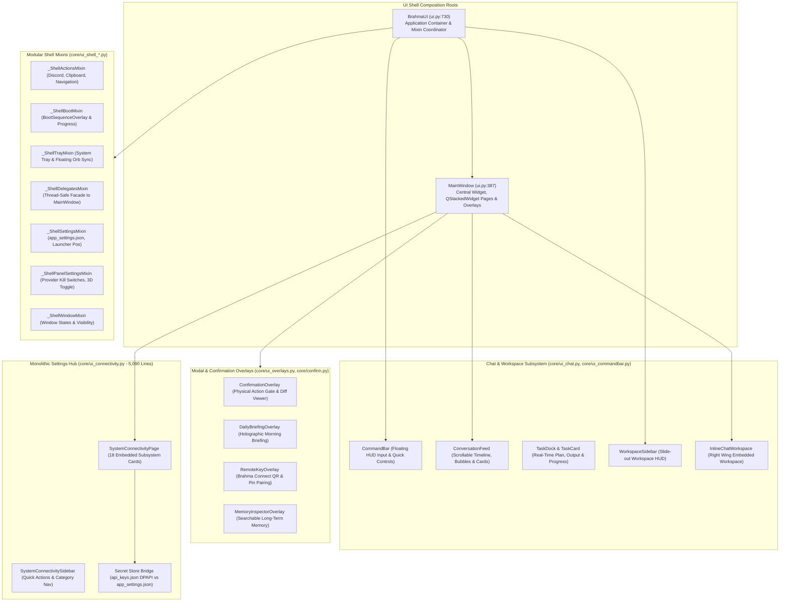

# WP-06: PyQt6 UI Shell, Chat HUD, Overlays & Settings Hub (UI Part A) — Deep Scan & Analysis Report

- **Work Package:** WP-06 (PyQt6 UI Shell, Chat HUD, Overlays & Settings Hub — UI Part A)
- **Baseline Commit:** `6439b2e` (`Make the subagent library visible on voice and first-call surfaces`)
- **Files Scanned:** 29 files (11,972 lines of Python)
- **Overall Subsystem Health:** **Needs Hardening / Critical Issues Found**
  - **Critical Thread Safety Violation:** Background `ClipboardSentry` thread directly creates QWidgets and mutates QLayouts without Qt marshalling (`core/ui_shell_actions.py:23-35`, `core/ui_chat.py:1654-1691`), risking heap corruption and random crashes.
  - **High Concurrency Flaw:** Confirmation system is single-slot global (`core/confirm.py`); back-to-back approvals orphan the earlier waiter into an un-resolvable 90-second deadlock, and approvals requested when minimized to tray are completely invisible to the user.
  - **Security Leakage:** Plaintext storage of `local_api_key` and `custom_api_key` in `app_settings.json` on every keystroke, bypassing DPAPI-protected `api_keys.json`.
  - **Invariant Breaches:** Global monkey-patching of `QWidget.setStyleSheet` with triple-duplicated replacement at import time (`I-26`), import-time disk read of user settings (`I-26`), non-atomic writes to config files (`I-17`), and pseudo-marshalled `run_on_ui` fallback executing off the GUI thread (`I-05`, `I-25`).
  - **Extreme Monolithic Bloat:** `core/ui_connectivity.py` has grown into a 5,090-line monolith containing embedded self-healing test beds, hardware process killers, and synchronous blocking network/subprocess calls on the GUI thread.

---

## 1. Subsystem Architecture & Data-Flow Summary

WP-06 covers the core desktop GUI layer of Brahma AI Evo. It constitutes the user-facing visual shell, multimodal Chat HUD, floating HUD elements, holographic modal overlays, and the Settings Hub.



### 1.1 Architectural Composition & Lifecycle
- **Entry & Hierarchy:** `main.py` instantiates `BrahmaUI(face_path)`. `BrahmaUI` wraps a `QApplication` instance (configured with `"Fusion"` style and `quitOnLastWindowClosed=False`), constructs `MainWindow(face_path)`, and attaches a system tray icon (`QSystemTrayIcon`), a floating desktop launcher (`FloatingLauncher`), an optional floating command bar (`CommandBar`), and a collapsible slide-out workspace (`WorkspaceSidebar`).
- **Decomposition Mechanism:** To satisfy architecture line-count ratchets (`ui.py <= 827` lines; currently at `820`), `ui.py` relies heavily on Python multiple inheritance mixins extracted into `core/ui_shell_*.py` and `core/ui_*.py`. A late-binding dependency injection pattern (`bind(...)`) is executed at import time to inject module-level variables (`BASE_DIR`, `CONFIG_DIR`, `C`, `_default_app_settings`, etc.) into mixin modules before class construction.
- **Visual State Machine:** `core/ui_apply_state.py` defines `_ApplyStateMixin._apply_state(state)` which coordinates UI aesthetics across 9 operational modes (`IDLE`, `LISTENING`, `SPEAKING`, `THINKING`, `PROCESSING`, `EXECUTING`, `WORKING`, `MUTED`, `SCANNING`, `STANDBY`). It drives the WebGL 3D background canvas (`BackgroundWidget.set_ai_state`), updates status badges, adjusts input placeholder texts, and sets task/result card headers.

### 1.2 Data Flow & Thread Boundaries
1. **Model/Agent to UI:** Tool progress, status transitions, HUD telemetry deliverables, and logging originate in `BrahmaLive` (asyncio event loop thread) or `AgentLoop` (worker threads). In `core/ui_shell_delegates.py`, these calls are funneled through Qt signals (`_state_sig`, `_log_sig`, `_hud_operation_sig`, `_hud_deliverable_sig`, `_task_workspace_sig`, `_confirm_sig`) or `_ui(fn)` -> `core/ui_thread.py:run_on_ui`.
2. **User Input to Controller:** Text commands submitted via `CommandBar`, `WorkspaceSidebar`, or `InlineChatWorkspace` emit `command_submitted(str)`, which reaches `MainWindow.submit_command()`. `submit_command` appends the text to `_chat_source_queue`, emits `_log_sig`, and spawns a daemon `threading.Thread(target=self.on_text_command, args=(txt, source))` to prevent blocking the GUI thread during LLM generation.
3. **Physical Action Confirmation:** Irreversible desktop actions (power off, restart, WiFi disconnect, file deletions) and high-risk agent tool approvals invoke `core/confirm.py:ask_blocking_choice`. The caller thread (a background worker) blocks on a `threading.Event`, while a signal is emitted to the Qt thread to pop up `ConfirmationOverlay`. When the human clicks CONFIRM, ALWAYS ALLOW, or CANCEL (or the timeout expires), `core/confirm.py:resolve()` unblocks the worker.

---

## 2. File-by-File Inventory & Health Matrix

| File Path | Lines | Primary Symbols / Classes | Status | Risk Level | Notes |
|---|---:|---|---|---|---|
| `ui.py` | 820 | `MainWindow`, `BrahmaUI`, `_RootShim`, `_new_setStyleSheet` | `Active` | **High** | Ratchet limit 827 (7 lines remaining); global `QWidget.setStyleSheet` monkey-patch; import-time JSON read; Chromium flags. |
| `core/ui_chat.py` | 2,275 | `ChatBubble`, `EventCard`, `ArtifactCard`, `TaskCard`, `ConversationFeed`, `WorkspaceSidebar`, `InlineChatWorkspace` | `Active` | **Critical** | Thread safety bug via `ClipboardSentry`; streaming markdown HTML renderer; SQLite workspace transcript persistence. |
| `core/ui_connectivity.py` | 5,090 | `SystemConnectivitySidebar`, `SettingsHubPage`, `SystemConnectivityPage`, `_ModelDiscoveryBridge` | `Active` | **Critical** | Massive 5,090-line monolith; cleartext API keys; non-atomic writes; broken `run_on_ui`; blocking network/process calls on UI thread. |
| `core/ui_overlays.py` | 1,126 | `ConfirmationOverlay`, `DailyBriefingOverlay`, `RemoteKeyOverlay`, `MemoryInspectorOverlay`, `DetailHighlighter` | `Active` | **High** | Hardcoded 90s countdown desynced from `popup_settings`; diff syntax highlighter; QR code generator. |
| `core/ui_overlays_cards.py` | 171 | `_OverlayCardsMixin` | `Active` | **High** | Overwrites active confirmation overlay if two approvals arrive; parented to `MainWindow` (invisible when minimized). |
| `core/ui_secondary_overlays.py` | 163 | `_SecondaryOverlaysMixin` | `Active` | **Medium** | Call screening modal dialog; circuit HUD overlay; memory inspector overlay. |
| `core/ui_commandbar.py` | 221 | `CommandBar` | `Active` | **Low** | Frameless floating pill input HUD; dev mode launcher; audio/mute shortcuts. |
| `core/ui_mute_send.py` | 130 | `_MuteSendMixin` | `Active` | **Medium** | Mute button toggle; sound effects triggers; spawns daemon thread on text submit. |
| `core/ui_runtime.py` | 181 | `_RuntimeMixin` | `Active` | **Medium** | SysMetrics updater; clock tick; attachment handling broken due to typo `_on_chat_event`. |
| `core/ui_thread.py` | 30 | `run_on_ui` | `Active` | **High** | Falls back to running inline if object lacks `_run_on_ui`; exploited by `SystemConnectivityPage` to execute off-thread. |
| `core/ui_theme.py` | 90 | `C` (Color tokens), `load_theme` | `Active` | **Low** | Theme palette; HLS color calculation; listener notifications. |
| `core/ui_widgets.py` | 80 | `MetricBar`, `_active_net_label` | `Active` | **Low** | Custom antialiased metric progress bar; psutil network interface detection. |
| `core/ui_wiring.py` | 64 | `_WiringMixin` | `Active` | **Low** | Page switcher for `QStackedWidget` (`dashboard`, `home`, `devices`, `settings`). |
| `core/ui_apply_state.py` | 118 | `_ApplyStateMixin` | `Active` | **Low** | 9-state visual state machine applier; status badge styling; input placeholders. |
| `core/ui_state_appliers.py` | 149 | `_StateAppliersMixin` | `Active` | **High** | `capture_screen_threadsafe` blocks for 5.0s if called on GUI thread; meeting mode; scanning screen. |
| `core/ui_appsettings.py` | 117 | `_AppSettingsMixin` | `Active` | **Medium** | Settings file stamp validation; cache invalidation; atomic writes; startup animation toggle. |
| `core/popup_settings.py` | 96 | `dismiss_seconds`, `approval_timeout`, `clamp_approval_timeout` | `Active` | **Low** | Capped approval budget (10s–600s); cosmetic dismissal logic (1s–600s). |
| `core/ui_shell_actions.py` | 82 | `_ShellActionsMixin` | `Active` | **Critical** | Receives `ClipboardSentry` thread callback and invokes Qt methods off-thread; Discord config handler. |
| `core/ui_shell_boot.py` | 114 | `_ShellBootMixin` | `Active` | **Medium** | BootSequenceOverlay controller; calls `QTimer.singleShot` from background threads. |
| `core/ui_shell_controlpanel.py` | 42 | `_ShellControlPanelMixin` | `Active` | **Low** | Launcher control panel action handler (open app, workspace, restart, quit). |
| `core/ui_shell_delegates.py` | 337 | `_ShellDelegatesMixin` | `Active` | **Medium** | MainWindow delegation facade; `choose_session` modal dialog; audio levels. |
| `core/ui_shell_devmode.py` | 38 | `_ShellDevModeMixin` | `Active` | **Low** | DeveloperModeDialog launcher; workspace setting handler. |
| `core/ui_shell_discord.py` | 70 | `_ShellDiscordMixin` | `Active` | **Medium** | Discord token input and settings persistence; non-atomic file write. |
| `core/ui_shell_launcher.py` | 42 | `_ShellLauncherMixin` | `Active` | **Low** | FloatingLauncher position, double-click, and action wiring. |
| `core/ui_shell_panel_settings.py` | 95 | `_ShellPanelSettingsMixin` | `Active` | **Low** | Provider toggle bridge (`core.provider_router`); 3D background animation toggle. |
| `core/ui_shell_settings.py` | 72 | `_ShellSettingsMixin` | `Active` | **Low** | Settings cache and merge persistence for BrahmaUI. |
| `core/ui_shell_sidebar.py` | 40 | `_ShellSidebarMixin` | `Active` | **Low** | WorkspaceSidebar toggle and display coordinator. |
| `core/ui_shell_tray.py` | 70 | `_ShellTrayMixin` | `Active` | **Medium** | QSystemTrayIcon context menu; hides windows to tray on minimize. |
| `core/ui_shell_window.py` | 49 | `_ShellWindowMixin` | `Active` | **Low** | App icon helper; show/hide window states; dashboard activation. |

---

## 3. Invariant & Specific Audit Question Verdicts

| Invariant / Question ID | Verdict | Evidence (`file:line` & symbol) | Explanation |
|---|---|---|---|
| **I-05: Qt Main Thread Approver Guard** | **PARTIAL** | `core/confirm.py:137` (`_on_qt_main_thread`), `core/ui_overlays_cards.py:152` | `ask_blocking_choice` properly refuses to run on Qt main thread (`return "deny"`). However, back-to-back approvals orphan the earlier thread, and minimized-window state hides the dialog completely. |
| **I-17: Atomic Configuration Persistence** | **FAIL** | `core/ui_connectivity.py:4458, 4623`, `core/ui_shell_discord.py:32` | `_change_theme` and `_set_setting` (fallback) use raw `with open(..., 'w') as f: json.dump(...)`. `_save_discord_settings` uses `write_text(...)`. Crashes during write will corrupt configuration files. |
| **I-25: Single Marshaller per Thread Boundary** | **FAIL** | `core/ui_shell_actions.py:23-35`, `core/ui_chat.py:1654`, `core/ui_connectivity.py:2478` | `ClipboardSentry` thread executes raw callbacks directly into `record_chat_event`, mutating QLayouts off-thread. `SystemConnectivityPage` calls `run_on_ui` without having `_run_on_ui`, executing inline on background threads. |
| **I-26: Zero Import-Time Side Effects** | **FAIL** | `ui.py:76-82`, `ui.py:85-100` (`_new_setStyleSheet`) | `ui.py` reads user data (`app_settings.json`) at top-level on import. It also globally monkey-patches `QWidget.setStyleSheet` across the entire Python process with triple-duplicated string replacements. |
| **Ratchet Limit: `ui.py <= 827`** | **PASS (Fragile)** | `ui.py:1-820` (820 lines), `tests/architecture_ratchet.json:5` | `ui.py` is at 820 lines, which is 7 lines beneath the ratchet ceiling of 827. |
| **Q1: Off-Main-Thread QWidget / QTimer / setStyleSheet** | **FAIL** | `core/ui_shell_actions.py:30`, `core/ui_shell_boot.py:96`, `core/ui_connectivity.py:2478` | Unmarshalled widget creation and layout insertions from clipboard monitor thread; `QTimer.singleShot` executed from background threads; `setText` invoked directly on worker threads. |
| **Q2: setStyleSheet Monkey-Patch & Redundant Replace** | **CONFIRMED DEFECT** | `ui.py:88-90` (`_new_setStyleSheet`) | Line 88-90 repeats `style.replace("#00e5ff", ...)` 3 consecutive times; executes 11 string replacements on every stylesheet call system-wide; severe overhead on animations and violates I-26. |
| **Q3: `ui_connectivity.py` Complexity & Cleartext Keys** | **CONFIRMED DEFECT** | `core/ui_connectivity.py:3178, 3290`, lines 4458-4465 | 5,090-line monolith; `local_api_key` and `custom_api_key` written in cleartext to `app_settings.json` on every keystroke; duplicate app instance spawned on theme change; dead controls. |
| **Q4: Confirmation Deadlock / Tray Minimized Cases** | **CONFIRMED DEFECT** | `core/confirm.py:77, 160-170`, `core/ui_overlays_cards.py:136-166` | Single `_pending` global causes back-to-back approvals to orphan earlier waiting worker threads; minimized window traps child overlays so user is never notified, causing 90s silent timeouts. |

---

## 4. Detailed Findings

### [WP-06-F01] ClipboardSentry Background Thread Directly Invokes QWidget Methods and Modifies Layouts
- **Severity:** `Critical`
- **Category:** `Concurrency/Threading`
- **Location:** [`core/ui_shell_actions.py:23-35`](file:///C:/Users/Admin/Brahma-Ai-Evo/core/ui_shell_actions.py#L23-L35) (`_ShellActionsMixin._on_clipboard_actionable`), [`core/ui_chat.py:1654-1691`](file:///C:/Users/Admin/Brahma-Ai-Evo/core/ui_chat.py#L1654-L1691) (`WorkspaceSidebar.record_chat_event`), [`core/clipboard_sentry.py:29`](file:///C:/Users/Admin/Brahma-Ai-Evo/core/clipboard_sentry.py#L29)
- **Evidence & Mechanism:**
  In `ui.py:779-782`, Brahma initializes `ClipboardSentry`:
  ```python
  self._clip_sentry = ClipboardSentry(callback=self._on_clipboard_actionable)
  self._clip_sentry.start()
  ```
  `ClipboardSentry` spawns a background Python thread:
  ```python
  self._thread = threading.Thread(target=self._monitor_loop, daemon=True)
  self._thread.start()
  ```
  When actionable clipboard content is detected (traceback, JSON, SQL, code), the worker thread directly calls `callback(category, content)`, invoking `_on_clipboard_actionable`:
  ```python
  def _on_clipboard_actionable(self, category: str, content: str):
      label = { ... }.get(category, "Clipboard item copied")
      self._workspace_sidebar.record_chat_event({
          "role": "system",
          "text": f"💡 {label}",
          "source": "clipboard",
      })
  ```
  `_workspace_sidebar.record_chat_event` does not marshal to the GUI thread. It immediately calls:
  ```python
  self._feed.add_message("system", "System", text, _fmt_time_stamp(stamp), attachments=attachments, event_type=text)
  ```
  Inside `ConversationFeed.add_message` (`core/ui_chat.py:883-912`), it instantiates `EventCard` (a `QFrame`), invokes `self._layout.addWidget(bubble, ...)`, applies CSS stylesheets, and schedules `QTimer.singleShot(0, self.scroll_to_bottom)`. All of these Qt operations execute on the background thread of `ClipboardSentry`.
- **Impact:** Direct violation of Qt thread affinity (`I-05`, `I-25`). In PyQt6, modifying `QLayout` or instantiating `QWidget` hierarchies on a non-GUI thread causes internal memory corruption, layout desynchronization, `QObject::setParent: Cannot set parent, new parent is in a different thread` runtime errors, or hard application crashes (`SIGSEGV`).
- **Recommended Fix:** In `core/ui_shell_actions.py`, wrap the event in `run_on_ui`:
  ```python
  def _on_clipboard_actionable(self, category: str, content: str):
      label = { ... }.get(category, "Clipboard item copied")
      self._ui(lambda: self._workspace_sidebar.record_chat_event({
          "role": "system",
          "text": f"💡 {label}",
          "source": "clipboard",
      }))
  ```

---

### [WP-06-F02] Confirmation Overlay Single-Pending Race & Orphaned Thread Deadlock
- **Severity:** `High`
- **Category:** `Concurrency/Threading`
- **Location:** [`core/confirm.py:77, 160-170, 243-268`](file:///C:/Users/Admin/Brahma-Ai-Evo/core/confirm.py#L77), [`core/ui_overlays_cards.py:136-141`](file:///C:/Users/Admin/Brahma-Ai-Evo/core/ui_overlays_cards.py#L136-L141) (`_OverlayCardsMixin._apply_confirm_overlay`)
- **Evidence & Mechanism:**
  `core/confirm.py` holds state in a single global variable:
  ```python
  _pending: Optional[_Pending] = None
  _lock = threading.Lock()
  ```
  When Approval 1 is initiated by Worker Thread 1:
  1. `pending1` is assigned to `_pending`.
  2. `_show_cb` sends a queued signal to the GUI to display `ConfirmationOverlay`.
  3. Worker Thread 1 blocks on `pending1.waiter.wait(wait_for)`.
  
  If Approval 2 is triggered by Worker Thread 2 before Approval 1 is answered:
  1. `pending2` overwrites `_pending`:
     ```python
     with _lock:
         _pending = pending
     ```
  2. `_show_cb` emits `_confirm_sig` for Approval 2.
  3. `_apply_confirm_overlay` in `core/ui_overlays_cards.py` executes:
     ```python
     if action == "show":
         if getattr(self, "_confirm_overlay", None):
             try:
                 self._confirm_overlay.deleteLater()
             except Exception:
                 pass
             self._confirm_overlay = None
     ```
     The UI destroys Approval 1's overlay and presents Approval 2's overlay.
  4. The user clicks "CONFIRM" or "CANCEL" for Approval 2.
  5. `confirm.resolve(accepted)` runs:
     ```python
     with _lock:
         p, _pending = _pending, None
     ```
     `p` is `pending2`. `pending2.waiter.set()` is called, and Approval 2 completes.
  6. **Approval 1 is completely orphaned.** It was removed from `_pending` and its `waiter` was never signalled. Worker Thread 1 remains completely blocked for the full 90-second timeout.
- **Impact:** Actions from concurrent tools or rapid sequential tool dispatches fail with a 90-second artificial hang and false `Approval timed out` rejection, degrading autonomy and causing user confusion.
- **Recommended Fix:** Implement a queue or dictionary keyed by unique confirmation ID (`dict[str, _Pending]`). In the UI, support stacked confirmation cards or modal approval queues so each request is individually tracked and resolved.

---

### [WP-06-F03] Minimized Window Traps Confirmation Overlay, Causing Silent Approval Timeout
- **Severity:** `High`
- **Category:** `Architecture/UX`
- **Location:** [`core/ui_overlays_cards.py:152-166`](file:///C:/Users/Admin/Brahma-Ai-Evo/core/ui_overlays_cards.py#L152-L166) (`_apply_confirm_overlay`), [`core/ui_shell_tray.py:61-63`](file:///C:/Users/Admin/Brahma-Ai-Evo/core/ui_shell_tray.py#L61-L63) (`_ShellTrayMixin._on_minimized`)
- **Evidence & Mechanism:**
  In `ui_shell_tray.py`, minimizing the main window hides the command bar and presents the floating icon launcher:
  ```python
  def _on_minimized(self):
      self._command_bar.hide()
      self._show_floating_icon()
  ```
  `MainWindow` enters minimized state (`self.isMinimized() == True` or window hidden).
  When an approval is subsequently requested by `core/confirm.py`, `_apply_confirm_overlay` constructs `ConfirmationOverlay` with `parent=self` (`MainWindow`):
  ```python
  overlay = ConfirmationOverlay(title, detail, parent=self, ...)
  self._confirm_overlay = overlay
  self._position_confirm_overlay()
  overlay.show()
  overlay.raise_()
  ```
  In Qt, child widgets of a minimized or hidden window are not rendered to the screen. Because `ConfirmationOverlay` is parented to `MainWindow`, it remains completely invisible to the user. Furthermore, neither `FloatingLauncher` nor `QSystemTrayIcon` is alerted or badged that an approval is pending.
- **Impact:** The user has no way of knowing Brahma is requesting permission. The action remains stalled until the 90-second timeout expires, leading to silent tool failures.
- **Recommended Fix:** In `_apply_confirm_overlay`, check if `self.isMinimized()` or not `self.isVisible()`. If minimized, automatically un-minimize and restore the window:
  ```python
  if self.isMinimized() or not self.isVisible():
      self.showNormal()
      self.raise_()
      self.activateWindow()
  ```
  Additionally, trigger a tray notification via `self._tray.showMessage("Approval Required", title)`.

---

### [WP-06-F04] Approval Timeout Desynchronization Between Backend and UI Overlay
- **Severity:** `Medium`
- **Category:** `Correctness/Bug`
- **Location:** [`core/ui_overlays.py:779-783, 914-920`](file:///C:/Users/Admin/Brahma-Ai-Evo/core/ui_overlays.py#L779-L783) (`ConfirmationOverlay.__init__`, `_tick`), [`core/confirm.py:154-159`](file:///C:/Users/Admin/Brahma-Ai-Evo/core/confirm.py#L154-L159) (`ask_blocking_choice`)
- **Evidence & Mechanism:**
  In `core/confirm.py:154-159`, the backend clamps approval timeouts based on user configuration in `app_settings.json` (`approval_timeout_seconds`, clamped to 10s–600s via `core.popup_settings.clamp_approval_timeout`):
  ```python
  wait_for = clamp_approval_timeout(timeout)
  pending.timeout = wait_for
  ```
  However, in `core/ui_overlays.py:779`, `ConfirmationOverlay` hardcodes its timer:
  ```python
  self._remaining_secs = 90
  self._countdown_lbl = QLabel(f"Confirmation auto-cancels in {self._remaining_secs}s")
  ```
  And its countdown timer tick (`_tick` in line 914) counts down from 90 regardless of `pending.timeout`:
  ```python
  def _tick(self):
      self._remaining_secs -= 1
      if self._remaining_secs <= 0:
          self._on_cancel()
  ```
- **Impact:**
  - Case 1: If user configured `approval_timeout_seconds = 30`, `confirm.py` aborts and denies the action after 30 seconds. Meanwhile, the UI overlay is still visible and counting down from 90s (showing 60s remaining) on an already dead/denied request.
  - Case 2: If user configured `approval_timeout_seconds = 300`, `ConfirmationOverlay._tick` hits 0 at 90 seconds, emits `self.answered.emit(False)`, and prematurely cancels the request after 90 seconds, completely ignoring the 300-second user setting.
- **Recommended Fix:** Pass the actual timeout budget into `ConfirmationOverlay.__init__(..., timeout_seconds: float = None)`. Read `timeout_seconds` or query `clamp_approval_timeout()` directly during overlay initialization.

---

### [WP-06-F05] Global `QWidget.setStyleSheet` Monkey-Patch with 3x Redundant Replace at Import Time
- **Severity:** `Medium`
- **Category:** `Architecture/Invariant / Performance`
- **Location:** [`ui.py:84-100`](file:///C:/Users/Admin/Brahma-Ai-Evo/ui.py#L84-L100), [`ui.py:76-82`](file:///C:/Users/Admin/Brahma-Ai-Evo/ui.py#L76-L82)
- **Evidence & Mechanism:**
  At import time of `ui.py`, lines 76-82 read disk user data:
  ```python
  try:
      if APP_SETTINGS_FILE.exists():
          with open(APP_SETTINGS_FILE, "r", encoding="utf-8") as f:
              _global_settings = json.load(f)
              C.load_theme(_global_settings.get("app_theme", "#ffffff"))
  except Exception:
      pass
  ```
  Immediately followed by lines 85-100:
  ```python
  # Patch setStyleSheet to dynamically replace hardcoded gold colors with active white and ice theme
  _old_setStyleSheet = QWidget.setStyleSheet
  def _new_setStyleSheet(self, style):
      if style:
          style = style.replace("#00e5ff", getattr(C, "ACC", "#00e5ff"))
          style = style.replace("#00e5ff", getattr(C, "ACC", "#00e5ff"))
          style = style.replace("#00e5ff", getattr(C, "ACC", "#00e5ff"))
          style = style.replace("#ffd700", getattr(C, "ACC", "#00e5ff"))
          style = style.replace("#d4af37", getattr(C, "ACC", "#00e5ff"))
          style = style.replace("#80ffff", getattr(C, "ACC2", "#80ffff"))
          style = style.replace("#00b4d8", getattr(C, "ACC", "#00e5ff"))
          style = style.replace("255, 179, 0", "0, 229, 255")
          style = style.replace("255,179,0", "0,229,255")
          style = style.replace("255, 190, 26", "0, 229, 255")
          style = style.replace("244, 180, 0", "0, 229, 255")
      _old_setStyleSheet(self, style)
  QWidget.setStyleSheet = _new_setStyleSheet
  ```
  Lines 88–90 repeat the exact same `style.replace("#00e5ff", ...)` statement three times consecutively.
- **Impact:**
  - Violates Invariant `I-26` ("No import-time side effects: importing a UI/core module must not start a thread, open a socket, or read user data").
  - Modifies the global behavior of all `QWidget` instances across the Python interpreter, including third-party dialogs, WebEngine inspector widgets, and isolated unit test fixtures.
  - Adds 11 string replacement passes and 5 dynamic `getattr` lookups to every `setStyleSheet()` call on every widget in the application. During rapid UI animations (pulse glow timers, streaming text rendering, audio metering at 30–50 Hz), this creates constant main-thread string allocations and garbage collection pressure.
- **Recommended Fix:** Eliminate the global monkey patch entirely. Replace hardcoded legacy colors in widget stylesheets with color tokens from `core.ui_theme.C` or apply an application-level QSS stylesheet via `QApplication.setStyleSheet()`. Move the `app_settings.json` read inside `BrahmaUI.__init__`.

---

### [WP-06-F06] Cleartext Storage of `local_api_key` and `custom_api_key` in `app_settings.json` on Every Keystroke
- **Severity:** `High`
- **Category:** `Security`
- **Location:** [`core/ui_connectivity.py:3175-3179, 3287-3291, 4611-4627`](file:///C:/Users/Admin/Brahma-Ai-Evo/core/ui_connectivity.py#L3175-L3179)
- **Evidence & Mechanism:**
  In `core/ui_connectivity.py:3175` and line 3287, the Settings Hub wires the API key input fields for Local and Custom providers:
  ```python
  self._local_api_key_input = QLineEdit(self._load_app_settings().get("local_api_key", ""))
  self._local_api_key_input.textChanged.connect(lambda t: self._set_setting("local_api_key", t))

  self._custom_api_key_input = QLineEdit(self._load_app_settings().get("custom_api_key", ""))
  self._custom_api_key_input.textChanged.connect(lambda t: self._set_setting("custom_api_key", t))
  ```
  `_set_setting` commits directly to `app_settings.json`:
  ```python
  def _set_setting(self, key: str, value):
      settings = self._ctrl()._win._load_app_settings()
      settings[key] = value
      self._ctrl()._win._save_app_settings(settings)
  ```
  `app_settings.json` is a plaintext JSON file. Furthermore, connecting to `textChanged` causes a full disk write on every single keystroke typed into the field.
- **Impact:**
  - Security violation: API keys entered for custom LLM endpoints (e.g., private OpenAI, Groq, Together, vLLM, or OpenRouter keys) are stored in unencrypted plaintext on disk in `%LOCALAPPDATA%\BrahmaAI\config\app_settings.json`, completely circumventing Windows DPAPI protection (`api_keys.json` via `core/secret_store.py`).
  - Disk I/O thrashing: Typing a 40-character API key results in 40 consecutive file re-reads, JSON serialization cycles, and atomic file replacements.
- **Recommended Fix:** Store `local_api_key` and `custom_api_key` in `api_keys.json` via `core.secret_store.save_api_keys()`. Do not save on `textChanged`; require an explicit "Save" button or persist on `editingFinished`.

---

### [WP-06-F07] Non-Atomic Writes to User Settings Files Violating Invariant I-17
- **Severity:** `Medium`
- **Category:** `Architecture/Invariant`
- **Location:** [`core/ui_connectivity.py:4458-4459, 4623-4624`](file:///C:/Users/Admin/Brahma-Ai-Evo/core/ui_connectivity.py#L4458-L4459), [`core/ui_shell_discord.py:32`](file:///C:/Users/Admin/Brahma-Ai-Evo/core/ui_shell_discord.py#L32)
- **Evidence & Mechanism:**
  Invariant `I-17` mandates: "Writes are atomic where user data is persisted (`core/user_paths.atomic_write_json`); a crash cannot leave a half-written config."
  Multiple methods in UI modules bypass `atomic_write_json`:
  1. `core/ui_connectivity.py:4458` (`_change_theme`):
     ```python
     with open(APP_SETTINGS_FILE, "w", encoding="utf-8") as f:
         json.dump(settings, f, indent=4)
     ```
  2. `core/ui_connectivity.py:4623` (`_set_setting` fallback):
     ```python
     with open(APP_SETTINGS_FILE, "w", encoding="utf-8") as f:
         json.dump(data, f, indent=4)
     ```
  3. `core/ui_shell_discord.py:32` (`_save_discord_settings`):
     ```python
     DISCORD_SETTINGS_FILE.write_text(json.dumps(settings, indent=4), encoding="utf-8")
     ```
- **Impact:** An unexpected system crash, OS shutdown, or power loss while writing will truncate `app_settings.json` or `discord_bot.json` to 0 bytes, destroying all saved user preferences.
- **Recommended Fix:** Replace all raw file writes with `core.user_paths.atomic_write_json(file_path, data)`.

---

### [WP-06-F08] Pseudo-Marshalled `run_on_ui` in `SystemConnectivityPage` Executes UI Calls on Worker Thread
- **Severity:** `High`
- **Category:** `Concurrency/Threading`
- **Location:** [`core/ui_connectivity.py:2478, 2481`](file:///C:/Users/Admin/Brahma-Ai-Evo/core/ui_connectivity.py#L2478), [`core/ui_thread.py:19-30`](file:///C:/Users/Admin/Brahma-Ai-Evo/core/ui_thread.py#L19-L30)
- **Evidence & Mechanism:**
  In `core/ui_thread.py`, `run_on_ui` is defined as:
  ```python
  def run_on_ui(win, fn):
      runner = getattr(win, "_run_on_ui", None)
      if runner is not None:
          runner(fn)
      else:
          fn()
  ```
  In `core/ui_connectivity.py:2470-2483`, a speech engine test is spawned on a worker thread:
  ```python
  def _run():
      played, used = _tts.speak_with(engine, "Brahma Evo speech engine test.")
      msg = f"Tested {used or engine}: {'audio played' if played else 'no audio produced'}."
      run_on_ui(self, lambda: self._speech_status.setText(msg))
  threading.Thread(target=_run, daemon=True, name="speech-test").start()
  ```
  `self` here is an instance of `SystemConnectivityPage`.
  However, `SystemConnectivityPage` does **not** define `_run_on_ui`!
  `getattr(self, "_run_on_ui", None)` evaluates to `None`.
  `run_on_ui` therefore executes the `else:` branch: `fn()`.
  This executes `self._speech_status.setText(msg)` directly inside the `speech-test` background worker thread!
- **Impact:** `QLabel.setText()` and underlying Qt paint events are called off the main GUI thread, violating `I-05` and `I-25`.
- **Recommended Fix:** Either pass `self.window()` (which is `MainWindow` and defines `_run_on_ui`) to `run_on_ui`, or implement `_run_on_ui` on `SystemConnectivityPage` using `QMetaObject.invokeMethod` or a dedicated Qt signal.

---

### [WP-06-F09] Monolithic Size & Structural Bloat of `core/ui_connectivity.py` (5,090 Lines)
- **Severity:** `Medium`
- **Category:** `Architecture/Maintainability`
- **Location:** [`core/ui_connectivity.py:1-5090`](file:///C:/Users/Admin/Brahma-Ai-Evo/core/ui_connectivity.py#L1-L5090)
- **Evidence & Mechanism:**
  While `ui.py` was strictly refactored down to 820 lines using mixins, `core/ui_connectivity.py` was used as an unconstrained dumping ground, swelling to 5,090 lines.
  A single class, `SystemConnectivityPage`, spans from line 345 to line 5,090 (~4,745 lines) and mixes:
  - AI Provider settings & fallback chains
  - Custom MCP server editor
  - Tool visibility & index management
  - Core Skills library controls
  - Memory connector cards (Mem0, Letta, Local)
  - Speech synthesis & Kokoro/Piper voice management
  - 3D Avatar and VRM/Live2D backends
  - Instagram browser login & cookie scrapers
  - Google Workspace credentials & IMAP testers
  - Spotify OAuth flows and polling timers
  - Autonomous Self-Healing AST patchers & bug injectors
  - Windows registry desktop shortcut and taskbar pinning scripts
- **Impact:** Extreme maintenance burden, high risk of regression, hidden dead controls, and difficult testing.
- **Recommended Fix:** Decompose `core/ui_connectivity.py` into focused card modules under a package directory `core/settings/` (e.g., `card_providers.py`, `card_speech.py`, `card_tools.py`, `card_integrations.py`, `card_system.py`).

---

### [WP-06-F10] Duplicate Process Spawn Bug Without Termination on Theme Change
- **Severity:** `Medium`
- **Category:** `Correctness/Bug`
- **Location:** [`core/ui_connectivity.py:4445-4465`](file:///C:/Users/Admin/Brahma-Ai-Evo/core/ui_connectivity.py#L4445-L4465) (`_change_theme`)
- **Evidence & Mechanism:**
  In `core/ui_connectivity.py:4464-4465`:
  ```python
  QMessageBox.information(self, "Restart Required", "The application will now restart to apply the new theme.")
  subprocess.Popen([sys.executable, "main.py"])
  ```
  The method alerts the user and spawns a new `main.py` process. However, it **never terminates the current process** (`self._app.quit()` or `sys.exit()` is completely omitted!).
- **Impact:** Two simultaneous instances of Brahma AI Evo run on the host. Both processes contend for the loopback gateway port (8000), API port (8010), SQLite databases (`workspace_store.sqlite3`), microphone audio devices, and system tray icons.
- **Recommended Fix:** Terminate the current application immediately after spawning the restart process:
  ```python
  subprocess.Popen([sys.executable, "main.py"])
  QApplication.instance().quit()
  ```

---

### [WP-06-F11] Settings Key Confusion: `show_workspace_on_startup` Used for Windows Registry Startup Checkbox
- **Severity:** `Low`
- **Category:** `Correctness/Bug`
- **Location:** [`core/ui_connectivity.py:3364`](file:///C:/Users/Admin/Brahma-Ai-Evo/core/ui_connectivity.py#L3364) (`_build_left_column`)
- **Evidence & Mechanism:**
  Line 3364 sets up the startup checkbox:
  ```python
  self._startup_launch_btn = self._mk_toggle(
      "Launch Brahma Evo when Windows starts",
      bool(self._load_app_settings().get("show_workspace_on_startup", False)),
      self._toggle_startup_from_page
  )
  ```
  The checkbox label states `"Launch Brahma Evo when Windows starts"`.
  When clicked, `_toggle_startup_from_page` calls `_set_startup_enabled()`, which registers `BrahmaAI` in `HKCU\Software\Microsoft\Windows\CurrentVersion\Run`.
  However, the checked state is loaded from `"show_workspace_on_startup"`, which controls whether the chat workspace sidebar slides open on startup.
- **Impact:** Desynchronization between registry state and UI checkbox. If the user wants the workspace sidebar on launch, the "Launch with Windows" box appears checked even if Windows startup is disabled in the registry.
- **Recommended Fix:** Query the actual Windows startup status via `self._ctrl()._win._startup_enabled()` or read the `"windows_startup"` settings key.

---

### [WP-06-F12] Dead File Attachment Presentation Due to Attribute Name Typo `_on_chat_event`
- **Severity:** `Low`
- **Category:** `Correctness/Bug`
- **Location:** [`core/ui_runtime.py:156-160`](file:///C:/Users/Admin/Brahma-Ai-Evo/core/ui_runtime.py#L156-L160) (`_RuntimeMixin._on_file_selected`)
- **Evidence & Mechanism:**
  When a user attaches a file in `_on_file_selected`:
  ```python
  # Post a file artifact card into the chat timeline
  event = {
      "role": "file",
      "text": f"Attached file: {name}",
      "attachments": [{"path": path, "name": name, "size": size}],
  }
  if hasattr(self, "_on_chat_event"):
      try:
          self._on_chat_event(event)
      except Exception:
          pass
  ```
  `MainWindow` (where `_RuntimeMixin` is inherited) does not have `_on_chat_event`.
  In `ui.py:754`, the handler was assigned as `self._win.on_chat_event = self._on_chat_event` (without leading underscore).
  Because the attribute name has no leading underscore, `hasattr(self, "_on_chat_event")` evaluates to `False`.
- **Impact:** Attaching a file via the file dialog never posts the artifact card to the chat timeline.
- **Recommended Fix:** Change `hasattr(self, "_on_chat_event")` to `hasattr(self, "on_chat_event") and callable(self.on_chat_event)`.

---

### [WP-06-F13] Blocking Network and Subprocess Calls Executed Inline on the Qt GUI Main Thread
- **Severity:** `Medium`
- **Category:** `Performance/Resource`
- **Location:** [`core/ui_connectivity.py:4068, 4431, 5036-5041, 5080-5083`](file:///C:/Users/Admin/Brahma-Ai-Evo/core/ui_connectivity.py#L4068)
- **Evidence & Mechanism:**
  Multiple click handlers in `core/ui_connectivity.py` perform blocking network and subprocess operations directly on the GUI main thread:
  1. `_handle_gw_test` (line 4068): calls `GmailEngine.test_connection()` directly on the GUI thread, opening a blocking SSL socket (`imaplib.IMAP4_SSL`) to `imap.gmail.com:993`.
  2. `_handle_ah_fix_captured_bug` (line 4431-4434): calls `QApplication.processEvents()` and then executes `auto_heal({"action": "heal"})`, running full LLM code synthesis synchronously.
  3. `_create_desktop_shortcut_logic` (line 5036) and `_pin_app_to_taskbar_logic` (line 5080): invoke `subprocess.run([powershell_exe, ...], check=True)` synchronously on the main thread.
- **Impact:** Causes the Windows OS to flag the window as "Not Responding" (ghosting), freezing animations, clock tickers, and input handling during network latency or slow PowerShell execution.
- **Recommended Fix:** Offload all network and subprocess checks into worker threads (`QThread` or daemon `threading.Thread`) using Qt signal/slot pattern (as is already correctly done for `_ig_browser_worker` and `SpotifyTestWorker`).

---

### [WP-06-F14] `QTimer.singleShot(0, ...)` Called From Background Asyncio Threads in Boot Mixin
- **Severity:** `Low`
- **Category:** `Concurrency/Threading`
- **Location:** [`core/ui_shell_boot.py:92-114`](file:///C:/Users/Admin/Brahma-Ai-Evo/core/ui_shell_boot.py#L92-L114) (`boot_add_step`, `boot_set_step_status`, `boot_set_progress`)
- **Evidence & Mechanism:**
  `core/session_lifecycle.py` calls `self._host.ui.boot_add_step(...)` during asyncio startup tasks. In `core/ui_shell_boot.py`:
  ```python
  def boot_add_step(self, text: str):
      try:
          if not self._boot_overlay:
              return None
          QTimer.singleShot(0, lambda: self._boot_overlay.add_step(text))
      except Exception:
          pass
  ```
  `QTimer.singleShot(0, ...)` without a context object runs in the context of the calling thread's event loop. When called from a background Python thread that lacks a `QEventLoop`, Qt raises `QObject::startTimer: Timers can only be used with threads started with QThread` or fails to deliver the event.
- **Impact:** Boot progress steps can be dropped or trigger Qt console warnings.
- **Recommended Fix:** Route through `run_on_ui` or provide the target `QObject` as context: `QTimer.singleShot(0, self._boot_overlay, lambda: self._boot_overlay.add_step(text))`.

---

### [WP-06-F15] `ui.py` Ratchet Line Count Proximity to Limit (820 vs 827 limit)
- **Severity:** `Informational`
- **Category:** `Architecture/Ratchet`
- **Location:** [`ui.py:1-820`](file:///C:/Users/Admin/Brahma-Ai-Evo/ui.py#L1-L820), [`tests/architecture_ratchet.json:5`](file:///C:/Users/Admin/Brahma-Ai-Evo/tests/architecture_ratchet.json#L5)
- **Evidence & Mechanism:**
  `tests/architecture_ratchet.json` enforces:
  ```json
  "lines": {
    "ui.py": 827
  }
  ```
  `ui.py` currently has exactly 820 lines. Any developer adding 8 lines to `ui.py` will break the CI architecture ratchet gate.
- **Impact:** Fragile test boundary; high risk of accidental CI breakages.
- **Recommended Fix:** Extract the remaining `MainWindow` UI construction methods (`_build_center_panel_modern`, `_build_right_panel_modern`) into `core/ui_panels.py` to bring `ui.py` down to ~450 lines.

---

## 5. Cross-Package Seams & Handoff Notes for Orchestrator

1. **`core/confirm.py` vs `actions/*` (Handoff to WP-02, WP-04):**
   `core/confirm.py` is the single confirmation gate for both native actions and harness agent approvals (`ask_blocking_choice`). The single-slot `_pending` deadlock (Finding WP-06-F02) must be reconciled with how `AgentLoop` (WP-01) dispatches parallel tool calls. If parallel tool execution ever requests two approvals simultaneously, one will immediately deadlock.
2. **Settings Persistence Conflict (Handoff to WP-03, WP-04):**
   `core/ui_connectivity.py` writes `app_settings.json` directly, while `core/provider_router.py` (WP-03) and `memory/config_manager.py` (WP-08) also write to it. Ensure that cache stamp invalidation (`_invalidate_app_settings_cache`) is uniformly adopted across all subsystems.
3. **Cleartext Secret Exposure (Handoff to WP-04):**
   Finding WP-06-F06 (`local_api_key` and `custom_api_key` stored in `app_settings.json`) directly touches the security workstream (WS-2 / DPAPI Secret Store).
4. **Dead Controls & Legacy Action Imports (Handoff to WP-09, WP-10):**
   `core/ui_connectivity.py` imports and exercises `actions/auto_heal_engine.py`, `actions/system_diagnostics_mcp.py`, `actions/test_action.py`, and `actions/google_workspace_mcp.py`. WP-09 and WP-10 should verify if these action modules are meant for production end-users or are deprecated prototypes.

---

## 6. Prioritized Action Queue for This Subsystem

1. **Immediate (P0 / P1):**
   - [ ] Fix `ClipboardSentry` thread violation: Wrap `_on_clipboard_actionable` in `run_on_ui` before mutating `WorkspaceSidebar` (`core/ui_shell_actions.py:23-35`).
   - [ ] Resolve confirmation overlay race: Support multiple pending approvals in `core/confirm.py` so back-to-back requests do not orphan worker threads into 90-second deadlocks.
   - [ ] Un-minimize window on confirmation request: Ensure `MainWindow` is restored and raised when an approval arrives while minimized to tray (`core/ui_overlays_cards.py:152-166`).
   - [ ] Move `local_api_key` and `custom_api_key` from cleartext `app_settings.json` to DPAPI-encrypted `api_keys.json` (`core/ui_connectivity.py:3178, 3290`).
   - [ ] Fix pseudo-marshalled `run_on_ui` in `SystemConnectivityPage` so `_speech_status.setText` is dispatched to the GUI thread (`core/ui_connectivity.py:2478`).
2. **Near-Term (P2):**
   - [ ] Replace non-atomic file writes with `atomic_write_json` in `core/ui_connectivity.py:4458, 4623` and `core/ui_shell_discord.py:32`.
   - [ ] Fix approval timeout desynchronization: Pass `pending.timeout` into `ConfirmationOverlay` instead of hardcoding 90 seconds (`core/ui_overlays.py:779`).
   - [ ] Remove duplicate process spawn in `_change_theme`: Call `QApplication.instance().quit()` after `subprocess.Popen` (`core/ui_connectivity.py:4465`).
   - [ ] Eliminate global `QWidget.setStyleSheet` monkey-patch and deduplicate 3x `#00e5ff` replace calls (`ui.py:85-100`). Move `app_settings.json` import-time read into `BrahmaUI.__init__`.
   - [ ] Fix file attachment timeline card typo: Change `_on_chat_event` to `on_chat_event` in `core/ui_runtime.py:156`.
3. **Cleanup / Refactor (P3):**
   - [ ] Deconstruct `core/ui_connectivity.py` (5,090 lines) into modular card components under `core/settings/`.
   - [ ] Correct startup checkbox setting key: Disentangle `"show_workspace_on_startup"` from Windows Registry startup (`core/ui_connectivity.py:3364`).
   - [ ] Offload blocking network calls (`GmailEngine.test_connection`) and PowerShell shortcut scripts to background `QThread` workers.
   - [ ] Slim `ui.py` down from 820 lines to create a safe buffer beneath the 827-line ratchet ceiling.
