# Work Package Scan Report: WP-10 — Native Capability Actions Part B: Browser, Web/Social, Media, Sentinels & Embedded Spotify MCP

## Metadata
- **Work Package**: WP-10
- **Baseline Commit**: `6439b2e`
- **Files Scanned**: 28 Python action files + 8 TypeScript / package files in `actions/spotify_mcp_server` (36 files total)
- **Overall Subsystem Health**: **Needs Hardening / Critical Issues Found (AMBER / RED)**
- **Audit Date**: 2026-11-08
- **Auditor**: Software Architect & Security Auditor (WP-10 Subagent)

---

## 1. Subsystem Architecture & Data-Flow Summary

### Architectural Overview
Work Package 10 covers the second major cohort of native capability actions in Brahma AI Evo: browser control and web automation, external data retrieval and geolocation, vision and multimodal processing, social and workspace integrations, scheduling and reminders, media controllers, background sentinels, and physical/health tracking.

Unlike the core agentic harness (`agent/`), which adheres strictly to stdlib isolation, permissions gating, and structured `ToolSpec` definitions, the `actions/` package contains heterogeneous capability layers implemented across distinct evolutionary waves of the system:
1. **Wave 1 & Legacy Tools**: Directly imported by `core/desktop_tools.py` and `core/tool_exec.py`, using ad-hoc global singletons, background threads, and direct external library dependencies.
2. **MCP Client Bridges**: Standalone subprocess-based MCP clients (`actions/playwright_mcp_client.py`, `actions/rea_mcp_client.py`, and `actions/spotify_controller.py`) spawning Node.js/NPX servers over JSON-RPC.
3. **Background Daemons & Sentinels**: Persistent monitoring threads (`actions/attention_monitor.py`, `actions/google_workspace_mcp.py`, `actions/instagram_mcp.py`, `actions/game_updater.py`) running autonomous loops, maintaining long-lived sockets, polling external APIs, and invoking speech synthesis out-of-band.
4. **Multimodal & Real-time Vision Bridges**: High-throughput screen capture and WebSocket streaming (`actions/screen_processor.py`) running real-time multimodal loops.

### Data Flow and Process Boundaries

```mermaid
flowchart TD
    subgraph UI_and_Harness ["UI & Agent Core Boundary"]
        HUD["Brahma Desktop UI / BrahmaLive"]
        Exec["core/tool_exec.py & core/desktop_tools.py"]
        Harness["agent/loop.py & agent/runtime.py"]
        Gateway["core/llm_gateway.py"]
    end

    subgraph Browser_Automation ["Browser Automation & Web MCP"]
        BC["actions/browser_control.py"]
        PMC["actions/playwright_mcp_client.py"]
        RMC["actions/rea_mcp_client.py"]
        NPX_Playwright["npx @modelcontextprotocol/server-playwright"]
        NPX_Puppeteer["npx @puppeteer/replay / rea"]
        Chrome["Chromium Process Tree"]
    end

    subgraph Vision_and_Multimodal ["Vision & Multimodal Processing"]
        SP["actions/screen_processor.py"]
        IG["actions/image_generator.py"]
        GenAI_Live["Google GenAI Live WebSocket (Bypass)"]
        Audio_Out["sounddevice PortAudio Output (Bypass)"]
    end

    subgraph Workspace_and_Social ["Workspace & Social Integrations"]
        GWM["actions/google_workspace_mcp.py"]
        IM["actions/instagram_mcp.py"]
        IC["actions/instagram_chat.py"]
        SM["actions/send_message.py"]
        BCONN["actions/brahma_connect.py"]
        Email_Plaintext["config/email_credentials.json + .email_key"]
        IG_Plaintext["config/api_keys.json + ig_session.json"]
    end

    subgraph Media_and_Embedded_MCP ["Media & Embedded Spotify MCP"]
        SC["actions/spotify_controller.py"]
        Node_Spotify["actions/spotify_mcp_server (Node.js)"]
        YTV["actions/youtube_video.py"]
        UV["actions/upload_video.py"]
        Spotify_Plaintext["config/spotify-config.json"]
    end

    subgraph Sentinels_and_Health ["Sentinels, Background Monitors & Health"]
        AM["actions/attention_monitor.py"]
        BM["actions/background_monitor.py"]
        GU["actions/game_updater.py"]
        CC["actions/calorie_counter.py"]
        PC["actions/pushup_counter.py"]
        REM["actions/reminder.py"]
        Schtasks["Windows Task Scheduler (schtasks.exe)"]
    end

    %% Wiring
    Harness -->|Controlled Tool Call| Exec
    Exec --> BC
    Exec --> GWM
    Exec --> SC
    Exec --> REM
    Exec --> YTV
    Exec --> CC

    BC --> PMC
    BC --> RMC
    PMC -->|Popen shell=True| NPX_Playwright
    NPX_Playwright --> Chrome

    SP -.->|Bypasses Gateway & UI| GenAI_Live
    SP -.->|Direct Audio Out| Audio_Out

    GWM --> Email_Plaintext
    IM --> IG_Plaintext
    SC --> Node_Spotify
    SC --> Spotify_Plaintext

    REM -->|Unescaped Script & XML| Schtasks
    AM -->|Unsolicited Speech| Audio_Out
    GWM -.->|Direct Speech Call| AM
    IM -.->|Direct Speech Call| AM
```



### Critical Architectural Defects Identified at a Glance
1. **Windows Task Scheduler & Python Script Injection in `actions/reminder.py`**: User-controlled reminders are formatted directly into Python scripts written to `%TEMP%` and XML manifests without escaping, enabling arbitrary code execution and XML injection via scheduled tasks.
2. **LLM Gateway & Provider Kill Switch Bypass in `actions/screen_processor.py`**: Directly instantiates `google.genai.Client` and initiates bi-directional WebSocket connections, streaming audio directly via PortAudio `sounddevice`, completely outside `core/llm_gateway.py` and UI audio controls (`I-21` violation).
3. **Subprocess & Orphan Process Leaks in Browser MCP Clients**: `actions/playwright_mcp_client.py` and `actions/rea_mcp_client.py` spawn Node.js servers via `shell=True` on Windows without Job Objects or `taskkill /F /T`, leaving orphan `cmd.exe`, `node.exe`, and `chrome.exe` processes running when closed.
4. **Arbitrary Code Execution via Playwright MCP**: `actions/browser_control.py` exposes a raw `run_code` action that invokes `mcp.run_code_unsafe(code)` directly to model dispatch without sandboxing.
5. **Plaintext Secret & Token Storage Across Integrations**: Plaintext passwords, OAuth secrets, session tokens, and decryption keys stored in `config/` JSON files and logged to `ig_debug.log`, violating `I-14`.

---

## 2. File-by-File Inventory & Health Matrix

| File Path | LOC | Role / Primary Responsibility | Invariants Touched | Health Status | Key Issues / Deficiencies |
|---|---|---|---|---|---|
| `actions/browser_control.py` | 765 | Web browser automation hub (Playwright / MCP) | `I-01`, `I-12`, `I-24` | ⚠️ WARNING | Exposes `run_code_unsafe` to model dispatch; singleton thread lacks graceful shutdown. |
| `actions/playwright_mcp_client.py` | 456 | JSON-RPC client for Playwright MCP server | `I-12`, `I-24` | 🔴 CRITICAL | Spawns `npx.cmd` with `shell=True`; `terminate()` leaks child Node and Chromium processes. No `atexit` cleanup. |
| `actions/rea_mcp_client.py` | 427 | JSON-RPC client for Puppeteer / REA MCP server | `I-12`, `I-24` | 🔴 CRITICAL | Spawns `npx.cmd` with `shell=True`; orphan process leaks on close; no Job Object tree management. |
| `actions/google_workspace_mcp.py` | 551 | Gmail & Google Calendar integration | `I-01`, `I-14` | ⚠️ WARNING | Fernet encryption key stored in plaintext right next to ciphertext (`.email_key`); unsolicited background TTS. |
| `actions/web_search.py` | 185 | Web search aggregator (DuckDuckGo, SearXNG, Serper) | `I-01` | 🟢 HEALTHY | Standard web search cascading with proper error handling and clean timeouts. |
| `actions/weather_report.py` | 232 | Weather data retrieval (Open-Meteo, wttr.in) | `I-01` | 🟢 HEALTHY | Clean public REST API fetching; no secrets or subprocesses. |
| `actions/flight_finder.py` | 339 | Amadeus flight search & LLM summarizer | `I-01`, `I-21` | ⚠️ WARNING | Imports and calls `from llm_client import client` directly rather than `core/llm_gateway.py`. |
| `actions/geospatial_globe.py` | 619 | 3D Geospatial mapping (Pydeck, Cesium, GeoJSON) | `I-01`, `I-24` | 🟢 HEALTHY | Local data processing and HTML map generation. Safe file output handling. |
| `actions/image_generator.py` | 198 | Image generation client (Pollinations.ai / local) | `I-01`, `I-21` | ⚠️ WARNING | Hits external unauthenticated endpoint `pollinations.ai` via raw urllib; bypasses gateway. |
| `actions/screen_processor.py` | 477 | Real-time screen capture & multimodal voice stream | `I-12`, `I-21` | 🔴 CRITICAL | Hardcoded import of `google.genai`; direct WebSocket live streaming; uncoordinated PortAudio output stream. |
| `actions/instagram_mcp.py` | 979 | Instagram automation via Instagrapi & Playwright | `I-01`, `I-14` | 🔴 CRITICAL | Stores plaintext credentials in `config/api_keys.json` and session dumps in `ig_session.json`; logs to `ig_debug.log`; unsolicited TTS. |
| `actions/instagram_chat.py` | 147 | Legacy wrapper around Instagram messaging | `I-01`, `I-14` | ⚠️ WARNING | Obsolete duplicate of `instagram_mcp.py`; shares plaintext credential paths and `ig_debug.log`. |
| `actions/send_message.py` | 283 | Multi-channel messaging dispatcher (Email, SMS, Webhook) | `I-01`, `I-14` | 🟢 HEALTHY | Proper parameter validation; delegates transport to respective backends. |
| `actions/brahma_connect.py` | 365 | Local device pairing & WebSocket remote control | `I-01`, `I-12` | 🟢 HEALTHY | Well-bounded asyncio WebSocket server for companion app sync; token-based auth. |
| `actions/mobile_autopilot.py` | 138 | Android ADB mobile automation bridge | `I-12`, `I-24` | ⚠️ WARNING | Spawns ADB commands via subprocess; lacks Windows Job Object tree management. |
| `actions/call_assistant.py` | 673 | Twilio VoIP telephony & live audio call routing | `I-01`, `I-14`, `I-21` | ⚠️ WARNING | Twilio credentials loaded from environment; handles Webhooks; relies on external telephony. |
| `actions/meeting_assistant.py` | 377 | Live meeting audio recording & transcription | `I-01`, `I-21` | ⚠️ WARNING | Direct use of `google.genai.types.Part.from_bytes` tightly coupling tool to Gemini SDK. |
| `actions/daily_briefing.py` | 420 | Aggregator for calendar, tasks, weather, system status | `I-01` | 🟢 HEALTHY | Safe local data aggregation; pure deterministic string formatting. |
| `actions/calendar_scheduler.py` | 250 | Local / Google Calendar event management | `I-01` | 🟢 HEALTHY | Safe dateutil parsing; delegates to `google_workspace_mcp.py` or local store. |
| `actions/reminder.py` | 156 | Windows Task Scheduler reminder creator | `I-12`, `I-24` | 🔴 CRITICAL | Remote code execution via Python string interpolation into `%TEMP%/*.pyw` and XML injection into `schtasks`. |
| `actions/spotify_controller.py` | 479 | Spotify playback controller & MCP host | `I-01`, `I-12`, `I-14` | ⚠️ WARNING | Saves OAuth tokens and client secret in plaintext JSON; launches unmanaged Node auth server. |
| `actions/spotify_mcp_server/package.json` | 42 | Embedded Spotify MCP Node.js package manifest | `I-12` | 🟢 HEALTHY | Standard MCP TypeScript server manifest targeting Model Context Protocol SDK. |
| `actions/spotify_mcp_server/src/auth.ts` | 68 | Spotify OAuth local callback HTTP server | `I-14` | ⚠️ WARNING | Runs ephemeral HTTP server on port 8888 for OAuth exchange; writes tokens to plaintext config. |
| `actions/spotify_mcp_server/src/utils.ts` | 402 | Spotify Web API client & config manager | `I-14` | ⚠️ WARNING | Hardcoded path to `config/spotify-config.json`; reads and writes client secret and tokens in plaintext. |
| `actions/spotify_mcp_server/src/index.ts` | 33 | Spotify MCP entrypoint (stdio transport) | `I-12` | 🟢 HEALTHY | Clean StdioServerTransport connection. |
| `actions/spotify_mcp_server/src/server.ts` | 89 | Spotify MCP server setup & tool registration | `I-01` | 🟢 HEALTHY | Exposes 20+ Spotify playback and search tools. |
| `actions/spotify_mcp_server/src/play.ts` | 134 | Spotify playback control handlers | `I-01` | 🟢 HEALTHY | Standard Spotify Web API endpoint calls. |
| `actions/spotify_mcp_server/src/tool.ts` | 358 | Tool execution dispatch logic for Spotify | `I-01` | 🟢 HEALTHY | Validates tool arguments and invokes Spotify API. |
| `actions/spotify_mcp_server/src/types.ts` | 88 | TypeScript interfaces for Spotify MCP | N/A | 🟢 HEALTHY | Type definitions only. |
| `actions/youtube_video.py` | 414 | YouTube search, playback & download helper | `I-01`, `I-21` | ⚠️ WARNING | Synchronous `tkinter.simpledialog` freezes dispatch thread; uses legacy `llm_client`. |
| `actions/upload_video.py` | 231 | Browser-guided video upload automation | `I-01`, `I-12` | 🟢 HEALTHY | Directs user through existing browser session; no credentials stored. |
| `actions/attention_monitor.py` | 742 | OpenCV webcam face tracker & window monitor | `I-12`, `I-24` | ⚠️ WARNING | Spawns PowerShell via `subprocess.Popen` with `-Command` string interpolation; unsolicited speech. |
| `actions/background_monitor.py` | 111 | Idle & active application sentinel | `I-01` | 🟢 HEALTHY | Windows API (`GetLastInputInfo`, `GetForegroundWindow`) polling. Clean thread lifecycle. |
| `actions/proactive.py` | 176 | Autonomous suggestion and intervention trigger | `I-01` | 🟢 HEALTHY | Rules engine evaluating background monitor metrics against intervention thresholds. |
| `actions/calorie_counter.py` | 367 | Nutritional analysis from food images | `I-01`, `I-21` | ⚠️ WARNING | Directly imports `llm_client.py` and uses Gemini-specific `Part.from_bytes` in fallback. |
| `actions/pushup_counter.py` | 456 | MediaPipe pose estimation for exercise rep counting | `I-01` | 🟢 HEALTHY | Standalone MediaPipe & OpenCV pipeline; uses SAPI/Winsound for audio prompts. |
| `actions/game_sentinel.py` | 78 | Game detection and performance tuning shim | `I-01` | 🟢 HEALTHY | Thin shim delegating to `core.game_sentinel`. |
| `actions/game_updater.py` | 817 | Background game update monitor & RSS tracker | `I-01`, `I-12` | 🟢 HEALTHY | Manages SQLite database `game_cache.db`; monitors Steam/Epic game patch notes. |
| `actions/net_sentinel.py` | 138 | Network traffic and latency monitor shim | `I-01` | 🟢 HEALTHY | Thin shim delegating to `core.net_sentinel`. |
| `actions/study_guard.py` | 105 | Distraction blocking and focus mode shim | `I-01` | 🟢 HEALTHY | Thin shim delegating to `core.study_guard`. |

---

## 3. Invariant & Specific Audit Question Verdicts

### Invariant Compliance Verdicts

| Invariant | Status | Verdict Summary |
|---|---|---|
| **I-01: Single Permission Boundary** | **PASS (with caveats)** | Gated at `AgentRuntime.execute` when invoked through harness; legacy wave actions accessed directly from `core/desktop_tools.py` bypass permission prompts unless wrapped. |
| **I-12: Subprocess Containment** | **FAIL** | `actions/playwright_mcp_client.py` and `actions/rea_mcp_client.py` launch Node via `shell=True` on Windows without Job Objects or tree termination. Background processes survive termination. |
| **I-14: Sandbox & Environment Scrubbing** | **FAIL (Credentials)** | Plaintext credential files in `config/` (Instagram, Google Workspace, Spotify). Logging session cookies to `ig_debug.log`. `google_workspace_mcp.py` stores Fernet key adjacent to encrypted secrets. |
| **I-21: LLM Gateway & Provider Kill Switch** | **FAIL** | `actions/screen_processor.py` creates direct WebSocket session via `google.genai.Client`, completely evading `core/llm_gateway.py` and provider kill switches. `meeting_assistant.py` and `calorie_counter.py` lock into Gemini `Part.from_bytes`. |
| **I-24: Subprocess & Shell Safety** | **FAIL** | `actions/reminder.py` performs unsafe string interpolation into Python files and XML for `schtasks.exe`, permitting arbitrary command and script execution. `actions/attention_monitor.py` interpolates paths into PowerShell `-Command`. |

---

### Specific Audit Questions

#### 1. Credential & API Key Handling Across Social/Workspace Actions
- **`actions/instagram_mcp.py` & `actions/instagram_chat.py`**:
  - `actions/instagram_mcp.py:41-44`: Reads `instagram_username` and `instagram_password` directly from `config/api_keys.json` in plaintext.
  - `actions/instagram_mcp.py:367-375` & `952-961`: Writes session cookies (`instagram_sessionid`, `instagram_user_id`) in plaintext back into `config/api_keys.json`.
  - `actions/instagram_mcp.py:458`: Executes `self.cl.dump_settings(SESSION_FILE)`, writing raw session cookies, device identifiers, and cryptographic authorization tokens in plaintext to `config/ig_session.json`.
  - `actions/instagram_mcp.py:44, 55-58` & `actions/instagram_chat.py:32-34`: Configures file logging to `ig_debug.log` at the project root with `level=logging.DEBUG`, logging full HTTP payloads and session state.
- **`actions/google_workspace_mcp.py`**:
  - `actions/google_workspace_mcp.py:28-46, 52-92`: Stores Gmail App Password encrypted with Fernet in `config/email_credentials.json`. However, the symmetric encryption key is generated via `Fernet.generate_key()` and written directly to `config/.email_key` in plaintext! An attacker or untrusted process with read access to `config/` can trivially decrypt the password. None of these use Windows DPAPI (`core.secret_store`).
- **`actions/spotify_controller.py` & `actions/spotify_mcp_server`**:
  - `actions/spotify_controller.py:23, 329-343`: Saves `clientId`, `clientSecret`, and redirect URI into `config/spotify-config.json` in plaintext.
  - `actions/spotify_mcp_server/src/utils.ts:11, 46-48, 394-398`: Reads and writes Spotify OAuth tokens (`accessToken`, `refreshToken`, `expiresAt`) and `clientSecret` in plaintext JSON to `config/spotify-config.json`.
- **`actions/upload_video.py`**:
  - Compliant: Does not store user credentials or API tokens. Guides the user's active browser to the YouTube Studio upload page.

#### 2. LLM Gateway & Provider Kill-Switch Compliance (`I-21`)
- **`actions/screen_processor.py:22-23, 203-224` [VIOLATION]**: Directly imports `from google import genai` and `from google.genai import types`. Instantiates `client = genai.Client(api_key=_get_api_key(), http_options={"api_version": "v1beta"})` and connects to the Gemini Live multimodal WebSocket `client.aio.live.connect(model=LIVE_MODEL, config=config)`. It bypasses `core/llm_gateway.py`, evades provider kill switches, does not track token costs, and independently routes incoming audio to `sounddevice.RawOutputStream`.
- **`actions/calorie_counter.py:151-163` [VIOLATION]**: Imports `from llm_client import client as ai_client` and calls `ai_client.models.generate_content(...)`. While it contains a fallback to `llm_gateway.generate_content(...)`, it passes `google.genai.types.Part.from_bytes(...)` which crashes if any provider other than Google Gemini is active.
- **`actions/meeting_assistant.py:15, 219, 346` [VIOLATION]**: Imports `google.genai.types` directly and constructs `types.Part.from_bytes` for audio buffers, tightly coupling the action to the Google GenAI SDK.
- **`actions/flight_finder.py:60, 146` & `actions/youtube_video.py:151`**: Uses `from llm_client import client` directly rather than invoking `core/llm_gateway.py`.
- **`actions/image_generator.py:133`**: Performs an unauthenticated GET request to `https://image.pollinations.ai/prompt/...` via `urllib.request`. Bypasses the gateway, but is a free external public endpoint.
- **`actions/daily_briefing.py` & `actions/call_assistant.py`**: `daily_briefing.py` is fully compliant (no LLM calls; deterministic formatting). `call_assistant.py` delegates live speech to Twilio/transcribers.

#### 3. Browser & MCP Subprocess Containment (`I-12`, `I-24`)
- **`actions/playwright_mcp_client.py:85` & `actions/rea_mcp_client.py:89` [VIOLATION]**:
  - On Windows, executes `subprocess.Popen(cmd, stdin=subprocess.PIPE, stdout=subprocess.PIPE, stderr=subprocess.PIPE, text=True, bufsize=1, shell=True)`.
  - When `close()` is invoked (lines 176-189), it calls `self._proc.terminate()` and `self._proc.kill()`. On Windows, calling `terminate()` on a process spawned with `shell=True` kills only the `cmd.exe` interpreter. The child `node.exe` process (and any grandchild `chrome.exe` processes spawned by Playwright) are detached and permanently orphaned.
  - Neither client uses Windows Job Objects or `taskkill /F /T`.
  - Neither client registers an `atexit` handler, so terminating Brahma leaves background browser automation instances running indefinitely.
- **`actions/browser_control.py:184-195`**:
  - Spawns a background worker thread `_BrowserThread` running `async_playwright().start()`. If Brahma crashes or exits, this thread has no `atexit` or cleanup hook to shut down the Playwright driver.
- **`actions/spotify_controller.py:364`**:
  - `_spotify_mcp_action` launches the local OAuth authorization server with `subprocess.Popen(["node", str(AUTH_SCRIPT)], cwd=str(SERVER_DIR), stdout=subprocess.PIPE, stderr=subprocess.PIPE)`.
  - The process reference is not stored in any instance variable or manager; if the user never completes browser auth, the Node HTTP server listens on port 8888 indefinitely and leaks.

#### 4. Windows Task Scheduler Injection (`actions/reminder.py`)
- **`actions/reminder.py:41`**:
  ```python
  safe_message = message.replace('"', '').replace("'", "").strip()[:200]
  ```
  Only strips single and double quotes. It does **not** escape newlines (`\n`), backslashes (`\`), or XML tags (`<`, `>`, `&`).
- **Python Script Injection (`reminder.py:55-86`) [CRITICAL]**:
  - The action writes a script to `%TEMP%\{task_name}.pyw` via string interpolation:
    ```python
    notify_script = f'''...
    ToastNotifier().show_toast("MARK Reminder", "{safe_message}", ...)
    subprocess.run(["msg", "*", "/TIME:30", "{safe_message}"])
    '''
    ```
  - An attacker or malicious model prompt containing:
    `Test\nimport os; os.system('calc.exe')#`
    injects arbitrary Python code into `{task_name}.pyw`. When the scheduled task fires, `pythonw.exe` executes the payload under the user's desktop session.
- **XML Injection in `schtasks.exe` Registration (`reminder.py:90-122`) [CRITICAL]**:
  - Writes `{safe_message}` directly into the XML task definition:
    ```xml
    <RegistrationInfo>
        <Description>{safe_message}</Description>
    </RegistrationInfo>
    ```
  - Zero XML escaping (`xml.sax.saxutils.escape`) is applied. An attacker can break out of `<Description>` and inject `<Actions><Exec><Command>powershell.exe</Command><Arguments>-enc ...</Arguments></Exec></Actions>`, resulting in arbitrary command execution scheduled through the Windows Task Scheduler.

---

## 4. Detailed Findings

### WP-10-F01: Windows Task Scheduler & Python Script Injection in `actions/reminder.py`
- **Severity**: **CRITICAL**
- **Category**: Security / Remote Code Execution / Injection (`I-24`)
- **Location**: [`actions/reminder.py:41-86, 90-122`](file:///C:/Users/Admin/Brahma-Ai-Evo/actions/reminder.py#L41-L122) (`create_reminder`)
- **Evidence & Mechanism**:
  1. `safe_message` at line 41 only replaces quotation marks:
     ```python
     safe_message = message.replace('"', '').replace("'", "").strip()[:200]
     ```
  2. At lines 55-86, `notify_script` is created via an f-string:
     ```python
     notify_script = f'''...
     toaster.show_toast("MARK Reminder", "{safe_message}", duration=10, threaded=False)
     ...
     subprocess.run(["msg", "*", "/TIME:30", "{safe_message}"])
     '''
     ```
     Because newlines and backslashes are not escaped, inserting `\nimport os; os.system('cmd.exe')#` causes Python to parse and execute arbitrary code when `pythonw.exe` executes the temporary `.pyw` file.
  3. At lines 90-122, `safe_message` is interpolated directly into an unparsed XML template:
     ```python
     xml_content = f'''<?xml version="1.0" encoding="UTF-16"?>
     <Task version="1.2" xmlns="http://schemas.microsoft.com/windows/2004/02/mit/task">
       <RegistrationInfo>
         <Description>{safe_message}</Description>
       </RegistrationInfo>
     ...
     '''
     ```
     Injecting `</Description></RegistrationInfo><Actions><Exec><Command>powershell.exe</Command>...` corrupts the XML structure and injects unauthorized commands into the Windows Task Scheduler.
- **Impact**: Arbitrary local code execution via model tool invocation or user input. Persisted into the Windows Task Scheduler under the current user account.
- **Recommended Fix**:
  1. Discontinue writing dynamic `.pyw` scripts to `%TEMP%`.
  2. Use a fixed, static notification runner (e.g. `python -m core.notifier --title "Reminder" --message <escaped_arg>`).
  3. Use Python's `xml.etree.ElementTree` or `xml.sax.saxutils.escape` when constructing Task Scheduler XML definitions, or call `schtasks.exe /Create` using parameterized command arguments without XML templates.

---

### WP-10-F02: Direct `genai.Client` WebSocket Instantiation & Audio Bypass in `actions/screen_processor.py`
- **Severity**: **CRITICAL**
- **Category**: Architecture / Invariant Violation (`I-21`)
- **Location**: [`actions/screen_processor.py:22-23, 203-224, 267-330`](file:///C:/Users/Admin/Brahma-Ai-Evo/actions/screen_processor.py#L22-L224)
- **Evidence & Mechanism**:
  1. Lines 22-23 directly import Google GenAI:
     ```python
     from google import genai
     from google.genai import types
     ```
  2. Lines 203-224 instantiate the client and connect to Gemini Live:
     ```python
     client = genai.Client(api_key=_get_api_key(), http_options={"api_version": "v1beta"})
     ...
     async with client.aio.live.connect(model=LIVE_MODEL, config=config) as session:
     ```
  3. Lines 267-330 create a direct PortAudio stream:
     ```python
     self.out_stream = sd.RawOutputStream(
         samplerate=RECEIVE_SAMPLE_RATE, channels=1, dtype="int16"
     )
     ```
- **Impact**: Completely circumvents `core/llm_gateway.py`. Provider kill switches, API key rotation, request auditing, token logging, and model fallback logic are totally bypassed. Audio output plays concurrently and uncoordinated with BrahmaLive.
- **Recommended Fix**:
  1. Route real-time multimodal sessions through an abstraction in `core/llm_gateway.py` (e.g. `llm_gateway.create_live_session()`) that enforces the active provider, kill switch, and credentials.
  2. Route synthesized audio output through Brahma's central audio manager (`core.audio` or Qt audio sink) rather than opening a raw `sounddevice` stream.

---

### WP-10-F03: Orphaned Node/Chromium Process Leakage via `shell=True` in Browser MCP Clients
- **Severity**: **HIGH**
- **Category**: Resource Leakage / Subprocess Safety (`I-12`, `I-24`)
- **Location**: [`actions/playwright_mcp_client.py:85, 176-189`](file:///C:/Users/Admin/Brahma-Ai-Evo/actions/playwright_mcp_client.py#L85), [`actions/rea_mcp_client.py:89, 175-188`](file:///C:/Users/Admin/Brahma-Ai-Evo/actions/rea_mcp_client.py#L89)
- **Evidence & Mechanism**:
  1. Both clients spawn external MCP servers using:
     ```python
     self._proc = subprocess.Popen(
         cmd, stdin=subprocess.PIPE, stdout=subprocess.PIPE,
         stderr=subprocess.PIPE, text=True, bufsize=1, shell=True
     )
     ```
  2. In `close()`, both clients call:
     ```python
     self._proc.terminate()
     try:
         self._proc.wait(timeout=3)
     except subprocess.TimeoutExpired:
         self._proc.kill()
     ```
  3. On Windows, `shell=True` causes `Popen` to spawn `cmd.exe /c npx ...`. Terminating `self._proc` only terminates `cmd.exe`. The underlying `node.exe` process running `@modelcontextprotocol/server-playwright` and all spawned `chrome.exe` browser processes remain running in the background.
  4. Neither file registers an `atexit` hook or assigns the process to a Windows Job Object.
- **Impact**: Severe memory and process leakage on Windows. Multiple browser automation runs result in dozens of orphaned Chromium and Node.js instances consuming CPU and RAM.
- **Recommended Fix**:
  1. Use `agent/process.py:run_captured` or assign the spawned process to a Windows Job Object configured with `JOB_OBJECT_LIMIT_KILL_ON_JOB_CLOSE`.
  2. Do not use `shell=True`; resolve `npx.cmd` directly using `shutil.which("npx.cmd")`.
  3. On termination, execute a tree-kill via `taskkill /F /T /PID {self._proc.pid}` if Job Objects are unavailable.
  4. Register `atexit.register(self.close)` on client instantiation.

---

### WP-10-F04: Arbitrary Playwright Code Execution via `run_code_unsafe` in `actions/browser_control.py`
- **Severity**: **HIGH**
- **Category**: Security / Sandbox Bypass (`I-01`, `I-24`)
- **Location**: [`actions/browser_control.py:638-650`](file:///C:/Users/Admin/Brahma-Ai-Evo/actions/browser_control.py#L638-L650)
- **Evidence & Mechanism**:
  ```python
  elif action == "run_code":
      code = kwargs.get("code", "")
      if not code:
          return {"error": "code required"}
      result = await mcp.run_code_unsafe(code)
      return {"status": "success", "result": result}
  ```
  `run_code_unsafe` allows the LLM to supply arbitrary JavaScript or Python code that is executed directly in the Playwright browser/Node context without validation, sanitization, or permission prompts.
- **Impact**: Enables prompt injection payloads to execute arbitrary code within the Node/browser context, accessing the local file system, cookies, or internal network endpoints.
- **Recommended Fix**: Remove `action == "run_code"` or restrict it behind an explicit user confirmation gate (`AgentRuntime.session_allow`) requiring operator approval.

---

### WP-10-F05: Plaintext Credential & Session Token Storage Across Integrations
- **Severity**: **HIGH**
- **Category**: Security / Secret Management (`I-14`)
- **Location**:
  - [`actions/instagram_mcp.py:41-44, 367-375, 458, 952-961`](file:///C:/Users/Admin/Brahma-Ai-Evo/actions/instagram_mcp.py#L41-L44)
  - [`actions/google_workspace_mcp.py:28-46, 52-92`](file:///C:/Users/Admin/Brahma-Ai-Evo/actions/google_workspace_mcp.py#L28-L92)
  - [`actions/spotify_controller.py:23, 329-343`](file:///C:/Users/Admin/Brahma-Ai-Evo/actions/spotify_controller.py#L23)
  - [`actions/spotify_mcp_server/src/utils.ts:11, 46-48, 394-398`](file:///C:/Users/Admin/Brahma-Ai-Evo/actions/spotify_mcp_server/src/utils.ts#L11-L48)
- **Evidence & Mechanism**:
  1. `actions/instagram_mcp.py` loads usernames/passwords and saves authentication session IDs in plaintext into `config/api_keys.json` and dumps session state to `config/ig_session.json`. Furthermore, `actions/instagram_mcp.py:44, 55-58` logs verbose debug traces to `ig_debug.log`.
  2. `actions/google_workspace_mcp.py` encrypts the Gmail App Password, but stores the Fernet symmetric key in plaintext in `config/.email_key` right alongside `config/email_credentials.json`.
  3. `actions/spotify_controller.py` and `actions/spotify_mcp_server` store `clientId`, `clientSecret`, `accessToken`, and `refreshToken` in plaintext JSON at `config/spotify-config.json`.
- **Impact**: Exposure of user credentials, OAuth tokens, and email passwords to any local process or unintended git commit.
- **Recommended Fix**:
  1. Migrate all secret storage to Windows DPAPI via `core.secret_store` (or OS keychain).
  2. Stop writing Fernet keys to plaintext files on disk.
  3. Exclude `ig_debug.log`, `*.session.json`, and `spotify-config.json` in `.gitignore` and redact tokens from all logger outputs.

---

### WP-10-F06: Blocking Tkinter Dialog in `actions/youtube_video.py` Freezing Tool Thread
- **Severity**: **MEDIUM**
- **Category**: Concurrency / UI Thread Safety
- **Location**: [`actions/youtube_video.py:100-115`](file:///C:/Users/Admin/Brahma-Ai-Evo/actions/youtube_video.py#L100-L115) (`_prompt_quality_gui`)
- **Evidence & Mechanism**:
  ```python
  import tkinter as tk
  from tkinter import simpledialog
  root = tk.Tk()
  root.withdraw()
  user_choice = simpledialog.askstring("YouTube Quality", ...)
  root.destroy()
  ```
  Spawns a synchronous Tkinter modal dialog from within an async tool handler or thread pool worker in a PyQt6 application.
- **Impact**: Blocks the action execution thread waiting for user GUI interaction; causes window focus hangs and conflicts between Tkinter event loops and the PyQt6 main thread.
- **Recommended Fix**: Pass the desired quality as a tool argument, or use PyQt6 signals (`core.confirm`) to request UI interaction on the main Qt thread.

---

### WP-10-F07: Unsolicited Background Speech via `attention_monitor.speak_native` in Email/Social Daemons
- **Severity**: **MEDIUM**
- **Category**: Audio / UX Boundary
- **Location**: [`actions/google_workspace_mcp.py:512`](file:///C:/Users/Admin/Brahma-Ai-Evo/actions/google_workspace_mcp.py#L512), [`actions/instagram_mcp.py:316, 734`](file:///C:/Users/Admin/Brahma-Ai-Evo/actions/instagram_mcp.py#L316)
- **Evidence & Mechanism**:
  Background polling loops in `google_workspace_mcp.py` and `instagram_mcp.py` directly call `actions.attention_monitor.speak_native(f"New email from {name}: {subj}")` and `speak_native("New Instagram message...")`.
- **Impact**: Autonomous speech synthesis interrupts the user without checking whether the user is busy, speaking, or if Brahma is currently in a live audio turn.
- **Recommended Fix**: Route all background alerts through `actions/proactive.py` or the notification banner, respecting user focus state and audio session locks.

---

### WP-10-F08: Unmanaged Background Auth Process Spawn in `actions/spotify_controller.py`
- **Severity**: **MEDIUM**
- **Category**: Process Safety / Subprocess Management (`I-12`)
- **Location**: [`actions/spotify_controller.py:364`](file:///C:/Users/Admin/Brahma-Ai-Evo/actions/spotify_controller.py#L364)
- **Evidence & Mechanism**:
  ```python
  subprocess.Popen(["node", str(AUTH_SCRIPT)], cwd=str(SERVER_DIR), stdout=subprocess.PIPE, stderr=subprocess.PIPE)
  ```
  The process handle is discarded immediately. If the authorization flow is cancelled or abandoned by the user, the Node HTTP server continues listening on port 8888 indefinitely.
- **Impact**: Port collisions on subsequent auth attempts; orphan Node.js process.
- **Recommended Fix**: Store the `Popen` handle in `SpotifyController` and terminate it after a 120-second timeout or when authorization completes.

---

### WP-10-F09: Legacy Shim Modules & Duplicate Wrappers
- **Severity**: **LOW**
- **Category**: Code Quality / Technical Debt
- **Location**:
  - [`actions/instagram_chat.py`](file:///C:/Users/Admin/Brahma-Ai-Evo/actions/instagram_chat.py) (duplicates `actions/instagram_mcp.py`)
  - [`actions/game_sentinel.py`](file:///C:/Users/Admin/Brahma-Ai-Evo/actions/game_sentinel.py) (shim to `core.game_sentinel`)
  - [`actions/net_sentinel.py`](file:///C:/Users/Admin/Brahma-Ai-Evo/actions/net_sentinel.py) (shim to `core.net_sentinel`)
  - [`actions/study_guard.py`](file:///C:/Users/Admin/Brahma-Ai-Evo/actions/study_guard.py) (shim to `core.study_guard`)
- **Evidence & Mechanism**:
  Multiple files exist solely to re-export functions from `core/` or provide obsolete wrappers around other actions.
- **Impact**: Maintenance confusion, duplicate bug surface, and inconsistent imports across callers.
- **Recommended Fix**: Consolidate imports directly to canonical modules and deprecate legacy shim files.

---

## 5. Cross-Package Seams & Handoff Notes for Orchestrator

1. **Handoff to WP-02 (`core/llm_gateway.py`)**:
   - `actions/screen_processor.py` bypassed the gateway because `core/llm_gateway.py` does not currently offer a bidirectional WebSocket / streaming multimodal API for live screen processing.
   - `actions/meeting_assistant.py` and `actions/calorie_counter.py` need standard multimodal part abstractions in `core/llm_gateway.py` so that images and audio buffers can be sent across OpenRouter/Anthropic/Gemini without SDK-specific types (`google.genai.types.Part`).
2. **Handoff to WP-03 (`core/desktop_tools.py`, `core/tool_exec.py`)**:
   - Several Wave 1 actions in `actions/` (e.g. `reminder.py`, `youtube_video.py`) are still registered in `desktop_tools.py` with ad-hoc schemas rather than canonical `ToolSpec` objects.
   - Tool execution in `core/tool_exec.py` should enforce `I-01` permission checks before delegating to action functions.
3. **Handoff to WP-04 (`core/secret_store.py`)**:
   - Instagram, Google Workspace, and Spotify controllers urgently require migration to `core/secret_store.py` (Windows DPAPI) to eliminate plaintext token storage in `config/`.
4. **Handoff to WP-08 (`agent/process.py` & Harness MCP Manager)**:
   - MCP clients in `actions/playwright_mcp_client.py` and `actions/rea_mcp_client.py` must be refactored to use `agent/process.py` or the stdlib `agent/mcp.py` infrastructure, ensuring Windows Job Object containment and zero orphan processes.
5. **Handoff to WP-11 (System / OS Actions)**:
   - `actions/reminder.py` should be redesigned in coordination with WP-11's Windows notification and scheduling primitives.

---

## 6. Prioritized Action Queue

| Priority | ID | Title | File / Component | Effort |
|---|---|---|---|---|
| **P0** | `WP-10-F01` | Fix Task Scheduler & Python Script Injection | [`actions/reminder.py`](file:///C:/Users/Admin/Brahma-Ai-Evo/actions/reminder.py) | Low |
| **P0** | `WP-10-F02` | Bring Screen Processor under LLM Gateway & Audio Controls | [`actions/screen_processor.py`](file:///C:/Users/Admin/Brahma-Ai-Evo/actions/screen_processor.py) | Medium |
| **P1** | `WP-10-F03` | Eliminate `shell=True` and Add Job Objects to MCP Clients | [`actions/playwright_mcp_client.py`](file:///C:/Users/Admin/Brahma-Ai-Evo/actions/playwright_mcp_client.py), [`actions/rea_mcp_client.py`](file:///C:/Users/Admin/Brahma-Ai-Evo/actions/rea_mcp_client.py) | Medium |
| **P1** | `WP-10-F04` | Restrict or Remove `run_code_unsafe` in Browser Action | [`actions/browser_control.py`](file:///C:/Users/Admin/Brahma-Ai-Evo/actions/browser_control.py) | Low |
| **P1** | `WP-10-F05` | Migrate Action Credentials to Windows DPAPI Secret Store | `actions/instagram_mcp.py`, `actions/google_workspace_mcp.py`, `actions/spotify_controller.py` | High |
| **P2** | `WP-10-F06` | Remove Blocking Tkinter Dialog from YouTube Action | [`actions/youtube_video.py`](file:///C:/Users/Admin/Brahma-Ai-Evo/actions/youtube_video.py) | Low |
| **P2** | `WP-10-F07` | Gate Background Speech Notifications through Proactive Engine | `actions/google_workspace_mcp.py`, `actions/instagram_mcp.py` | Medium |
| **P2** | `WP-10-F08` | Track and Terminate Spotify Auth Server Process | [`actions/spotify_controller.py`](file:///C:/Users/Admin/Brahma-Ai-Evo/actions/spotify_controller.py) | Low |
| **P3** | `WP-10-F09` | Deprecate and Clean Up Redundant Action Shims | `actions/instagram_chat.py`, `actions/game_sentinel.py`, `actions/net_sentinel.py`, `actions/study_guard.py` | Low |
