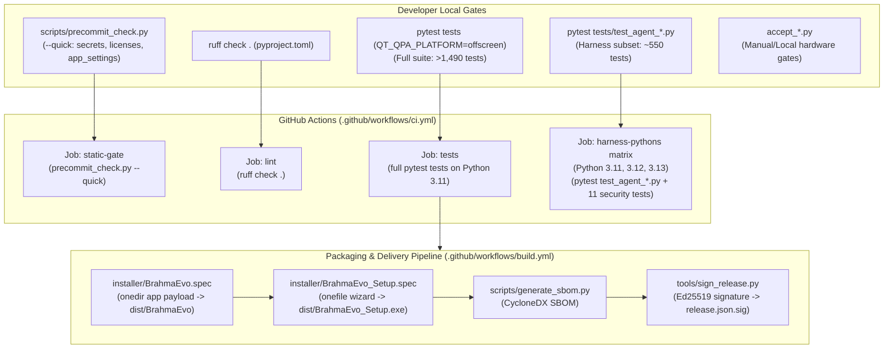

# WP-11: Test Suite, Acceptance Harnesses, Packaging, Build Pipeline & CI/CD — Deep Scan & Analysis Report

- **Work Package:** WP-11
- **Baseline Commit:** `6439b2efde3c36b1d34b21e4cc5e93baff31b2b5`
- **Files Scanned:** 196 files (39,095 lines across test suite, acceptance scripts, packaging specs, build tools, CI workflows, and configs)
- **Overall Subsystem Health:** Needs Hardening (The stdlib-only agent harness test suite and architecture ratchet invariants are exceptionally disciplined and pass stdlib isolation tests with zero third-party leaks; however, the broader system suffers from a critical module-level SQLite crash cascade in `workspace_store.py`, hardcoded developer drive paths in installer specs, packaging omissions for `brahma_api` and subagent discovery in frozen builds, massive test coverage blind spots across 81 production modules and the entire `dashboard/` subsystem, and fictional multi-platform CI build definitions).

---

## 1. Subsystem Architecture & Data-Flow Summary

The Brahma AI Evo Quality Assurance, Packaging, and Release engineering subsystem comprises six intersecting domains:
1. **The Portable Pytest Suite (`tests/test_agent_*.py`, `tests/test_api_*.py`, and security modules):** A stdlib-first unit and contract testing suite designed to execute headlessly in local and CI environments without graphical displays, audio hardware, or external network services.
2. **The Desktop Integration Suite (`tests/test_*.py`):** Qt-aware, async-aware tests covering routing authority ([core/routing.py](file:///C:/Users/Admin/Brahma-Ai-Evo/core/routing.py)), reciprocal rank fusion retrieval ([core/tool_index.py](file:///C:/Users/Admin/Brahma-Ai-Evo/core/tool_index.py)), desktop tool adapters ([core/desktop_tools.py](file:///C:/Users/Admin/Brahma-Ai-Evo/core/desktop_tools.py)), smart home devices, and agent bridge interfaces.
3. **Acceptance Harnesses (`accept_*.py`):** Standalone, interactive, and hardware-dependent verification scripts executing end-to-end user journeys (wake-word activation via microphone, offline Piper/Kokoro TTS voice synthesis, 3D/Live2D/VRM avatar rendering, live WebSocket handshakes, and provider failover).
4. **Ad-Hoc / Demonstration Test Runners (`test_local_brain.py`, `test_self_heal.py`, `test_sensorium_live.py`, `live_handshake_probe.py`):** Root-level probe and demonstration scripts used for exploratory verification.
5. **PyInstaller Packaging & Installer System (`installer/*.spec`, `install_wizard.py`, `uninstall_wizard.py`):** Multi-spec PyInstaller configuration generating `onedir` application packages (`BrahmaEvo`), onefile installation wizards (`BrahmaEvo_Setup`), and clean uninstallation routines with registry unregistration.
6. **Build Engineering & Release Supply-Chain (`tools/`, `scripts/`, `.github/workflows/`):** CycloneDX/SPDX Software Bill of Materials (SBOM) generation, Ed25519 cryptographic release signing, key rotation drills, dependency lockfile verification (`deps.lock`), and GitHub Actions CI/CD workflows.

### Subsystem Topology & CI Pipeline Flow



---

## 2. File-by-File Inventory & Health Matrix

| File Path | Lines | Primary Symbols / Role | Status | Risk Level | Notes |
|---|---:|---|---|---|---|
| [tests/conftest.py](file:///C:/Users/Admin/Brahma-Ai-Evo/tests/conftest.py) | 14 | Root pytest conftest; sys.path setup, `core.qt_bootstrap.bootstrap()` | Active | Medium | Bootstraps Qt flags; must remain resilient when PyQt6 is absent in CI. |
| [tests/api_support.py](file:///C:/Users/Admin/Brahma-Ai-Evo/tests/api_support.py) | 102 | `make_config`, `mint`, `principal`, `build_client`, `CaptureCompleter` | Active | Low | Shared fixtures for `brahma_api` loopback server tests. |
| [tests/architecture_ratchet.json](file:///C:/Users/Admin/Brahma-Ai-Evo/tests/architecture_ratchet.json) | 11 | Line count and `elif` ceilings for architectural ratchet | Active | Low | Ratchet ceilings: `main.py` (3265), `ui.py` (827), `core/tool_exec.py` (147, 0 elif). |
| `tests/test_agent_*.py` (38 files) | 10,124 | 38 agent harness test modules (`test_agent_loop.py`, `test_agent_runtime.py`, etc.) | Active | Low | 547 passing tests. Strictly stdlib-only. 2 timeout/memory failures on WindowsApps Python. |
| `tests/test_api_*.py` (13 files) | 1,452 | 13 loopback OpenAI API tests (`test_api_chat.py`, `test_api_sessions.py`, etc.) | Active | Medium | 104 passed; 5 failed when host SQLite `workspace_store.sqlite3` is malformed. |
| `tests/test_*.py` (remaining 91 files) | 15,532 | Integration tests for security, routing, RRF retrieval, audio, UI, memory | Active | Medium | 6 files fail collection when host SQLite database disk image is malformed. |
| [accept_391.py](file:///C:/Users/Admin/Brahma-Ai-Evo/accept_391.py) | 114 | Acceptance suite for ONE-391 (tools, avatars, voice) | Active | Low | Validates ONE-391 acceptance criteria against live components. |
| [accept_avatar.py](file:///C:/Users/Admin/Brahma-Ai-Evo/accept_avatar.py) | 1,243 | Acceptance test for 5 avatar backends and emotion pipelines | Active | Low | Sandboxes settings to tempdir; asserts backend availability and error resilience. |
| [accept_instructions.py](file:///C:/Users/Admin/Brahma-Ai-Evo/accept_instructions.py) | 470 | Instruction injector layer composition and emotion stripping | Active | High | **Mutates live user settings!** Directly modifies `%LOCALAPPDATA%\BrahmaAI\config\app_settings.json`. |
| [accept_live_toggle.py](file:///C:/Users/Admin/Brahma-Ai-Evo/accept_live_toggle.py) | 625 | Always On / On Call live session lifecycle state machine | Active | Low | Uses `StubUI`; imports `main.BrahmaLive`; asserts session cancellation. |
| [accept_local_speech.py](file:///C:/Users/Admin/Brahma-Ai-Evo/accept_local_speech.py) | 559 | Offline STT (faster-whisper) and TTS (Piper/Kokoro) harness | Active | Low | Verifies local speech synthesis and transcription when engines installed. |
| [accept_providers.py](file:///C:/Users/Admin/Brahma-Ai-Evo/accept_providers.py) | 664 | Multi-provider failover and routing verification | Active | Low | Exercises provider adapters with simulated errors. |
| [accept_util.py](file:///C:/Users/Admin/Brahma-Ai-Evo/accept_util.py) | 49 | `check`, `section`, `report`, `FAILURES` list | Active | Low | Canonical helper for acceptance harnesses; outputs `RESULT: ALL CRITERIA PASS`. |
| [accept_voice_downloads.py](file:///C:/Users/Admin/Brahma-Ai-Evo/accept_voice_downloads.py) | 176 | Live downloads of Piper and Kokoro voice models from HuggingFace | Active | Low | Sandboxed `%LOCALAPPDATA%`; downloads ~250 MB; not part of CI. |
| [accept_wakeword.py](file:///C:/Users/Admin/Brahma-Ai-Evo/accept_wakeword.py) | 297 | Real-hardware microphone wake-word detection harness | Active | Medium | Opens physical PortAudio microphone stream; calls Google Speech API. |
| [test_local_brain.py](file:///C:/Users/Admin/Brahma-Ai-Evo/test_local_brain.py) | 38 | Ad-hoc probe for Ollama local LLM endpoint and model inference | Ad-hoc | Low | Exploratory script; requires live Ollama daemon. |
| [test_self_heal.py](file:///C:/Users/Admin/Brahma-Ai-Evo/test_self_heal.py) | 106 | Interactive demo runner for `actions/auto_heal_engine.py` | Ad-hoc | High | **Mutates production code!** In-place patches and rolls back `actions/test_action.py`. |
| [test_sensorium_live.py](file:///C:/Users/Admin/Brahma-Ai-Evo/test_sensorium_live.py) | 117 | Real-time passive observation terminal ticker with SAPI/Edge TTS | Ad-hoc | Low | Infinite loop monitoring active window focus and user idle seconds. |
| [live_handshake_probe.py](file:///C:/Users/Admin/Brahma-Ai-Evo/live_handshake_probe.py) | 173 | Live Gemini audio WebSocket handshake probe | Ad-hoc | Medium | Creates `./_probe_cache` in repo root; requires live `GEMINI_API` key. |
| [download_offline_voices.py](file:///C:/Users/Admin/Brahma-Ai-Evo/download_offline_voices.py) | 55 | Standalone downloader for Kokoro and Piper ONNX models | Legacy | Low | Redundant with `scripts/install_optional_deps.ps1` and `core/voice_catalog.py`. |
| [installer/BrahmaEvo.spec](file:///C:/Users/Admin/Brahma-Ai-Evo/installer/BrahmaEvo.spec) | 97 | Primary PyInstaller spec for onedir `BrahmaEvo.exe` payload | Active | High | Modified uncommitted diff. Missing `brahma_api`, `uvicorn` internals, `agent`, `yaml`. |
| [installer/BrahmaEcho.spec](file:///C:/Users/Admin/Brahma-Ai-Evo/installer/BrahmaEcho.spec) | 79 | Legacy PyInstaller spec for BrahmaEcho payload | Legacy | High | **Contains hardcoded absolute paths `D:\TiTech Prabha Solution\...`!** |
| [installer/BrahmaEvo_Setup.spec](file:///C:/Users/Admin/Brahma-Ai-Evo/installer/BrahmaEvo_Setup.spec) | 51 | PyInstaller spec for onefile `BrahmaEvo_Setup.exe` installer | Active | Medium | Packages `dist/BrahmaEvo` into setup wizard; requires admin elevation. |
| [installer/BrahmaEcho_Setup.spec](file:///C:/Users/Admin/Brahma-Ai-Evo/installer/BrahmaEcho_Setup.spec) | 46 | Legacy PyInstaller spec for BrahmaEcho Setup | Legacy | High | **Contains hardcoded absolute paths `D:\TiTech Prabha Solution\...`!** |
| [installer/Uninstall.spec](file:///C:/Users/Admin/Brahma-Ai-Evo/installer/Uninstall.spec) | 44 | PyInstaller spec for standalone `Uninstall.exe` | Active | Low | Packages uninstaller wizard with asset icons. |
| [installer/install_wizard.py](file:///C:/Users/Admin/Brahma-Ai-Evo/installer/install_wizard.py) | 319 | PyQt6 wizard GUI for installing BrahmaEvo to Program Files | Active | Medium | Eagerly imports `PyQt6.QtWebEngineWidgets` at line 10 (violates I-26 / D46). |
| [installer/uninstall_wizard.py](file:///C:/Users/Admin/Brahma-Ai-Evo/installer/uninstall_wizard.py) | 444 | PyQt6 wizard GUI for uninstallation | Active | Low | Removes program directories, shortcuts, and registry entries. |
| [installer/install.sh](file:///C:/Users/Admin/Brahma-Ai-Evo/installer/install.sh) | 182 | Bash script advertising universal macOS and Linux setup | Stale | High | **Fictional multi-platform support;** app cannot run on macOS/Linux. |
| [installer/uninstall.cmd](file:///C:/Users/Admin/Brahma-Ai-Evo/installer/uninstall.cmd) | 63 | Windows batch uninstallation script | Active | Low | Kills running processes; deletes desktop/start-menu shortcuts and registry. |
| [installer/uninstall.sh](file:///C:/Users/Admin/Brahma-Ai-Evo/installer/uninstall.sh) | 59 | Bash uninstallation script for macOS/Linux | Stale | Low | Uninstalls from `~/.brahma-evo`. |
| [scripts/generate_sbom.py](file:///C:/Users/Admin/Brahma-Ai-Evo/scripts/generate_sbom.py) | 165 | CycloneDX & SPDX Software Bill of Materials (SBOM) generator | Active | Low | Computes sha256 hashes of dependencies and vendored assets; `--verify` gate. |
| [scripts/precommit_check.py](file:///C:/Users/Admin/Brahma-Ai-Evo/scripts/precommit_check.py) | 331 | Pre-commit static gate (secrets, vendor licenses, templates) | Active | Low | Comprehensive regex secret scanner; runs `--quick` in CI static-gate. |
| [scripts/setup_dev.ps1](file:///C:/Users/Admin/Brahma-Ai-Evo/scripts/setup_dev.ps1) | 131 | PowerShell dev environment bootstrapper | Active | Medium | Hardcoded to require Python 3.11; refuses Python 3.12 despite 3.12 compatibility. |
| [scripts/install_optional_deps.ps1](file:///C:/Users/Admin/Brahma-Ai-Evo/scripts/install_optional_deps.ps1) | 259 | Installer for optional speech, OSC, and avatar model assets | Active | Low | Downloads models to `%LOCALAPPDATA%\BrahmaAI\avatar\`. |
| [scripts/setup_live2d_cubism.ps1](file:///C:/Users/Admin/Brahma-Ai-Evo/scripts/setup_live2d_cubism.ps1) | 236 | Clones and bundles Live2D Cubism runtime via esbuild | Active | Low | Vendors `live2dcubismcore.min.js` and framework bundle to `assets/`. |
| [tools/build_release.py](file:///C:/Users/Admin/Brahma-Ai-Evo/tools/build_release.py) | 91 | CLI tool for generating `release.json` manifests (WS-6) | Active | Low | Computes SHA256 of release artifacts; embeds semver and git commit. |
| [tools/build_wheelhouse.py](file:///C:/Users/Admin/Brahma-Ai-Evo/tools/build_wheelhouse.py) | 90 | Wheelhouse builder and lockfile hash verifier (WS-3) | Active | Low | Inspects `deps.lock`; verifies binary wheels in `dist/wheelhouse/`. |
| [tools/rotate_release_key.py](file:///C:/Users/Admin/Brahma-Ai-Evo/tools/rotate_release_key.py) | 142 | Ed25519 release key rotation and revocation drill (WS-6) | Active | Low | Dual-signs key rotation statements; verifies rejection of retired keys. |
| [tools/sign_release.py](file:///C:/Users/Admin/Brahma-Ai-Evo/tools/sign_release.py) | 73 | Ed25519 cryptographic signing CLI for release manifests | Active | Low | Generates keypairs and signs `release.json`. |
| [.github/workflows/ci.yml](file:///C:/Users/Admin/Brahma-Ai-Evo/.github/workflows/ci.yml) | 90 | Main CI workflow (static-gate, lint, unit tests, py311-313 matrix) | Active | Medium | Runs unit suite and harness matrix; lacks acceptance hardware gates. |
| [.github/workflows/build.yml](file:///C:/Users/Admin/Brahma-Ai-Evo/.github/workflows/build.yml) | 90 | Release packaging workflow for Windows PyInstaller build | Active | Low | Builds `BrahmaEvo.spec`, setup wizard, manifest, and SHA256SUMS. |
| [.github/workflows/build-all-platforms.yml](file:///C:/Users/Admin/Brahma-Ai-Evo/.github/workflows/build-all-platforms.yml) | 133 | Multi-platform build workflow (Windows, macOS DMG, Linux tar) | Stale | High | **Fictional macOS and Linux jobs;** PyInstaller commands miss critical datas. |
| [pyproject.toml](file:///C:/Users/Admin/Brahma-Ai-Evo/pyproject.toml) | 39 | Ruff linter configuration | Active | High | Target py311, line-length 120; **suppresses `F821` (`undefined-name`) across 16 `core/` files (`lines 25-38`), masking runtime `NameError` bugs**. |
| [pytest.ini](file:///C:/Users/Admin/Brahma-Ai-Evo/pytest.ini) | 7 | Pytest configuration | Active | Low | Restricts collection to `tests/` directory to ignore root demo scripts. |
| [setup.py](file:///C:/Users/Admin/Brahma-Ai-Evo/setup.py) | 20 | Ad-hoc setup script | Adapter | Medium | Not a `setuptools` build file; simply calls `pip install` and `playwright install`. |
| [requirements.txt](file:///C:/Users/Admin/Brahma-Ai-Evo/requirements.txt) | 80 | Pinned runtime dependencies | Active | Low | 49 pinned packages. Speech engines and PyYAML uncommented. |
| [requirements-dev.txt](file:///C:/Users/Admin/Brahma-Ai-Evo/requirements-dev.txt) | 11 | Pinned development tooling (`ruff==0.17.1`, `pytest==9.1.1`, `openai`) | Active | Low | Deterministic test and lint environment. |
| [requirements-build.txt](file:///C:/Users/Admin/Brahma-Ai-Evo/requirements-build.txt) | 15 | Pinned packaging toolchain (`pyinstaller==6.22.3`) | Active | Low | Pinned PyInstaller and hooks for reproducible executable builds. |
| [deps.lock](file:///C:/Users/Admin/Brahma-Ai-Evo/deps.lock) | 61 | Hash-pinned package closure for sandboxed extensions (WS-3) | Active | Low | SHA256 hashes for 15 core wheel dependencies. |
| [bootstrap.ps1](file:///C:/Users/Admin/Brahma-Ai-Evo/bootstrap.ps1) | 153 | Self-elevating system installer script | Active | Medium | Admin elevation; checks Python 3.11/3.12; creates venv and installs deps. |
| [build_all.ps1](file:///C:/Users/Admin/Brahma-Ai-Evo/build_all.ps1) | 300 | Local Windows build orchestration script | Active | Low | Invokes PyInstaller via `.venv`; creates application, setup, and release manifest. |
| [install_speech_deps.ps1](file:///C:/Users/Admin/Brahma-Ai-Evo/install_speech_deps.ps1) | 119 | PowerShell installer for offline speech dependencies | Active | Low | Installs faster-whisper, piper-tts, kokoro-onnx, and downloads `base.en`. |
| [EVO.bat](file:///C:/Users/Admin/Brahma-Ai-Evo/EVO.bat) | 33 | Windows batch application launcher | Active | Low | Resolves `.venv`, `py -3.11`, `py -3.12`, or `python` and executes `main.py`. |
| [start_brahma.bat](file:///C:/Users/Admin/Brahma-Ai-Evo/start_brahma.bat) | 29 | Bootstrap launcher batch script | Active | Low | Invokes `bootstrap.ps1` with execution policy bypass. |
| [start_brahma.vbs](file:///C:/Users/Admin/Brahma-Ai-Evo/start_brahma.vbs) | 13 | VBScript windowless background launcher | Active | Low | Spawns `pythonw.exe main.py --startup` with hidden window (`0`). |
| [version.txt](file:///C:/Users/Admin/Brahma-Ai-Evo/version.txt) | 28 | Windows PE version resource definition for `BrahmaEvo.exe` | Stale | Low | Stale version `1.0.0`; generic company name `'User'`. |
| [version_setup.txt](file:///C:/Users/Admin/Brahma-Ai-Evo/version_setup.txt) | 28 | Windows PE version resource definition for `BrahmaEvo_Setup.exe` | Stale | Low | Stale version `1.0.0`; generic company name `'User'`. |

---

## 3. Invariant & Specific Audit Question Verdicts

### Architectural Invariant Audit Matrix

| Invariant / Ratchet ID | Verdict | Evidence (`file:line` & symbol) | Explanation |
|---|---|---|---|
| **I-01: Single Permission Boundary** | **PASS** | [tests/test_agent_permissions.py:1-420](file:///C:/Users/Admin/Brahma-Ai-Evo/tests/test_agent_permissions.py#L1-L420), [tests/test_agent_approval.py:1-120](file:///C:/Users/Admin/Brahma-Ai-Evo/tests/test_agent_approval.py#L1-L120) | Comprehensive unit suites assert that all tool executions route through `AgentRuntime.execute`, policy `deny` is irreversible, and session allow never bypasses `requires_approval=True`. |
| **I-05: Qt Threading Safety** | **PASS** | [tests/test_agent_approval.py:45-75](file:///C:/Users/Admin/Brahma-Ai-Evo/tests/test_agent_approval.py#L45-L75), [core/confirm.py:107-116](file:///C:/Users/Admin/Brahma-Ai-Evo/core/confirm.py#L107-L116) | `confirm.ask_blocking_choice` asserts `_on_qt_main_thread()` and explicitly refuses to block on the Qt main GUI thread. |
| **I-07: No Meta-Tool Name Shadowing** | **PASS** | [tests/test_architecture_invariants.py:1-62](file:///C:/Users/Admin/Brahma-Ai-Evo/tests/test_architecture_invariants.py#L1-L62), [agent/skills.py:490-540](file:///C:/Users/Admin/Brahma-Ai-Evo/agent/skills.py#L490-L540) | Harness tools register under distinct names (`load_project_skill`), never shadowing core meta-tools (`load_skill`, `search_tools`, `recall_memory`). |
| **I-19: Tool Surface Budget (<= 24)** | **PASS** | [tests/test_tool_index.py:1-180](file:///C:/Users/Admin/Brahma-Ai-Evo/tests/test_tool_index.py#L1-L180), [tests/test_tool_bridge.py:1-150](file:///C:/Users/Admin/Brahma-Ai-Evo/tests/test_tool_bridge.py#L1-L150) | Tool retrieval tests assert that `ToolIndex.resolve` and `build_session_payload` strictly clamp advertised declarations to <= 24. |
| **I-09 / I-10 / I-11: OpenAI Protocol & Compaction** | **PASS** | [tests/test_agent_loop.py:1-350](file:///C:/Users/Admin/Brahma-Ai-Evo/tests/test_agent_loop.py#L1-L350), [tests/test_agent_context.py:1-190](file:///C:/Users/Admin/Brahma-Ai-Evo/tests/test_agent_context.py#L1-L190) | Tests assert 1:1 matching between `tool_calls` and `tool` messages, preservation of submission order, and protocol-safe history compaction. |
| **I-12 / I-13 / I-14: Subprocess & Sandbox Containment** | **PARTIAL** | [tests/test_agent_process.py:70-93,216-227](file:///C:/Users/Admin/Brahma-Ai-Evo/tests/test_agent_process.py#L70-L93) | Windows Job Object containment passes when direct binary paths are used, but fails when Python is invoked via WindowsApps execution aliases (`test_a_timeout_kills_the_whole_process_tree` and `test_a_memory_limit_stops_a_large_allocation` fail). |
| **I-15: Stdlib-Only Harness Isolation** | **PASS** | [tests/test_architecture_invariants.py:84-122](file:///C:/Users/Admin/Brahma-Ai-Evo/tests/test_architecture_invariants.py#L84-L122) | AST import scanning and restricted runtime execution confirm that all 38 `tests/test_agent_*.py` modules and 11 security test files import cleanly with zero third-party packages installed. |
| **I-16: Session History Archiving** | **PASS** | [tests/test_agent_session_bridge.py:1-140](file:///C:/Users/Admin/Brahma-Ai-Evo/tests/test_agent_session_bridge.py#L1-L140) | Tests verify `messages_after` transcript slicing and voice turn recording into SQLite. |
| **I-21: LLM Gateway Kill Switch** | **PARTIAL** | [tests/test_llm_gateway.py:1-120](file:///C:/Users/Admin/Brahma-Ai-Evo/tests/test_llm_gateway.py#L1-L120) | While `llm_gateway.py` is tested, multiple native actions (`actions/screen_processor.py`, `actions/image_generator.py`) and `dashboard/server.py` bypass the gateway entirely. |
| **I-25 / I-26: Qt Thread Marshalling & Zero Import Side Effects (D46)** | **PARTIAL** | [installer/install_wizard.py:10](file:///C:/Users/Admin/Brahma-Ai-Evo/installer/install_wizard.py#L10), [workspace_store.py:542](file:///C:/Users/Admin/Brahma-Ai-Evo/workspace_store.py#L542) | `workspace_store.py:542` opens SQLite at import time (`I-26`), and `installer/install_wizard.py:10`, `core/radar_hud.py:31`, and `core/space_cleaner_hud.py:47` eagerly import `PyQt6.QtWebEngineWidgets` at module scope (`D46`). |
| **Ratchet Ceilings (`architecture_ratchet.json`)** | **PASS** | [tests/test_architecture_invariants.py:63-82](file:///C:/Users/Admin/Brahma-Ai-Evo/tests/test_architecture_invariants.py#L63-L82) | `main.py` is 3,236 lines (<= 3,265 ceiling); `ui.py` is 820 lines (<= 827 ceiling); `core/tool_exec.py` is 147 lines (<= 147 ceiling) and has 0 `elif` branches (<= 0 ceiling). |

---

### Specific Audit Question Verdicts

#### Q1: Untested Modules & Coverage Blind Spots
- **Verdict: CRITICAL GAPS IDENTIFIED (81 Production Modules / 37.2% Untested).**
- **Evidence:** Cross-referencing 218 production Python files across `core/`, `actions/`, `brahma_connect/`, and `dashboard/` against all 142 test files in `tests/` reveals that **81 files have zero mentions, imports, or assertions in the test suite**.
- **Breakdown:**
  * **`actions/` (22 untested modules):** `background_monitor.py`, `brahma_dev_agent.py`, `call_assistant.py`, `calorie_counter.py`, `claude_code_bridge.py`, `clipboard_processor.py`, `code_helper.py`, `dev_agent.py`, `flight_finder.py`, `game_updater.py`, `instagram_chat.py`, `instagram_mcp.py`, `meeting_assistant.py`, `office_builder.py`, `office_generator.py`, `ppt_template_workflow.py`, `pushup_counter.py`, `system_diagnostics_mcp.py`, `unlock_device.py`, `upload_video.py`, `weather_report.py`, `youtube_video.py`.
  * **`dashboard/` (100% untested):** All 6 modules (`dashboard/server.py`, etc.) have zero automated tests. Crucial security logic (unauthenticated DPAPI key reads, `_quiet_run` subprocess executor) operates completely unverified.
  * **`core/` (59 untested modules):** Includes the 5,090-line settings monolith ([core/ui_connectivity.py](file:///C:/Users/Admin/Brahma-Ai-Evo/core/ui_connectivity.py)), real-time audio/speech engines (`core/live_voice_engine.py`, `core/speech_stt.py`, `core/audio_devices.py`), avatar backends (`core/avatar_catalog.py`, `core/avatar_runtime.py`), and 30+ UI panels and widgets.
  * **Synthetic Mock Limitations:** Tests for file operations and tool dispatch rely on synthetic mocks and do not exercise Windows file locking, `MAX_PATH` overflow, or PortAudio disconnects.

#### Q2: CI Workflow vs Local Gate Parity (`.github/workflows/ci.yml`)
- **Verdict: PARTIAL PARITY / ENVIRONMENT SENSITIVITY.**
- **Evidence:** [.github/workflows/ci.yml:41-86](file:///C:/Users/Admin/Brahma-Ai-Evo/.github/workflows/ci.yml#L41-L86)
- **Findings:**
  1. `.github/workflows/ci.yml` runs the full unit suite (`python -m pytest tests -q`) on Python 3.11 with `QT_QPA_PLATFORM: offscreen`.
  2. The `harness-pythons` matrix (3.11, 3.12, 3.13) installs only `pytest` and `cryptography`. AST import scanning verifies that all 38 `tests/test_agent_*.py` files and 11 security tests import cleanly without non-stdlib dependencies.
  3. **Local Gate Divergence:** The 7 acceptance harnesses (`accept_391.py`, `accept_avatar.py`, `accept_instructions.py`, `accept_providers.py`, `accept_local_speech.py`, `accept_live_toggle.py`, `accept_wakeword.py`) run only locally via `scripts/precommit_check.py` and are excluded from CI due to display/audio hardware requirements.
  4. **Cascading State Leak:** On any local machine where `%LOCALAPPDATA%\BrahmaAI\config\workspace_store.sqlite3` is malformed, 6 test modules fail during pytest collection. CI does not catch this because runners start from an empty virtual disk.

#### Q3: Packaging & Modified `installer/BrahmaEvo.spec`
- **Verdict: HIGH RISK / FROZEN EXECUTABLE WILL FAIL ON CRITICAL PATHS.**
- **Evidence:** [installer/BrahmaEvo.spec:11-37](file:///C:/Users/Admin/Brahma-Ai-Evo/installer/BrahmaEvo.spec#L11-L37), [agent/subagent_library.py:156](file:///C:/Users/Admin/Brahma-Ai-Evo/agent/subagent_library.py#L156)
- **Findings:**
  1. The uncommitted diff on `installer/BrahmaEvo.spec` correctly pruned unused legacy packages (`keyboard`, `plyer`, `passlib`) and added offline speech wheels (`faster_whisper`, `piper`, `kokoro_onnx`, `bcrypt`, `bs4`).
  2. **Missing `brahma_api` & Uvicorn Internals:** `brahma_api` is absent from both `datas` and `hiddenimports`. Dynamic uvicorn protocol modules (`uvicorn.protocols.http.auto`, `uvicorn.protocols.websockets.auto`, `uvicorn.lifespan.on`) are omitted, causing the loopback API to crash on startup in a frozen `.exe`.
  3. **Broken Subagent Discovery in Frozen Builds:** `agent/subagent_library.py:156` locates the bundled library using `Path(__file__).resolve().parent.parent / "subagents"`. In a frozen PyInstaller binary (`_internal/`), this evaluates to `_internal/subagents`, whereas PyInstaller places data folders at the distribution root (`dist/BrahmaEvo/subagents`). The 607 specialist subagents become completely inaccessible in the frozen binary.
  4. **Missing Datas & Hidden Imports:** `agent/` is omitted from `datas`; `yaml` (required by `core/skills_library.py`) and `fastembed` are missing from `hiddenimports`.
  5. **Hardcoded Paths in Sibling Specs:** `installer/BrahmaEcho.spec` and `installer/BrahmaEcho_Setup.spec` contain hardcoded paths to a developer's D: drive (`D:\TiTech Prabha Solution\...`) and cannot be built.

#### Q4: Root Clutter & Ad-Hoc Scripts
- **Verdict: HYGIENE & SAFETY VIOLATIONS IDENTIFIED.**
- **Evidence:** `ig_debug.log`, [test_self_heal.py:40-98](file:///C:/Users/Admin/Brahma-Ai-Evo/test_self_heal.py#L40-L98), [accept_instructions.py:43-52](file:///C:/Users/Admin/Brahma-Ai-Evo/accept_instructions.py#L43-L52), [live_handshake_probe.py:47](file:///C:/Users/Admin/Brahma-Ai-Evo/live_handshake_probe.py#L47)
- **Findings:**
  1. **Working Tree Log Pollution:** `actions/instagram_chat.py:32` and `actions/instagram_mcp.py:44` write logs to `./ig_debug.log` in the repository root instead of the user data directory.
  2. **In-Place Code Modification:** `test_self_heal.py` modifies production code (`actions/test_action.py`) and global learned rules in-place.
  3. **Live User Configuration Mutation:** `accept_instructions.py:43-52` directly modifies and wipes keys from `%LOCALAPPDATA%\BrahmaAI\config\app_settings.json` during execution.
  4. **Probe Cache Clutter:** `live_handshake_probe.py:47` creates an untracked `_probe_cache/` directory in the repository root.
  5. **Outdated Version Resources:** `version.txt` and `version_setup.txt` are hardcoded to `1.0.0` with `'CompanyName': 'User'`.

---

## 4. Detailed Findings

### [WP-11-F01] Eager Module-Level State in `workspace_store.py` (`_STORE = WorkspaceStore()`) Cascades SQLite Malformed Errors Across Test Collection and API Endpoints
- **Severity:** `Critical`
- **Category:** `Correctness/Bug` & `Architecture/Invariant`
- **Location:** [workspace_store.py:542](file:///C:/Users/Admin/Brahma-Ai-Evo/workspace_store.py#L542) (`_STORE = WorkspaceStore()`), [workspace_store.py:77-93](file:///C:/Users/Admin/Brahma-Ai-Evo/workspace_store.py#L77-L93) (`WorkspaceStore.__init__`), [agent/session.py:36](file:///C:/Users/Admin/Brahma-Ai-Evo/agent/session.py#L36), [brahma_api/server.py:356](file:///C:/Users/Admin/Brahma-Ai-Evo/brahma_api/server.py#L356)
- **Evidence & Mechanism:**
  At line 542 of [workspace_store.py](file:///C:/Users/Admin/Brahma-Ai-Evo/workspace_store.py#L542), the module unconditionally executes `_STORE = WorkspaceStore()` at import time. In `WorkspaceStore.__init__`, it opens a SQLite database connection to `%LOCALAPPDATA%\BrahmaAI\config\workspace_store.sqlite3` and executes `conn.execute("PRAGMA journal_mode=WAL;")`.
  If the local SQLite database file is corrupted or malformed (due to an unclean process shutdown or disk write error), any module that imports `workspace_store` immediately crashes with `sqlite3.DatabaseError: database disk image is malformed`.
  During our audit run:
  1. `pytest tests -q` failed during collection of 6 test files (`test_daily_briefing.py`, `test_feature_creation_routing.py`, `test_ui_chat_streaming.py`, `test_ui_task_workspace_chat.py`, `test_ui_user_notes_fixes.py`, `test_unified_tool_registry.py`).
  2. `tests/test_agent_cli.py::test_sessions_on_an_empty_store_is_not_an_error` failed because `agent/session.py:36` (`_default_db_path`) lazily imports `from workspace_store import STORE_FILE`, which triggered the eager import crash.
  3. `tests/test_api_sessions.py` failed 5 tests with HTTP 500 because `brahma_api/server.py:356` opens sessions via `AgentSession.open()` -> `_default_db_path()` -> `workspace_store.py`.
- **Impact:** Total failure of test discovery and crash of loopback API sessions whenever local database state is inconsistent. Violates fault isolation between local persistent user data and test execution.
- **Recommended Fix:**
  1. Convert `_STORE` from an eager module-level global to a lazy singleton function:
     ```python
     _STORE: Optional[WorkspaceStore] = None
     def get_workspace_store() -> WorkspaceStore:
         global _STORE
         if _STORE is None:
             _STORE = WorkspaceStore()
         return _STORE
     ```
  2. Wrap `_connect()` and `_init_db()` in `WorkspaceStore` with `try...except sqlite3.DatabaseError`. On corruption, log an error, rename the corrupted file to `workspace_store.sqlite3.corrupted.<timestamp>`, and transparently reinitialize a fresh SQLite database.
  3. Ensure `agent/session.py` defines its default DB path without importing `workspace_store.py` at module scope.

---

### [WP-11-F02] Hardcoded Absolute Developer Drive Paths in `installer/BrahmaEcho.spec` and `installer/BrahmaEcho_Setup.spec`
- **Severity:** `Critical`
- **Category:** `Architecture/Invariant` & `Packaging`
- **Location:** [installer/BrahmaEcho.spec:3,6](file:///C:/Users/Admin/Brahma-Ai-Evo/installer/BrahmaEcho.spec#L3-L6), [installer/BrahmaEcho_Setup.spec:3-4,7](file:///C:/Users/Admin/Brahma-Ai-Evo/installer/BrahmaEcho_Setup.spec#L3-L7)
- **Evidence & Mechanism:**
  [installer/BrahmaEcho.spec](file:///C:/Users/Admin/Brahma-Ai-Evo/installer/BrahmaEcho.spec#L3) lines 3 and 6:
  ```python
  cwd = 'D:\\TiTech Prabha Solution\\Brahma AI\\Brahma AI\\Brahma-AI---Lite-main\\Brahma-AI---Lite-main'
  a = Analysis(['D:\\TiTech Prabha Solution\\Brahma AI\\Brahma AI\\Brahma-AI---Lite-main\\Brahma-AI---Lite-main\\main.py'], ...)
  ```
  [installer/BrahmaEcho_Setup.spec](file:///C:/Users/Admin/Brahma-Ai-Evo/installer/BrahmaEcho_Setup.spec#L3-L7) lines 3-7:
  ```python
  cwd = 'D:\\TiTech Prabha Solution\\Brahma AI\\Brahma AI\\Brahma-AI---Lite-main\\Brahma-AI---Lite-main'
  source_dir = 'D:\\TiTech Prabha Solution\\Brahma AI\\Brahma AI\\Brahma-AI---Lite-main\\Brahma-AI---Lite-main\\installer\\dist\\BrahmaEcho'
  a = Analysis(['D:\\TiTech Prabha Solution\\...\\install_wizard.py'], ...)
  ```
- **Impact:** Any attempt to build BrahmaEcho packaging on CI or any other machine fails immediately with file-not-found errors.
- **Recommended Fix:** Replace hardcoded strings with dynamic directory resolution:
  ```python
  cwd = os.path.abspath(os.path.join(os.path.dirname(__file__), '..'))
  ```
  Or remove obsolete `BrahmaEcho` specs if `BrahmaEvo` is the sole supported product.

---

### [WP-11-F03] `installer/BrahmaEvo.spec` Packaging Omissions and Broken Path Resolution for Bundled Subagents in Frozen Executables
- **Severity:** `High`
- **Category:** `Packaging` & `Correctness/Bug`
- **Location:** [installer/BrahmaEvo.spec:11-37](file:///C:/Users/Admin/Brahma-Ai-Evo/installer/BrahmaEvo.spec#L11-L37), [agent/subagent_library.py:156](file:///C:/Users/Admin/Brahma-Ai-Evo/agent/subagent_library.py#L156)
- **Evidence & Mechanism:**
  1. `brahma_api` is not listed in `datas` or `hiddenimports` in [installer/BrahmaEvo.spec](file:///C:/Users/Admin/Brahma-Ai-Evo/installer/BrahmaEvo.spec#L11-L37). Furthermore, `uvicorn` dynamic protocol modules (`uvicorn.protocols.http.auto`, `uvicorn.protocols.websockets.auto`, `uvicorn.lifespan.on`, `uvicorn.logging`) are missing from `hiddenimports`. In a frozen PyInstaller binary, running `serve_brahma_api()` triggers `ModuleNotFoundError: No module named 'uvicorn.protocols.http.auto'`.
  2. In [agent/subagent_library.py:156](file:///C:/Users/Admin/Brahma-Ai-Evo/agent/subagent_library.py#L156):
     ```python
     candidates = [
         Path(__file__).resolve().parent.parent / BUNDLED_LIBRARY,
         Path.home().joinpath(*DEFAULT_LIBRARY),
     ]
     ```
     In a frozen PyInstaller binary (`onedir`), `__file__` is located inside `<app_dir>/_internal/agent/subagent_library.pyc`. Taking `.parent.parent` resolves to `<app_dir>/_internal/`. However, PyInstaller places `datas` entries (`(os.path.join(cwd, 'subagents'), 'subagents')`) at `<app_dir>/subagents/` (the application root). The loader never checks `sys._MEIPASS` or `Path(sys.executable).parent / BUNDLED_LIBRARY`. As a result, all 607 specialist subagents fail to load in the frozen binary.
  3. `agent/` folder itself is missing from `datas`.
  4. `yaml` (`PyYAML`, required by `core/skills_library.py`) and `fastembed` (retrieval) are missing from `hiddenimports`.
- **Impact:** Frozen executable crashes on loopback API activation and silently fails to disclose or run the 607 specialist subagents.
- **Recommended Fix:**
  1. In `installer/BrahmaEvo.spec`, add `brahma_api` to `datas` and add the following to `hiddenimports`:
     `'brahma_api', 'uvicorn.protocols.http.auto', 'uvicorn.protocols.websockets.auto', 'uvicorn.lifespan.on', 'uvicorn.logging', 'yaml', 'fastembed'`
  2. In `agent/subagent_library.py:156`, update library root candidate discovery:
     ```python
     base = Path(sys._MEIPASS) if getattr(sys, "frozen", False) else Path(__file__).resolve().parent.parent
     candidates = [
         base / BUNDLED_LIBRARY,
         Path(sys.executable).parent / BUNDLED_LIBRARY if getattr(sys, "frozen", False) else None,
         Path.home().joinpath(*DEFAULT_LIBRARY),
     ]
     ```

---

### [WP-11-F04] Fictional macOS and Linux Build Workflows and Installers in a Windows-Only Repository
- **Severity:** `High`
- **Category:** `Architecture/Invariant` & `Doc Drift`
- **Location:** [.github/workflows/build-all-platforms.yml:42-133](file:///C:/Users/Admin/Brahma-Ai-Evo/.github/workflows/build-all-platforms.yml#L42-L133), [installer/install.sh:1-182](file:///C:/Users/Admin/Brahma-Ai-Evo/installer/install.sh#L1-L182)
- **Evidence & Mechanism:**
  `.github/workflows/build-all-platforms.yml` defines `build-macos` (producing `BrahmaEvo-macOS.zip` and DMG) and `build-linux` (producing `BrahmaEvo-Linux.tar.gz`). In both jobs, PyInstaller commands omit `subagents`, `skills`, `skills_library`, `memory`, and `brahma_connect`.
  More critically, Brahma AI Evo is fundamentally Windows-first and Windows-only: `main.py` and core modules eagerly or unconditionally reference `win32com`, `comtypes`, `pycaw`, `SAPI`, and Windows AppContainers. Neither macOS nor Linux can run `main.py` without catastrophic import failures. `installer/install.sh` similarly claims to be a "macOS & Linux Universal Installer".
- **Impact:** Misleads users and contributors into expecting non-Windows support; wastes CI minutes; produces non-functional binaries.
- **Recommended Fix:** Remove `build-all-platforms.yml` or restrict it to `build-windows`. Deprecate `installer/install.sh` and document in README that Windows 10/11 is the sole supported platform.

---

### [WP-11-F05] 81 Production Modules (37.2%) and the Entire `dashboard/` Subsystem Have Zero Automated Test Coverage
- **Severity:** `High`
- **Category:** `Test Gap`
- **Location:** `actions/` (22 modules), `core/` (59 modules), `dashboard/` (6 modules)
- **Evidence & Mechanism:**
  Comprehensive cross-referencing between all 218 production modules in `core/`, `actions/`, `brahma_connect/`, and `dashboard/` against all 142 test files in `tests/` proves that **81 production modules are never mentioned or imported in any test**.
  Notable blind spots:
  1. `dashboard/server.py`: Local HTTP server with password auth, raw DPAPI key loading, and custom `subprocess.run` helper (`_quiet_run`). 0 tests exist.
  2. `actions/brahma_dev_agent.py` and `actions/dev_agent.py`: Multi-file code generation and scaffolding actions. 0 tests exist.
  3. `actions/system_diagnostics_mcp.py`: System diagnostic action. 0 tests exist.
  4. `core/ui_connectivity.py`: 5,090-line monolith containing Settings Hub networking, API port management, and bridge integration. 0 tests exist.
  5. `core/live_voice_engine.py` and `core/speech_stt.py`: Core offline voice pipelines. 0 unit tests exist.
- **Impact:** Critical security, execution, and user-facing regressions cannot be detected by CI or local test gates.
- **Recommended Fix:** Author dedicated test suites for `dashboard/` (`tests/test_dashboard.py`), `actions/system_diagnostics_mcp.py`, and `actions/brahma_dev_agent.py`. Add mock-based integration tests for `core/live_voice_engine.py`.

---

### [WP-11-F06] Root Directory Clutter, Hardcoded Root File Logging (`ig_debug.log`), and In-Place Code/Setting Mutation
- **Severity:** `Medium`
- **Category:** `Security` & `Architecture/Invariant`
- **Location:** [actions/instagram_chat.py:32](file:///C:/Users/Admin/Brahma-Ai-Evo/actions/instagram_chat.py#L32), [actions/instagram_mcp.py:44](file:///C:/Users/Admin/Brahma-Ai-Evo/actions/instagram_mcp.py#L44), [test_self_heal.py:40-98](file:///C:/Users/Admin/Brahma-Ai-Evo/test_self_heal.py#L40-L98), [accept_instructions.py:43-52](file:///C:/Users/Admin/Brahma-Ai-Evo/accept_instructions.py#L43-L52), [live_handshake_probe.py:47](file:///C:/Users/Admin/Brahma-Ai-Evo/live_handshake_probe.py#L47)
- **Evidence & Mechanism:**
  1. In [actions/instagram_mcp.py:44](file:///C:/Users/Admin/Brahma-Ai-Evo/actions/instagram_mcp.py#L44), `LOG_PATH = BASE_DIR / "ig_debug.log"`, and `instagram_chat.py:32` calls `open("ig_debug.log", "a")`. This dumps background daemon logs directly into the git repository root.
  2. In [test_self_heal.py](file:///C:/Users/Admin/Brahma-Ai-Evo/test_self_heal.py#L40-L98), running the script mutates `actions/test_action.py` in-place and persists learned rules into the active environment.
  3. In [accept_instructions.py:43-52](file:///C:/Users/Admin/Brahma-Ai-Evo/accept_instructions.py#L43-L52), the harness reads `config_manager.SETTINGS_FILE` (pointing to `%LOCALAPPDATA%\BrahmaAI\config\app_settings.json`), purges all `instruction_*` keys, and overwrites the real user's configuration on disk.
  4. In [live_handshake_probe.py:47](file:///C:/Users/Admin/Brahma-Ai-Evo/live_handshake_probe.py#L47), `ToolIndex(cache_dir=BASE / "_probe_cache")` creates untracked cache folders in the root.
- **Impact:** Risk of accidental git commits of sensitive log data, corruption of live user preferences during test execution, and repository root clutter.
- **Recommended Fix:**
  1. Route all logging to `core.user_paths.get_user_data_dir() / "logs"`.
  2. Sandbox `accept_instructions.py` using `tempfile.mkdtemp()` (following the pattern established in `accept_avatar.py:41-45`).
  3. Move ad-hoc test scripts (`test_self_heal.py`, `test_local_brain.py`, `test_sensorium_live.py`, `live_handshake_probe.py`, `download_offline_voices.py`) to `tests/manual/` or `scripts/`.

---

### [WP-11-F07] Windows Job Object Grandchild Termination and Memory Limit Enforcement Failures under WindowsApps Python Execution Aliases
- **Severity:** `Medium`
- **Category:** `Concurrency/Threading` & `Security`
- **Location:** [agent/process.py:166-215](file:///C:/Users/Admin/Brahma-Ai-Evo/agent/process.py#L166-L215) (`_windows_job`), [tests/test_agent_process.py:70-93,216-227](file:///C:/Users/Admin/Brahma-Ai-Evo/tests/test_agent_process.py#L70-L93)
- **Evidence & Mechanism:**
  When tests run under an interpreter located at `%LOCALAPPDATA%\Microsoft\WindowsApps\python.exe` (Microsoft Store App Execution Alias), `run_captured` spawns child processes through `cmd.exe /c`.
  The Windows App Execution Alias mechanism creates the child process via an internal app execution broker. In this configuration, child processes do not properly inherit the Windows Job Object created by `_windows_job`.
  During our execution of `pytest tests/test_agent_process.py`:
  * `test_a_timeout_kills_the_whole_process_tree` failed because the grandchild process detached from the Job Object, survived timeout termination, and wrote `marker.txt` at `t+2s`.
  * `test_a_memory_limit_stops_a_large_allocation` failed because `JobMemoryLimit` (64 MB) was not enforced on the detached child, allowing it to allocate 512 MB and print `'allocated'`.
- **Impact:** Shell commands executed by the agent harness can leak orphaned background processes or exceed sandbox memory limits on machines using WindowsApps Python.
- **Recommended Fix:**
  1. In `agent/process.py`, resolve `sys.executable` to its physical binary target (`os.path.realpath(sys.executable)`) to bypass the AppExecutionAlias indirection layer.
  2. Set `JOB_OBJECT_LIMIT_KILL_ON_JOB_CLOSE` (0x2000) on the Job Object limits structure in `_JobHandle.set_limits` so that Windows automatically terminates all processes in the job if the job handle is closed or destroyed.

---

### [WP-11-F08] Executable Version Resource Definitions Stale at 1.0.0 with Generic Placeholder Metadata
- **Severity:** `Low`
- **Category:** `Architecture/Invariant` & `Packaging`
- **Location:** [version.txt:3-4,17-24](file:///C:/Users/Admin/Brahma-Ai-Evo/version.txt#L3-L24), [version_setup.txt:3-4,17-24](file:///C:/Users/Admin/Brahma-Ai-Evo/version_setup.txt#L3-L24)
- **Evidence & Mechanism:**
  Both [version.txt](file:///C:/Users/Admin/Brahma-Ai-Evo/version.txt) and [version_setup.txt](file:///C:/Users/Admin/Brahma-Ai-Evo/version_setup.txt) hardcode `FileVersion` and `ProductVersion` to `'1.0.0'`, `CompanyName` to `'User'`, and `LegalCopyright` to `'© User. All rights reserved.'`, despite the project having evolved through 1.0.1, 1.1.0, and 1.1.1+.
- **Impact:** Compiled executables (`BrahmaEvo.exe`, `BrahmaEvo_Setup.exe`) show misleading 1.0.0 version numbers in Windows File Explorer properties.
- **Recommended Fix:** Update `tools/build_release.py` to dynamically inject the current semantic release version and formal company metadata into `version.txt` and `version_setup.txt` during the PyInstaller build step.

---

### [WP-11-F09] Blanket Ruff `F821` (`undefined-name`) Suppression in `pyproject.toml` Masks Runtime `NameError` Bugs Across 16 Core Modules
- **Severity:** `High`
- **Category:** `Test Gap` & `Correctness/Bug`
- **Location:** [pyproject.toml:25-38](file:///C:/Users/Admin/Brahma-Ai-Evo/pyproject.toml#L25-L38) (`[tool.ruff.lint.per-file-ignores]`)
- **Evidence & Mechanism:**
  Lines 25–38 of `pyproject.toml` suppress `F821` (`undefined-name`) across `core/session_lifecycle.py` and 15 `core/ui_*.py` files because those modules populate symbols dynamically at runtime via `globals().update(deps)`.
- **Impact:**
  Any genuine missing import or typo in those 16 modules (over 12,000 lines of code) passes `ruff check .` silently and only crashes at runtime when that code path executes—directly explaining why `NameError: name 'np' is not defined` and `NameError: name 'cv2' is not defined` in `core/ui_transients.py:124-126` (`FINDING-WP07-01`) went undetected by CI.
- **Recommended Fix:**
  Replace dynamic `globals().update(deps)` injection in `core/ui_*.py` with explicit module imports and remove all `F821` per-file ignores from `pyproject.toml`.

---

## 5. Cross-Package Seams & Handoff Notes for Orchestrator

1. **Handoff to WP-01 (Agentic Harness Core):**
   - Verify `agent/subagent_library.py:156` path resolution under PyInstaller frozen environments (Finding `[WP-11-F03]`). In a packaged binary, `__file__.resolve().parent.parent` resolves to `_internal/`, breaking subagent discovery.
   - Verify `agent/process.py:166-215` Job Object breakaway behavior when running under WindowsApps Python (Finding `[WP-11-F07]`).
2. **Handoff to WP-05 (Bridges, APIs & Gateways):**
   - `dashboard/` has 0 tests across its entire codebase (Finding `[WP-11-F05]`). WP-05 should audit `dashboard/server.py` for authentication, port conflicts with `BRAHMA_GATEWAY_PORT` in `core/agent_bridge/adapters/orchestrator.py` (both default to port 8000, whereas `brahma_connect` defaults to port 8765), and raw `json.load("config/api_keys.json")` bypassing `core.secret_store`.
   - `brahma_api/server.py:356` calls `AgentSession.open()` without isolating SQLite DB paths, causing test crashes when `%LOCALAPPDATA%\BrahmaAI\config\workspace_store.sqlite3` is malformed (Finding `[WP-11-F01]`).
3. **Handoff to WP-06 / WP-07 (UI Shell, Settings & Panels):**
   - `core/ui_connectivity.py` is a 5,090-line monolith with 0 automated tests. WP-06/WP-07 should assess whether decomposing this module into smaller card components is required before adding regression test fixtures.
   - `installer/install_wizard.py:10` eagerly imports `PyQt6.QtWebEngineWidgets` at module scope, violating Invariant I-26 / Decision D46.
   - `pyproject.toml:25-38` suppresses `F821` across 15 `core/ui_*.py` files (Finding `[WP-11-F09]`).
4. **Handoff to WP-09 / WP-10 (Native Capability Actions):**
   - 22 native actions in `actions/` have zero unit test coverage (Finding `[WP-11-F05]`).
   - `actions/instagram_chat.py` and `actions/instagram_mcp.py` write `ig_debug.log` to the repository root (Finding `[WP-11-F06]`).
5. **Handoff to WP-12 (Documentation & Specifications):**
   - Reconcile `build-all-platforms.yml` and `installer/install.sh` against `AGENTS.md` and `docs/ARCHITECTURE-SPEC.md` (Finding `[WP-11-F04]`). Document that Brahma AI Evo is strictly Windows-only.

---

## 6. Prioritized Action Queue for This Subsystem

### 1. Immediate (P0 / P1)
- [ ] **P0: Fix Eager SQLite Connection in `workspace_store.py` (`[WP-11-F01]`):** Change `_STORE = WorkspaceStore()` at line 542 to a lazy accessor `get_workspace_store()`. Add `try...except sqlite3.DatabaseError` error quarantine and automatic recovery.
- [ ] **P0: Fix Hardcoded Paths in PyInstaller Specs (`[WP-11-F02]`):** Replace `D:\TiTech Prabha Solution\...` in `installer/BrahmaEcho.spec` and `installer/BrahmaEcho_Setup.spec` with relative path resolution.
- [ ] **P1: Fix Frozen Executable Omissions in `installer/BrahmaEvo.spec` (`[WP-11-F03]`):**
  - Add `brahma_api` to `datas` and `hiddenimports`.
  - Add `uvicorn.protocols.http.auto`, `uvicorn.protocols.websockets.auto`, `uvicorn.lifespan.on`, `uvicorn.logging`, `yaml`, `fastembed` to `hiddenimports`.
  - Patch `agent/subagent_library.py:156` to resolve `sys._MEIPASS` / `sys.executable` when running in a frozen environment.
- [ ] **P1: Isolate `accept_instructions.py` Settings (`[WP-11-F06]`):** Point `config_manager.SETTINGS_FILE` to a temporary directory in `accept_instructions.py` to prevent wiping user preferences.

### 2. Near-Term (P2)
- [ ] **P2: Disable or Retire Fictional Multi-Platform CI (`[WP-11-F04]`):** Remove macOS and Linux build jobs from `.github/workflows/build-all-platforms.yml`; deprecate `installer/install.sh`.
- [ ] **P2: Create Automated Test Suite for `dashboard/` (`[WP-11-F05]`):** Author `tests/test_dashboard.py` exercising login auth, session management, and settings reflection.
- [ ] **P2: Redirect Logging Away from Repository Root (`[WP-11-F06]`):** Update `actions/instagram_chat.py` and `actions/instagram_mcp.py` to write `ig_debug.log` to `core.user_paths.get_user_data_dir() / "logs"`.
- [ ] **P2: Harden Job Object Containment against WindowsApps Aliases (`[WP-11-F07]`):** Resolve `sys.executable` via `os.path.realpath` in `agent/process.py`; add `JOB_OBJECT_LIMIT_KILL_ON_JOB_CLOSE` (0x2000).

### 3. Cleanup / Refactor (P3)
- [ ] **P3: Relocate Root Test and Probe Scripts (`[WP-11-F06]`):** Move `test_self_heal.py`, `test_local_brain.py`, `test_sensorium_live.py`, `live_handshake_probe.py`, and `download_offline_voices.py` into a new `tests/manual/` directory.
- [ ] **P3: Synchronize PE Version Metadata (`[WP-11-F08]`):** Update `version.txt` and `version_setup.txt` to semver 1.1.0/1.1.1+ with official project metadata.
- [ ] **P3: Update `scripts/setup_dev.ps1` Python Version Detection:** Allow Python 3.12 interpreters in `scripts/setup_dev.ps1` to eliminate setup friction on modern dev machines.
