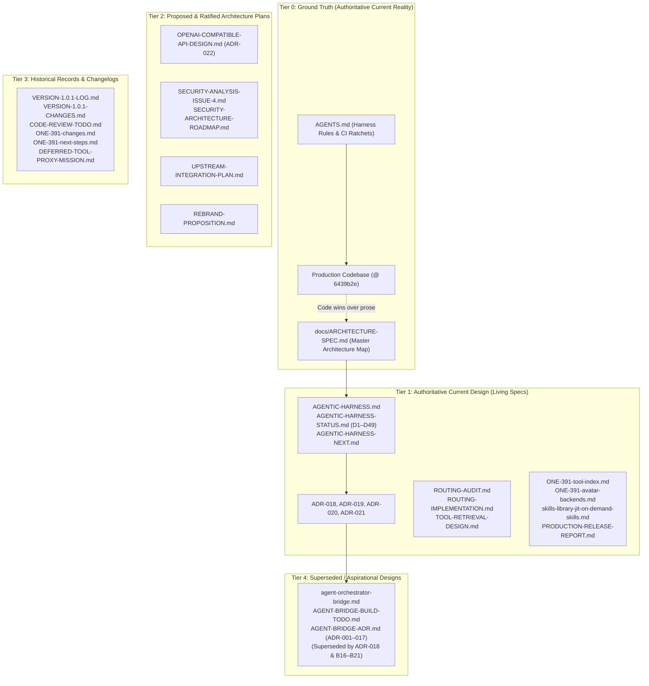

# WP-12: Documentation Authority, ADRs & Specification Drift Audit — Deep Scan & Analysis Report

- **Work Package:** WP-12 (Documentation Authority, ADRs & Specification Drift Audit)
- **Baseline Commit:** `6439b2efde3c36b1d34b21e4cc5e93baff31b2b5` (`6439b2e`)
- **Files Scanned:** 40 files (7 root governance + 33 documentation files in `docs/`) (17,214 lines total)
- **Overall Subsystem Health:** **Needs Hardening** (Substantial specification drift between master architecture spec and `HEAD` @ `6439b2e`; severe internal self-contradictions in `ARCHITECTURE-SPEC.md`; misleading sandbox claims in `README.md`; untracked resolutions in `user-notes-2.md`).

---

## 1. Subsystem Architecture & Data-Flow Summary

Documentation in Brahma AI Evo is not passive narrative; it is an active engineering control surface governing architectural boundaries, permission models, dispatch constraints, and CI/CD ratchet gates. The documentation suite comprises **40 files** (~17,200 lines) organized into a strict authority hierarchy established in [`docs/ARCHITECTURE-SPEC.md`](file:///C:/Users/Admin/Brahma-Ai-Evo/docs/ARCHITECTURE-SPEC.md) §3.



### 1.1 The Document Authority Hierarchy

The repository enforces a strict five-tier document authority rule:
1. **Tier 0 (Current Truth):** The executable source code, [`AGENTS.md`](file:///C:/Users/Admin/Brahma-Ai-Evo/AGENTS.md), and [`docs/ARCHITECTURE-SPEC.md`](file:///C:/Users/Admin/Brahma-Ai-Evo/docs/ARCHITECTURE-SPEC.md). When code and documentation conflict, **code wins over prose**; prose that contradicts code is a defect in documentation.
2. **Tier 1 (Authoritative Current Design):** Detailed subsystem specifications kept in continuous alignment with code. Includes the harness trio ([`AGENTIC-HARNESS.md`](file:///C:/Users/Admin/Brahma-Ai-Evo/docs/AGENTIC-HARNESS.md), [`AGENTIC-HARNESS-STATUS.md`](file:///C:/Users/Admin/Brahma-Ai-Evo/docs/AGENTIC-HARNESS-STATUS.md), [`AGENTIC-HARNESS-NEXT.md`](file:///C:/Users/Admin/Brahma-Ai-Evo/docs/AGENTIC-HARNESS-NEXT.md)), ratified Architectural Decision Records ([`ADR-018`](file:///C:/Users/Admin/Brahma-Ai-Evo/docs/ADR-018-AGENT-BRIDGE-RUNTIME-BOUNDARY.md) through [`ADR-021`](file:///C:/Users/Admin/Brahma-Ai-Evo/docs/ADR-021-PINNED-EXTRA-SEMANTICS.md)), routing & retrieval designs ([`ROUTING-AUDIT.md`](file:///C:/Users/Admin/Brahma-Ai-Evo/docs/ROUTING-AUDIT.md), [`ROUTING-IMPLEMENTATION.md`](file:///C:/Users/Admin/Brahma-Ai-Evo/docs/ROUTING-IMPLEMENTATION.md), [`TOOL-RETRIEVAL-DESIGN.md`](file:///C:/Users/Admin/Brahma-Ai-Evo/docs/TOOL-RETRIEVAL-DESIGN.md)), and stable feature records ([`ONE-391-tool-index.md`](file:///C:/Users/Admin/Brahma-Ai-Evo/docs/ONE-391-tool-index.md), [`ONE-391-avatar-backends.md`](file:///C:/Users/Admin/Brahma-Ai-Evo/docs/ONE-391-avatar-backends.md)).
3. **Tier 2 (Proposed / Phased Implementation Plans):** High-quality designs undergoing active or phased delivery. Includes [`OPENAI-COMPATIBLE-API-DESIGN.md`](file:///C:/Users/Admin/Brahma-Ai-Evo/docs/OPENAI-COMPATIBLE-API-DESIGN.md) (Phases 0–2 landed; Phase 3 gated), [`SECURITY-ARCHITECTURE-ROADMAP.md`](file:///C:/Users/Admin/Brahma-Ai-Evo/docs/SECURITY-ARCHITECTURE-ROADMAP.md) (Phase 0 landed; Phases 1–3 designed), [`UPSTREAM-INTEGRATION-PLAN.md`](file:///C:/Users/Admin/Brahma-Ai-Evo/docs/UPSTREAM-INTEGRATION-PLAN.md) (selective porting roadmap), and [`REBRAND-PROPOSITION.md`](file:///C:/Users/Admin/Brahma-Ai-Evo/docs/REBRAND-PROPOSITION.md) (Abhasa proposal).
4. **Tier 3 (Historical Records):** Immutable changelogs, build notes, and superseded milestone trackers ([`VERSION-1.0.1-LOG.md`](file:///C:/Users/Admin/Brahma-Ai-Evo/docs/VERSION-1.0.1-LOG.md), [`VERSION-1.0.1-CHANGES.md`](file:///C:/Users/Admin/Brahma-Ai-Evo/docs/VERSION-1.0.1-CHANGES.md), [`CODE-REVIEW-TODO.md`](file:///C:/Users/Admin/Brahma-Ai-Evo/docs/CODE-REVIEW-TODO.md), [`ONE-391-changes.md`](file:///C:/Users/Admin/Brahma-Ai-Evo/docs/ONE-391-changes.md), [`DEFERRED-TOOL-PROXY-MISSION.md`](file:///C:/Users/Admin/Brahma-Ai-Evo/docs/DEFERRED-TOOL-PROXY-MISSION.md)).
5. **Tier 4 (Aspirational / Superseded Specs):** Designs authored against older codebase states that were superseded during implementation. Pre-harness bridge specifications ([`agent-orchestrator-bridge.md`](file:///C:/Users/Admin/Brahma-Ai-Evo/docs/agent-orchestrator-bridge.md), [`AGENT-BRIDGE-BUILD-TODO.md`](file:///C:/Users/Admin/Brahma-Ai-Evo/docs/AGENT-BRIDGE-BUILD-TODO.md), [`AGENT-BRIDGE-ADR.md`](file:///C:/Users/Admin/Brahma-Ai-Evo/docs/AGENT-BRIDGE-ADR.md)) are explicitly stamped as superseded by [`ADR-018`](file:///C:/Users/Admin/Brahma-Ai-Evo/docs/ADR-018-AGENT-BRIDGE-RUNTIME-BOUNDARY.md) and Batches B16–B21.

### 1.2 Governance Lifecycle & Ratchet Gates

The documentation connects directly to machine-enforced gates:
- [`AGENTS.md`](file:///C:/Users/Admin/Brahma-Ai-Evo/AGENTS.md) is automatically injected into agentic turns and sets non-negotiable rules: single permission boundary (`AgentRuntime.execute`), stdlib-only harness isolation (`I-15`), no new `elif` branches in [`core/tool_exec.py`](file:///C:/Users/Admin/Brahma-Ai-Evo/core/tool_exec.py), atomic JSON writes (`I-17`), and OpenAI-shaped tool transcripts (`I-09`).
- [`tests/architecture_ratchet.json`](file:///C:/Users/Admin/Brahma-Ai-Evo/tests/architecture_ratchet.json) and [`tests/test_architecture_invariants.py`](file:///C:/Users/Admin/Brahma-Ai-Evo/tests/test_architecture_invariants.py) enforce line-count ceilings and prevent regression on monolithic file sizes: [`main.py`](file:///C:/Users/Admin/Brahma-Ai-Evo/main.py) $\le 3,265$, [`ui.py`](file:///C:/Users/Admin/Brahma-Ai-Evo/ui.py) $\le 827$, and [`core/tool_exec.py`](file:///C:/Users/Admin/Brahma-Ai-Evo/core/tool_exec.py) $\le 147$ with `0` `elif` branches.

---

## 2. File-by-File Inventory & Health Matrix

| File Path | Lines | Primary Symbols / Role | Status | Risk Level | Notes |
|---|---:|---|---|---|---|
| [`AGENTS.md`](file:///C:/Users/Admin/Brahma-Ai-Evo/AGENTS.md) | 205 | Root agent instructions, invariant enforcement, dev gates | Active | Low | Accurate; mandatory rules for harness and tool developers. |
| [`README.md`](file:///C:/Users/Admin/Brahma-Ai-Evo/README.md) | 251 | Public project overview, quickstart, architecture map | Active | Medium | Inaccurate Crucible sandbox claim; missing `brahma_api`, `subagents/`; stale Python launcher syntax. |
| [`SECURITY.md`](file:///C:/Users/Admin/Brahma-Ai-Evo/SECURITY.md) | 74 | Vulnerability disclosure, SLA, 6 defense layers | Active | Low | Up to date with DPAPI, AppContainer, and Job Object descriptions. |
| [`PRIVACY_POLICY.md`](file:///C:/Users/Admin/Brahma-Ai-Evo/PRIVACY_POLICY.md) | 52 | Privacy policy, zero-tracking, on-device storage | Active | Low | Google Play / upstream compliance document. |
| [`CONTRIBUTING.md`](file:///C:/Users/Admin/Brahma-Ai-Evo/CONTRIBUTING.md) | 35 | Contributor guidelines, workflow | Active | Low | Minor drift: refers to "Brahma AI - Lite" at line 3. |
| [`CODE_OF_CONDUCT.md`](file:///C:/Users/Admin/Brahma-Ai-Evo/CODE_OF_CONDUCT.md) | 27 | Contributor covenant pledge and enforcement | Active | Low | Standard open-source conduct policy. |
| [`TRADEMARK.md`](file:///C:/Users/Admin/Brahma-Ai-Evo/TRADEMARK.md) | 27 | Trademark rules for Brahma branding | Active | Low | Contains literal unreplaced placeholder `"associated with User."` at line 4. |
| [`docs/ARCHITECTURE-SPEC.md`](file:///C:/Users/Admin/Brahma-Ai-Evo/docs/ARCHITECTURE-SPEC.md) | 825 | Master architecture spec, invariant map, work queues | Active | High | Severe internal self-contradictions (§4.1/§5.2/Appendix B vs §1/§7/§12/§13); post-`58a773d` drift. |
| [`docs/ARCHITECTURE-RECOMMENDATIONS.md`](file:///C:/Users/Admin/Brahma-Ai-Evo/docs/ARCHITECTURE-RECOMMENDATIONS.md) | 195 | Architectural review annex, O-1–O-8 decisions, B1–B22 | Active | Low | Authoritative rationale companion to `ARCHITECTURE-SPEC.md`. |
| [`docs/AGENTIC-HARNESS.md`](file:///C:/Users/Admin/Brahma-Ai-Evo/docs/AGENTIC-HARNESS.md) | 1,225 | Harness architecture, loop contract, permissions, sessions | Active | Low | Authoritative; updated in `26daa83` and `6439b2e` with subagent library. |
| [`docs/AGENTIC-HARNESS-STATUS.md`](file:///C:/Users/Admin/Brahma-Ai-Evo/docs/AGENTIC-HARNESS-STATUS.md) | 1,295 | Decisions D1–D49 log, build history, known gaps | Active | Low | Fully updated; records decisions through D49. |
| [`docs/AGENTIC-HARNESS-NEXT.md`](file:///C:/Users/Admin/Brahma-Ai-Evo/docs/AGENTIC-HARNESS-NEXT.md) | 311 | Forward tracker: N1–N8 status, snapshot at D46/D47 | Active | Low | Up to date; tracks completed and deferred items. |
| [`docs/ADR-018-AGENT-BRIDGE-RUNTIME-BOUNDARY.md`](file:///C:/Users/Admin/Brahma-Ai-Evo/docs/ADR-018-AGENT-BRIDGE-RUNTIME-BOUNDARY.md) | 112 | ADR-018: Bridge is a Tool Source, Never a Runtime | Active | Low | Ratified; establishes boundary for Bridge v2. |
| [`docs/ADR-019-ACTION-HOST-INJECTION.md`](file:///C:/Users/Admin/Brahma-Ai-Evo/docs/ADR-019-ACTION-HOST-INJECTION.md) | 259 | ADR-019: HostServices injection for native actions | Active | Low | Ratified; governs 84 `ToolSpec` desktop adapters. |
| [`docs/ADR-020-TRUSTED-USER-ROOTS.md`](file:///C:/Users/Admin/Brahma-Ai-Evo/docs/ADR-020-TRUSTED-USER-ROOTS.md) | 140 | ADR-020: `trusted_roots` and `trusted_workspaces` | Active | Low | Ratified and implemented in `agent/permissions.py`. |
| [`docs/ADR-021-PINNED-EXTRA-SEMANTICS.md`](file:///C:/Users/Admin/Brahma-Ai-Evo/docs/ADR-021-PINNED-EXTRA-SEMANTICS.md) | 126 | ADR-021: Budget accounting for `pinned_extra` | Active | Low | Ratified and implemented in `core/tool_index.py`. |
| [`docs/AGENT-BRIDGE-ADR.md`](file:///C:/Users/Admin/Brahma-Ai-Evo/docs/AGENT-BRIDGE-ADR.md) | 358 | ADR-001 through ADR-017 (Pre-harness bridge decisions) | Tier 4 (Superseded) | Low | Stamped with note: superseded in part by ADR-018. |
| [`docs/OPENAI-COMPATIBLE-API-DESIGN.md`](file:///C:/Users/Admin/Brahma-Ai-Evo/docs/OPENAI-COMPATIBLE-API-DESIGN.md) | 969 | `brahma_api` design, token presets, proposed ADR-022 | Active | Low | Accurate specification; Phases 0–2 implemented. |
| [`docs/ROUTING-AUDIT.md`](file:///C:/Users/Admin/Brahma-Ai-Evo/docs/ROUTING-AUDIT.md) | 569 | Audit of pre-LLM regex/substring traps & Plane A | Active | Low | Authoritative analysis that drove `core/routing.py`. |
| [`docs/ROUTING-IMPLEMENTATION.md`](file:///C:/Users/Admin/Brahma-Ai-Evo/docs/ROUTING-IMPLEMENTATION.md) | 111 | Progress ledger for Routing & Retrieval Phases 0–8 | Active | Low | Authoritative record of Plane-A registry and R0–R3. |
| [`docs/TOOL-RETRIEVAL-DESIGN.md`](file:///C:/Users/Admin/Brahma-Ai-Evo/docs/TOOL-RETRIEVAL-DESIGN.md) | 479 | Retrieval R0–R3 specification (short queries, ambiguity) | Active | Low | Authoritative design for `core/tool_index.py`. |
| [`docs/SECURITY-ANALYSIS-ISSUE-4.md`](file:///C:/Users/Admin/Brahma-Ai-Evo/docs/SECURITY-ANALYSIS-ISSUE-4.md) | 173 | Security analysis of upstream issue #4 findings | Active | Low | Baseline analysis (historical state prior to Q0). |
| [`docs/SECURITY-ARCHITECTURE-ROADMAP.md`](file:///C:/Users/Admin/Brahma-Ai-Evo/docs/SECURITY-ARCHITECTURE-ROADMAP.md) | 1,191 | WS-1 through WS-10 security architecture | Active | Medium | Table 2 out of sync: Q0-A findings 1, 4, 5 still marked "Present". |
| [`docs/ONE-391-tool-index.md`](file:///C:/Users/Admin/Brahma-Ai-Evo/docs/ONE-391-tool-index.md) | 182 | Tool index RRF architecture (173 $\rightarrow$ 24 tools) | Active | Low | Foundational Tier 1 design for `core/tool_index.py`. |
| [`docs/ONE-391-avatar-backends.md`](file:///C:/Users/Admin/Brahma-Ai-Evo/docs/ONE-391-avatar-backends.md) | 448 | Avatar 3-method contract, transports, state | Active | Low | Authoritative Tier 1 design for `core/avatar_runtime.py`. |
| [`docs/ONE-391-changes.md`](file:///C:/Users/Admin/Brahma-Ai-Evo/docs/ONE-391-changes.md) | 332 | Historical change record for ONE-391 | Historical | Low | Accurate provenance. |
| [`docs/ONE-391-next-steps.md`](file:///C:/Users/Admin/Brahma-Ai-Evo/docs/ONE-391-next-steps.md) | 184 | Historical next steps for ONE-391 | Historical | Low | All items superseded or completed. |
| [`docs/skills-library-jit-on-demand-skills.md`](file:///C:/Users/Admin/Brahma-Ai-Evo/docs/skills-library-jit-on-demand-skills.md) | 263 | JIT Skills Library architecture | Active | Low | Authoritative; notes stale 2-root count (updated to 3 in D42). |
| [`docs/DEFERRED-TOOL-PROXY-MISSION.md`](file:///C:/Users/Admin/Brahma-Ai-Evo/docs/DEFERRED-TOOL-PROXY-MISSION.md) | 110 | Gemini Live `1008` investigation notes | Historical | Low | Investigation record that culminated in ADR-021. |
| [`docs/UPSTREAM-INTEGRATION-PLAN.md`](file:///C:/Users/Admin/Brahma-Ai-Evo/docs/UPSTREAM-INTEGRATION-PLAN.md) | 629 | Selective surgical port plan for 7 upstream commits | Active | Low | Authoritative integration strategy. |
| [`docs/PRODUCTION-RELEASE-REPORT.md`](file:///C:/Users/Admin/Brahma-Ai-Evo/docs/PRODUCTION-RELEASE-REPORT.md) | 63 | Build artifacts, SHA-256 sums, Ed25519 signature report | Active | Low | Production release report for v1.1.0/1.1.1. |
| [`docs/REBRAND-PROPOSITION.md`](file:///C:/Users/Admin/Brahma-Ai-Evo/docs/REBRAND-PROPOSITION.md) | 337 | Rebrand proposal (Brahma $\rightarrow$ Abhasa) | Active (Proposal) | Low | Comprehensive philosophical and brand analysis. |
| [`docs/USER-GUIDE.md`](file:///C:/Users/Admin/Brahma-Ai-Evo/docs/USER-GUIDE.md) | 263 | End-user operations guide (v1.1.1) | Active | Medium | Omits Subagent Library (607 templates), Web tools, Popup auto-dismiss. |
| [`docs/user-notes.md`](file:///C:/Users/Admin/Brahma-Ai-Evo/docs/user-notes.md) | 343 | User feedback punchlist & resolution tracker | Active | Low | All 19 user notes and 5 handoff workstreams ticked `[x]`. |
| [`docs/user-notes-2.md`](file:///C:/Users/Admin/Brahma-Ai-Evo/docs/user-notes-2.md) | 3 | Punchlist #2 (proactive speech, subagents, duplicates) | Active | Medium | All 3 items implemented in code (`26daa83`), but markdown untracked. |
| [`docs/CODE-REVIEW-TODO.md`](file:///C:/Users/Admin/Brahma-Ai-Evo/docs/CODE-REVIEW-TODO.md) | 899 | Historical review punchlist (P0–P4 all `[x]`) | Historical | Low | Provenance record for post-1.0.1 hardening rules. |
| [`docs/VERSION-1.0.1-LOG.md`](file:///C:/Users/Admin/Brahma-Ai-Evo/docs/VERSION-1.0.1-LOG.md) | 1,287 | 1.0.1 release changelog & architecture decisions | Historical | Low | Provenance for provider chain and decomposition. |
| [`docs/VERSION-1.0.1-CHANGES.md`](file:///C:/Users/Admin/Brahma-Ai-Evo/docs/VERSION-1.0.1-CHANGES.md) | 1,037 | 1.0.1 narrative change record | Historical | Low | Companion to `VERSION-1.0.1-LOG.md`. |
| [`docs/agent-orchestrator-bridge.md`](file:///C:/Users/Admin/Brahma-Ai-Evo/docs/agent-orchestrator-bridge.md) | 1,341 | Rev 3 pre-harness orchestrator bridge design | Tier 4 (Superseded) | Low | Stamped with note: superseded by ADR-018; landed in `core/agent_bridge/`. |
| [`docs/AGENT-BRIDGE-BUILD-TODO.md`](file:///C:/Users/Admin/Brahma-Ai-Evo/docs/AGENT-BRIDGE-BUILD-TODO.md) | 1,002 | Pre-harness bridge work breakdown structure | Tier 4 (Superseded) | Low | Stamped with note: superseded by ADR-018; landed in `core/agent_bridge/`. |

---

## 3. Invariant & Specific Audit Question Verdicts

| Invariant / Question ID | Verdict | Evidence (`file:line` & symbol) | Explanation |
|---|---|---|---|
| **Question 1: Contradictions in `ARCHITECTURE-SPEC.md`** | **FAIL** | `docs/ARCHITECTURE-SPEC.md:§4.1:L214`, `§5.2:L285-L294`, `Appendix B:L746-L748` vs `§1:L43-L58`, `§7.1:L419-L430`, `§12:L640-L697`, `§13:L704-L711` | §5.2 ("Built-partial") and Appendix B ("Glossary") contain 10 direct self-contradictions against §1, §2, §7, §12, §13, and Appendix D in the same document. |
| **Question 2: Post-`58a773d` Drift** | **FAIL** | `core/routing.py`, `core/tool_index.py` (R0–R3), `subagents/`, `agent/subagent_library.py`, `agent/web.py`, `docs/REBRAND-PROPOSITION.md` | Major capabilities landed between `58a773d` and `6439b2e` (15 commits) are completely omitted from `ARCHITECTURE-SPEC.md` and `USER-GUIDE.md`. |
| **Question 3: Open vs Closed in `user-notes*.md`** | **PARTIAL** | `docs/user-notes.md:L5-23`, `docs/user-notes-2.md:L1-3`, commits `26daa83`, `6439b2e` | All 19 items in `user-notes.md` are marked `[x]` and resolved in code. All 3 items in `user-notes-2.md` are resolved in code (`26daa83`), but `user-notes-2.md` lacks checkboxes and was never updated. |
| **Question 4: `README.md` & `USER-GUIDE.md` Accuracy** | **PARTIAL** | `README.md:L9`, `L126`, `L142`, `L187-214`, `L231-233`; `docs/USER-GUIDE.md:L1-263` | `README.md` falsely describes Crucible as an "isolated sandbox", gives non-portable `py -3.11 setup.py`, and omits `brahma_api`, `subagents/`. `USER-GUIDE.md` omits Subagents and Web Tools. |
| **I-01: Single Permission Boundary** | **PASS** | `AGENTS.md:L2`, `docs/ARCHITECTURE-SPEC.md:L213`, `agent/runtime.py:execute` | Documented universally across Tier 0 and Tier 1 specifications as the non-bypassable boundary. |
| **I-02: Native Tool Policy Scoping** | **PARTIAL** | `docs/ARCHITECTURE-SPEC.md:L214`, `core/desktop_tools.py`, `core/tool_exec.py` | Spec table row I-02 still claims native tools have "no policy engine" (stale pre-ADR-019); in code, all 84 native tools route through `AgentRuntime.execute`. |
| **I-06: Malformed Policy Fail-Closed** | **PASS** | `AGENTS.md:L72-76`, `docs/ARCHITECTURE-SPEC.md:L218`, `agent/runtime.py:reload_policy` | Documented and verified by `tests/test_agent_policy_reload.py`. |
| **I-07: Meta-Tool Collision Guard** | **PASS** | `AGENTS.md:L172-177`, `docs/ARCHITECTURE-SPEC.md:L219`, `agent/skills.py` | Documented rule: harness tools must never shadow `load_skill`, `search_tools`, or `recall_memory`. |
| **I-08: Subagent Delegation Boundary** | **PASS** | `docs/ARCHITECTURE-SPEC.md:L220`, `agent/subagent.py`, `agent/loop.py` | Strict 1-child, 12-turn clamp, report-only return, no recursion. |
| **I-15: Stdlib-Only Harness Isolation** | **PASS** | `AGENTS.md:L42-46`, `docs/ARCHITECTURE-SPEC.md:L232`, CI `harness-pythons` job | `agent/` imports with only stdlib and pytest; enforced by CI and `tests/test_architecture_invariants.py`. |
| **I-16: System Prompt Non-Persistence** | **PASS** | `AGENTS.md:L106-108`, `docs/ARCHITECTURE-SPEC.md:L233`, `agent/session_bridge.py` | Seed message reconstruction uses `messages_after` to prevent prompt bloat and duplication. |
| **I-17: Atomic Configuration Persistence** | **PASS** | `docs/ARCHITECTURE-SPEC.md:L234`, `core/user_paths.py:atomic_write_json` | Documented review rule; verified in user paths and settings stores. |
| **I-18: Dual MCP Client Architecture** | **PASS** | `docs/ARCHITECTURE-SPEC.md:L235`, `agent/mcp.py`, `core/mcp_manager.py` | Preserves division: stdio stdlib in `agent/mcp.py`, asyncio SDK for voice in `core/mcp_manager.py`. |
| **I-19: Tool Surface & Budget Accounting** | **PASS** | `docs/ARCHITECTURE-SPEC.md:L239`, `docs/ADR-021-PINNED-EXTRA-SEMANTICS.md` | Session budget strictly enforces $\le 24$ declarations; `pinned_extra` consumes budget. |
| **I-21: Provider Egress Kill Switch** | **PASS** | `docs/ARCHITECTURE-SPEC.md:L243`, `core/provider_router.py:guard` | Outbound model calls gated before opening network sockets. |
| **I-26: Import-Time Purity** | **PARTIAL** | `docs/ARCHITECTURE-SPEC.md:L253`, `ui.py:L85-100` | Rule documented in spec; however `ui.py` monkey-patches `QWidget.setStyleSheet` at import time. |
| **I-28: Zero `elif` Dispatch** | **PASS** | `AGENTS.md:L160`, `tests/architecture_ratchet.json`, `core/tool_exec.py` | Ratchet ceiling enforces `0` `elif` branches and line count $\le 147$. |

---

## 4. Detailed Findings

### [WP-12-F01] Severe Internal Self-Contradictions Inside Master Architecture Spec (`docs/ARCHITECTURE-SPEC.md`)
- **Severity:** `High`
- **Category:** `Doc Drift` / `Architecture/Invariant`
- **Location:** [`docs/ARCHITECTURE-SPEC.md:L214`](file:///C:/Users/Admin/Brahma-Ai-Evo/docs/ARCHITECTURE-SPEC.md#L214) (§4.1), [`L282-L295`](file:///C:/Users/Admin/Brahma-Ai-Evo/docs/ARCHITECTURE-SPEC.md#L282-L295) (§5.2), [`L746-L748`](file:///C:/Users/Admin/Brahma-Ai-Evo/docs/ARCHITECTURE-SPEC.md#L746-L748) (Appendix B) vs [`L54-L58`](file:///C:/Users/Admin/Brahma-Ai-Evo/docs/ARCHITECTURE-SPEC.md#L54-L58) (§1), [`L110-L115`](file:///C:/Users/Admin/Brahma-Ai-Evo/docs/ARCHITECTURE-SPEC.md#L110-L115) (§2.1), [`L341`](file:///C:/Users/Admin/Brahma-Ai-Evo/docs/ARCHITECTURE-SPEC.md#L341) (§6.3), [`L419-L430`](file:///C:/Users/Admin/Brahma-Ai-Evo/docs/ARCHITECTURE-SPEC.md#L419-L430) (§7.1), [`L615`](file:///C:/Users/Admin/Brahma-Ai-Evo/docs/ARCHITECTURE-SPEC.md#L615) (§11.2), [`L664`](file:///C:/Users/Admin/Brahma-Ai-Evo/docs/ARCHITECTURE-SPEC.md#L664) (§12.3), [`L704`](file:///C:/Users/Admin/Brahma-Ai-Evo/docs/ARCHITECTURE-SPEC.md#L704) (§13)
- **Evidence & Mechanism:** 
  [`docs/ARCHITECTURE-SPEC.md`](file:///C:/Users/Admin/Brahma-Ai-Evo/docs/ARCHITECTURE-SPEC.md) contains **10 severe internal self-contradictions** where earlier draft sections (§4.1, §5.2, §6.6, §6.9, Appendix B) directly contradict later ratified and implemented sections (§1, §2.1, §6.3, §7.1, §11.2, §12, §13, Appendix D) within the *same file*:
  1. *Native Tool Policy & Dispatch:* §5.2 (Table row 1, line 285) asserts native tool dispatch is `Built-partial`: *"No policy engine; only three destructive actions are confirm-gated."* §4.1 (Table row I-02, line 214) claims *"Native (non-harness) tools have no policy engine... legacy elif chain"*. Appendix B (Glossary, line 748) claims *"Nine now have a ToolSpec adapter... the rest are still dispatched by the core/tool_exec.py elif chain."* **Contradicted by** §1 (line 57), §2.1 (line 110), §6.3 (line 341), §11.2 (ADR-019, line 615), §12.3 (Wave 3, line 664), and §13 (line 704), which correctly document that all 84 desktop specs were migrated behind `AgentRuntime.execute` and the `elif` chain was completely retired (0 `elif` branches, 147 lines).
  2. *Gateway Network Bind & Auth:* §5.2 (Table row 8, line 292) asserts Gateway is `Built-partial`: *"WebSocket authenticates; HTTP control routes do not; binds 0.0.0.0."* §6.9 (line 395) claims HTTP control routes do not authenticate. **Contradicted by** §1 (line 58), §2.2 (line 127), §7.1 (line 427), §7.3 (line 450), §12.2 (line 653), and §13 (lines 705–706), which prove Gateway defaults to `127.0.0.1`, disabled by default, and all HTTP control routes enforce paired-device authentication (`core/gateway_auth.py`).
  3. *Legacy `agent_task` Door:* §5.2 (Table row 2, line 286) asserts `agent_task` autonomous execution is `Built-partial`: *"Bypasses the harness entirely; planner is prompt-driven and unverified."* Appendix B (line 746) calls it an *"unsupported fourth"* door. **Contradicted by** §1 (line 58), §2.1 (line 115), §6.10 (lines 399–409), and §12.1 (line 647), which record that `agent_task` was deleted outright in Q0-A / B4 along with `agent/planner.py`, `executor.py`, `task_queue.py`, and `error_handler.py`.
  4. *Self-Update / Updaters:* §5.2 (Table row 9, line 293) asserts Updates is `Built-partial`: *"Startup git pull / reset --hard from a hardcoded upstream, unsigned."* **Contradicted by** §1 (line 58), §2.3 (line 149), §7.1 (Finding 3, line 421), §7.3 (line 451), and §12.2 (line 654), which document that all updaters were deleted in Q0-B.
  5. *Secrets at Rest (DPAPI vs Plaintext):* §5.2 (Table row 10, line 294) asserts Secrets is `Built-partial`: *"Fernet key stored beside the ciphertext; plaintext api_keys.json."* **Contradicted by** §1 (line 58), §7.1 (Finding 6, line 424), §7.3 (line 452), and §12.2 (line 656), which document that Windows DPAPI was implemented in Q0-B (`core/secret_store.py`).
  6. *Skills Forge Execution:* §5.2 (Table row 6, line 290) asserts Skills Forge is `Built-partial`: *"Writes and immediately executes model-generated code... runtime pip."* §6.6 (line 375) asserts `main.py:_forge_skill` executes the new skill immediately. **Contradicted by** §7.1 (Finding 1, line 419), §7.3 (line 445), and §12.1 (line 643), which prove Q0-A stopped `execute_sync` and stages drafts to `staged_skills/`.
  7. *Plugins Allowlist:* §5.2 (Table row 7, line 291) asserts Plugins is `Built-partial`: *"Any .py in plugins/ is imported at startup, unsigned."* **Contradicted by** §1 (line 58), §7.1 (Finding 2, line 420), and §12.2 (line 655), which document the opt-in allowlist in `PluginManager`.
  8. *Agent Bridge Implementation Status:* §1 (Table, line 65) asserts Agent Bridge is *"Aspirational; no code"*, and §8.1 (line 472) states *"None of it is implemented. core/agent_bridge/ does not exist"*. **Contradicted by** §12.3 (Queue 2, lines 670–677), §13 (line 707), Appendix C (lines 769, 774), and Appendix D.1 (lines 779–783), which document that Bridge v2 was fully built in `core/agent_bridge/` across Batches B16–B21.
  9. *Conflicting Baseline Commits & Test Counts:* The header (line 5) cites baseline commit `531b961` (2026-10-31); §3.2 cites 790 passed; §10.2 cites 996 passed; Appendix C cites commit `58a773d` and 1,020 passed; while Appendix D records subsequent batches with 1,134+ passed.
  10. *Monolithic Line Counts:* §1 (line 57) says `main.py` was reduced to 3,233 lines; §2.2 (line 121) says `main.py` is 3,264 lines; §3.2 (line 196) and §6.1 (line 321) claim `main.py` is 4,811 lines.
- **Impact:** Misinforms human developers and autonomous coding agents regarding system trust boundaries, active capabilities, and security posture. An agent inspecting §5.2 might assume native tools have no policy engine or that the gateway binds 0.0.0.0, leading to duplicated or counter-productive patches.
- **Recommended Fix:** Perform an atomic document synchronization pass on `docs/ARCHITECTURE-SPEC.md`:
  1. Rewrite §5.2 to remove obsolete "Built-partial" entries for native tool dispatch, `agent_task`, updaters, DPAPI secrets, forge immediate execution, and gateway 0.0.0.0 bind.
  2. Update Appendix B ("Glossary") to reflect that all 84 desktop declarations are registered `ToolSpec` adapters and that `agent_task` is deleted.
  3. Reconcile §1, §4.1 (I-02), §6.6, §6.9, and §8.1 to state that Agent Bridge v2 and Security Phase 0 are landed.
  4. Standardize baseline commit and test metrics across header, §10.2, and Appendix C.

---

### [WP-12-F02] Post-`58a773d` Architectural Drift: Major Subsystems Merged at HEAD Omitted from Master Architecture Spec and User Guide
- **Severity:** `High`
- **Category:** `Doc Drift`
- **Location:** [`docs/ARCHITECTURE-SPEC.md`](file:///C:/Users/Admin/Brahma-Ai-Evo/docs/ARCHITECTURE-SPEC.md), [`docs/USER-GUIDE.md`](file:///C:/Users/Admin/Brahma-Ai-Evo/docs/USER-GUIDE.md)
- **Evidence & Mechanism:** 
  Between baseline commit `58a773d` (recorded in `ARCHITECTURE-SPEC.md` Appendix C) and current `HEAD` @ `6439b2e` (15 commits), major architectural capabilities and redesigns were merged into `main` that have **zero documentation** in `ARCHITECTURE-SPEC.md` and `USER-GUIDE.md`:
  1. *Plane-A Pre-LLM Routing Authority (`core/routing.py`):* Landed in commit `8206795` (governed by [`ROUTING-AUDIT.md`](file:///C:/Users/Admin/Brahma-Ai-Evo/docs/ROUTING-AUDIT.md) and [`ROUTING-IMPLEMENTATION.md`](file:///C:/Users/Admin/Brahma-Ai-Evo/docs/ROUTING-IMPLEMENTATION.md)). Introduces the 4 authority types (`syntax`, `exact_alias`, `owned_state`, `verified_target`), the 23-record `ROUTERS` registry, word-bounded phrase matching (`has_phrase`), and completely eliminates pre-LLM regex/keyword hijacks (e.g. smart-home false positives on "backup"). Not mentioned in `ARCHITECTURE-SPEC.md` or `USER-GUIDE.md`!
  2. *Tool Retrieval Overhaul R0–R3 (`core/tool_index.py`, `core/tool_bridge.py`):* Landed in commits `8395ac5`, `8206795`, and `cfef7cd` (governed by [`TOOL-RETRIEVAL-DESIGN.md`](file:///C:/Users/Admin/Brahma-Ai-Evo/docs/TOOL-RETRIEVAL-DESIGN.md)). Delivers multi-server search (`server=`, `domain=`, `context=`), deterministic ambiguity contrast sets with refine hints, implicit 2-turn context completion for compressed queries ($\le 6$ tokens), resident server manifests (`ToolIndex.server_manifest()`), and cross-indexing of harness MCP tools into `core.tool_index`. Not mentioned in `ARCHITECTURE-SPEC.md`!
  3. *Vendored Subagent Library (607 Specialist Templates):* Landed in commits `26daa83` and `6439b2e`. Adds [`agent/subagent_library.py`](file:///C:/Users/Admin/Brahma-Ai-Evo/agent/subagent_library.py) and the 607 vendored specialist subagent templates in `subagents/` with `subagents/catalog.json`, tiered disclosure (resident category index in prompts), `list_subagents` tool, and `run_subagent(subagent_type=...)` loading exactly one clamped body (24 KB cap). While documented in `AGENTIC-HARNESS.md`, it is completely missing from `ARCHITECTURE-SPEC.md` and `USER-GUIDE.md`!
  4. *Harness-Native Web Search and Fetch (`agent/web.py`, D48):* Landed in commit `ded75c6`. Implements stdlib `web_search` and `web_fetch` with SSRF guards and DuckDuckGo fallback, making web search available to `worker`/`operator` profiles and subagents. Missing from `ARCHITECTURE-SPEC.md` and `USER-GUIDE.md`!
  5. *Abhasa Rebrand Proposition ([`docs/REBRAND-PROPOSITION.md`](file:///C:/Users/Admin/Brahma-Ai-Evo/docs/REBRAND-PROPOSITION.md)):* Added in commit `832c1ae`. Missing from `ARCHITECTURE-SPEC.md` Appendix A inventory!
  6. *Decisions D47–D49:* Recorded in `AGENTIC-HARNESS-STATUS.md` (outbound stdio MCP server, provider failover/web tools, and token registry concurrency), but `ARCHITECTURE-SPEC.md` §11.1 table stops at "D1–D42".
  7. *Popup Auto-Dismiss Settings Controls:* Added in `core/popup_settings.py` and `core/ui_connectivity.py` (resolving user feedback). Not mentioned in `USER-GUIDE.md`.
  8. *Missing Appendix A Entries:* `ARCHITECTURE-SPEC.md` Appendix A document inventory omits `docs/ROUTING-AUDIT.md`, `docs/ROUTING-IMPLEMENTATION.md`, `docs/TOOL-RETRIEVAL-DESIGN.md`, `docs/REBRAND-PROPOSITION.md`, and `docs/user-notes-2.md`.
- **Impact:** System-level documentation has fallen 15 commits behind repository reality. Critical routing and retrieval architectural patterns (Plane-A authorities, R0–R3 retrieval, 607-subagent library) are invisible to engineers relying on the master specification.
- **Recommended Fix:** 
  1. Add a dedicated section to `ARCHITECTURE-SPEC.md` for Plane-A Routing Authority (`core/routing.py`) and R0–R3 Retrieval Engine (`core/tool_index.py`).
  2. Document the Subagent Library (`agent/subagent_library.py` + `subagents/`) in `ARCHITECTURE-SPEC.md` §6.4 and `USER-GUIDE.md`.
  3. Update `ARCHITECTURE-SPEC.md` Appendix A to include all five missing documents.
  4. Update `USER-GUIDE.md` with operational guides for subagent templates, web search, and popup auto-dismiss settings.

---

### [WP-12-F03] Misleading "Isolated Sandbox" Claim in `README.md` for Skill Crucible
- **Severity:** `Medium`
- **Category:** `Security` / `Doc Drift`
- **Location:** [`README.md:L232`](file:///C:/Users/Admin/Brahma-Ai-Evo/README.md#L232)
- **Evidence & Mechanism:** 
  [`README.md`](file:///C:/Users/Admin/Brahma-Ai-Evo/README.md) lines 231–233 state:
  > *"External tools run through permission sentries and the isolated Crucible sandbox."*
  
  This claim is factually false and contradicts the repository's security documentation:
  - [`SECURITY-ANALYSIS-ISSUE-4.md:L32`](file:///C:/Users/Admin/Brahma-Ai-Evo/docs/SECURITY-ANALYSIS-ISSUE-4.md#L32): *"The Crucible provides some validation but does not establish a trust boundary - it's a quality/safety check, not an authorization gate."*
  - [`SECURITY.md:L48-50`](file:///C:/Users/Admin/Brahma-Ai-Evo/SECURITY.md#L48-L50): Process isolation is achieved via Windows Job Objects and AppContainer profiles for runtime skills, not the Crucible.
  - [`docs/ARCHITECTURE-SPEC.md:L425`](file:///C:/Users/Admin/Brahma-Ai-Evo/docs/ARCHITECTURE-SPEC.md#L425) (§7.1 Finding 7): *"Crucible validation is a denylist, not a sandbox. 12 string checks + same-user subprocess + timeout."*
  - Decision D36 in [`docs/AGENTIC-HARNESS-STATUS.md`](file:///C:/Users/Admin/Brahma-Ai-Evo/docs/AGENTIC-HARNESS-STATUS.md): AppContainer sandbox fails against normal Python installs; `exec.sandbox` is a policy hook, not a kernel sandbox.
- **Impact:** Misleads users, contributors, and security auditors into trusting that untrusted, LLM-synthesized code in the Crucible executes in a hardened OS sandbox, when it actually executes with the full privileges of the host user account under a basic AST denylist.
- **Recommended Fix:** Edit [`README.md`](file:///C:/Users/Admin/Brahma-Ai-Evo/README.md) line 232 to replace *"isolated Crucible sandbox"* with *"automated AST safety validation and capability policy gates"*, aligning user-facing documentation with actual security implementation.

---

### [WP-12-F04] `README.md` Installation, Architecture Tree, and API Inaccuracies
- **Severity:** `Medium`
- **Category:** `Doc Drift` / `Correctness/Bug`
- **Location:** [`README.md:L9`](file:///C:/Users/Admin/Brahma-Ai-Evo/README.md#L9), [`L126-127`](file:///C:/Users/Admin/Brahma-Ai-Evo/README.md#L126-L127), [`L142`](file:///C:/Users/Admin/Brahma-Ai-Evo/README.md#L142), [`L158-164`](file:///C:/Users/Admin/Brahma-Ai-Evo/README.md#L158-L164), [`L187-214`](file:///C:/Users/Admin/Brahma-Ai-Evo/README.md#L187-L214)
- **Evidence & Mechanism:** 
  1. *Python Version Inconsistency:* Badge at line 9 advertises `Python 3.11 | 3.12`. Line 127 says `bootstrap.ps1` accepts 3.12 for runtime-only. However, line 164 asserts: *"The scripts refuse anything but Python 3.11 rather than failing later inside a dependency build"*, and `scripts/setup_dev.ps1` hard-fails on Python 3.12.
  2. *Non-Portable Launcher Invocation:* Line 142 specifies `py -3.11 setup.py`. On Windows systems where Python is installed from the Windows Store or where the global `py.exe` launcher was not registered, this command fails with `'py' is not recognized as an internal or external command`.
  3. *Stale Architecture Directory Tree:* Lines 187–214 provide a representative tree that omits several core production subsystems:
     - Missing `brahma_api/` (Loopback OpenAI-compatible server on port 8010).
     - Missing `subagents/` (607 specialist subagent templates).
     - Missing `skills/` and `skills_library/` (On-demand task playbooks).
     - Missing `sandbox/` (AppContainer launchers).
  4. *Omission of `brahma_api`:* The built-in OpenAI-compatible API (`brahma_api`), which allows external coding extensions (Cline, Continue, Cursor) to connect over port 8010, is completely unmentioned in `README.md`.
- **Impact:** Developer friction during initial setup; confusing error messages when `py.exe` is missing; under-representation of flagship capabilities in the project's primary front page.
- **Recommended Fix:** 
  1. Harmonize Python version guidance: clarify that Python 3.11 is required for dev tools, tests, and packaging, while 3.12 is supported for runtime execution only.
  2. Provide fallback command syntax (`python setup.py` or `.\bootstrap.ps1`).
  3. Update the ASCII architecture tree to include `brahma_api/`, `subagents/`, `skills/`, and `skills_library/`.
  4. Add a feature card for the OpenAI-compatible local API (port 8010).

---

### [WP-12-F05] Untracked Implementations and Missing Resolution Status in `docs/user-notes-2.md`
- **Severity:** `Low`
- **Category:** `Doc Drift`
- **Location:** [`docs/user-notes-2.md:L1-L3`](file:///C:/Users/Admin/Brahma-Ai-Evo/docs/user-notes-2.md#L1-L3)
- **Evidence & Mechanism:** 
  [`docs/user-notes-2.md`](file:///C:/Users/Admin/Brahma-Ai-Evo/docs/user-notes-2.md) contains 3 unticked bullet items:
  ```markdown
  - In Identity and Profile, settings: unclicking the proactive commentary dididn't turn them off, last time i tested.
  - we have now the ability to delegate tasks to subagents, we need to identify which ones the system has and then expand that library... (C:\Users\Admin\Documents\Obsidian\My Vault\subagent-orchestration)
  - sometimes (often) it happens that the response is piped back twice. for example right after being tasked to do a websearch on a topic, the ai reports back, and then reports back again...
  ```
  All three items were investigated, fixed in code, and verified in commits `26daa83` and `6439b2e`:
  - Item 1 was fixed by gating idle check-ins and startup briefings on the `Identity & Profile` proactive toggle and sharing the identity singleton across speech engines.
  - Item 2 was resolved by importing and vendoring the entire 607-template corpus into `subagents/` with `catalog.json` and adding `agent/subagent_library.py`.
  - Item 3 was fixed by stopping tool-start status speech and task-card chat mirroring, eliminating double replies.
  However, `docs/user-notes-2.md` was never updated to reflect these resolutions with checkmarks (`[x]`) or resolution summaries.
- **Impact:** Engineers reading the punchlist cannot tell that these items have already been resolved without inspecting git commit histories.
- **Recommended Fix:** Update `docs/user-notes-2.md` to format each item as completed (`- [x]`) with commit hashes (`26daa83`, `6439b2e`) and one-line resolution summaries, matching the convention of `docs/user-notes.md`.

---

### [WP-12-F06] Stale "Brahma AI - Lite" Branding Artifacts and Template Placeholders in Root Governance Documents
- **Severity:** `Low`
- **Category:** `Doc Drift` / `Governance`
- **Location:** [`CONTRIBUTING.md:L3`](file:///C:/Users/Admin/Brahma-Ai-Evo/CONTRIBUTING.md#L3), [`TRADEMARK.md:L3-L4`](file:///C:/Users/Admin/Brahma-Ai-Evo/TRADEMARK.md#L3-L4)
- **Evidence & Mechanism:** 
  1. [`CONTRIBUTING.md:L3`](file:///C:/Users/Admin/Brahma-Ai-Evo/CONTRIBUTING.md#L3) states: *"Thank you for helping improve Brahma AI - Lite."* The application was renamed and evolved to "Brahma AI Evo"; "Lite" is obsolete.
  2. [`TRADEMARK.md:L3-L4`](file:///C:/Users/Admin/Brahma-Ai-Evo/TRADEMARK.md#L3-L4) states:
     > *"`Brahma`, `Brahma AI`, `Brahma AI - Lite`, the Brahma logo, and any related brand assets are trademarks or trade dress associated with User."*
     The word `"User"` is an unpopulated template placeholder.
- **Impact:** Creates an unprofessional appearance in root governance documentation and leaves trademark ownership legally ambiguous.
- **Recommended Fix:** Update `CONTRIBUTING.md` to reference "Brahma AI Evo"; replace `"User"` in `TRADEMARK.md` with the official copyright owner or organization entity.

---

### [WP-12-F07] Desynchronized Security Finding Ledgers in `docs/SECURITY-ARCHITECTURE-ROADMAP.md`
- **Severity:** `Low`
- **Category:** `Doc Drift`
- **Location:** [`docs/SECURITY-ARCHITECTURE-ROADMAP.md:L37-L49`](file:///C:/Users/Admin/Brahma-Ai-Evo/docs/SECURITY-ARCHITECTURE-ROADMAP.md#L37-L49) (Table 2)
- **Evidence & Mechanism:** 
  In [`docs/SECURITY-ARCHITECTURE-ROADMAP.md`](file:///C:/Users/Admin/Brahma-Ai-Evo/docs/SECURITY-ARCHITECTURE-ROADMAP.md) Table 2:
  - Finding 2 (Plugin allowlist), Finding 3 (Unsigned self-update), Finding 6 (DPAPI secrets), and Finding + (Gateway auth) are correctly marked *"Closed (Q0-B, 2026-11-02)"*.
  - However, Finding 1 (Forge execution), Finding 4 (Forge prompt TLS bypass), and Finding 5 (Unpinned runtime `pip`) are still marked *"Present"*, despite being fully closed by Security Phase 0-A in commit `20e4803` (2026-11-01) and recorded as closed in [`docs/ARCHITECTURE-SPEC.md:L419-L423`](file:///C:/Users/Admin/Brahma-Ai-Evo/docs/ARCHITECTURE-SPEC.md#L419-L423).
- **Impact:** Discrepancies between security documents create uncertainty over whether Forge execution and prompt hardening were completed.
- **Recommended Fix:** Update Table 2 in `docs/SECURITY-ARCHITECTURE-ROADMAP.md` to mark Findings 1, 4, and 5 as *"Closed (Q0-A, 2026-11-01)"* with matching evidence citations.

---

### [WP-12-F08] Fragmented Baseline Versioning and Inconsistent Test Count Citations Across Document Tiers
- **Severity:** `Informational`
- **Category:** `Doc Drift`
- **Location:** Multiple files across `docs/`
- **Evidence & Mechanism:** 
  Test suite counts and baseline git commit citations have fragmented across different documentation files as batches were merged:
  - `docs/ARCHITECTURE-SPEC.md`: Cites `531b961` (header), `58a773d` (Appendix C), and test counts 790, 888, 996, 1,020, and 1,134.
  - `docs/AGENTIC-HARNESS-NEXT.md`: Cites `HEAD` as `cc1e970` and test count as 1,134 passed.
  - `docs/ROUTING-IMPLEMENTATION.md`: Cites test count 1,491 passed.
  - Current `HEAD` @ `6439b2e` passes >1,490 tests.
- **Impact:** Minor cosmetic confusion regarding the canonical baseline across historical batches.
- **Recommended Fix:** Add a single chronological release/test growth matrix in `docs/ARCHITECTURE-SPEC.md` §0 that documents the test expansion curve across milestones (790 $\rightarrow$ 888 $\rightarrow$ 996 $\rightarrow$ 1,020 $\rightarrow$ 1,134 $\rightarrow$ 1,491+).

---

## 5. Cross-Package Seams & Handoff Notes for Orchestrator

This audit identifies critical cross-cutting touchpoints that the Lead Orchestrator must synthesize during **WP-13 (Master System Analysis Report)**:

1. **WP-01 (Agentic Harness Core) $\leftrightarrow$ WP-12:**
   - Verify that [`agent/subagent_library.py`](file:///C:/Users/Admin/Brahma-Ai-Evo/agent/subagent_library.py) and the 607 specialist templates in `subagents/` (landed in `26daa83` / `6439b2e`) strictly maintain harness stdlib isolation (`I-15`).
   - Confirm that [`agent/web.py`](file:///C:/Users/Admin/Brahma-Ai-Evo/agent/web.py) (D48) does not introduce third-party network libraries or bypass SSRF/private-IP restrictions.
2. **WP-02 (Tool Surface & Retrieval) $\leftrightarrow$ WP-12:**
   - Cross-verify that the 23-record `ROUTERS` registry in [`core/routing.py`](file:///C:/Users/Admin/Brahma-Ai-Evo/core/routing.py) matches the Plane-A authority model documented in [`docs/ROUTING-IMPLEMENTATION.md`](file:///C:/Users/Admin/Brahma-Ai-Evo/docs/ROUTING-IMPLEMENTATION.md).
   - Confirm that the R0–R3 retrieval enhancements in [`core/tool_index.py`](file:///C:/Users/Admin/Brahma-Ai-Evo/core/tool_index.py) strictly respect the $\le 24$ declaration budget (`I-19`).
3. **WP-04 (Security Architecture) $\leftrightarrow$ WP-12:**
   - Ensure the distinction between `SkillCrucible` (AST denylist) and a genuine OS sandbox is clearly communicated in both `README.md` and `docs/SECURITY-ARCHITECTURE-ROADMAP.md`.
   - Validate that `DynamicToolRegistry.execute_sync` fallback in [`core/tool_exec.py`](file:///C:/Users/Admin/Brahma-Ai-Evo/core/tool_exec.py) (lines 120–144) is strictly isolated to quarantined staged skills.
4. **WP-05 (Bridge, APIs & Gateways) $\leftrightarrow$ WP-12:**
   - Verify that `brahma_api` (port 8010) adheres to ADR-022 ("transport, not a door") and routes 100% of tool execution through `AgentRuntime.execute`.
   - Reconcile the port 8000 default collision between `dashboard/server.py` and `brahma_connect`.
5. **WP-11 (Test Suite & Packaging) $\leftrightarrow$ WP-12:**
   - Ensure `installer/BrahmaEvo.spec` bundles `subagents/` and `skills_library/` so packaged binaries do not fail on missing templates.

---

## 6. Prioritized Action Queue for Documentation Reconciliation

### Immediate (P0 / P1)
1. **Reconcile `docs/ARCHITECTURE-SPEC.md` Internal Contradictions ([WP-12-F01]):**
   - Clean up §5.2 ("Built-partial") and Appendix B to remove stale statements claiming native tools lack a policy engine, `agent_task` is active, or the gateway binds `0.0.0.0`.
   - Synchronize §1, §4.1 (I-02), and §8.1 to reflect that Bridge v2 and 84 desktop `ToolSpec`s are 100% landed.
2. **Document Post-`58a773d` Subsystems in Master Spec & User Guide ([WP-12-F02]):**
   - Add architecture sections to `ARCHITECTURE-SPEC.md` covering Plane-A Routing Authority (`core/routing.py`), R0–R3 Tool Retrieval, Subagent Library (607 specialists), and `agent/web.py`.
   - Add Appendix A entries for `ROUTING-AUDIT.md`, `ROUTING-IMPLEMENTATION.md`, `TOOL-RETRIEVAL-DESIGN.md`, `REBRAND-PROPOSITION.md`, and `user-notes-2.md`.
   - Expand `USER-GUIDE.md` with user-facing documentation for subagent templates and web search.

### Near-Term (P2)
3. **Correct `README.md` Sandbox Claims and Architecture Map ([WP-12-F03], [WP-12-F04]):**
   - Replace "isolated Crucible sandbox" with accurate description of AST validation and policy gating.
   - Update architecture directory tree to include `brahma_api/`, `subagents/`, `skills/`, and `skills_library/`.
   - Add feature highlight and setup instructions for `brahma_api` (port 8010).
4. **Close Open Notes in `docs/user-notes-2.md` ([WP-12-F05]):**
   - Format all 3 items with `[x]` checkboxes and link to commits `26daa83` and `6439b2e`.
5. **Update Security Finding Ledgers in `docs/SECURITY-ARCHITECTURE-ROADMAP.md` ([WP-12-F07]):**
   - Mark Q0-A findings 1, 4, and 5 as "Closed (Q0-A, 2026-11-01)".

### Cleanup / Governance (P3)
6. **Harmonize Root Governance Documents ([WP-12-F06]):**
   - Replace "Brahma AI - Lite" in `CONTRIBUTING.md` with "Brahma AI Evo".
   - Replace `"User"` placeholder in `TRADEMARK.md` with the official project entity.
7. **Consolidate Baseline Versioning Matrix ([WP-12-F08]):**
   - Add a historical test count and milestone ledger to `ARCHITECTURE-SPEC.md` §0.
